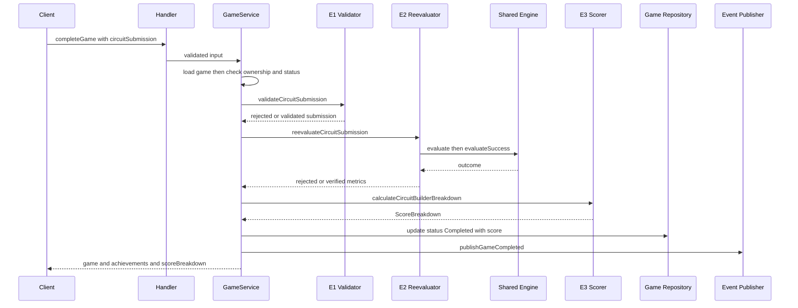

# Backend Integration - Functional Design

**Unit**: U6 Backend Integration (Circuit Builder)
**Package**: `services/game`
**Stage**: CONSTRUCTION - Functional Design
**Repository HEAD**: `a328c74` (unchanged; nothing committed by this unit)

> **PRODUCTION DEPLOYMENT CAUTION.** `.github/workflows/deploy-lambdas.yml` fires on a push to
> `main` that touches `services/game/src/**` and runs
> `aws lambda update-function-code --function-name MemoryGame-GameService-prod --publish`.
> That job has no test step, no smoke test, no canary, and no rollback. Everything in this
> design is therefore additive and guarded by a theme-id check, so the other 23 games cannot
> be affected and the whole unit is revertible.

---

## 1. Submission payload contract

No new GraphQL operation. The submission rides on the existing `completeGame` mutation as one
new optional field, because `completeGame` already performs the game lookup, the ownership
check, the in-progress check, the persistence write, the achievement hook, the metrics
publish, and the leaderboard event. A separate operation would duplicate all of it, which is
the parallel path `circuit-builder-services.md` forbids.

```ts
// CompleteGameInput, as the client sends it
{
  gameId: string,                 // existing, UUID
  completionTime: number,         // existing, integer seconds - the ONLY place time is carried
  attempts: 1,                    // existing and required by the schema; meaningless here, so send 1
  circuitSubmission: {            // NEW, optional, present only for Circuit Builder
    levelId: string,
    layout: {
      elements: CircuitElement[],
      connections: Connection[],
      gridSize: { cols: number, rows: number }
    },
    switches: { [elementId: string]: 'open' | 'closed' },
    environment: { sourceVoltage: number, lightLevel: number },
    faultCount: number            // client-reported shorts incurred during the attempt
  }
}
```

### Decisions, and why

| Decision | Reason |
|---|---|
| `gameId` and `completionTime` are **not** repeated inside `circuitSubmission` | Two copies of one number invite disagreement. The outer fields exist already and are already validated. |
| `attempts` stays **required**, and the client sends `1` | Relaxing `attempts` in `completeGameInputSchema` would change validation for all 23 existing games. Not additive, not safe on a straight-to-production path. |
| `attempts` is **stored as 1**, not overloaded with the component count | The leaderboard's anomaly service reads `performanceMetrics.attempts`. Giving one field a per-game meaning is how that goes wrong. |
| The field is typed `unknown` in `CompleteGameInput` and `z.unknown().optional()` in the schema | `z.object` silently strips keys it does not declare, so without the declaration the field would never reach the service. Narrowing happens in E1, where it is bounded. |
| `schema.graphql` documents the field in a comment rather than as a typed field | That file declares no JSON scalar, is not loaded at runtime (the handler routes with regular expressions and validates with zod), and already omits every other optional completion metric. A comment documents the contract without inventing a scalar. |
| `hintsUsed` and `pauseCount` are published as **0**, not echoed from the client | Circuit Builder has no hint or pause mechanism, so there is no verified number to report. The leaderboard's anomaly service reads `performanceMetrics`, and feeding it unverified client numbers would be worse than feeding it none. |
| `averageResponseTime` is the completion time | This game has exactly one submission, so the average response time and the completion time are the same quantity. |

---

## 2. Bounds table - every bound and its source

E1 enforces all of these **before** the engine, the repository, or the event publisher is
touched. Every engine-sourced value is **imported** from `@memory-game/shared`, never restated
in `services/game`.

| Field | Bound | Source |
|---|---|---|
| serialized `circuitSubmission` | at most **65536** characters of `JSON.stringify` | **U6, derived** - see section 2.1 |
| `levelId` | non-empty string, at most 64 chars | `MAX_ID_LENGTH` (engine) |
| `layout.elements.length` | **1** to 64 | `MAX_ELEMENT_COUNT` (engine); the lower bound of 1 is U6's, because an empty layout cannot satisfy any objective |
| `layout.connections.length` | 0 to 128 | `MAX_CONNECTION_COUNT` (engine) |
| `layout.gridSize.cols` | integer 2 to 24 | `MIN_GRID_COLS` / `MAX_GRID_COLS` (engine) |
| `layout.gridSize.rows` | integer 2 to 16 | `MIN_GRID_ROWS` / `MAX_GRID_ROWS` (engine) |
| `element.kind` | member of `ELEMENT_KINDS` | `ELEMENT_KINDS` (engine) - an unknown kind is rejected |
| `element.id`, both `terminals`, `connection.id`, `connection.from`, `connection.to` | non-empty string, at most 64 chars | `MAX_ID_LENGTH` (engine) |
| `element.position.col` | integer 0 to `gridSize.cols - 1`, ceiling 23 | engine `isInsideGrid` rule; ceiling `MAX_GRID_COLS` |
| `element.position.row` | integer 0 to `gridSize.rows - 1`, ceiling 15 | engine `isInsideGrid` rule; ceiling `MAX_GRID_ROWS` |
| `element.position.rotation` | member of `{0, 90, 180, 270}` | `VALID_ROTATIONS` (engine) |
| `element.params` values | finite numbers only | engine `NON_FINITE_PARAM` rule |
| `element.params.resistance` on a resistor | 1 to 10000 | `MIN_RESISTANCE` / `MAX_RESISTANCE` (engine) |
| `element.params.internalResistance` on a source kind | 0 to 10000 | engine `validateParams` rule; `MAX_RESISTANCE` |
| `environment.sourceVoltage` | finite, 1.5 to 12 | `MIN_SOURCE_VOLTAGE` / `MAX_SOURCE_VOLTAGE` (engine) |
| `environment.lightLevel` | finite, 0 to 1 | `MIN_LIGHT_LEVEL` / `MAX_LIGHT_LEVEL` (engine) |
| `switches` values | `'open'` or `'closed'` | engine `SwitchState` |
| `switches` key count | at most 64 | derived from `MAX_ELEMENT_COUNT` (U6) |
| `completionTime` | integer 1 to 3600 | ceiling 3600 from the existing `validateCompletionTime` `maxTime`; the existing per-difficulty floor of `difficulty * 2` is additionally applied in the orchestrator, where `game.difficulty` is known |
| `faultCount` | non-negative safe integer at E1, then `clampFaultCount` to `level.maxFaultCount ?? 20` at E2 | `MAX_FAULT_COUNT_PER_LEVEL` (engine) |
| any unknown object key inside `circuitSubmission` | rejected | U6 - every object schema is `.strict()` |
| **per-kind element count** | at most `level.availableComponents[kind] + count of that kind in level.prePlaced`; a kind the level does not list has an allowance of **0** | `LevelDefinition` (engine), enforced in **E2** - see section 2.3 |
| **`element.position.col`, against the level** | integer 0 to `level.gridSize.cols - 1` | `LevelDefinition` (engine), enforced in **E2** |
| **`element.position.row`, against the level** | integer 0 to `level.gridSize.rows - 1` | `LevelDefinition` (engine), enforced in **E2** |

### 2.3 Level constraints, and why they are enforced in E2 rather than E1

E1 cannot check them: it never resolves a level, by design, so it has no view of what
`cb-01-closed-circuit` grants. E2 already holds the `LevelDefinition` for the difficulty
check, so the data is in hand and the check costs one pass over the elements. It runs before
`evaluate`, so a layout that was never entitled to its components is refused before the solver
is asked to work on it (SECURITY-05).

Three decisions inside that check:

| Decision | Reason |
|---|---|
| The budget is read from `level.availableComponents`, never restated in `services/game` | Same single-source-of-truth rule the E1 bounds follow. A level authored in `packages/shared` is the only place the inventory lives. |
| `level.prePlaced` is **added** to the allowance | A pre-placed element is supplied by the level rather than drawn from the player's tray budget, and it arrives back in the submitted layout. Both authored levels pre-place nothing, so this changes nothing today; it keeps a future level from being refused for the components it supplied itself. E3's efficiency budget counts `prePlaced` for the same reason, so the two checks agree - see section 4. |
| Coordinates are **bounded** against `level.gridSize`, rather than `layout.gridSize` being required to **equal** it | Equality would refuse a client that renders a smaller canvas than the level allows, which is a legitimate thing for a responsive layout to do. Bounding the coordinates still makes the level's grid the real ceiling on where a component may sit. |

`level.lockedElementIds` is **not** enforced. Both authored levels lock nothing, and a lock is
a presentation constraint on dragging rather than a property of a submitted layout; enforcing
it would need a rule about what "unchanged" means for an element the player may legitimately
rewire. Recorded as a gap, not an oversight.

### "Unknown connection kind" (CB-4.5, FR-CB-26)

The engine's `Connection` type is `{ id, from, to }`. It has **no** `kind` field, so there is
no connection-kind enum to validate against. The requirement is satisfied concretely by
`.strict()`: a connection object carrying any extra discriminator, such as
`{ id, from, to, kind: 'teleport' }`, is rejected as an unrecognized key. This is an explicit
interpretation of a design-document term that has no engine counterpart, and it is covered by
a test.

### Why E1 exists at all, given that `evaluate` validates internally

Four reasons, none of which the engine covers:

1. SECURITY-05 requires rejection **before any processing**. A huge element array must never
   reach the solver.
2. `levelId`, `completionTime`, `faultCount`, and total payload size are invisible to the
   engine.
3. `EvaluationError.issues[].detail` is developer-facing text that must never reach a player.
   E1 returns a result with no detail at all.
4. Every numeric bound is imported from the engine, so there is one source of truth instead of
   two that can drift.

E1 deliberately does **not** re-implement the engine's deep structural semantics - duplicate
ids, unresolved terminal references, self-connections, duplicate terminals. Those stay in the
engine, and an `EvaluationError` of any code becomes the same generic rejection.

### 2.1 Payload size ceiling, derived

Worst legal payload at the engine ceilings, with maximum-length ids throughout:

```
element:     id(64) + kind(8) + 2 terminals(64 each) + position + params + punctuation
             about 300 chars, times 64 elements                        = about 19 200
connection:  id(64) + from(64) + to(64) + punctuation
             about 220 chars, times 128 connections                    = about 28 160
switches:    64 entries at id(64) plus "closed"                        = about  5 000
levelId, gridSize, environment, faultCount, wrapper                    = about     400
                                                                   total about 52 760
```

`MAX_CIRCUIT_SUBMISSION_CHARS = 65536` leaves roughly 24% headroom over the worst legal
payload and sits three orders of magnitude below the API Gateway and Lambda request limits, so
this ceiling binds first.

**Where it is measured, and the residual.** The size is measured on the parsed
`circuitSubmission` object inside E1, not on `event.body` in `src/index.ts`. Measuring the raw
body would be a global change affecting every operation on a straight-to-production Lambda;
measuring the submission is scoped to Circuit Builder and risks nothing else. Residual, stated
and not fixed: a caller can still post a multi-megabyte body that the Lambda parses before E1
runs. That is pre-existing behaviour for all 23 existing games and out of this unit's scope.

### 2.2 Check order inside E1

Cheapest gates first, so a caller cannot dictate how much work the server does:

1. `circuitSubmission` is a non-null, non-array object.
2. `layout.elements` and `layout.connections` are arrays whose `.length` is within the
   ceilings. O(1), before anything walks them.
3. `JSON.stringify(...).length` is within the size ceiling, inside `try/catch` so a circular
   object is rejected rather than allowed to throw.
4. `completionTime` parses as an integer in range.
5. Full `.strict()` zod `safeParse` of every field in the bounds table. `safeParse`, never
   `parse`: E1 returns a result and never throws.

---

## 3. Re-evaluation sequence (E2)

```
1. level = getLevel(submission.levelId)                  -> undefined         => reject
2. level.difficulty === game.difficulty                  -> mismatch          => reject
3. per-kind counts within level.availableComponents       -> over budget       => reject
   and every position inside level.gridSize               -> outside grid      => reject
4. outcome = evaluate(layout, switches, environment)     -> isEvaluationError => reject, log errorCode only
5. success = evaluateSuccess(level, outcome)             -> not satisfied     => reject
6. clamp = clampFaultCount(submission.faultCount, level) -> wasMalformed      => reject
7. verifiedMetrics = {
     componentCount: outcome.elements.length,   // read off the ENGINE result, not the submitted array
     completionTime: <the server-validated time>,
     faultCount: clamp.value,                   // HISTORICAL, client-reported, clamped
     unresolvedFaultCount: outcome.faults.length // VERIFIED, present in the final layout
   }
```

Both fault fields are carried because they answer different questions. `faultCount` is the
client's claim about events over time, which a final layout cannot reconstruct.
`unresolvedFaultCount` is what the engine still finds in the layout that was actually
submitted, so it is server-knowable and unspoofable. Section 4 describes how E3 combines them;
section 5 records what each one does and does not prove.

On an accepted submission `unresolvedFaultCount` can only count `OVERCURRENT` or
`REVERSED_POLARITY`, because the `noBlockingFault` success clause has already refused anything
carrying `SHORT_CIRCUIT` or `SINGULAR_SYSTEM` at step 5. E2 counts every code rather than
filtering to those two, so if the engine's blocking set ever changes the count follows it
instead of silently disagreeing.

### Mermaid diagram - submission pipeline



### Text alternative to the diagram

1. The client calls the existing `completeGame` mutation, now carrying a `circuitSubmission`
   object.
2. The handler validates the outer input with the existing zod schema and passes it to
   `GameService.completeGame`.
3. `GameService` loads the game, verifies ownership, and verifies the game is still in
   progress. These three checks are unchanged and run for every game.
4. Because the theme id is `CIRCUIT_BUILDER`, control moves to the Circuit Builder branch.
5. E1 validates the submission against every bound in section 2. A failure ends the request.
6. The per-difficulty completion-time floor is checked with the existing helper. A failure
   ends the request.
7. E2 resolves the level, checks its difficulty against the stored session difficulty, checks
   the layout against the level's own component budget and grid, runs the shared `evaluate`,
   and applies the shared success predicate. Any failure ends the request.
8. E3 computes the score from the verified metrics only, including the faults the engine
   found in the submitted layout.
9. Only then is the game record updated, the metric published, and the leaderboard event
   emitted.
10. The response carries the game, any achievements, and the score breakdown.

Every rejection in steps 5 to 7 happens before step 9, so a refused submission writes no
score, publishes no event, and leaves the game in progress.

### Why step 2 is a real exploit closure

The difficulty multiplier comes from the server-stored `game.difficulty`. Without this check a
player could start a Super Hard session, multiplier 2.5, and submit the trivial difficulty-1
level. Requiring `level.difficulty === game.difficulty` makes the claimed level and the
paid-for session agree.

> **Contract for U4, level authoring.** Each level's `difficulty` field must equal the
> difficulty a player selects to reach it, or submissions for that level will be rejected.
> Today only a difficulty-1 session can submit `cb-01-closed-circuit`.

`componentCount` is read from `outcome.elements.length` rather than `layout.elements.length`.
The two are equal after validation; reading the engine's result is what makes the metric
*verified* rather than *echoed*.

### The sandbox needs no special case

`SUCCESS_CONDITIONS.none` is a single clause whose predicate returns `false`, so a `sandbox`
submission can never satisfy the objective and is always rejected at step 4. That is the
structural enforcement of FR-CB-31.

---

## 4. Scoring formula (E3)

Returns the **unchanged** `ScoreBreakdown` interface, so
`apps/web/src/components/game/ScoreBreakdownModal.tsx` needs no change.

```
targetTime      = CB_TARGET_TIME_BY_DIFFICULTY[difficulty] or 120     // {1:90, 2:120, 3:150, 4:180} seconds
speedBonus      = clamp(0.90, 1.15, 1 + 0.15 * (targetTime - t) / targetTime)

budget          = sum of level.availableComponents values
                  + level.prePlaced.length                            // cb-01 gives 7 + 0
denominator     = max(1, budget - 2)                                  // 2 = source plus load, the irreducible minimum
efficiencyRatio = clamp(0, 1, (budget - componentCount) / denominator)

cleared         = max(0, faultCount - unresolvedFaultCount)           // historical, net of what is still there
historical      = min(0.30, cleared * 0.05)                           // client-reported, clamped by E2, capped on its own
verified        = unresolvedFaultCount  * 0.30                        // engine-computed, from result.faults
faultPenalty    = min(0.60, historical + verified)
qualityRatio    = clamp(0, 1, efficiencyRatio - faultPenalty)

baseScore       = 1700
difficultyMult  = 1.0 / 1.5 / 2.0 / 2.5 by difficulty 1 to 4          // the existing private helper
accuracyBonus   = 0.5 + qualityRatio                                  // range 0.5 to 1.5, same shape as the existing formula
finalScore      = clamp(0, 8000, round(1700 * difficultyMult * speedBonus * accuracyBonus))
```

### ScoreBreakdown field mapping

| Field | Value | Note |
|---|---|---|
| `baseScore` | 1700 | matches the existing premium-game base |
| `difficultyMultiplier` | 1.0 / 1.5 / 2.0 / 2.5 | from the server-stored `game.difficulty` |
| `speedBonus` | the time factor, 0.90 to 1.15 | the modest factor |
| `accuracyBonus` | `0.5 + qualityRatio`, 0.5 to 1.5 | carries efficiency **and** fault avoidance |
| `accuracy` | `qualityRatio`, 0 to 1 | also published as the event's `accuracy`, which the leaderboard requires in 0 to 1 |
| `completionTime` | the server-validated time | |
| `difficulty` | `Easy` / `Medium` / `Hard` | the existing expression, unchanged; difficulty 4 shows `Hard`, as it already does for every other game |
| `finalScore` | integer, 0 to 8000 | |

### The fault penalty combines two signals: netted, summed, and capped separately

The scorer receives two counts that both describe faults, and they are not the same quantity:

| Signal | Where it comes from | Weight | Own cap | Verifiable? |
|---|---|---|---|---|
| `faultCount` | the browser's own tally of faults it hit during play, clamped to 20 by E2 | **0.05** each | **0.30** | No, in the under-reporting direction. See section 5. |
| `unresolvedFaultCount` | `CircuitResult.faults.length` on the **submitted final layout**, computed by the engine | **0.30** each | none below the 0.60 total | Yes, completely. The server recomputes it from the layout. |

```
cleared      = max(0, faultCount - unresolvedFaultCount)
faultPenalty = min(0.60, min(0.30, cleared * 0.05) + unresolvedFaultCount * 0.30)
```

**Why both, rather than only the verified one.** A fault that occurred and was fixed leaves no
trace in the final layout, so dropping `faultCount` would make a player who shorted the
battery eight times and then tidied up score exactly as a player who never shorted it at all.
FR-CB-24 asks for a penalty per short *incurred*, so the historical signal has to stay even
though it rests on residual trust.

**Why the counts are netted before pricing.** A fault still present at submission necessarily
also occurred during the attempt, so it is already inside whatever the client reported.
Pricing the reported count in full would charge that fault twice, and charge a truthful client
more than a lying one for the identical circuit. Netting the verified count out of the cleared
count makes honest reporting cost exactly what hiding costs - asserted directly: `faultCount:
1` with one unresolved fault scores the same 2040 as `faultCount: 0` with one unresolved
fault.

**Why the two terms add rather than one replacing the other.** This is the correction to the
first version of this design, which took `max(historical, verified)`. Under a maximum the
verified penalty only *substitutes* for the historical one, so the quantity that actually
decides whether leaving a fault in the layout pays - the **marginal** cost of that fault - was
`0.30 - 0.05 * faultCount`, which falls to zero at a reported count of 6. One component is
worth 0.20 of `qualityRatio` on `cb-01-closed-circuit`, so the protective-resistor exploit
reopened from a reported count of 3 upward: 1955 against 2040 at 3 reported faults, and 1700
against 2040 at 6 or more. That is the experimenting player the game is built for, scoring
better for the mistake the level teaches against. Summing the netted terms holds the marginal
cost flat at `0.30 - 0.05 = 0.25` at every count, which clears the 0.20 one component buys.

**Why each term is capped separately.** A single 0.60 ceiling over the summed penalty
reproduces the same inversion at high counts: once both halves saturate it the verified fault
is free again, and the unprotected solve wins by 340 points at a reported count of 12 or more.
Capping the historical half at 0.30 on its own leaves exactly one verified fault's worth of
room under the 0.60 total, so the verified penalty always survives the ceiling. At a reported
count of 20 - the clamp - a clean layout scores 2040 and the same layout with one engine-
visible fault scores 1530: the fault still costs 510 points. Asserted.

**Neither signal can hide the other, in absolute and in marginal terms.** A client that
reports `faultCount: 0` still pays 0.30 for every fault the engine finds in what it submitted.
A client that honestly reports a pile of cleared faults still pays the historical penalty even
though its final layout is spotless. And at no reported count does either signal absorb the
other's marginal cost. All three are asserted in
`tests/unit/services/circuit-score.test.ts`, the third across the whole reported range.

### Why the unresolved-fault weight is 0.30 (FR-CB-2, CB-3.6)

The weight is not a feel. The **marginal** cost of leaving a fault in the submitted layout has
to **exceed what dropping one component buys on the efficiency term**, or omitting a component
would still pay even when the omission is the mistake the level teaches against.

Because the historical count is netted first, that marginal cost is `0.30 - 0.05 = 0.25` when
the client also reported the fault, and the full 0.30 when it did not. **0.25 is the binding
figure.** One component is worth `1 / max(1, budget - 2)` of `qualityRatio`:

| level budget | one component is worth | 0.25 clears it? |
|---|---|---|
| 8 | 0.167 | yes, by 0.083 |
| 7 (`cb-01-closed-circuit`) | 0.200 | yes, by 0.050 |
| 6 | 0.250 | exactly ties - the unprotected solve draws, never wins |
| 5 | 0.333 | **no** |
| 4 | 0.500 | **no** |

> **Contract for U4, level authoring.** A guided level must grant a total component budget of
> at least **7** for the protected solve to win outright, counting `availableComponents` plus
> `prePlaced`. At a budget of 6 the two solves tie; below 6 one component is worth more than
> the marginal fault penalty and an unprotected solve out-scores a protected one again.
> `cb-01-closed-circuit` grants 7. This contract tightened from 6 to 7 when the combination
> rule changed from `max` to a netted sum, because netting trades 0.05 of absolute penalty for
> a marginal cost that no longer collapses as the reported count rises.

At 0.30 two unresolved faults saturate the 0.60 total cap, which is the intended shape: one
unresolved fault is a mistake, two is a circuit that was never debugged.

### The budget counts `prePlaced`, in E3 as well as in E2

`budget` sums `level.availableComponents` **and** `level.prePlaced.length`. E2 grants a
pre-placed element allowance (section 2.3), and a pre-placed element arrives back in the
submitted layout, so excluding it from the E3 budget would make the two halves of the level
contract disagree: a level granting `wire: 2` plus two pre-placed batteries would admit a
four-element layout at E2 and then score `efficiencyRatio = clamp(0, 1, (2 - 4) / max(1, 0))`,
which is 0, for every submission including the ideal one. Both authored levels pre-place
nothing, so the figure for `cb-01-closed-circuit` is 7 either way and no score moves today.
Asserted on a synthetic level in `circuit-score.test.ts`.

**What this deliberately does NOT do.** `OVERCURRENT` stays non-blocking. An overdrawn LED
still satisfies the objective and still completes the level (FR-CB-19, CB-3.8: a fault teaches
rather than terminates). The only consequence is a lower score. A test asserts the unprotected
solve is **accepted**, not refused, so this cannot drift into a hard failure.

### Why time is weighted at 0.15 (FR-CB-25)

Time moves the score across a 0.25-point spread, 0.90 to 1.15, a 1.28x range. Efficiency and
fault avoidance together move it across a 1.00-point spread, 0.5 to 1.5, a 3x range. Design
quality therefore has roughly 2.4 times the leverage of speed, which is the modest weighting
the requirement asks for while still letting speed break ties between equally elegant
circuits.

### Worked proof that an elegant fault-free circuit out-scores a faster careless one

Level `cb-01-closed-circuit`, difficulty 1, budget 7, denominator 5, target time 90 s. All
three rows are asserted as exact integers in `tests/unit/services/circuit-score.test.ts`.
`faults` here is the historical client-reported count; all three rows submit a layout with no
unresolved fault, so these figures are **unchanged** by the two-signal penalty.

| | components | faults | time | speedBonus | efficiency | penalty | quality | accuracyBonus | finalScore |
|---|---|---|---|---|---|---|---|---|---|
| **A** elegant, fault-free, slower | 3 | 0 | 120 s | 0.950 | 0.80 | 0.00 | 0.80 | 1.30 | **2100** |
| **B** careless, faster | 6 | 3 | 45 s | 1.075 | 0.20 | 0.15 | 0.05 | 0.55 | **1005** |
| **C** careless, fastest legal | 5 | 1 | 30 s | 1.100 | 0.40 | 0.05 | 0.35 | 0.85 | **1590** |

A beats both by a wide margin.

### Worked proof that the protected solve out-scores the unprotected one

Same level, same difficulty, same 90-second completion time, so `speedBonus` is exactly 1.000
on both rows and the ranking is decided by circuit quality alone. Both rows are scored through
the production path in the test - E1, then E2's engine re-evaluation, then E3 - so the fault
counts are the engine's own rather than hand-written.

| | components | efficiency | unresolved faults | penalty | quality | accuracyBonus | finalScore |
|---|---|---|---|---|---|---|---|
| **protected** battery + 470 ohm resistor + LED | 3 | 1.00 → 0.80 | 0 | 0.00 | 0.80 | 1.30 | **2210** |
| **unprotected** battery + LED | 2 | 1.00 | 1 (`OVERCURRENT`) | 0.30 | 0.70 | 1.20 | **2040** |

The protected solve wins by 170 points, 8.3%. Before the engine's faults reached the scorer
the unprotected solve scored **2550** against the same 2210, that is **15.4% more** for the
circuit the level exists to teach against. Both the new ranking and the old 2550 figure are
asserted, the second so the defect cannot return unnoticed.

The rows above both carry a reported `faultCount` of 0. The ranking has to hold at **every**
reported count, because the historical penalty applies to both layouts and the first version
of this design let it absorb the verified one. Same level, same 90 seconds, so `speedBonus` is
1.000 throughout; every integer in this table is asserted:

| reported `faultCount` | protected (3 components) | unprotected (2 components) | margin | under the superseded `max` rule |
|---|---|---|---|---|
| 0 | **2210** | 2040 | +170 | protected +170 |
| 1 | **2125** | 2040 | +85 | protected +85 |
| 2 | **2040** | 1955 | +85 | tie |
| 3 | **1955** | 1870 | +85 | **unprotected +85** |
| 6 | **1700** | 1615 | +85 | **unprotected +340** |
| 7 | **1700** | 1530 | +170 | **unprotected +340** |
| 12 | **1700** | 1530 | +170 | **unprotected +340** |
| 20 (the clamp) | **1700** | 1530 | +170 | **unprotected +340** |

The margin never drops below 85 points, which is the 0.05 by which the 0.25 marginal fault
cost exceeds the 0.20 one component buys at this budget, times the 1700 base.

**Bounds sanity.** The best possible submission - 2 components of a 7 budget, 0 faults,
difficulty 4, 8 seconds - scores 7289, below the 8000 cap, so the formula stays monotone and
is never clipped. The worst possible *successful* submission - efficiency 0, the historical
penalty at its 0.30 cap, time at twice target, difficulty 1 - scores 765: never zero, never
negative, because `qualityRatio` clamps at 0 before the penalty is exhausted. Both are
asserted in the test suite.

### Edge cases

- A `budget` of 0, or of 2 or less, from missing or odd level data cannot divide by zero
  because the denominator is `max(1, ...)`, and the ratio clamps into 0 to 1.
- A `componentCount` above `budget` clamps `efficiencyRatio` to 0 rather than going negative.
- `finalScore` is floored at 0, capped at 8000, and rounded to an integer. A non-finite
  intermediate resolves to 0.

### What is deliberately NOT changed

`CIRCUIT_BUILDER` is **not** added to `PREMIUM_GAME_THEMES` in either
`score-calculator.service.ts` or `game.service.ts`. Those arrays only steer the generic,
Memory-Match-shaped formula and the generic score cap, and the Circuit Builder branch reaches
neither. Adding it there would be dead code that reads like a live path. The 8000 cap is
applied inside the new method instead.

Likewise the `validateAttempts` skip-list and the `preAccuracy` game-type list in
`completeGame` are left untouched: the Circuit Builder branch returns before either is
reached, so adding the theme id to them would be dead code. Recorded here so a reviewer does
not read the omission as an oversight.

---

## 5. faultCount - clamp and residual-trust analysis

U2's recommended approach, applied verbatim:

- E1 **rejects** a `faultCount` that is not a non-negative safe integer, rather than coercing
  it.
- E2 calls `clampFaultCount(reported, level)` and uses `clamp.value`, which caps at
  `level.maxFaultCount ?? MAX_FAULT_COUNT_PER_LEVEL`, that is 20.
- E3 caps the historical half of the penalty at `CB_MAX_HISTORICAL_FAULT_PENALTY = 0.30` and
  the total at `CB_MAX_FAULT_PENALTY = 0.60`, so a score can never go negative and
  `faultCount: 500` scores identically to `faultCount: 20`.

The clamp bounds the **historical** signal only. `unresolvedFaultCount` needs no clamp of its
own: it is recomputed by the engine from the submitted layout, and the 0.60 total ceiling
already bounds the penalty it can produce. The 0.30 historical cap exists so that ceiling can
never be spent entirely on the unverifiable signal.

### What is verified and what is not

| Direction | Status |
|---|---|
| **The submitted final layout is shorted** | **Fully verified.** The `noBlockingFault` clause in `SUCCESS_CONDITIONS` fails the objective on `SHORT_CIRCUIT` or `SINGULAR_SYSTEM`, so a currently-shorted circuit is always rejected with no score. |
| **A non-blocking fault is present in the submitted final layout** | **Fully verified, and now penalized.** `OVERCURRENT` and `REVERSED_POLARITY` are recomputed server-side from the layout and cost 0.30 each. A client reporting `faultCount: 0` cannot suppress them. |
| **Over-reporting faults** | **Bounded.** Clamped to 20, and the penalty saturates at 0.60 of the quality factor. An absurd value cannot drive a score negative. |
| **Under-reporting faults that were CLEARED during play** | **NOT verified, and unprovable from a final layout.** Faults are historical events; a final layout cannot reconstruct them. |

**Quantified residual, unchanged and still accurate.** Engine faults close the half of the
problem that is server-knowable, and they cannot close the other half: a short that was
genuinely repaired leaves nothing behind to re-derive. So the historical weight stays at 0.05
and the residual stays exactly as U6 quantified it. A player who shorted five times, repaired
every one, and reports zero gains at most `5 x 0.05 = 0.25` of `qualityRatio`, hence at most
`0.25 x 1700 x 2.5 = 1062` points - under 13% of the 8000 cap, and only at the highest
difficulty. Closing it would require streaming fault events to the server during play, which is
outside this unit's scope. **This is documented as residual trust, not claimed as verified.**

---

## 6. Entitlement (S4)

`CIRCUIT_BUILDER` is added to the `PAID_GAMES` array in `startGame`. Nothing else in
`startGame` changes.

The gate ordering in `startGame` is: tier check, then difficulty check, then rate limit, then
theme validation. A Free-tier start is therefore rejected by the paywall **before the theme is
ever looked up**, which means the paywall holds even though the DynamoDB theme row does not
exist yet (seeding it is U7's work). The test asserts that `validateTheme`, `checkLimit`, and
`create` are never called on a Free-tier attempt.

`'CIRCUIT_BUILDER'` passes `startGameInputSchema`, which requires only `z.string().min(1)`, so
no schema change is needed for the theme id to reach `validateTheme`.

The theme id is also added to the fixed game-type list in `review.service.ts#getReviewStats`
(FR-CB-44).

---

## 7. Known consequence before U7 lands

`services/leaderboard/src/handlers/event.handler.ts#validateEvent` rejects a `gameType` that
is not in its `GameType` enum, and U6 is forbidden from adding it - that is U7. So until U7
lands, the leaderboard drops the Circuit Builder event. The invocation is
`InvocationType: 'Event'`, asynchronous, so the game service never sees the failure, the score
is still persisted, and the player still sees the breakdown.

Publishing unconditionally is the right choice over a temporary
`if (themeId !== CIRCUIT_BUILDER)` guard, which U7 would have to remember to delete. This is
precisely why `circuit-builder-unit-of-work.md` orders U6 before U7.
