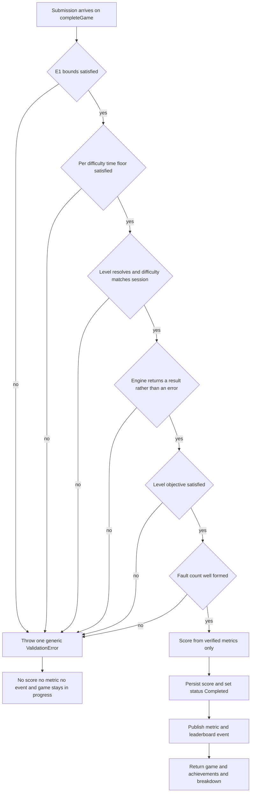

# Backend Integration - NFR Design

**Unit**: U6 Backend Integration (Circuit Builder)
**Package**: `services/game`
**Stage**: CONSTRUCTION - NFR Design

How the three cross-cutting requirements are actually implemented: failing closed, refusing to
disclose internals, and keeping the engine import cheap on a warm Lambda container.

---

## 1. Fail-closed strategy (SECURITY-15, NFR-CB-22)

### The ordering that makes it structural rather than careful

Every rejection happens **before** the first side effect. This is not a convention to be
remembered; it is the order of statements in `completeCircuitBuilderGame`:

```
1. validateCircuitSubmission(...)        -> throw on failure     |
2. validateCompletionTime(...)           -> throw on failure     |  no side effects yet
3. reevaluateCircuitSubmission(...)      -> throw on failure     |
4. calculateCircuitBuilderBreakdown(...) -> pure                 |
----------------------------------------------------------------- first side effect below
5. gameRepository.update(...)            -> persists the score
6. achievementTracker.trackCompletion()  -> non-blocking, in try/catch
7. metricsPublisher.publishGameCompleted()
8. eventPublisher.publishGameCompleted() -> the leaderboard event
9. statisticsCache.delete(...)
```

A failure at steps 1 to 3 therefore guarantees, with no extra code:

- **no score persisted** - `update` has not been called
- **no default or partial score** - there is no fallback value anywhere; the only path to a
  score is step 4, and it is reached only when every check passed
- **no leaderboard event** - `publishGameCompleted` has not been called
- **no metric** - `publishGameCompleted` on the metrics publisher has not been called
- **the game stays `IN_PROGRESS`** - so the player can retry

The test suite asserts all four negatives for each of eleven distinct rejection causes.

### Mermaid diagram - fail-closed decision path



### Text alternative to the diagram

The submission passes through six gates in order: E1 bounds, the per-difficulty completion
time floor, level resolution and difficulty match, a successful engine evaluation, objective
satisfaction, and a well-formed fault count. Failing any gate throws a single generic
`ValidationError` and lands in the terminal state "no score, no metric, no event, game stays
in progress". Only a submission that clears all six gates reaches scoring, and only then is
anything persisted or published. There is no branch from a failed gate to a partial result.

### `evaluate` is wrapped even though it cannot throw

The engine documents `evaluate` as never throwing: its whole body is in a `try` block and an
internal failure returns `errorCode: 'INTERNAL_ERROR'`. E2 wraps the call in explicit error
handling anyway and converts any escaped exception into the same generic rejection. Relying on
a documented promise is fine for correctness, but a defence that costs three lines and removes
a whole class of 500 responses is worth having.

Two independent failure signals are therefore both handled: `isEvaluationError(outcome)` for
the typed outcome, and `catch` for anything that escapes.

### Non-blocking achievement tracking, deliberately unchanged

Step 6 keeps the existing `try/catch` contract: an achievement failure is logged and does not
prevent the score or the leaderboard event. That is a copy of the generic path's behaviour,
not a new decision, and it is the correct trade - the score is the player's earned result and
should not be lost to an unrelated subsystem.

---

## 2. Generic errors without internal disclosure (SECURITY-09, NFR-CB-21)

### One error class, one message, every cause

All rejections throw `ValidationError` from `@memory-game/shared` carrying the single constant
`CIRCUIT_SUBMISSION_REJECTED_MESSAGE`. `sanitizeError` in `src/utils/error-mapper.ts` passes
`ValidationError` through unchanged, so the client receives that message with
`extensions.code`.

Because every cause yields the identical string, a probing client gets **no oracle** telling it
which bound it hit. It cannot distinguish "your voltage is too high" from "that level does not
exist" from "your circuit is shorted" from "the component count is over the ceiling". The test
`gives every cause the identical message` collects the message from all eleven rejection
causes into a set and asserts the set has exactly one member - so the property is enforced,
not just intended.

### Never echo engine detail

`EvaluationError.issues[].detail` is developer-facing text, for example
`"params.resistance must lie in [1, 10000]"`. It is:

- never returned to a client
- never logged, as a whole or field by field
- never copied into E2's internal result - the rejection carries only a reason enum and, at
  most, the `errorCode` enum

A test asserts that E2's rejection object has exactly the keys `ok`, `reason`, and `errorCode`,
so an engine issue array cannot leak in by accident.

### E1 returns no reason at all

`CircuitValidationResult` is `{ ok: true, value } | { ok: false }`. The failure case carries no
reason field. There is deliberately nothing to leak and nothing for a future caller to be
tempted into returning: a developer cannot accidentally surface a bound-specific message
because the validator never produced one.

### Logging whitelist, and the prohibition

Only these fields are logged by the new code:

| Field | Why it is safe |
|---|---|
| `userId` | already logged on every existing operation |
| `gameId` | already logged on every existing operation |
| `levelId` | server-side content identifier, not user data |
| `stage` | which phase refused - `validation`, `completionTime`, `reevaluation` |
| `reason` | the internal rejection enum |
| `errorCode` | the engine's error-code enum |
| `elementCount`, `componentCount`, `faultCount`, `score` | scalars |

**Explicitly prohibited** (NFR-CB-20, SECURITY-03): the layout, any part of it,
`JSON.stringify(submission)`, any token, any email address, any username. None of these
appears in the new code.

### The pre-existing `JSON.stringify(event)` log is not made worse

`src/index.ts` has a pre-existing top-level `catch` that serializes the whole Lambda event.
That log is **not reached** by a submission rejection: `GameHandler.handleRequest` wraps
`routeOperation` in its own `try/catch` and returns a GraphQL error response, so a
service-level `ValidationError` never propagates to the top-level handler.

U6 adds no new serialization of the payload anywhere, and the pre-existing log line is left
exactly as it was. The pre-existing behaviour is recorded as a known gap belonging to a
different unit, not fixed here and not worsened here.

### Resubmission after rejection

A rejected submission leaves the game `IN_PROGRESS`, so the player may retry. That is existing
behaviour for all 23 games, and with a single generic message a retry loop offers nothing to
learn: an attacker gets a binary accept/reject signal they could already get by playing.
Recorded as residual, unchanged.

---

## 3. Module-level import placement for container reuse

### The decision

Every engine import sits at the **top** of its module:

```ts
// src/services/circuit-reevaluation.service.ts
import { clampFaultCount, evaluate, evaluateSuccess, getLevel, isEvaluationError }
  from '@memory-game/shared';
```

Never `await import(...)` inside a request path, and never a lazy `require` behind a cache
check.

### Why this is right for Lambda

A Lambda container is reused across invocations. Module-level imports are resolved once, when
the container initializes, and every subsequent warm invocation reuses the already-parsed
modules at zero cost. A lazy import inside the handler would pay a module-resolution check on
every invocation and would move the parse cost into the first *request* rather than into
initialization, where the platform is more tolerant of it.

### Why it is safe - the purity argument

Module-level state shared across invocations is dangerous when it is mutable, because one
request can then observe another's data. None of that applies here. The engine is documented
and tested as pure and deterministic:

| Property | Consequence |
|---|---|
| no module-level mutable state | nothing accumulates between invocations |
| no clock | the same layout evaluates identically at any time |
| no random source | the result is reproducible |
| frozen result objects | a caller cannot mutate a shared structure |
| no browser or Node API | nothing environment-dependent to carry over |

So one player's circuit cannot leak into another's evaluation. `getLevel` and
`SUCCESS_CONDITIONS` return frozen registry data, and `listLevels` returns a fresh array, so a
caller cannot mutate the registry for subsequent invocations either.

### The one thing imported lazily, and why not

Nothing. The zod schemas in E1 are also built once at module level rather than per request.
Schema construction is the expensive part of zod; `safeParse` on a prebuilt schema is cheap.
Rebuilding the schema per request would be the obvious performance mistake here, so the
schemas are module constants.

---

## 4. Blast-radius containment

A separate concern from the three above, and the reason the code is shaped as it is.

| Technique | Effect |
|---|---|
| Theme-id guard placed immediately after the in-progress check | The branch returns before any generic logic, so the other 23 games cannot reach the new code. Three tests assert this directly. |
| E2 implemented as pure exported functions, not a class | Nothing to add to the `GameService` constructor, so the existing dependency list and the two pre-existing test suites are untouched. |
| E3 added as a new method | No existing method, constant, or array in `score-calculator.service.ts` is altered. The diff is 91 added lines and zero deletions. |
| `ScoreBreakdown` interface unchanged | `apps/web`'s `ScoreBreakdownModal` needs no change, so a frontend deploy is not coupled to this one. |
| Three new source files plus small hunks in five existing files | Reverting is deleting three files and undoing five small hunks. |
