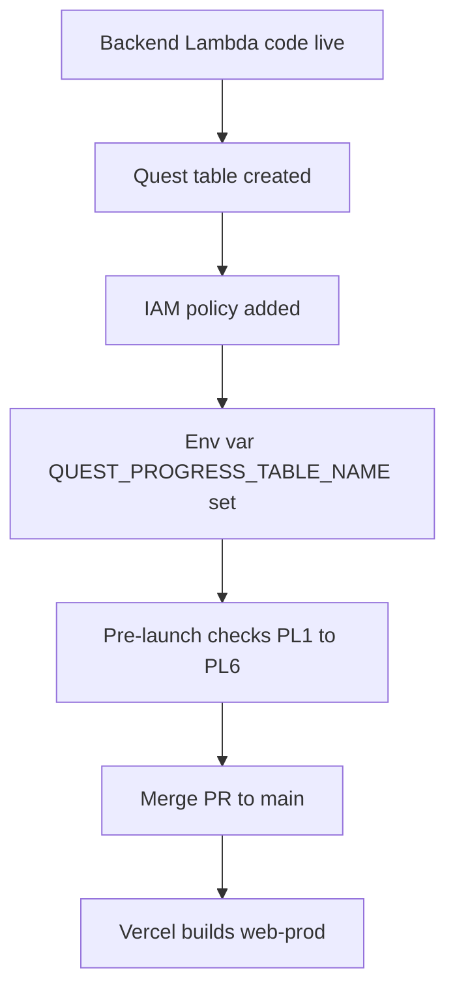

# Quest Map Build and Test Summary

**Branch**: feat/quest-map · **Stage**: CONSTRUCTION - Build and Test
**Result**: Build success. All automated tests pass except the two known baseline suites. Manual and owner-run checks below are still open.

## 1. Results per package
| Package | Command | Result |
|---|---|---|
| packages/shared | `npx jest --ci --runInBand` | PASS: 23 suites, 534 tests |
| packages/shared | `npx tsc --noEmit` | PASS (exit 0) |
| packages/shared | `npm run build` | PASS (exit 0) |
| services/game | `npx tsc --noEmit` | PASS (exit 0) |
| services/game | `npx jest --ci --runInBand` | 9 suites pass, 214 tests pass; 2 suites fail to run (baseline: `event-publisher.service.test.ts`, `tests/integration/event-flow.test.ts`) |
| services/game | `npx jest circuit` | PASS: 4 suites, 125 tests |
| infrastructure | `npx tsc --noEmit` | PASS (exit 0) |
| apps/web | `npm install` | OK; `package-lock.json` churn reverted, tree clean |
| apps/web | `npx tsc --noEmit` | PASS (exit 0) |
| apps/web | `npx vitest run` | PASS: 44 files, 832 tests (was 833: the TRAFFIC_LAB launch row case was removed) |
| apps/web | `npm run build` | PASS (exit 0); pre-existing chunk-size warning (1.76 MB, 510 kB gzip) |

No failures beyond the baseline. No code fixes were needed. Not run: coverage, load tests, `cdk synth`/`cdk diff`, any AWS or Vercel command.

## 2. Manual browser checklist (QM3, QM4, PL5)
QM3 (no automated coverage, U8):
- [ ] 320 px layout of the map, node panel, plays-left bar and banner
- [ ] Keyboard order through the map and node panel
- [ ] Node accessible names (screen reader reads node, state and stars)
- [ ] Reduced motion (`prefers-reduced-motion`) shows static states
- [ ] Each of the 13 game pages opened once from a node
- [ ] Forced start failure goes to the expected message and consumes no play
- [ ] Last-allowed-play start (one play left): node plays normally, next start goes to the rate-limit page
- [ ] Hub-launched game shows no banner and no quest section
- [ ] Hub card renders for a signed-in user; locked World 2 teaser links to subscription
- [ ] Quest result modal hides "Play again" and every close path returns to the map

QM4:
- [ ] "World Cleared" and "World Mastered" badges render locked and earned on the map shelf and the Achievements page
- [ ] Animated unlock on return to the map; static marker under reduced motion

PL5:
- [ ] Manual accessibility, 320 px and reduced-motion pass (NFR-QM-3)

## 3. Pre-launch checks PL1 to PL6
| Id | Check | Owner action | Status |
|---|---|---|---|
| PL1 | Every themeId in config has a PUBLISHED row in `memory-game-themes-prod` | AWS read, `dashden-new` | Done (prod, read-only). Found `OCEAN` missing; fixed by moving `bp-07` to `SPACE` (thresholds.md section 7) |
| PL2 | Every `catalogGameId` in config is `ACTIVE` in `memory-game-catalog-prod` | AWS read, `dashden-new` | Done (prod, read-only). Found `traffic-lab` COMING_SOON; fixed by removing Traffic Lab from launch content (thresholds.md section 7) |
| PL3 | Calibrate thresholds from real score percentiles (read-only leaderboard data) | Owner analysis | Open |
| PL4 | `cdk diff MemoryGame-Database-prod` shows exactly one new table plus added Outputs/exports; anything else means stop | Owner, read-only | Open |
| PL5 | Manual accessibility, 320 px and reduced-motion pass | Manual (section 2) | Open |
| PL6 | Playtest node durations acceptable for ages 8 to 16 | Playtest | Open |

PL1 and PL2 fix results (config only, no AWS write): shared jest 23 suites / 534 tests, game jest 9 suites / 214 tests (same 2 baseline suites fail to run), web vitest 44 files / 832 tests; all three `tsc --noEmit` and the shared and web builds pass.

Known pre-existing issue, NOT fixed here: the hub's Memory Match offers the `OCEAN` theme (`apps/web/src/config/constants.ts`, `GAME_THEMES`), but prod has no `OCEAN` row in `memory-game-themes-prod`, so that hub option fails today with "Theme not found". Quest Map no longer uses `OCEAN`.

## 4. Release order (critical)
The hub card always renders for signed-in users and there is no feature flag. So the backend must be live in prod before the frontend ships.

**Text alternative:** first the backend Lambda code, quest table, IAM policy and environment variable are live in prod; then the pre-launch checks pass; only then the PR is merged, which makes Vercel build the production frontend.

Facts that drive this order:
- CI `.github/workflows/deploy-lambdas.yml` only runs `update-function-code`. It does not create the table, set the env var or change IAM.
- The table, IAM and env var steps in `aidlc-docs/construction/quest-map-backend/infrastructure-design/deployment-architecture.md` are OWNER-RUN, one step at a time, using the `dashden-new` profile (account 342278407349). I did not run them.
- Owner-run steps: (1) identity check, (2) read-only `cdk diff MemoryGame-Database-prod`, (3) `cdk deploy MemoryGame-Database-prod --exclusively`, (4) verify table, (5) `put-role-policy` on the Game Lambda role, (6) env var read-merge-write, (7) `./scripts/deploy-game-lambda.sh prod`.
- Never run `deploy.sh prod`, `cdk deploy --all`, `cdk deploy MemoryGame-Lambda-prod` or `--require-approval never` against prod (O3: it would replace the live `dist/index.handler` code).
- Vercel builds web-prod on merge to main (observed for PR #21 and #23 this week). This resolves open item O2. Merging the PR therefore deploys the frontend immediately.
- **Do NOT merge the PR until the backend prod steps are done.** Merging `packages/shared/**` also triggers CI to redeploy the Game, Leaderboard and Email Sender Lambdas with no behavior change.

## 5. Overall status
- Build: success
- Automated tests: pass (baseline suites excepted)
- Ready for Operations: not yet. Needs the manual checklist, PL1 to PL6 and the owner-run backend steps first.
