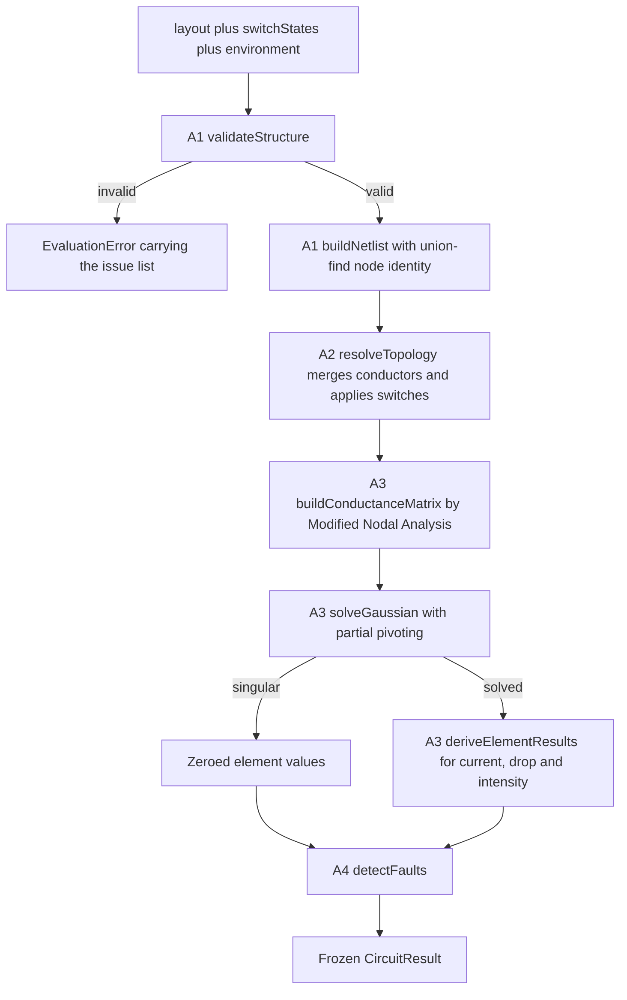
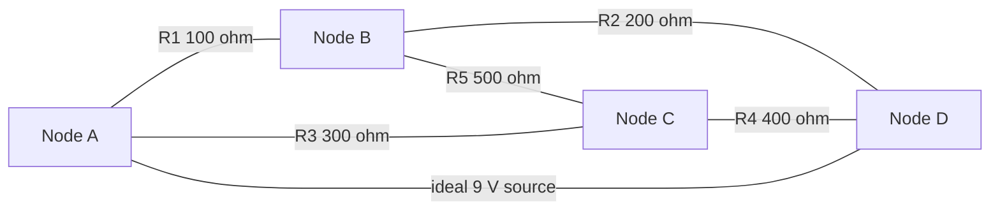

# Circuit Engine - Functional Design

**Unit**: U2 Circuit Engine
**Package**: `packages/shared/src/circuit/`
**Stage**: CONSTRUCTION - Functional Design
**Basis**: `aidlc-docs/inception/application-design/circuit-builder-components.md` (Groups A and B),
`circuit-builder-component-methods.md`, `circuit-builder-unit-of-work.md` (U2),
`aidlc-docs/inception/requirements/circuit-builder-requirements.md`

This document resolves every rule the Application Design stage deferred for A1 through A5 and
B1 through B3: conductor merge rules, per-element matrix stamping, the intensity normalization
curve, fault thresholds and severity ordering, per-level success predicate logic, and role
activation rules.

---

## 1. Evaluation pipeline



**Text alternative:** `evaluate` receives a layout, a switch state map, and an environment. It
first runs structural validation; if that fails it returns an `EvaluationError` carrying the
list of structural issues and goes no further. On success it builds the netlist, resolving
node identity with union-find, then resolves the electrical graph, which merges ideal
conductors into single nodes and applies switch states. It stamps the Modified Nodal Analysis
system and solves it by Gaussian elimination with partial pivoting. A singular solve yields
zeroed element values instead of an error. Either branch then runs fault detection, and the
pipeline returns one frozen `CircuitResult`.

### Stage ownership

| Step | Component | Function |
|---|---|---|
| Structural validation | A1 | `validateStructure(layout, switches, env)` |
| Netlist and node identity | A1 | `buildNetlist(layout)`, `resolveNodeIdentity(layout, policy)` |
| Electrical graph | A2 | `resolveTopology(netlist, switches, env)` |
| Connectivity | A2 | `findConnectedComponents`, `hasClosedPath`, `minimumResistancePath` |
| System assembly and solve | A3 | `buildConductanceMatrix`, `solveLinearSystem` |
| Per-element values | A3 | `deriveElementResults`, `presentationOf`, `summarize` |
| Faults | A4 | `detectFaults`, `isShortCircuitPath`, `locateFaultPosition` |
| Public entry point | A5 | `evaluate` |

---

## 2. Graph model

Three representations exist, each for a reason.

1. **Layout** - what the player built. Elements carry two terminals and an opaque
   `GridPosition`. Connectivity comes only from explicit `Connection` records and from
   conductor elements. Grid coordinates are never read to infer connectivity (FR-CB-4).
2. **Merged canonical-node graph** - what the solver stamps. Ideal conductors have collapsed,
   so a wire is no longer an element with a current.
3. **Conduction graph** - raw terminal ids with conductors still present as traversable edges.
   This exists because fault reporting must name the wire the player placed so C3 can put a
   spark on it (FR-CB-17), and the merged view has deliberately erased it.

### Terminal identity

Terminal ids are globally unique: a terminal belongs to exactly one element. Two elements may
not share a terminal id, because that would be an implicit connection, and all connectivity
must be explicit. A repeated terminal id is a `DUPLICATE_TERMINAL` structural issue.

### Conductor merge rules

Union-find with union by size and path compression merges nodes:

| Trigger | Effect |
|---|---|
| Every `Connection` | unions `from` and `to` |
| A `wire` element | unions its own two terminals |
| A `switch` element, **closed** | unions its own two terminals |
| A `switch` element, **open** | no union, and no edge either |
| Any other element | no union |

The canonical representative of a merged set is its **lexicographically smallest** member,
compared by code unit. Identity therefore depends on the set's contents and never on the order
the input arrays arrived in. See `nfr-design.md` section 4 for why `localeCompare` is
prohibited here.

### Switch state map contract - obligation on U3 and U6

`switchStates` is a map from a switch element id to `'open'` or `'closed'`. Two rules govern
it, and they are deliberately asymmetric:

| Input | Engine behaviour | Why |
|---|---|---|
| A switch element with **no** entry | reads as `'open'` | Fail closed: an incomplete map de-energizes rather than energizing something the player did not ask for |
| An entry naming **no existing** element | `UNKNOWN_SWITCH_ELEMENT`, and `evaluate` returns `STRUCTURAL_INVALID` for the whole layout | The pair is one submitted payload, and the server re-evaluating it (FR-CB-21) must not silently discard part of what it was sent |

**The second rule is a contract C5's reducer must honour: deleting a switch element must
delete its `switchStates` entry in the same state update.** A stale entry is not ignored. The
returned issue carries the offending `elementId`, so a reducer that drifts can prune the key it
names and re-evaluate, but it will get no result until it does.

This is strict on purpose. The same `evaluate` runs in the browser and in the Game Service, and
a server that quietly dropped unrecognised keys would accept a payload whose switch map and
element list disagree - exactly the kind of mismatch SECURITY-05 asks it to reject. The cost is
borne by one reducer that owns both halves of the state; the benefit is that browser and server
never disagree about which layout was evaluated.

`resolveNodeIdentity` takes the merge policy as a parameter rather than hard-coding it, because
a closed switch is a conductor and an open one is a break, so the rule is switch-state
dependent. A1 uses the conductor-only policy; A2 supplies the switch-aware one. This is a
documented refinement of the approved `resolveNodeIdentity(netlist)` signature: the netlist
alone cannot answer the question, since it carries no switch state.

### Edge emission

| Kind | Merged graph | Conduction graph |
|---|---|---|
| `wire` | no edge, terminals merged | 0 ohm edge, element named |
| `switch` closed | no edge, terminals merged | 0 ohm edge, element named |
| `switch` open | no edge at all | no edge at all |
| `resistor`, `led`, `motor`, `buzzer` | resistance edge | resistance edge |
| `battery`, `solar` | source edge carrying voltage and internal resistance | internal-resistance edge |

---

## 3. Element electrical specification

Fixed in `constants.ts` as `ELEMENT_SPECS`.

| Kind | Resistance (ohm) | Internal resistance (ohm) | Rated current (A) | Polarized | Source | Load | Conductor |
|---|---|---|---|---|---|---|---|
| `battery` | - | 0.5 | - | no | yes | no | no |
| `solar` | - | 2.0 | - | no | yes | no | no |
| `wire` | 0 | - | - | no | no | no | yes |
| `switch` | 0 | - | - | no | no | no | yes |
| `resistor` | `params.resistance`, default 470 | - | - | no | no | yes | no |
| `led` | 30 | - | 0.02 | **yes** | no | yes | no |
| `motor` | 60 | - | 0.22 | no | no | yes | no |
| `buzzer` | 180 | - | 0.08 | no | no | yes | no |

Source voltage:

- `battery`: `clamp(environment.sourceVoltage, 1.5, 12)` (FR-CB-7)
- `solar`: `6 * clamp(environment.lightLevel, 0, 1)`

`params.internalResistance` overrides a source's default, bounded to `[0, 10000]`. Zero makes
the source ideal, which is how the bridge test exercises a pure voltage source. An ideal source
across a zero-ohm path then has no solution, and the solver reports that as singular rather
than inventing a number.

### Why these load numbers

Load resistances and ratings are chosen so that across the whole legal voltage range a single
non-LED load alone on a battery never overloads:

```
MAX_SOURCE_VOLTAGE / (resistance + batteryInternalResistance) < ratedCurrent
```

- motor: `12 / 60.5 = 0.1983 < 0.22` - 10 percent margin
- buzzer: `12 / 180.5 = 0.0665 < 0.08` - 17 percent margin
- led: `12 / 30.5 = 0.3934` against a 0.02 rating, a factor of 20 over

The LED deliberately violates the inequality. Needing a series resistor is the lesson, and it
is the only overcurrent a player meets by accident rather than by misuse.

### Polarity

`polarized` is true for the LED only. Reverse current through a polarized **load** is a fault.
Sources are not marked polarized, because a delivering battery carries current from its
negative to its positive terminal by definition, so the same sign rule would flag every working
battery. A source defines orientation rather than violating it.

---

## 4. Modified Nodal Analysis stamping

Modified Nodal Analysis was chosen over series/parallel reduction at the Application Design
stage because reduction cannot solve a bridge, and free grid placement produces bridges. See
section 9.

### Unknowns and grounding

Unknowns are the voltage of every ungrounded node, followed by one branch current per source.
Node order is the sorted union of canonical nodes and internal source nodes; source branches
follow in sorted element-id order.

**One node is grounded per connected component**, each the lexicographically smallest canonical
node in that component. Grounding a single node for the whole circuit would leave every other
component's voltages undetermined, so an innocuous floating sub-circuit would report as
singular. Grounding per component means singularity signals only a genuine degeneracy.

### Stamp per element

Let `i` and `j` be the unknown indices of an element's two canonical nodes. A reference node has
no index, and every term touching it is dropped, which is the same as holding it at 0 V.

| Element | Stamp |
|---|---|
| `resistor`, `led`, `motor`, `buzzer` with resistance `R` | `G[i][i] += 1/R`, `G[j][j] += 1/R`, `G[i][j] -= 1/R`, `G[j][i] -= 1/R` |
| `wire`, closed `switch` | nothing; already merged into one node |
| open `switch` | nothing; absent from the graph |
| `battery`, `solar` | see below |

A source is an ideal voltage source in series with its internal resistance. With a non-zero
internal resistance an internal node `__src:<elementId>` is introduced:

- ideal branch between `terminals[0]` (call it `p`) and the internal node `m`, adding branch
  unknown `k`: `A[p][k] += 1`, `A[k][p] += 1`, `A[m][k] -= 1`, `A[k][m] -= 1`, `rhs[k] = V`
- the internal resistance is then stamped as an ordinary resistor between `m` and `terminals[1]`

With a zero internal resistance no internal node is created and the ideal branch spans the
terminals directly, which avoids dividing by a zero resistance.

The branch unknown `k` is the current flowing **into** the element at `terminals[0]`. A battery
delivering power therefore reports a negative current, because conventional current leaves its
positive terminal into the circuit. This sign convention is uniform across every element:
positive current enters `terminals[0]` and leaves `terminals[1]`.

### Derived per-element values

| Field | Rule |
|---|---|
| `voltageDrop` | `V(canonical terminals[0]) - V(canonical terminals[1])` |
| `current`, resistive edge | `voltageDrop / resistance` |
| `current`, source | the solved branch unknown |
| `current`, conductor | `0` - see below |
| `energized`, `intensity` | the curve in section 5 |

An ideal conductor has **no individually determined current**: two wires in parallel split it
arbitrarily. A wire therefore reports `current: 0` and `voltageDrop: 0`, both of which are true
statements under the model, and its `energized` flag is derived instead from whether its
component contains a source that is actually delivering current. That is what C1 needs to draw
a glowing trace along a live path (FR-CB-20, NFR-CB-9) without the engine inventing a number it
cannot compute.

### `totalResistance` contract

`totalResistance` is the equivalent **external** resistance seen by the dominant source - the
one carrying the largest current, ties broken by the smallest element id - computed as
`|voltageDrop| / |current|` and only when `|current| > CURRENT_EPSILON`. When no source current
flows it is `0`, never `Infinity` and never `NaN`, so the result stays JSON-safe across the
server round trip. Consumers must check `closedPathExists` before reading it.

For one motor on a 9 V battery: current `9 / 60.5 = 0.148760 A`, terminal voltage
`9 - 0.148760 * 0.5 = 8.925620 V`, so `totalResistance = 60.0 ohm`, which is the motor.

**With two sources both delivering, these two totals describe the dominant source only.** Two
batteries on common rails feeding one motor each carry `9 / 120.5 = 0.0747 A`, so `totalCurrent`
reports 0.0747 A rather than the 0.1494 A the motor actually draws, and `totalResistance`
reports the 120 ohm that one battery sees rather than the motor's 60 ohm. Per-element results
are unaffected and remain exact. A consumer that needs a whole-circuit figure for a
multi-source layout must sum the source currents in `elements` itself.

---

## 5. Intensity normalization curve

`intensity` is a presentation value in `[0, 1]` derived from computed current, never
hard-coded (FR-CB-13).

```
ratio = |current| / ratedCurrent

ratio < ENERGIZE_THRESHOLD_RATIO (0.05)   ->  energized = false, intensity = 0
polarized load with reverse current       ->  energized = false, intensity = 0
otherwise                                 ->  energized = true
    intensity = clamp01(0.08 + 0.92 * ratio ** (1 / 2.2))
```

Kinds with no rated current - `resistor`, `battery`, `solar` - get `intensity = 0` and
`energized = |current| > CURRENT_EPSILON`. Conductors are handled as described in section 4.

### Why a gamma curve, with the numbers

Two identical motors on a 9 V battery with a 0.5 ohm internal resistance:

| Arrangement | Current per load | `ratio` | Linear intensity | Gamma intensity |
|---|---|---|---|---|
| Series | `9 / 120.5 = 0.074689 A` | 0.3395 | 0.3395 | **0.643** |
| Parallel | `9 / 61 = 0.147541 A` | 0.6706 | 0.6706 | **0.847** |

The gamma curve widens the visible gap to **0.204**, against a required floor of 0.15 asserted
in `evaluate.test.ts` and `solver.test.ts`. The `MIN_VISIBLE_INTENSITY` floor of 0.08 keeps a
barely-lit load distinguishable from a dark one rather than fading to invisible, which matters
because "dim" and "off" must not look the same when FR-CB-11 and FR-CB-12 are the lesson.

Note that the current ratio is 1.975 - close to the ideal factor of two, with the small
shortfall caused by the battery's internal resistance.

---

## 6. Fault detection

### Thresholds

| Code | Condition |
|---|---|
| `SHORT_CIRCUIT` | either test below puts a source below `SHORT_CIRCUIT_RESISTANCE_THRESHOLD` = 1.0 ohm, compared strictly |
| `SINGULAR_SYSTEM` | the solver reported a singular system |
| `OVERCURRENT` | `|current|` exceeds the kind's `ratedCurrent` |
| `REVERSED_POLARITY` | a polarized load carries current below `-CURRENT_EPSILON` |

#### The two short-circuit tests

| Test | Measures | Available when |
|---|---|---|
| Passive path | minimum-resistance route between a source's terminals over the conduction graph, with **every source excluded** | always, including a singular solve |
| Solved external resistance | `|terminal voltage| / |current|` for that source | only when the system solved |

The passive-path test names the offending elements, so a short reports the wire the player
placed and not just the battery. It runs first; the solved test is a second chance for a source
the path search cannot reach.

**Why every source is excluded, not only the source under test.** A source edge carries its
internal resistance - 0.5 ohm for a battery. With only the source under test excluded, the
cheapest route out of one battery's positive terminal runs straight through a second battery on
the same rails and costs 0.5 ohm, which trips the threshold. Two batteries wired in parallel to
one motor would report a short on both while the solver simultaneously showed a healthy
0.149 A through the motor. Another source is not a conductor the player placed, so it is not
part of what the threshold judges.

**Why the solved test exists.** Excluding every source would otherwise lose a genuine short:
two batteries in series with the loop closed by nothing but wire. Each battery's terminals are
joined only through the other battery, so no passive path exists, yet 18 A flows and each
terminal voltage collapses to 0 V. The solved test measures the thing that actually matters -
the external resistance the source is driving - and catches it. The two tests disagree in
exactly one direction, which is the point: opposing sources on common rails share a topological
route but drive no current through it, so the solved test clears them at about 120 ohm each.

A short found only by the solved test names the source alone, so the spark lands on the battery.
There is no passive element to blame, because the other source is the rest of the loop.

| Player-buildable case | Passive path | Solved external R | Reported |
|---|---|---|---|
| Wire, or closed switch, across the terminals | 0 ohm | 0 ohm | short |
| Smallest legal resistor, 1 ohm | 1 ohm | 1.0 ohm | **no** - strict comparison |
| LED, the smallest fixed load, 30 ohm | 30 ohm | 30 ohm | no |
| Two batteries on common rails feeding a motor | no path | about 120 ohm each | no |
| Two batteries in series, loop closed by wire | no path | 0 ohm each | short, on each source |

The smallest legal resistor sits exactly **at** the threshold, and the comparison is strict, so
no single resistance a player can legally build lands in an ambiguous zone. Parallel
combination can go below 1 ohm - two 1 ohm resistors give 0.5 ohm - and the solved test does
report that as a short, which is physically right: 9 V across 1.0 ohm total draws 9 A.

A singular system is a fault, not an error. An ideal source across a zero-ohm path has no
solution, and telling the player their circuit is impossible is more useful than telling them
the solver failed.

### Severity ordering

`SHORT_CIRCUIT` then `SINGULAR_SYSTEM` then `OVERCURRENT` then `REVERSED_POLARITY`, ties broken
by the first element id ascending. A short comes first because it de-energizes everything else,
so any other fault reported alongside it is downstream of it. The list is fully ordered, so two
equal circuits always produce the same fault sequence and the browser always selects the same
tooltip.

### Reverse-biased loads report one fault, not two

A reverse-biased polarized load reports `REVERSED_POLARITY` only. Its overcurrent is an
artifact of modelling the LED as a plain resistor, which a real diode would block, so reporting
both would put a misleading second tooltip on screen.

### Fault element ordering and spark placement

A short's `elementIds` list the offending path elements first, sorted, then the source.
`locateFaultPosition` resolves the first id that exists in the layout, which puts the spark on
the wire the player placed rather than on the battery (FR-CB-17).

`atPosition` is a **copy** of that element's `GridPosition`, never the layout's own object. The
facade freezes everything it returns, so handing back a caller-owned position would freeze the
layout as a side effect of evaluating it, and the next in-place drag update would throw. The
engine owns every object in its result; see `nfr-design.md` section 5.

### Fuse state is outside the engine

FR-CB-17 de-energizes the circuit on a short, but `fuseBlown` and `resetFuse` live in C5's
reducer. The engine reports the fault **and** the true computed currents; it never zeroes a
shorted circuit's numbers. Keeping fuse state out of the engine is what lets the server
re-evaluate the identical layout without inheriting a browser-side flag, which FR-CB-21 needs.

---

## 7. Closed-path detection

FR-CB-10 asks whether a closed conductive path exists from positive to negative **through at
least one valid load**. `closedPathExists` is read off the solved currents: it is true when some
element whose kind is a load carries current above `CURRENT_EPSILON`.

This is not how the design was first drafted, and the reason matters. A graph search over
"has a load been traversed" over-reports, because a walk can enter a dead-end load and reverse
back out, traversing a load edge while carrying no current. Two cases make the difference
observable, and both are covered by tests:

- a load hanging off a dead-end branch: topologically on a path, electrically idle
- a load in parallel with a dead short: the short collapses the terminal voltage, so the load
  carries nothing

Carrying current **is** the condition, so the solve answers it exactly rather than approximately.

`hasClosedPath(graph, sourceId)` remains as A2's purely topological predicate - a conductive
path exists between a source's terminals - which is exactly the responsibility the Application
Design assigns it, and it is what the short-circuit search builds on.

---

## 8. Level model, success conditions, and the Mars Rover

### Levels authored here

| Level | Difficulty | Disclosure | Grid | Budget | Objective | Concept |
|---|---|---|---|---|---|---|
| `cb-01-closed-circuit` | 1 | `none` | 8 x 6 | battery 1, wire 4, led 1, resistor 1 | `rover-headlight-on` | closed-circuit |
| `sandbox` | 4 | `full` | 24 x 16 | 8 of each of the 8 kinds | `none` | free-play |

The sandbox budget sums to exactly 64, which is `MAX_ELEMENT_COUNT`. The remaining guided levels
of FR-CB-27 and FR-CB-28 are unit U4's content scope.

### Mars Rover roles

Data-driven so additional machines are content, not code (FR-CB-29).

| Role | Required kind | Activation rule | Meaning |
|---|---|---|---|
| `driveMotor` | `motor` | `intensityAtLeast:0.5` | wheels turning |
| `headlight` | `led` | `energized` | headlight lit |
| `buzzerAlert` | `buzzer` | `energized` | alert sounding |
| `solarCharging` | `solar` | `sourceDelivering` | panel delivering current |

Rules resolve through a frozen registry keyed by the exact rule string. An unrecognised key
resolves to `false` rather than throwing, so a content mistake leaves a role unpowered instead
of breaking the game. `driveMotor` uses an intensity threshold rather than `energized` because a
motor that is barely ticking over is not driving anything.

`ElementResult` carries `kind`, an addition to the shape sketched at Application Design. It is
required: the approved `evaluateRoleActivation(machine, result)` signature receives no layout,
so the result itself must say what kind each element is.

### Success conditions

| Condition | Clauses |
|---|---|
| `rover-headlight-on` | `noBlockingFault`, `headlightOn` |
| `rover-fully-powered` | `noBlockingFault`, `driveMotorTurning`, `headlightOn`, `buzzerSounding` |
| `none` (sandbox) | `sandboxHasNoObjective`, which never holds |

Every real objective carries an implicit `noBlockingFault` clause that fails when a
`SHORT_CIRCUIT` or `SINGULAR_SYSTEM` fault is present. This fails the **objective** without
failing the level: FR-CB-19 keeps the attempt alive, so the player resets the fuse, fixes the
wiring, and carries on.

An unknown machine id yields `unmetClauses: ['unknownTargetMachine']` and an unknown condition
id yields `['unknownSuccessCondition']`. Both fail closed, so a content error can never award a
score. `evaluateSuccess` is the identical function in the browser and in the Game Service, which
is the whole reason B2 lives in `packages/shared` (FR-CB-22).

`composePredicates([])` returns a predicate that is `true`: the conjunction of no conditions is
vacuously satisfied. A caller that means "no objective" must say so, and the sandbox does.

---

## 9. Why a bridge needs nodal analysis



**Text alternative:** A Wheatstone bridge with four nodes. A 9 V ideal source drives node A
relative to node D. Two voltage dividers hang between A and D: R1 of 100 ohm from A to B in
series with R2 of 200 ohm from B to D, and R3 of 300 ohm from A to C in series with R4 of 400
ohm from C to D. R5 of 500 ohm bridges node B to node C. Because R5 ties the midpoints of the
two dividers together, no sequence of series and parallel combinations can collapse this
network, which is why the engine solves the node equations instead of reducing the circuit.

The engine's answer is cross-checked against an independent Thevenin derivation computed from
scratch inside the test:

```
Vth = 9 * (200/300 - 400/700)             = 0.857142857142857 V
Rth = (100*200)/300 + (300*400)/700       = 238.095238095238 ohm
I(R5) = Vth / (Rth + 500)                 = 1.161290322580645e-3 A
```

The solver matches this to within 5e-13. The balanced case `R1 = R2 = R3 = R4 = 100`,
`R5 = 50` yields `|I(R5)| < 1e-9` and equal voltages at B and C, as symmetry requires.

---

## 10. Boundaries and known simplifications

| Topic | Decision |
|---|---|
| Fuse state | C5's reducer, not the engine - section 6 |
| Switch map pruning | C5's reducer must delete a switch's `switchStates` entry when it deletes the element; a stale key is a structural error, not an ignored key - section 2 |
| Multi-source totals | `totalCurrent` and `totalResistance` describe the dominant source only, so a circuit driven by two sources reports less than the sum - section 4 |
| Memoization | D2's wrapper, never here; the engine stays pure for Lambda reuse |
| LED model | a linear resistor, so reverse current still flows mathematically and is suppressed by the fault detector rather than by the model. A deliberate simplification: a real diode would block it |
| Conductor current | not individually determined under the ideal-conductor model - section 4 |
| Level content | two levels here; the rest is U4 |
| `faultCount` | bounded upward only - see `nfr-requirements.md` section 4 |

---

## Requirement coverage

| Requirement | Where satisfied |
|---|---|
| FR-CB-4 | terminal-to-terminal connections; grid position never read for connectivity |
| FR-CB-7 | battery voltage clamped to `[1.5, 12]` |
| FR-CB-8 | switch open or closed, applied in `resolveTopology` |
| FR-CB-9 | per-element current and voltage drop, plus `totalResistance` and `totalCurrent` |
| FR-CB-10 | `closedPathExists` from solved load currents - section 7 |
| FR-CB-11 | series: breaking the chain zeroes every load in it |
| FR-CB-12 | parallel: removing one branch leaves the others powered |
| FR-CB-13 | intensity curve derived from current - section 5 |
| FR-CB-14 | `SHORT_CIRCUIT` threshold - section 6 |
| FR-CB-15 | pure, framework-free, deterministic |
| FR-CB-16 | lives in `packages/shared` |
| FR-CB-17, FR-CB-18 | stable fault codes plus `atPosition` for the spark |
| FR-CB-19 | a short fails the objective, not the attempt |
| FR-CB-21, FR-CB-22 | one `evaluate` and one `evaluateSuccess` shared by browser and server |
| FR-CB-27, FR-CB-28 | level model with `conceptTag`; two levels authored |
| FR-CB-29, FR-CB-30 | data-driven machine and role registry |
| FR-CB-33, FR-CB-34 | `difficulty` tier and `numericDisclosure` per level |
