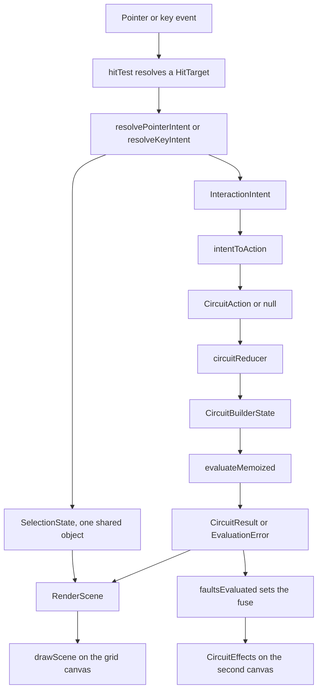

# Game Surface — Functional Design

**Unit**: U3 "Game Surface"
**Package**: `apps/web`
**Components**: C1 renderer, C2 interaction controller, C3 effects layer, C4 component tray,
C5 surface state, D2 engine wrapper
**Basis**: approved Application Design (`circuit-builder-components.md` group C and D2,
`circuitbuilder-component-methods.md`, `circuit-builder-unit-of-work.md` U3), and the completed
engine of U2 (`aidlc-docs/construction/circuit-engine/`)

No Functional Design existed for U3 before this document. The three decisions that
`circuit-builder-component-methods.md` marked "deferred to Functional Design" — the energized-trace
treatment and brightness mapping, the per-action validation rules, and the memo size and eviction
policy — are decided here, in sections 4, 6, 7, and in `../nfr-design/nfr-design.md` section 5.

---

## 1. Scope

This unit builds the interactive canvas: drawing a circuit, manipulating it, and showing what the
engine computed. It owns no content and talks to no server.

**In scope**: the grid canvas and its renderer, hit-testing and snap-to-grid, pointer and keyboard
interaction, the particle and fault-feedback layer, the component tray, the surface's own state
machine, and a memoizing wrapper around the shared engine.

**Out of scope, and genuinely absent from the code** — each is listed with its owner in
`../code/implementation-summary.md` section 8: audio, locale content beyond English keys, reading
the operating system's reduced-motion preference, level definitions, the Mars Rover target machine,
success evaluation, scoring, any network call, and the route that would make the surface reachable.

---

## 2. Layer decomposition

Six modules, split so that the two concerns most likely to tangle — drawing and interaction — are
separated by construction rather than by comment. The renderer is a pure function of a scene. The
controller is a pure function of an input event and a selection. Neither can reach the other.

| Component | Module | Knows about | Must not know about |
|---|---|---|---|
| **C1** renderer | `utils/circuitBuilderRenderer.ts` | a `CanvasRenderingContext2D`, the layout, the engine's `CircuitResult`, the viewport, the current selection, a timestamp | React, the DOM beyond the 2D context, input events, how a selection came to be |
| **C2** controller | `utils/circuitBuilderInteraction.ts` | a key or a logical point, a `HitTarget`, the `SelectionState`, the surface state | the canvas, any pixel it did not receive as an argument, React, event objects |
| **C3** effects | `utils/circuitBuilderEffects.ts` | grid coordinates, a time delta, a 2D context at draw time | the layout, the engine, React, the system clock, input |
| **C4** tray | `pages/circuit-builder/ComponentTray.tsx` | tray items and the armed kind | the canvas, the engine, the layout, English text |
| **C5** state | `utils/circuitBuilderState.ts` | the level, the layout, switches, environment, metrics | React, the canvas, pixels, the engine's internals |
| **D2** wrapper | `utils/circuitEngine.ts` | `packages/shared/src/circuit` | everything else in this unit |
| geometry | `utils/circuitBuilderGeometry.ts` | the canvas size, the grid size, element positions | React, input, the engine's electrical model |

Two React hosts and one composition component wire these together and own nothing else:
`GridCanvas.tsx` (a canvas ref, an animation loop, event plumbing), `EffectsCanvas.tsx` (a second
canvas and its own loop), and `CircuitBuilderSurface.tsx` (the reducer, the selection, and the
evaluation).

`circuitEngine.ts` is the only module in `apps/web` that names `packages/shared`. `apps/web` does
not depend on the shared package, and neither `package.json` nor `vite.config.ts` is in this unit's
permitted change set, so the engine is imported by relative source path. Funnelling that through one
module means a later change to a package-name import is a ten-line edit in one file. The residual
risk is recorded as R1 in the implementation summary.

### Interaction cycle



**Text alternative:** A pointer or key event is first resolved against the layout by `hitTest`,
which reports what is under the pointer as a `HitTarget`. The hit target and the current selection
go into one of the two resolvers, which return two things: the next `SelectionState` and an optional
`InteractionIntent`. An intent is translated by `intentToAction` into either a `CircuitAction` or
`null`. An action is applied by `circuitReducer`, producing the next `CircuitBuilderState`. That
state is evaluated through `evaluateMemoized`, which returns either a `CircuitResult` or an
`EvaluationError`. The outcome and the selection together form the `RenderScene` that `drawScene`
paints onto the grid canvas. Separately, the outcome's fault codes are dispatched back into the
reducer as a `faultsEvaluated` action, which blows the fuse on a rising edge, and the fault's grid
position drives the particle effects on the second canvas.

---

## 3. One selection, one intent vocabulary

NFR-CB-5 asks for a keyboard path equivalent to the pointer path. The usual failure is two
implementations that drift. This unit prevents that structurally rather than by discipline.

- There is **one** `SelectionState`: the armed tray kind, the selected element, the half-drawn
  connection, the grid cursor, and the in-flight drag. Both input paths read it and write it, and
  neither keeps any private state.
- There is **one** `InteractionIntent` union of eleven members. Both resolvers emit from it.
- There is **one** route from an intent to a state change, `intentToAction`. Neither resolver can
  reach the reducer directly.

Because all three functions are pure, the equivalence is directly assertable. The headline test in
`circuitBuilderInteraction.test.ts` takes one selection and one state and asserts that the pointer
and keyboard paths return **deep-equal intents and deep-equal selections** for placing a component,
toggling a switch, and completing a connection. A future keyboard addition that forked into a
parallel model would break it.

A supporting rule makes "one selection" true in practice as well as in type: every pointer gesture
that targets a cell, an element, or a terminal also moves the shared `cursor` to that cell. Mouse
and keyboard therefore never disagree about where the player is.

### Pointer resolution

| Phase | Target | Selection change | Intent |
|---|---|---|---|
| `down` | terminal | sets `pendingTerminal`, syncs cursor | `beginConnection` |
| `down` | element | sets `selectedElementId` and starts a canvas drag, syncs cursor | `selectElement` |
| `down` | cell, connection, outside | syncs cursor only | none |
| `move` | any | updates the drag point, the hovered cell, and `moved` once travel passes `TAP_SLOP` | none |
| `up` | terminal, a different terminal pending | clears `pendingTerminal` | `completeConnection` |
| `up` | terminal, the same terminal pending | clears `pendingTerminal` | `cancel` |
| `up` | anything but a terminal, with a terminal pending | clears `pendingTerminal` | `cancel` |
| `up` | cell or element, tray drag | clears the drag | `placeAt` |
| `up` | cell or element, moved canvas drag | clears the drag | `moveElementTo` |
| `up` | cell, nothing dragging, a kind armed | stays armed | `placeAt` |
| `up` | a switch, not dragged | clears the drag | `toggleSwitch` |
| `up` | connection, nothing dragging or pending | unchanged | `removeConnection` |
| `cancel` | any | clears the drag, the pending terminal, and the armed kind | `cancel` |

A tray drop onto an **occupied** cell still emits `placeAt`. The reducer then refuses it with
`CELL_OCCUPIED`, which is what puts the "something is already there" feedback on screen —
CB-2.1's second criterion. Swallowing the gesture silently would leave the player with no
explanation.

The armed kind survives a successful tap placement, so a player can place four wires with four
taps. `Escape`, a cancelled gesture, or an exhausted allowance disarms it.

### Keyboard resolution

| Key | Condition | Intent |
|---|---|---|
| arrow keys | always, cursor clamped to the grid | `moveCursor` |
| `Enter` or space | a kind is armed and the cursor cell is empty | `placeAt` |
| `Enter` or space | a terminal is pending | `completeConnection` on terminal 0 of the cursor element |
| `Enter` or space | the cursor element is a switch | `toggleSwitch` |
| `Enter` or space | the cursor element exists | `selectElement` |
| `c`, or `C` with shift for terminal 1 | the cursor element exists | `beginConnection` |
| `Delete` or `Backspace` | the cursor element exists | `removeElement` |
| `Escape` | always | `cancel` |
| anything else | — | none, and the identical selection object is returned |

The vocabulary is deliberately small. It is complete enough to build and energize a circuit without
a pointer, and `resolveKeyIntent` is the single extension point for the fuller model U5 owns.

`intentToAction` fails closed. It returns `null` rather than a half-formed action when nothing is
armed, when nothing is pending, or when the intent names an element or connection that no longer
exists — which is reachable, because the hit target came from a rendered frame and the layout may
have changed since. A stale gesture therefore does nothing, instead of raising a rejection the
player cannot explain.

---

## 4. Per-action validation — the normative rules

Twelve actions. Validation lives here and nowhere else, so the engine never receives a layout it
would reject. Every refusal produces a **code**, never a message: copy lives in the locale files,
and nothing from the engine's internals is ever shown to a player.

| Action | Refusals, in the order checked | Effect on success |
|---|---|---|
| `place` | `OUT_OF_BOUNDS`, `CELL_OCCUPIED`, `OVER_BUDGET`, `ELEMENT_LIMIT` | adds the element at rotation 0; a switch also gets a `closed` entry |
| `move` | `UNKNOWN_ELEMENT`, `ELEMENT_LOCKED`, `OUT_OF_BOUNDS`, `CELL_OCCUPIED` | replaces the position, **preserves rotation**, **leaves connections untouched**; moving onto its own cell returns the same state reference |
| `remove` | `UNKNOWN_ELEMENT`, `ELEMENT_LOCKED` | drops the element, every connection naming either terminal, and its switch entry |
| `connect` | `UNKNOWN_ELEMENT`, `SELF_CONNECTION`, `DUPLICATE_CONNECTION`, `CONNECTION_LIMIT` | joins the two terminals |
| `disconnect` | `UNKNOWN_CONNECTION` | removes that one connection; both components stay |
| `toggleSwitch` | `UNKNOWN_ELEMENT`, `NOT_A_SWITCH` | flips open and closed; an absent entry reads as open, so a first toggle closes |
| `setVoltage` | `INVALID_VOLTAGE`, only for a non-finite value | snaps to the 0.5 V step, then clamps to 1.5 V to 12 V |
| `setLightLevel` | `INVALID_LIGHT_LEVEL`, only for a non-finite value | clamps to 0 to 1 |
| `resetFuse` | none | clears the fuse; the fault count is unchanged |
| `tick` | none | sets elapsed seconds; same reference when unchanged |
| `reset` | none | rebuilds from the level definition |
| `faultsEvaluated` | none | on the rising edge of a blocking fault, blows the fuse and increments the clamped fault count |

Four rules cut across all twelve:

1. Every successful player action clears `lastRejection`, at one assignment point.
2. Every refusal returns a new state whose only change is `lastRejection`.
3. `metrics.componentCount` is recomputed from the layout at that same single point, so it cannot
   drift.
4. `tick` and `faultsEvaluated` are the two actions the host dispatches on its own rather than in
   response to the player, so neither clears `lastRejection`. A one-second clock must not erase the
   feedback for a refused placement before the player has read it.

Three rules deserve their reasoning:

**Overlap refusal is only ours.** The engine's structural validation has no position-collision
check at all — grid position is opaque metadata to it. Nothing downstream will catch an overlap, so
`CELL_OCCUPIED` here is the whole of CB-2.1's "cannot be placed overlapping another component".

**A switch is born closed.** The engine reads a missing switch entry as *open*, deliberately, to
fail closed. A switch placed without an entry would therefore be born dead, and CB-2.4's "given a
working circuit containing a closed switch" would be unreachable. Placing one writes `closed`.

**Voltage clamps, it does not reject.** CB-2.5 asks that the voltage "cannot be set outside the
defined safe range". Clamping satisfies that and additionally guarantees the environment is never
invalid for the engine, which validates it on every call even when no source is placed. A rejection
would leave the control and the state disagreeing.

**Joining terminal 0 to terminal 1 of the same element is allowed.** It is a legal short across one
component and a real lesson. Only joining a terminal to *itself* is refused, which is exactly
CB-2.2's invalid-target criterion.

---

## 5. Snap-to-grid and hit-test geometry

One fixed logical canvas, 960 by 640, for every grid size. Levels range from 8 by 6 to 24 by 16, so
instead of resizing the backing store per level — which would invalidate every cached coordinate
mid-session — the grid is letterboxed inside a constant canvas:

```
cellSize = floor(min((960 - 32) / cols, (640 - 32) / rows))     minimum 1
originX  = round((960 - cellSize * cols) / 2)
originY  = round((640 - cellSize * rows) / 2)
```

Cells stay square at every grid size, the grid stays centred, and one CSS aspect ratio of 3:2 covers
all of them. An 8 by 6 grid yields 101-pixel cells; 24 by 16 yields 38-pixel cells.

Snapping is a floor division, not a nearest-cell search, and `pointToCell` returns `null` outside
the grid rather than clamping to the nearest edge cell. A pointer released off the grid therefore
does nothing, instead of placing a component somewhere the player did not aim.

`clientToCanvasPoint` undoes the CSS scale once, from the element's measured rectangle. A zero-sized
rectangle — which happens on the first layout pass, before the element has been measured — returns
a point outside the grid, so the failure mode is "nothing happened" rather than a division by zero
and a position of `NaN`.

Terminal anchors sit `0.42 * cellSize` from the cell centre, along the axis the rotation picks:
rotation 0 puts terminal 0 left and terminal 1 right, and each 90 degrees turns the pair clockwise.
0.42 is under half a cell, so both anchors stay inside their own cell. Nothing in this unit emits a
rotation other than 0, but all four are implemented, which makes a later rotate action a reducer
change with no geometry change.

**Hit priority, highest first: terminal, element body, connection, empty cell, outside.** Terminals
outrank bodies because a terminal always sits on top of a body, and connecting is the finer-grained
action — selecting or dragging the element is still reachable everywhere else on the body. Grab
radii are proportions of `cellSize`, not pixels, so they scale with the grid: 0.28 of a cell for a
terminal, 0.12 for a connection.

---

## 6. Energized against de-energized: four non-colour channels

CB-2.6's manual criterion is explicit — the two states must be distinguishable *without relying on
colour alone*. One redundant channel would be the minimum. Four were implemented, so the distinction
survives monochrome printing, low contrast, and any colour-vision deficiency:

| Channel | De-energized | Energized |
|---|---|---|
| Stroke **width** | 2.4 px | 3.84 px, 1.6 times wider |
| Line **pattern** | solid | marching dashes, 10 on 6 off |
| **Glow** | none | 14 px shadow blur |
| **Shape** | hollow outline ring on a load | filled halo on a load |

Colour changes as well, from slate grey to cyan, but it is the fifth channel and never the only one.

When reduced motion is on, the dashes freeze at offset 0 and **static chevron glyphs are drawn along
the trace instead**, so the direction information the marching dashes carried is substituted rather
than dropped.

A connection is energized only when **both** elements it joins are energized. Under the engine's
model an ideal conductor has no individually determined current — two parallel wires split it
arbitrarily — so a wire reports zero current and its `energized` flag is the only usable signal.
This is also why no current reading is ever drawn on a wire.

No text is drawn on the canvas at all. Components are vector glyphs: a battery's long and short
bars, a resistor's zigzag, a diode triangle for the LED, a rotor line for the motor, concentric
rings for the buzzer, a hinged blade for the switch. Nothing on the canvas needs translating, and
all localized copy stays in the DOM where the locale files reach it.

---

## 7. Brightness from current

The engine already owns the perceptual curve. `ElementResult.intensity` arrives normalized to 0 to 1
as `MIN_VISIBLE_INTENSITY + (1 - MIN_VISIBLE_INTENSITY) * ratio ** (1 / INTENSITY_GAMMA)`, where
`ratio` is the current as a fraction of the element's rated current. The renderer consumes that
scalar directly. It never re-derives a brightness from a current, and it never hard-codes one per
circuit arrangement.

One documented mapping turns that scalar into drawing quantities:

```
coreAlpha       = 0.35 + 0.65 * intensity
glowAlpha       = 0.25 + 0.75 * intensity
glowRadiusRatio = 0.18 + 0.42 * intensity        multiplied by cellSize
```

All three are monotonic in intensity and stay inside 0 to 1 — asserted by a table test.

**The ramp applies only to `led`, `motor`, and `buzzer`.** Those are the three kinds that declare a
`ratedCurrent`, and the engine deliberately reports `intensity: 0` for every kind that does not.
Ramping a resistor from zero would render it permanently dark, and faking a ramp for it would be
exactly the hard-coding this unit must not do. Unrated kinds get a binary treatment driven by
`energized`, which is correct: a resistor either carries current or does not, and it has no
brightness to show.

Each of the three expresses the same scalar in its own way, so the series-versus-parallel difference
FR-CB-13 asks for is perceivable on any of them: the LED's halo grows in radius and opacity, the
motor's rotor turns faster, and the buzzer draws one more ring per quarter of intensity.

Every visual is gated on `energized` and `intensity`, never on `current`. A reverse-biased LED
reports a non-zero *negative* current with `energized: false`; keying anything off the current would
make a backwards LED appear to be working.

---

## 8. The fuse is a render-time suppression

The engine reports a short circuit **together with the true computed currents** and never zeroes a
shorted circuit. That is deliberate: the server has to be able to re-evaluate the identical layout
without inheriting a browser-side fuse flag.

So `fuseBlown` is C5 state, and the **renderer** is what suppresses energization while it is set.
Three consequences, all of them wanted:

- the layout stays submittable and unmodified, so it is a faithful record of what the player built;
- `resetFuse` is a one-field change with nothing to recompute;
- the same suppression path covers an evaluation error, where `result` is `null`.

On an evaluation error the surface draws the de-energized grid and one generic localized line. It
shows no error code, no issue list, no engine detail, and it reports no success and no celebration.

---

## 9. Deviations from the approved design

Each deviation is a correction to something the approved design could not have known, not a
convenience.

| # | Deviation | Why |
|---|---|---|
| 1 | **A twelfth reducer action, `faultsEvaluated`** | The approved eleven-action set has no way to move engine output into reducer state, yet C5 is required to own `fuseBlown` and `faultCount`. Nothing in the set could set `fuseBlown` to `true`, so the set was provably incomplete for its own stated responsibility. Overloading `tick` was rejected: `tick` fires once a second, so a short created and corrected between two ticks would never be counted, and it would weld the clock to fault detection. |
| 2 | **`CircuitBuilderState` carries its `level`** | The reducer is pure, and both `reset` and `faultsEvaluated` need level data — the pre-placed elements and allowances for one, the per-level fault ceiling for the other. The approved field list is intact and additive; `levelId`, `budget`, and `lockedElementIds` are still present and still what callers read. |
| 3 | **`selectSubmissionPayload` returns the full submission draft, not a bare `CircuitLayout`** | The brief requires "exactly what the backend will later receive". E1's contract is `gameId`, `levelId`, `layout`, `switches`, `environment`, `completionTime`, `faultCount`. Returning only the layout would silently drop the four fields U6 validates. `gameId` belongs to the session, which this unit has no access to, so the caller spreads it in. |
| 4 | **`HitTarget` carries the cell and the element kind** | Without them `resolvePointerIntent` cannot sync the shared cursor or tell a switch from a bulb, and the pointer path would need the layout — which would make it impure and break the equivalence test. `hitTest` already holds the element, so both fields are free. Additive: the discriminant and existing fields are unchanged. |
| 5 | **Two added intents, `moveElementTo` and `selectElement`** | The approved union covers placing and connecting but has no member for the result of a drag or a press on an existing element, both of which the approved action set requires (`move`). |
| 6 | **No rotate action** | The approved action set has none and no U3 requirement asks for one. Elements are placed at rotation 0 and `move` preserves rotation. Terminal anchors are already rotation-aware, so adding it later is a reducer change only. |
| 7 | **`CircuitEffects.setGridSize`** | `playCelebration` has no single position and needs the grid extent to spread itself across. An added method, not a changed one; the five approved methods are unchanged. |

---

## 10. Security baseline applicability

| Rule | Status | Evidence |
|---|---|---|
| SECURITY-09 | **Compliant** | Rejections and faults are codes resolved through locale keys. No engine detail, no issue code, no `detail` string, and no stack trace is rendered. An evaluation error shows one generic localized line. |
| SECURITY-15 | **Compliant** | `evaluateMemoized` wraps its body and returns a typed `INTERNAL_ERROR` carrying no message. `pointToCell` and `clientToCanvasPoint` fail closed on an off-grid or unmeasured input. Both canvas hosts return quietly when the element or its 2D context is absent. `intentToAction` returns `null` rather than a stale action. Both animation loops cancel their frame and the effects pool is cleared on unmount. No promise is created, so no rejection can go unhandled. |
| SECURITY-03 | **N/A for this unit** | A browser surface with no logging framework and no log sink. It emits no log line at all, so no sensitive value can reach one. |
| SECURITY-05 | **Partially applicable, compliant** | No API endpoint exists here, but every action is bounds-checked against the engine's published ceilings before it can reach the engine. |
| SECURITY-01, 02, 04, 06, 07, 08, 10, 11, 12, 13, 14 | **N/A** | No data store, no network intermediary, no response header, no IAM policy, no network configuration, no endpoint authorization, no new dependency, no authentication, no deserialization of untrusted input, and no alarm configuration is created or changed by this unit. |
