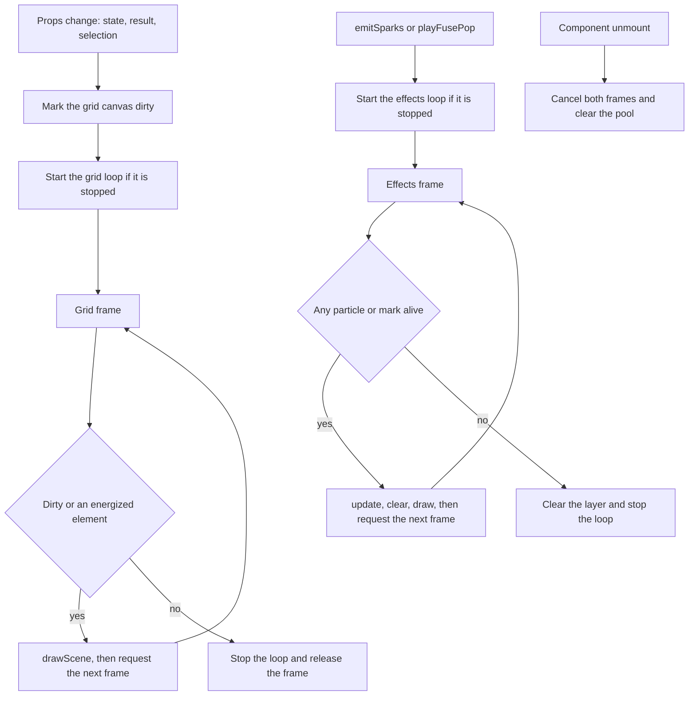

# Game Surface — NFR Design

**Unit**: U3 "Game Surface" · **Package**: `apps/web`

How the surface meets the budgets in `../nfr-requirements/nfr-requirements.md`.

---

## 1. Two independent render loops

**Text alternative:** There are two animation loops and they are independent. The grid loop is
started by a prop change, which also marks the canvas dirty. Each grid frame asks one question: is
the canvas dirty, or is at least one element energized? If yes it redraws the whole scene and
requests another frame; if no it stops and releases its frame handle. The effects loop is started by
an effect being emitted. Each effects frame advances the particle simulation, clears only its own
layer, draws, and asks whether any particle or static mark is still alive; if none is, it clears the
layer and stops. On unmount, both loops cancel their pending frames and the particle pool is
cleared. Neither loop can start the other, so sparks never force the circuit to redraw and a circuit
change never restarts a finished particle burst.

---

## 2. Dirty-flag invalidation, and why not dirty rectangles

The grid canvas redraws in full, gated on a dirty flag, rather than computing invalidation
rectangles.

A dirty-rectangle scheme would compute the bounding box of what changed and redraw only that. Here
that would be **wrong in exactly the cases that matter**: an energized trace is drawn with a 14-pixel
`shadowBlur`, and the blur bleeds well past any rectangle derived from the geometry. The region you
would compute from a trace's endpoints excludes its own glow, so toggling a switch would leave a halo
behind on screen. Growing every rectangle by the blur radius, for a path that may cross the whole
grid, converges on the full canvas anyway — at the cost of a rectangle-union pass per frame.

A full redraw of about 576 primitives inside an 8 ms budget is affordable, and it has one property a
partial redraw does not: **the canvas is always exactly the scene**, so no stale pixel can survive a
state change. The optimisation that actually matters is not drawing less, it is not drawing at all —
which the dirty flag plus `hasLiveAnimation` delivers. A settled circuit costs zero frames.

---

## 3. A second canvas for effects

Particles are composited on a separate canvas, absolutely positioned over the grid with
`pointer-events-none`, rather than drawn as a second pass on the same one.

The two layers have opposite lifetimes. A spark burst animates for 400 to 600 ms at 60 fps, which is
24 to 36 frames; the circuit underneath is static for all of them. Sharing a canvas would force all
576 circuit primitives to be redrawn on every one of those frames, because clearing the particles
means clearing everything beneath them. Separating them means a burst costs only its own clear and
its own particles.

`pointer-events-none` keeps the overlay out of hit testing entirely, so no input path has to know it
exists.

---

## 4. Animation frame and listener cleanup

Following the mini-golf precedent: no `addEventListener`, so there is no listener to remove. All
input arrives through React props on the canvas element, which React detaches when the element
unmounts.

What does need releasing is the animation frames and the particle pool. The exact unmount sequence,
matching the code:

**`GridCanvas`** — one effect with an empty dependency array whose cleanup runs on unmount:
1. set the running flag false, so a frame already queued returns immediately without drawing;
2. if a frame handle is held, `cancelAnimationFrame` it and zero the handle.

**`EffectsCanvas`** — same cleanup, plus one more step:
1. set the running flag false;
2. `cancelAnimationFrame` the held frame and zero the handle;
3. `clear()` the `CircuitEffects` instance, retiring every particle and dropping every static mark.

**`CircuitBuilderSurface`** — the cleanup of its interval effect:
1. `clearInterval` on the one-second tick;
2. `clear()` on the effects handle if it is still attached.

The surface deliberately cancels no frame of its own: the canvases own their frames, and an owner
that cancelled someone else's handle would be a second source of truth.

Three guards keep the loops honest:
- the running flag is checked at the top of every frame, so a cancelled loop cannot draw once more;
- a null canvas or a null 2D context stops the pump quietly rather than throwing (SECURITY-15 fail
  closed), and leaves no loop spinning;
- the loops self-terminate when there is nothing to draw, so the common case is no timer at all
  rather than a cancelled one.

No promise is created anywhere in this unit, so there is no unhandled rejection to guard against.

---

## 5. Memo eviction policy

A `Map` keyed by the full canonical circuit string, capacity 32.

| Operation | Implementation | Cost |
|---|---|---|
| Lookup | `map.get(key)` | one hash lookup |
| Hit | `delete` then `set` the same key | moves it to the end of the insertion order |
| Miss | `set`, then if `size > 32` delete the first key | one hash insert plus at most one delete |
| Eviction order | first key of `map.keys()` | the oldest by last use |

A `Map` already preserves insertion order, so least-recently-used behaviour needs no second data
structure: refresh-on-hit is delete-then-set, and evict-oldest is "delete the first key". No linked
list, no access counters, no timestamps.

**Why the key is the whole canonical string rather than a numeric digest.** A digest collision would
return a *different circuit's* result, and the player would see a correct-looking answer for a
circuit they did not build, with no error and no way to detect it. Realistic keys are 2 to 4 kB, so
32 of them is roughly 128 kB. Trading 128 kB for the complete elimination of a silent-wrong-answer
class is not a close call.

The canonical string sorts elements, connections, switch keys, and element params before
serializing, so two layouts differing only in array order produce one key — which matches the
engine, whose output is order-independent. Field and record separators are C0 control characters
that an id cannot contain, since ids are bounded to 64 printable characters, so no id can forge a
boundary. Negative zero is serialized distinctly from zero, because `String(-0)` is `"0"` and would
otherwise collide.

Error outcomes are cached too: identical input is identically invalid, and re-evaluating a
structurally broken layout on every keystroke would be the one case where the cache helps least and
is needed most.

---

## 6. Responsive scaling

One fixed logical canvas of 960 by 640, CSS-scaled by
`w-full max-w-[min(94vw,960px)] aspect-[3/2] touch-none`.

| Choice | Reason |
|---|---|
| Fixed backing store | Every coordinate path is written once in logical pixels. The browser does the scaling, and no cached coordinate is ever invalidated by a resize. |
| 3:2 aspect ratio | Matches the 24 by 16 grid ceiling, so the largest grid fills the canvas and smaller grids letterbox inside it with square cells. |
| `touch-none` | Stops the browser from treating a drag on the canvas as a page scroll or a pinch, which would otherwise make touch dragging unusable. |
| Tray scrolls horizontally below `lg`, stacks vertically at `lg` | Keeps all eight component kinds reachable on a phone without shrinking the canvas. |

**Accepted trade-off: no `devicePixelRatio` handling.** The backing store is not multiplied by the
display's pixel ratio, following the mini-golf and bond-and-burn precedent. Glow and fine strokes
will look slightly soft on a HiDPI screen. Fixing it means setting the backing store to
`size * dpr`, scaling the context, and re-checking every coordinate path — which is better done once
for all the canvas games than differently in this one. Recorded as residual risk R4.

---

## 7. Security baseline applicability for this stage

| Rule | Status | Evidence in this document |
|---|---|---|
| SECURITY-15 | **Compliant** | Section 4: both loops cancel their frames and release the pool on unmount; a null canvas or context fails closed and leaves no loop running; no promise exists to reject. |
| SECURITY-09 | **Compliant** | Section 5: a failure inside the memo returns a typed error carrying no message. No internal detail reaches a rendered string. |
| SECURITY-11 | **Partially applicable, compliant** | Sections 1 to 3: separation of concerns is structural — the renderer, the controller, and the state machine cannot reach each other. No rate limiting applies to a local canvas. |
| SECURITY-01, 02, 03, 04, 05, 06, 07, 08, 10, 12, 13, 14 | **N/A** | This stage designs a browser render loop. It introduces no store, intermediary, logger, header, endpoint, policy, network rule, dependency, credential, deserializer, or alarm. |
