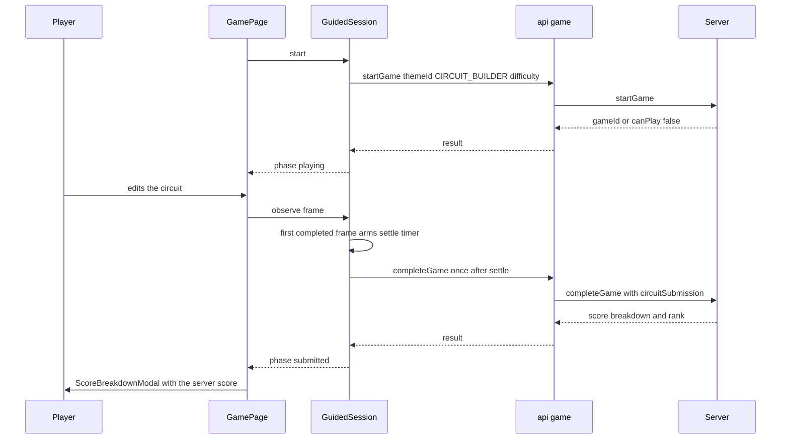
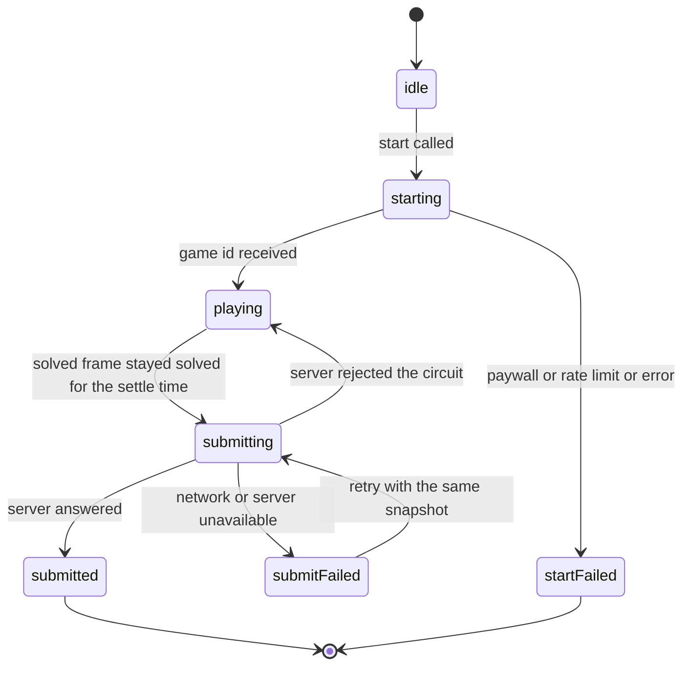

# Levels and Learning - Functional Design

**Unit**: U4 "Levels and Learning" - **Packages**: `apps/web` (primary), `packages/shared` (additive level definitions only) - **Nothing committed**

Every number below was produced by a command run during this unit (the engine through the tests in
`packages/shared/src/circuit/guided-levels.test.ts`, the probes in `.agents/tasks/u4/scratch/`, and the
runners recorded in `.agents/tasks/u4/verification.md`). Where the working tree could not confirm a claim
(browser behaviour), the claim is marked as unverified.

---

## 1. What this unit delivers

Eight guided levels (two per difficulty tier 1 to 4), a Setup page, a Game page and a Sandbox page behind
three new routes, a presentation layer that never shows a negative number, a Mars Rover panel, a fault
tooltip, a guided session that submits exactly once, and a sandbox that is structurally unable to call the
backend. Level data lives in the engine package so the server and the browser agree on the same definitions.

---

## 2. Levels

Target machine for all eight: `mars-rover`. Grids are within 24 x 16. Reference-layout ids: player-placed
parts are `e1, e2, ...` (what the reducer assigns), pre-placed parts are `pre-*`. Terminal notation is
`id:0` and `id:1`; terminal 0 of a battery is the positive terminal. Budget is
`sum(availableComponents) + prePlaced.length`, which is what the server computes (`level.prePlaced` plus the
tray allowance, wires included).

| # | Level id | Diff | Disclosure | Concept tag | Grid | Tray (availableComponents) | Pre-placed and locked | Budget | Success condition |
|---|---|---|---|---|---|---|---|---|---|
| 1 | `cb-01-closed-circuit` (existed, unchanged) | 1 | none | `closed-circuit` | 8x6 | battery 1, wire 4, led 1, resistor 1 | none | 7 | `rover-headlight-on` |
| 2 | `cb-02-switch-control` | 1 | none | `switch-control` | 8x6 | battery 1, resistor 1, led 1, wire 3 | `pre-switch` (3,2) | 7 | `rover-headlight-on` |
| 3 | `cb-03-series-loop` | 2 | qualitative | `series-circuit` | 10x6 | battery 1, resistor 1, led 1, buzzer 1, wire 3 | `pre-switch` (4,2) | 8 | `rover-headlight-on` |
| 4 | `cb-04-parallel-branches` | 2 | qualitative | `parallel-circuit` | 10x7 | battery 1, resistor 1, led 1, buzzer 1, wire 2 | `pre-switch-led` (4,1), `pre-switch-buzzer` (4,5) | 8 | `rover-headlight-on` |
| 5 | `cb-05-series-vs-parallel` | 3 | values | `series-vs-parallel` | 12x8 | battery 1, motor 2, led 1, buzzer 1, resistor 1, wire 3 | none | 9 | `rover-fully-powered` |
| 6 | `cb-06-short-circuit-recovery` | 3 | values | `short-circuit` | 8x6 | battery 1, resistor 1, led 1, wire 4 | none | 7 | `rover-headlight-on` |
| 7 | `cb-07-resistance-limits-current` | 4 | full | `resistance-limits-current` | 10x6 | resistor 2, wire 3 | `pre-battery` (1,3), `pre-led` (8,3) | 7 | `rover-headlight-on` |
| 8 | `cb-08-variable-voltage` | 4 | full | `variable-voltage` | 12x8 | battery 1, motor 1, led 1, buzzer 1, resistor 1, wire 3 | `pre-switch-master` (3,4), `pre-switch-headlight` (7,2) | 10 | `rover-fully-powered` |

`lockedElementIds` is every `pre-*` id. The supply defaults to 9 V and the light level to 1. A placed
resistor is 470 ohm; there is no resistance control in the UI (open item M12), so no level requires any
other resistor value.

**Deviation from the original plan**: `cb-08` has `wire 3` and budget 10 (plan: `wire 2`, budget 9). The
reference uses 7 parts; at budget 9 the efficiency term is 2/7 = 0.286 and the quality factor floors to 0 at
`faultCount` 6, which tied the fault-carrying bypass variant with the reference. Budget 10 keeps the
reference above the floor so "strictly lower for `faultCount` 0..6" holds (see section 8).

### 2.1 Reference solutions, rejected answers, penalised answers

"Rejected" means `evaluateSuccess(...).satisfied === false` with the real engine at 9 V, light 1. "Accepted
but penalised" means the objective is met and the engine reports a non-blocking fault, so the server score is
lower. All of these are asserted in `guided-levels.test.ts` (groups `reference solutions`, `rejected wrong
answers`, `accepted but penalised layouts`, `concept proofs`).

| Level | Reference connections (switches closed unless stated) | Rejected (unmet clause) | Accepted but penalised | Why it teaches |
|---|---|---|---|---|
| cb-01 | `e1` battery, `e2` resistor, `e3` led: `e1:0-e2:0, e2:1-e3:0, e3:1-e1:1` | LED reversed (`headlightOn`, fault REVERSED_POLARITY); no return wire (`headlightOn`); wire across the battery (`noBlockingFault` and `headlightOn`) | LED with no resistor (OVERCURRENT) | A current needs a complete loop, the right way round, with something limiting it |
| cb-02 | adds `pre-switch`: `e1:0-pre-switch:0, pre-switch:1-e2:0, e2:1-e3:0, e3:1-e1:1`, `pre-switch` closed | Same layout with `pre-switch` open (`headlightOn`); LED reversed | none listed | Opening a switch breaks the loop; test asserts closed passes and open fails |
| cb-03 | `e1` battery, `e2` resistor, `e3` led, `e4` buzzer, `pre-switch`: `e1:0-sw:0, sw:1-e2:0, e2:1-e3:0, e3:1-e4:0, e4:1-e1:1` | Switch open (`headlightOn`); buzzer not returned to the battery (`headlightOn`) | none listed | In series one open switch darkens the LED and the buzzer together; asserted with the engine |
| cb-04 | `e1` battery, `e2` resistor, `e3` led, `e4` buzzer, `pre-switch-led` (SW1), `pre-switch-buzzer` (SW2): `e1:0-SW1:0, SW1:1-e2:0, e2:1-e3:0, e3:1-e1:1, e1:0-SW2:0, SW2:1-e4:0, e4:1-e1:1` | SW1 open (`headlightOn`) | none listed | With SW2 open the LED stays lit and success still holds: branches are independent (the contrast with cb-03) |
| cb-05 | `e1` battery, `e2` and `e3` motors, `e4` resistor, `e5` led, `e6` buzzer, all loads in parallel, LED behind the resistor: `e1:0-e2:0, e1:0-e3:0, e1:0-e4:0, e1:0-e6:0, e4:1-e5:0, e2:1-e1:1, e3:1-e1:1, e5:1-e1:1, e6:1-e1:1` | Everything in one series loop fails `driveMotorTurning` at 9 V and at 12 V (motor intensity 0.33 and 0.36, below 0.5) | none listed | Series loads share the voltage and starve each other; a test computes that a series motor pair is dimmer than the parallel pair from the real engine |
| cb-06 | `e1` battery, `e2` resistor, `e3` led, `e4` wire: `e1:0-e2:0, e2:1-e3:0, e3:1-e4:0, e4:1-e1:1` | Wire across the battery (SHORT_CIRCUIT, unmet `noBlockingFault` and `headlightOn`); wire across the LED (`headlightOn`) | none listed | A short is a blocking fault the player recovers from: fuse, reset, remove the offending wire (section 5.3) |
| cb-07 | `pre-battery`, `pre-led`, `e1` resistor: `pre-battery:0-e1:0, e1:1-pre-led:0, pre-led:1-pre-battery:1` | LED reversed; resistor-only loop with the LED left out (`headlightOn`) | Two resistors in parallel (235 ohm, 33.9 mA, OVERCURRENT, still passes); no resistor (OVERCURRENT) | Resistance limits current; parallel resistors lower the total. Two resistors in series (940 ohm) is also a clean solve |
| cb-08 | `pre-switch-master` (SM), `pre-switch-headlight` (SH), `e1` battery, `e2` motor, `e3` buzzer, `e4` resistor, `e5` led: `e1:0-SM:0, SM:1-e2:0, SM:1-e3:0, SM:1-SH:0, SH:1-e4:0, e4:1-e5:0, e2:1-e1:1, e3:1-e1:1, e5:1-e1:1` | Master switch open (three unmet clauses); SH open (`headlightOn`); supply 1.5 V (`driveMotorTurning`) | Supply from 10.5 V up (OVERCURRENT, still passes) | Voltage matters: the objective fails at 1.5 V and 2 V and passes from 2.5 V (probe sweep); the test pins fail at 1.5, pass at 9 and at most one fault at every step 1.5 to 12 V |

Concept coverage against the requirements: CB-3.1 (cb-01), 3.2 (cb-02), 3.3 (cb-03), 3.4 (cb-04), 3.5
(cb-05), 3.7 and 3.8 (cb-06), 3.6 (cb-07), 3.9 and variable voltage (cb-08).

---

## 3. Numeric disclosure by persona

Disclosure is a pure function of difficulty (pinned by a test): `[none, qualitative, values, full][difficulty - 1]`.

| Difficulty | Tier | Levels | What the learner sees | Persona fit |
|---|---|---|---|---|
| 1 | none | cb-01, cb-02 | State glyph and word only. No digits, no unit tokens in the level copy (enforced by a regex test over goal, hint and learn in en, es, pt) | P1 Mateo, the younger learner |
| 2 | qualitative | cb-03, cb-04 | Adds a relative brightness bar and word (off, dim, medium, bright). No units in the copy | P1 Mateo moving up, P2 Sofia starting |
| 3 | values | cb-05, cb-06 | Adds supply voltage, per-part voltage and resistance | P2 Sofia, the older learner |
| 4 | full | cb-07, cb-08 | Adds current, drops, total resistance and total current | P2 Sofia wanting the full analysis |

The tension between P1 and P2 (a gentle visual experience against real numbers) is resolved by tiering, not
by a setting. Tiers are cumulative: key sets satisfy none, then qualitative, then values, then full (tested).

---

## 4. Voltage presentation rules (Constraint A)

**Constraint A**: positive voltages exist in the presentation layer only; the engine is not touched.
`apps/web/src/utils/circuitPresentation.ts` is the only module that converts.

Engine facts, read from the real engine by `.agents/tasks/u4/scratch/probe2.ts` (series battery, resistor,
LED at 9 V):

| Quantity | Raw engine value | Presented value |
|---|---|---|
| Node `e1:0` (battery +) | 0 | not shown |
| Node `e1:1` (battery -) | -8.991008991 | not shown (`positiveNodePotentials` shifts by the minimum so the minimum is exactly 0) |
| Node `e2:1` (between resistor and LED) | -8.451548451 | not shown |
| Battery current | -0.0180 | 18.0 mA (`current`, tier full) |
| Battery voltage drop | 8.991 | supply 8.99 V (largest absolute source current wins, ties by id) |
| Resistor voltage drop | 8.452 | 8.45 V |
| LED voltage drop | 0.539 | 0.54 V |
| Same circuit, battery wired backwards (probe2 case 3), resistor drop | -8.452 (current -0.0180) | 8.45 V (absolute value); the part state still comes from the fault list and energization |

Rules (each is a test in `circuitPresentation.test.ts`):

- Every number is `toDisplayMagnitude`: finite, absolute value, never `-0`, NaN and Infinity become 0.
- `supplyVoltage` is the absolute `voltageDrop` of the dominant source. `resistance` comes from the part spec
  or its `params.resistance`, only for resistor, led, motor and buzzer.
- State: `spark` if the part is in any fault, `dark` if not energized, `dim` if a rated part has intensity below
  0.4, else `lit`. Brightness label thresholds on intensity: 0 off, below 0.4 dim, below 0.75 medium, else bright.
- `totalResistance` and `totalCurrent` are reported only when a closed path exists, else 0.
- Units are SI symbols formatted with `Intl.NumberFormat(locale)`: `8.99 V` in en, `8,99 V` in es and pt-BR.
- Sweep 1.5 to 12 V in 0.5 V steps over series, parallel, mixed, reversed, reversed supply and short layouts at
  all four tiers: no negative, no `-0`, no non-finite number, Kirchhoff sums hold within 1e-6.

---

## 5. Session design

### 5.1 Guided session sequence

**Text alternative.** The Game page asks the session to start. The session calls `startGame` once with theme
`CIRCUIT_BUILDER` and the level's difficulty. If the server answers with a game id, the phase becomes playing.
The player edits the circuit and the page passes every frame to the session. The first frame that satisfies the
level arms a 750 ms settle timer. When the timer fires with the circuit still solved, the session calls
`completeGame` exactly once with the circuit submission. The server answers with the score breakdown and rank,
the phase becomes submitted, and the page shows the server score in the breakdown modal. No score exists
anywhere before that answer.

### 5.2 Guided session state machine

**Text alternative.** The session starts idle. `start` moves it to starting. A game id moves it to playing; any
start failure moves it to startFailed, and the page routes away (section 6). While playing, a solved frame that
stays solved for the settle time moves it to submitting. If the server accepts, it becomes submitted. If the
server rejects the circuit as unverifiable, it returns to playing with the latch released so the player can edit.
If the request fails for any other reason it becomes submitFailed, and `retry` resubmits the same snapshot.
Submitted and startFailed are terminal.

### 5.3 Sandbox

The sandbox has no state machine. `createSandboxSession()` returns `{ kind: 'sandbox', level }` where the level is
`getLevel('sandbox')`, and the sandbox page imports only the Surface, that factory, `useTranslation`,
`useNavigate` and `ROUTES`. It passes no `onFrame`, so nothing observes the circuit. A structural test builds
the static import graph (Vite `import.meta.glob` with `?raw`, because `@types/node` is absent), walks it from the
sandbox session and the sandbox page, and asserts the reachable set contains no `src/api/*`, `@apollo/client`,
`aws-amplify`, `circuitGameSession`, `useGuidedSession`, game page or setup page. A self-test proves the walker
sees edges (the guided graph does reach `api/game.ts` and `@apollo/client`), so the isolation test cannot pass
vacuously, and the sandbox page source contains neither `startGame` nor `completeGame`.

### 5.4 Recovery from a short circuit (CB-3.8)

Reducer plus engine test (`circuitRecovery.test.ts`): short the battery, `faultsEvaluated` gives `fuseBlown`
and `faultCount` 1, `resetFuse`, remove the offending connection, `evaluateSuccess` is satisfied, and the
payload carries `faultCount` 1. A second short after the reset counts a second fault. The fault tooltip never
navigates, submits or ends the attempt.

---

## 6. Submission and debounce design

- **Single submission**: `observe` ignores every frame unless the phase is `playing`. The first completed frame
  captures a snapshot (draft plus elapsed time) and arms a settle timer (default 750 ms). A later non-completed
  frame cancels and re-arms against the new snapshot. When the timer fires with the latch clear, the latch is
  set, the phase becomes `submitting`, and `completeGame` is called once. Fifty identical satisfied frames, or
  flapping frames, produce at most one call per settled completion. A frame with `fuseBlown` is never completed.
  The React binding (`useGuidedSession`) subscribes with `useSyncExternalStore`, starts in an effect and detaches
  in the cleanup.
- **Time**: the session owns time (injected `now()` minus the instant `startGame` succeeded). The value is an
  integer of seconds clamped to `[difficulty * 2, 3600]`, the server's own floor and ceiling, so a legitimately
  fast solve is not spuriously rejected. This cannot raise a score beyond what the server's capped speed term
  allows.
- **Payload** (`buildCompleteGameInput`): top level `{ gameId, completionTime, attempts: 1, circuitSubmission }`;
  `circuitSubmission` is exactly `{ levelId, layout: { elements, connections, gridSize }, switches, environment:
  { sourceVoltage, lightLevel }, faultCount }`. Every object is rebuilt by whitelist. There is no
  `completionTime` inside it because the server schema is strict.
- **Idempotent start**: `start()` is memoised, so React StrictMode's double effect (and detach then start) calls
  `startGame` once. `startGame` consumes the daily allowance, so a second call would cost a game.
- **No local score**: the state has no score field. `result` is the object `completeGame` returned (identity), and
  the only score the UI shows. A test asserts the session source contains no score computation and no `console.*`.

| Failure | Detection | Result | User sees |
|---|---|---|---|
| Server rejects the circuit (message contains `could not be verified`, or code `VALIDATION_ERROR`) | submit | `failure: rejected`, phase back to `playing`, latch released, identical circuit not auto-resubmitted | Generic inline message; can keep editing |
| Network or any other submit error | submit | phase `submitFailed`, `failure: unavailable`, snapshot kept | Inline banner with Retry; circuit and celebration stay visible |
| Retry while a request is in flight | `retry` | ignored | nothing |
| Response arrives after `detach` | resolution | state updates without throwing, nothing scheduled | nothing (hook unsubscribed first) |
| Server error text | any | never copied or displayed | generic localized text only |

### 6.1 Start-failure classification

`classifyStartFailure` never throws and never stores a message or stack. Rate-limit matching wins over paywall
when both match.

| Input | Class | Route |
|---|---|---|
| `canPlay: false` and tier FREE | paywall | `ROUTES.SUBSCRIPTION` with `{ premiumRequired: true }` |
| `canPlay: false` and any other tier | rateLimited | `ROUTES.RATE_LIMIT` with `{ rateLimited: true }` |
| Thrown error whose message contains `paid subscription`, `Upgrade to play` or `requires a paid`, or `extensions.code` `FORBIDDEN` | paywall | `ROUTES.SUBSCRIPTION` |
| Thrown error whose message contains `Rate limit`, or `extensions.code` `RATE_LIMIT_EXCEEDED` (also under `graphQLErrors[0]`) | rateLimited | `ROUTES.RATE_LIMIT` |
| Anything else (strings, null, undefined, other objects) | failed | `ROUTES.CIRCUIT_BUILDER_SETUP` with `{ startFailed: true }` |
| Started | started | none |

Existing games fall into a dead-end generic catch on the server's Free-tier `AuthorizationError`; U4 classifies
it to the subscription page instead.

---

## 7. Closed success registry limitation

`SUCCESS_CONDITIONS` has only `rover-headlight-on`, `rover-fully-powered` and `none`. Adding a key would change
an existing export of a production-deployed package, so every level reuses the first two. Consequence: the
predicate cannot require "series" or "parallel" topology. Series versus parallel is enforced only where the
engine genuinely discriminates (cb-05: one series loop cannot turn the motors) and is otherwise taught through
rover feedback and the cb-03 versus cb-04 behaviour tests. A stricter predicate needs an owner decision on the
registry. Recorded as residual risk R2.

---

## 8. Constraints B and C

### Constraint B - budget floor and fault cap

- **Budget floor**: `sum(availableComponents) + prePlaced.length >= 7` for every non-sandbox level (the U6
  contract; see `aidlc-docs/construction/backend-integration/functional-design/functional-design.md` section 4).
  Budgets in section 2.
- **Fault cap**: with one source of 12 V or less, a motor (rated 0.22 A) draws at most 12 / 60.5 = 0.198 A and a
  buzzer (rated 0.08 A) at most 12 / 180.5 = 0.066 A, both below rating. Only an LED (rated 0.02 A, polarized)
  can raise OVERCURRENT or REVERSED_POLARITY, once per LED. So every level has at most one LED and at most one
  source (battery plus solar), counting `prePlaced`, and a valid solve leaves at most one unresolved fault.
  Shorts and singular systems are blocking, invalidate the solve and never count. The test also derives the bound
  from the engine constants, so a constant change fails it, and runs a worst case (every load straight across the
  source at 12 V) per level.
- **No double listing**: a kind is never both pre-placed and in `availableComponents`, because the web tray counts
  pre-placed parts against the tray allowance while the server adds them.
- **Locked lesson parts**: a locked pre-placed element stays in the layout and counts regardless of wiring. If the
  lesson-bearing switches were in the tray, dropping an optional one would pay (cb-02 probe: bypassed optional
  switch scored 2210 against 1870 for the reference).

Mirrored score table (test-only `mirrorScore`, 90 s, `faultCount` 0, difficulty-dependent multiplier; the same
formula as `services/game/src/utils/circuit-builder.ts`, duplicated on purpose). The mirror is anchored by goldens
the U6 tests assert (cb-01 protected 2210, unprotected 2040; the 2100, 1005, 1590 triplet) and was cross-checked
against `ScoreCalculatorService.calculateCircuitBuilderBreakdown` on 8 levels x 180 combinations with 0
mismatches (recorded by FEAT-001; a scratch run, files removed, not re-run in this step).

Output of the afterAll table of `guided-levels.test.ts`, re-run in this step (only still-valid variants that meet
the objective are comparable):

| Level | Removed | Faults | Parts | Variant score | Reference score | Result |
|---|---|---|---|---|---|---|
| cb-01 | `e2` resistor | 1 | 2 | 2040 | 2210 | lower, asserted |
| cb-02 | `e2` resistor | 1 | 3 | 1700 | 1870 | lower, asserted |
| cb-03 | `e2` resistor | 1 | 4 | 2293 | 2646 | lower, asserted |
| cb-03 | `e4` buzzer | 0 | 4 | 3087 | 2646 | non-fault shortcut out-scores the reference (informational) |
| cb-04 | `e2` resistor | 1 | 5 | 1852 | 2205 | lower, asserted |
| cb-05 | `e4` resistor | 1 | 5 | 2780 | 3347 | lower, asserted |
| cb-06 | `e2` resistor | 1 | 3 | 3604 | 3964 | lower, asserted |
| cb-06 | `e4` return wire | 0 | 3 | 4685 | 3964 | non-fault shortcut out-scores the reference (informational) |
| cb-07 | `e1` resistor | 1 | 2 | 5483 | 5939 | lower, asserted |
| cb-08 | `e4` resistor | 1 | 6 | 3198 | 3998 | lower, asserted |

Removing any pre-placed switch is rejected by the engine as a variant (dangling nets); removing `pre-battery` or
`pre-led` (cb-07) fails the objective. Two shortcuts that add no fault (cb-03 dropping the optional buzzer, cb-06
dropping the optional return wire) out-score the reference: the success predicate does not need those parts. This
is expected from the efficiency formula, is not asserted, and is why the lesson-bearing parts are locked.

### Constraint C - every difficulty has a completable guided level

For each difficulty 1 to 4, the test finds at least two non-sandbox levels with `successConditionId` other than
`none` whose reference solution evaluates without error and satisfies the success condition with the real engine
(four tests, one per tier, all passing). The plan required one; the registry gives two.

---

## 9. Out of scope (U7b)

No catalog row, `GAME_FILTER_MAP`, `PREMIUM_GAMES`, leaderboard `GameType`, hub tile, `games.*` translation or theme
seed is added here. `/circuit-builder/setup` is exactly the path the catalog row will point at.

---

## 10. Mermaid validation record

Checked against `common/content-validation.md` by hand (no parser run in this step):

- Node and participant ids are alphanumeric (`Player`, `Page`, `Session`, `Api`, `Server`, state names).
- No raw parentheses, semicolons or quotes inside labels; message text uses plain words.
- Sequence arrows are `->>` and `-->>` only; state transitions use `-->` with a label after a colon.
- Each diagram is followed by a text alternative.
