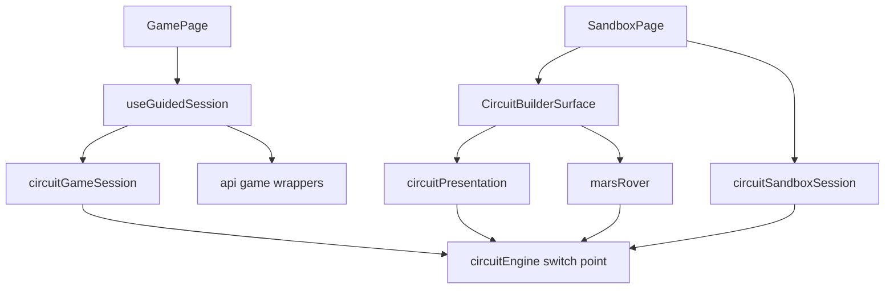

# Levels and Learning - NFR Design

**Unit**: U4 "Levels and Learning" - **Package**: `apps/web`

How the requirements in `../nfr-requirements/nfr-requirements.md` are built. Subjects: the seam design that
makes the session testable, the cleanup lifecycle, fail-closed behaviour, and the accessibility and performance
choices.

---

## 1. Seams and layering

**Text alternative.** The Game page uses the `useGuidedSession` hook. The hook is the only guided-side module that
imports the API wrappers, and it builds the session service with them. The session service and the presentation
and rover modules import the engine only through `utils/circuitEngine.ts`, the single switch point that keeps the
relative engine import. The Surface uses presentation and rover. The Sandbox page uses the Surface and the sandbox
session, which imports only the engine switch point. No arrow leads from the sandbox to the API, the hook or the
guided session.

Design choices:

- **Injected seams** (`api`, `now`, `schedule`) make the session a pure state machine in tests, with a manual
  clock and no real timers. The apps/web test environment is node with no jsdom, so behaviour lives in React-free
  modules.
- **One engine import point**: `circuitEngine.ts` keeps its BLOCKING DEPLOYMENT RISK comment unchanged; this unit
  added only exports below it (`DEFAULT_RESISTOR_RESISTANCE`, `MARS_ROVER`, `evaluateRoleActivation`, and the types
  `MachineRole`, `NumericDisclosure`, `TargetMachine`).
- **Additive Surface props**: `onFrame`, `celebrate`, `showRover`, `showReadout` are optional, so existing callers
  are unchanged. The reducer, renderer, interaction and geometry modules are untouched.

---

## 2. Session lifecycle and cleanup

| Event | Behaviour |
|---|---|
| Mount (effect) | `session.start()` runs; the start promise is memoised |
| StrictMode unmount then remount | `detach()` clears the timer and listeners; the second `start()` re-attaches and does not call `startGame` again |
| Solved frame | snapshot captured, settle timer armed through the injected scheduler |
| Frame changes before the timer fires | timer cancelled and re-armed against the new snapshot |
| Submit resolves | state updated; if detached, no throw and nothing scheduled |
| Unmount | `detach()` cancels the timer and drops listeners; the store subscription ends with the component |
| Next level | the Game page keys the guided body by level id, so a fresh session is built |

Text alternative for the table: the session owns exactly two resources, one timer and a listener list. Both are
released in `detach()`. Re-attaching after `detach()` is allowed but never repeats the network start.

---

## 3. Fail-closed behaviour

- A null engine result or a blown fuse deactivates every rover role (`deriveRoverView`); an unknown machine id
  yields no roles and does not throw.
- A non-finite viewport returns no fault overlay (`computeFaultOverlay`).
- `parseGameSearch` returns null for anything it cannot prove valid, and the page redirects to setup.
- `classifyStartFailure` maps every unrecognised value to `failed`, never to success.
- The submit path never copies server text; the user sees a generic localized line.

---

## 4. Accessibility design

- The rover encodes each role in at least two non-colour channels plus a text row ("On", "Off", "Not used here").
- The fault card is a non-modal tooltip: `pointer-events-none` container, `pointer-events-auto` card, no
  `aria-live`, dismissible with Escape or a button, never navigating or submitting.
- Placement math (`computeFaultOverlay`) flips the card below the faulty cell when the cell is in the top 28 per
  cent, and aligns start or end when the cell is within 18 per cent of the left or right edge, so the card stays
  inside the canvas and does not cover the faulty cell. The percentages are of the logical canvas, which is
  CSS-scaled, so they hold at any size.
- Reduced motion removes all animation and transition classes from the rover wheels and the card.

---

## 5. Performance design

- Frames are emitted from an effect keyed on `[layout, switches, environment, result, fuseBlown]`, not on the 1 s
  tick, so the session does no per-second work.
- Presentation and rover derivation are pure and cheap; they run once per frame.
- No asset fetches: the rover is inline SVG, and audio reuses the U5 synthesized cues (celebration plays once on
  the true edge of `celebrate`).
- The cost is bundle size (section 1 of the requirements document); runtime cost was not profiled in a browser.

---

## 6. Mermaid validation record

Checked by hand against `common/content-validation.md`: alphanumeric node ids, labels quoted where they contain
spaces, no raw parentheses, colons or semicolons in node text, valid `flowchart TD` arrows, and a text alternative
under the diagram. No Mermaid parser was run.
