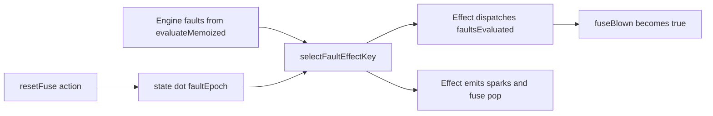
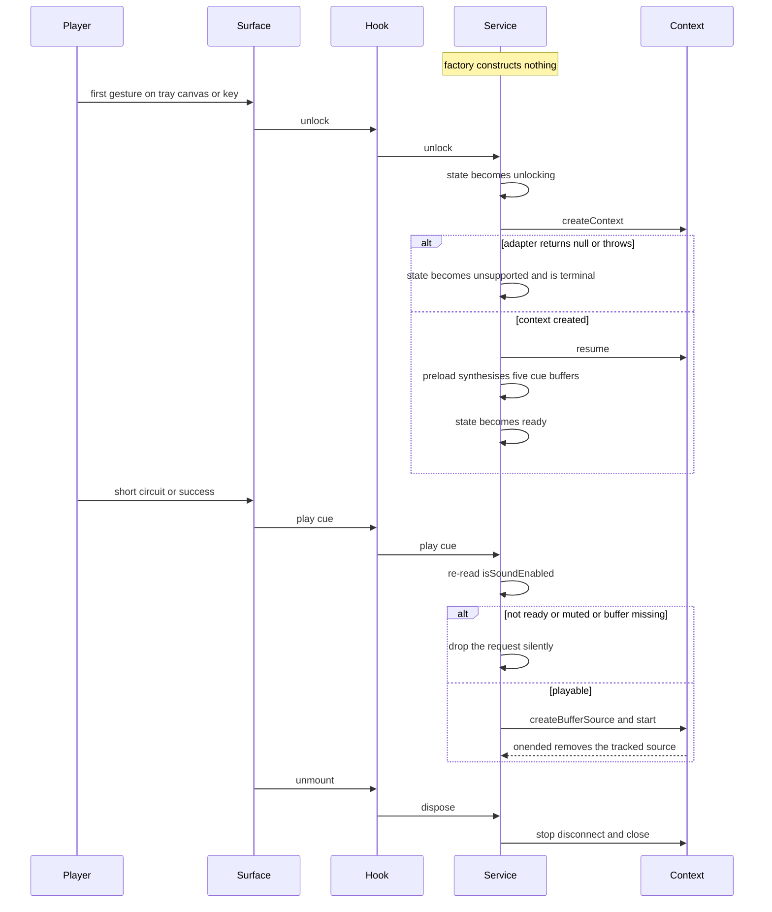

# Platform Quality — Functional Design

**Unit**: U5 "Platform Quality" · **Package**: `apps/web` · **HEAD**: `a328c74`, nothing committed

This unit owns four things U3 left open — accessibility completion, audio, the two remaining locales,
and the mobile layout — plus the three defects U3's own review confirmed. No Functional Design
existed for U5, so every design decision below is **made here**, not restated from an earlier
artifact.

---

## 1. The three inherited defects, as actually found in the code

Each was read in full in the file named. None is a generic description; each names the mechanism.

### Defect 1 — a reset fuse never re-blows on a circuit that is still shorted

**File**: `apps/web/src/pages/circuit-builder/CircuitBuilderSurface.tsx`, with the other half in
`apps/web/src/utils/circuitBuilderState.ts`.

**Mechanism**: the host computed `const faultSignature = faultCodes.join(',')` and used that string
as the **sole** dependency of the effect that dispatches `faultsEvaluated`. The reducer's
`case 'resetFuse'` committed only `{ fuseBlown: false }` — it changed neither the layout nor the
environment. So after a reset the engine re-evaluated the identical circuit, returned the identical
fault codes, `faultSignature` was byte-identical, React skipped the effect, `faultsEvaluated` was
never dispatched a second time, and `applyFaultsEvaluated` — the only code path that can set
`fuseBlown` — was never called. The circuit stayed drawn with the engine's true short-circuit
currents and the fuse never came back. The **same** stale key also suppressed spark re-emission,
because the spark/fuse-pop effect was keyed on `faultSignature` too.

A second, narrower bug lived in the same string: `join(',')` carries no position, so moving a short
to a different cell produced the identical key and emitted no new spark.

**Fix** (D1 and D2 below): a monotonic `faultEpoch` in reducer state plus a position-bearing key.

### Defect 2 — `SANDBOX_FALLBACK` was dead code duplicating engine level data

**File**: `apps/web/src/pages/circuit-builder/CircuitBuilderSurface.tsx`, lines 53–72 as U3 left it.

**Mechanism**: `const activeLevel = level ?? getLevel('sandbox') ?? SANDBOX_FALLBACK`.
`packages/shared/src/circuit/levels.ts` registers `sandbox` in a frozen `LEVELS` object, so
`getLevel('sandbox')` always returns a value and the third branch is **unreachable**. The constant
was a field-for-field copy of `LEVELS.sandbox` — including `targetMachineId: 'mars-rover'` and all
eight `availableComponents` counts — i.e. level content U4 owns, duplicated in a place where nothing
would ever notice it drifting out of step with the engine.

**Fix** (D3 below): delete the constant and split the component, so the level has exactly one source.

### Defect 3 — the 240-particle pool was rebuilt on every render

**File**: `apps/web/src/pages/circuit-builder/EffectsCanvas.tsx`, line 31 as U3 left it:
`useRef<CircuitEffects>(new CircuitEffects())`.

**Mechanism**: JavaScript evaluates the argument **before** the call. `useRef` then discards it on
every render but the first. `CircuitEffects`' constructor runs
`Array.from({ length: 240 }, emptyParticle)`, so each render allocated 240 objects and threw them
away — and the surface re-renders on every pointer **move** during a drag, which is exactly when the
allocation pressure matters least and hurts most.

**Fix** (D10 below): extract `lazyRefValue` so the single-construction property becomes assertable.

---

## 2. Decisions this unit owns

| # | Decision | Why the alternative was rejected |
|---|---|---|
| D1 | Key the host's post-evaluation effects on a monotonic `faultEpoch` in reducer state, not on `[faultSignature, fuseBlown]` | Keying on `fuseBlown` makes the effect depend on the very state it sets: it self-triggers and converges only because `applyFaultsEvaluated` happens to be idempotent. The epoch cannot loop by construction — dispatching `faultsEvaluated` changes `fuseBlown` but leaves `faultEpoch` and the engine's faults untouched, so the key is stable the instant after the dispatch. Cost: exactly one extra render per reset. |
| D2 | The key carries fault **positions**, not just codes — `code@col,row` per fault | Costs nothing and closes the separate confirmed finding that `join(',')` could not distinguish one short from a different short with the same code set. The spark effect consumes the same key, and position sensitivity is precisely what a positioned spark needs. |
| D3 | Fix defect 2 by splitting the component, not with a non-null assertion | `useReducer` cannot be called conditionally, so the level must be resolved before any hook runs. The default export is now a hook-free guard; the former body is a non-exported `CircuitSurfaceBody` taking a **required** `level: LevelDefinition`. Fails closed per SECURITY-15, keeps one source for level data, adds no file. |
| D4 | Synthesize audio buffers in-context; fetch nothing | The repository contains no audio assets at all (`apps/web/public` holds `traffic-sim.html` and `vite.svg`). Synthesis removes the network fetch, the 404 path and the asset-pipeline question in one move, and the `SoundLoader` seam lets a later unit swap in fetched files without touching the lifecycle. |
| D5 | Read the sound preference from `localStorage` only; deliberately do **not** consult the build-time flag | `env.features.enableSoundEffects` is read nowhere in the codebase and evaluates to `false` whenever `VITE_ENABLE_SOUND_EFFECTS` is unset. Honoring it would mute the game in every environment that has not opted in — a silent failure indistinguishable from a bug. The adapter reads `STORAGE_KEYS.SOUND_ENABLED` and **defaults to enabled**: absence of a preference is not a preference for silence, and a sound playing has no security consequence. |
| D6 | Reach terminal 1 from the keyboard with `Shift+Enter`, adding zero state and zero intents | Adding a `targetTerminal` field to `SelectionState` would either be set pointlessly by the pointer path, which already knows its terminal from the hit target, or become keyboard-only state — which is the one thing this architecture exists to prevent. `Shift+Enter` mirrors the existing `c` / `Shift+C` source-terminal convention, reuses the `shift` argument `resolveKeyIntent` already receives, and leaves the 11-member intent union untouched. |
| D7 | Mobile full-screen is a CSS overlay, not the Fullscreen API | See section 6. |
| D8 | U5 owns the educational fault **copy**; the positioned canvas tooltip stays U4's | NFR-CB-17 names educational tooltips as translation scope, but U3's stub S10 assigns the floating fault-positioned tooltip to U4. U5 adds `circuitBuilder.faultHelp.<CODE>` in all three locales and renders the line for the active fault in the surface's **existing** `aria-live="polite"` status row: the copy gets a real consumer and a real screen-reader path, the previously orphaned `fault.*` keys get used, and no positioned overlay and no level content is built. |
| D9 | Reduced motion changes one flag, never a second render path | See section 5. |
| D10 | Prove single construction by extracting the idiom, not by writing a comment | `utils/lazyRef.ts` exports `lazyRefValue(cell, create)` and is DOM-free, so a test can call it 100 times with a counting factory and assert the factory ran **once**. A comment in a React file would be an assertion with nothing checking it. |

---

## 3. The fault-effect key

**Text alternative.** `selectFaultEffectKey` takes two inputs: the fault list the engine returned
from `evaluateMemoized`, and `state.faultEpoch`. Its output string is the sole dependency of two
effects in the host — the one that dispatches `faultsEvaluated` and the one that emits sparks and the
fuse pop. The dispatch effect sets `fuseBlown` to true. The only thing that changes `faultEpoch` is
the `resetFuse` action, and only when that action actually clears a blown fuse. Because
`faultsEvaluated` changes neither input to the key, the dispatch effect cannot re-trigger itself;
because `resetFuse` changes one of them, an unchanged short produces a **new** key after a reset and
both effects run again. The recurrence of a short after a reset is the teaching moment CB-3.8 is
about, so an identical fault set after a reset must be treated as a new event, not a duplicate.

Key shape: `` `${faultEpoch}|` `` followed by one `` `${code}@${col},${row}` `` segment per fault,
joined with `;`, with `-` substituted for a missing `atPosition`. An empty fault list yields `0|`.

---

## 4. Audio lifecycle and gesture unlock

The service is `apps/web/src/services/audioService.ts` — a plain module with **no React import**,
because the `AudioContext` must outlive renders. The hook `useGameAudio` is a thin wrapper that holds
it in a lazy ref and disposes it in an unmount cleanup.

**Text alternative — the five steps of service S5, in order.**

1. **Construction does nothing.** `createCircuitAudio` creates no `AudioContext`, so a fresh page
   load cannot produce an autoplay console error. This is the literal content of CB-6.5.
2. **`unlock()` runs on the first user gesture.** It is synchronous and `void`-returning, and the
   surface calls it from `handleArm`, `handleKeyEvent` and — for the **activating** pointer phases
   `down` and `up` only — `handlePointerEvent`. A `move` or `cancel` phase deliberately does not
   unlock: a hover carries no user activation, and because `unlock()` is one-shot by state, spending
   it there is what would make a browser reject `resume()` and latch `unsupported`. It is idempotent
   by state, so no caller-side guard is needed beyond that phase filter. If the adapter returns
   `null` or throws, the service moves to `unsupported` permanently and silently.
3. **After the context exists, `resume()` then preload.** Preload is buffer synthesis (D4), one cue
   at a time, each in its own `try/catch`, so one failed cue leaves the other four playable. Only
   when preload settles does the state become `ready`.
4. **`play(cue)` returns immediately unless the state is `ready`.** It re-reads `isSoundEnabled()` on
   **every** call, which is what makes the mute toggle need no notification path (NFR-CB-14). A
   missing buffer is dropped silently rather than queued. Otherwise it starts a tracked source that
   `onended` removes. `play` is wrapped whole and can never throw, in any state.
5. **`dispose()` releases everything.** Every live source is stopped, disconnected and un-hooked, the
   buffer map is cleared, `close()` is called exactly once with a terminal `.catch(() => {})`, and
   every later `play` and `unlock` is a no-op. This is CB-6.6: navigating away gives immediate
   silence.

Every internal promise chain ends in a `.catch`, so no unhandled rejection can exist (SECURITY-15).
Nothing anywhere is logged, and no error object, code or message crosses a module boundary
(SECURITY-09).

**A cue requested in the same tick as the very first `unlock()` is dropped, by design** — `ready` is
reached a microtask turn later, not synchronously. In practice the first gesture precedes any fault
or success by many frames.

---

## 5. The keyboard model, key by key

`resolveKeyIntent` is the single keyboard entry point. Every row below emits a member of the
**existing eleven-member `InteractionIntent` union**; the union gained no member and `SelectionState`
gained no field. The whole terminal-reachability fix is one extra parameter on the private
`activateAtCursor(selection, state, shift)` and `terminalIndex: shift ? 1 : 0`.

| Key | Condition at the cursor | Intent emitted | Reducer action via `intentToAction` |
|---|---|---|---|
| `ArrowUp` `ArrowDown` `ArrowLeft` `ArrowRight` | always | `moveCursor` | none — selection-only |
| `Enter` or `Space` | a tray kind is armed and the cell is empty | `placeAt` | `place` |
| `Enter` or `Space` | a terminal is pending and an element is under the cursor | `completeConnection` with `terminalIndex: 0` | `connect` |
| `Shift+Enter` or `Shift+Space` | a terminal is pending and an element is under the cursor | `completeConnection` with `terminalIndex: 1` | `connect` |
| `Enter` or `Space` | a terminal is pending and the cell is empty | `cancel` | none — the pending terminal is cleared |
| `Enter` or `Space` | a switch is under the cursor | `toggleSwitch` | `toggleSwitch` |
| `Enter` or `Space` | any other element is under the cursor | `selectElement` | none — selection-only |
| `Enter` or `Space` | empty cell, nothing armed and nothing pending | none | none |
| `c` | an element is under the cursor | `beginConnection` with `terminalIndex: 0` | none — the pending terminal is recorded |
| `C` i.e. `Shift+c` | an element is under the cursor | `beginConnection` with `terminalIndex: 1` | none — the pending terminal is recorded |
| `c` or `C` | the cell is empty | none | none |
| `Delete` or `Backspace` | an element is under the cursor | `removeElement` | `remove` |
| `Delete` or `Backspace` | the cell is empty | none | none |
| `Escape` | always | `cancel` | none — arming, pending terminal and drag are cleared |
| Enter or click on a tray button | — | `selectTrayComponent` | none — the kind is armed |
| `Tab` and every other key | — | none, and the key is **not** in `CONSUMED_KEYS` | none |

**Why `Shift+Enter` rather than a new `SelectionState` field** (D6). Without it the keyboard could
only ever complete a connection on terminal 0, which is a strict **subset** of the circuits the
pointer can build, because a pointer release completes on whichever terminal it landed on. A
`targetTerminal` field would either be set redundantly by the pointer path or become keyboard-only
state — and the structural guarantee this architecture rests on is that there is exactly one
`SelectionState`, one intent union and one `intentToAction`. `shift` already arrives at
`resolveKeyIntent` and already means "the second terminal" for `Shift+C` on the source side, so
`Shift+Enter` on the target side is the same convention rather than a second one to learn. The
equivalence "`Shift+Enter` over the target produces the identical intent **and** the identical
`connect` action as a pointer release on that target's terminal 1" is then directly assertable, and
it is asserted.

`CONSUMED_KEYS` moved out of `GridCanvas.tsx` into `circuitBuilderInteraction.ts` and is now
exported, because it is input vocabulary rather than DOM. That makes two properties testable: that
the set and the resolver agree, and that `'Tab'` is **not** a member — the no-focus-trap regression
guard.

**Documented keyboard gaps under NFR-CB-6**, not silently omitted: `moveElementTo` and
`removeConnection` are reachable only from the pointer. Freeform wire routing and full
screen-reader narration of an arbitrary circuit graph remain out of scope, exactly as NFR-CB-6
states. A keyboard player is never stuck by the missing connection-removal: `Delete` on an element
already cascades its connections.

---

## 6. Reduced motion — substitution, not suppression

The adapter feeds the **existing** `reducedMotion` prop. `EffectsCanvas` already called
`CircuitEffects.setReducedMotion`, and `circuitBuilderRenderer.drawScene` already branched on
`scene.reducedMotion`. Nothing was forked. The explicit prop keeps precedence over the media query
when supplied — `const effectiveReducedMotion = reducedMotion ?? preferences.reducedMotion` — so
U3's tests and U4's future control both still work.

| Animation | What replaces it | Information the replacement preserves |
|---|---|---|
| Spark burst at a fault, 18–24 particles | one `StaticMark` with `kind: 'spark'` at the fault's own `cell` | **that a fault happened, and exactly where** — the mark carries the fault position, which is the teaching content of CB-3.8 |
| Fuse pop animation | one `StaticMark` with `kind: 'fuse'` at the pop position | that the fuse blew, and at which point in the circuit |
| Celebration burst | one `StaticMark` with `kind: 'celebration'` at the canvas-wide sentinel cell `col: -1, row: -1` | that a success happened; the sentinel says "the whole canvas", because a celebration has no single position |
| Marching dashes along energized traces | `lineDashOffset` is frozen and **static chevrons** are drawn along each energized connection | current direction and the energized-versus-dead distinction, which is one of CB-2.6's four non-colour channels |
| Motor rotor spin | rotor angle pinned to 0 | the motor still renders; intensity continues to drive the halo and ring channels, so series-versus-parallel brightness is still readable |
| The animation frame loop itself | `hasLiveAnimation` returns false, so no frame is scheduled | nothing is lost: the scene is already fully drawn, it simply stops being redrawn |
| Live particles at the moment reduced motion is turned **on** | they are retired immediately and the pool returns to zero | no half-faded animation is left mid-flight |

All static marks expire after `STATIC_MARK_DURATION_MS` (1600 ms), so marks cannot accumulate.

---

## 7. Mobile layout, and why the Fullscreen API was rejected

**Approach** (D7). `CircuitBuilderSurface` holds `const [fullScreen, setFullScreen] = useState(false)`
and renders an `lg:hidden` toggle button. When set, the root wrapper swaps to
`fixed inset-0 z-40 flex h-dvh w-screen flex-col-reverse overflow-hidden bg-slate-950`, with the
canvas host `min-h-0 flex-1`, the tray `shrink-0` and the controls column `shrink-0 px-3`. All of
those classes are conditional on `fullScreen`, so **the desktop class string is unchanged** and
`AppLayout` keeps owning the desktop shell (NFR-CB-10: standard shell on desktop, full-screen
permitted on mobile).

Four specifics, each load-bearing:

- **`h-dvh`, not `h-screen`.** Mobile browser chrome makes `100vh` overflow, which would push the
  tray off the bottom of the visible area — the opposite of the goal.
- **`flex-col-reverse`, so the tray is visually at the bottom** and reachable by thumb rather than
  overlaying the grid, while the **DOM order stays tray-first**. That is what keeps the tab order
  logical for the keyboard model in section 5.
- **The overlay escapes `AppLayout`'s `container mx-auto px-4 py-8` without editing `AppLayout`**,
  which this unit is forbidden to touch.
- **The exit affordance is a visible button, with no `document` keydown listener.** The canvas
  already consumes `Escape` to cancel a gesture, and one key doing two different things is a worse
  outcome than one more tap.

**Why not `requestFullscreen`.** Three concrete reasons, not a preference:

1. It returns a promise that can reject, which is an unhandled-rejection risk against SECURITY-15
   and would need a handler that has nothing useful to do.
2. On iOS Safari it is unavailable for non-video elements, so the primary target platform would
   silently get nothing.
3. It needs its own user gesture and its own permission path, and it is not reversible by a
   `setState`.

A CSS overlay produces the same visible result on every mobile browser, needs no permission, and is
reversible by a state update. Mobile is `< lg` (1024 px) — the breakpoint the component already used.
No new breakpoint was invented.

---

## 8. The build-time sound flag is deliberately not consulted

`env.features.enableSoundEffects` exists in `apps/web/src/config/env.ts` and is read **nowhere** in
the codebase. It evaluates to `false` whenever `VITE_ENABLE_SOUND_EFFECTS` is unset, which is every
environment that has not explicitly opted in. Wiring it would therefore mute the game by default and
present as a bug with no visible cause.

The decision is recorded here and in the header of `presentationPreferences.ts` so it is a decision
rather than an oversight. The single source of the sound preference is
`STORAGE_KEYS.SOUND_ENABLED` in `localStorage`, read tolerantly: `false` and `"false"` both mean off,
anything else — including absent, empty, malformed, or a getter that throws — means **on**. Absence
of a preference is not a preference for silence, and a sound playing has no security consequence.

---

## 9. Deviations from the plan as written

| # | Deviation | Reason |
|---|---|---|
| 1 | The `effects` accessor in `EffectsCanvas` is a `useCallback(..., [])` rather than a plain arrow, and is listed in three dependency arrays | A plain arrow is a new function every render, so `react-hooks/exhaustive-deps` reported it as a missing dependency on all three — and `--max-warnings 0` turns that warning into a failure. An empty-dep `useCallback` is stable, so listing it is a runtime no-op. |
| 2 | A **second** `eslint-disable-next-line react-hooks/exhaustive-deps` was needed, on `EffectsCanvas`' unmount cleanup | Reading `effectsRef.current` inside the cleanup is explicitly required, so an unmount before any effect call constructs nothing. The rule's remedy — copy the ref into a variable while the effect runs — would capture `null` on the first pass and never release the pool of a component that *was* used, i.e. the opposite of the leak it warns about. The directive carries that reasoning as a comment, and `--report-unused-disable-directives` confirms both directives are necessary. |
| 3 | Exactly **one** cast, `new Constructor() as AudioContextLike`, at the single boundary where a real context is produced | The real DOM types are a superset of the narrow structural types — notably `AudioBufferSourceNode.onended` is `((this, ev: Event) => any) \| null`, which cannot be assigned to a zero-argument handler type. Every other line is honestly typed and the node fake satisfies the interfaces exactly. |
| 4 | `readSoundPreference` accepts both `false` and `"false"` as an explicit off | The plan quoted the stored value inconsistently. Values are **written** with `JSON.stringify`, matching `utils/storage.ts`, and read tolerantly. |
| 5 | `ComponentTray` gained an optional `className` prop; the controls column gets `shrink-0 px-3` in full-screen | The tray must be `shrink-0` in full-screen while desktop markup stays byte-identical, and wrapping the tray in a div would have changed desktop markup. The controls column needs `shrink-0` because the overlay sets `overflow-hidden` and a default-shrink flex child would be squeezed and clipped; `px-3` restores the padding the root's `p-3` no longer provides. Both are conditional on `fullScreen`. |
| 6 | The copy-paste guard allow-list has **11** entries, not the 10 the plan named — `component.resistor.name` was added | The guard failed on `pt` only, because *Resistor* is exactly the word Brazilian school physics uses. Padding the label to something like *Resistor elétrico* purely to look different from English would have made it worse for the 8-to-16-year-old the text is written for. Spanish does not need the entry; it uses *Resistencia*. |
| 7 | The **mute** toggle is visible on desktop; only the **full-screen** toggle is `lg:hidden` | NFR-CB-14 requires a mute control generally. Hiding it on desktop would defeat its purpose. |

---

## 10. Security baseline

| Rule | How this unit satisfies it |
|---|---|
| SECURITY-15 — fail closed | Every browser capability call — `matchMedia`, `localStorage`, `createContext`, `resume`, `close`, `createBuffer` — sits in `try/catch` or ends in a terminal `.catch`. `play` can never throw in any lifecycle state. A missing level renders one localized line instead of crashing. Media-query listeners are detached with the API they were attached with, and the audio context is closed on unmount. `lazyRefValue` leaves nothing constructed if the component never used it. |
| no unhandled rejection | `unlock` is `void`-returning and every internal chain terminates in `.catch`. Two tests register a `process.on('unhandledRejection')` probe and assert it recorded nothing — one for a rejecting `resume()`, one for a rejecting `close()`. |
| SECURITY-09 — no internal detail reaches the user | Fault help and rejections are stable codes resolved through locale keys. The unavailable-level line carries no id, no code and no stack. Nothing new is logged anywhere in this unit, in any of the three locales. |
| SECURITY-10 | No dependency added, no lock file changed, no `npm install`, no registry call. |
