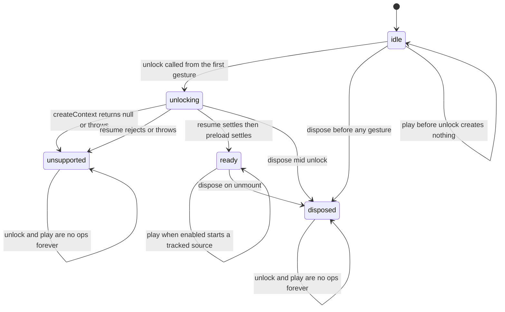

# Platform Quality — NFR Design

**Unit**: U5 "Platform Quality" · **Package**: `apps/web`

How the requirements in `../nfr-requirements/nfr-requirements.md` are actually built. Three subjects:
the audio context and buffer lifecycle, the cleanup design, and why reduced motion never becomes a
second render path.

---

## 1. Audio context and buffer lifecycle



**Text alternative — the state machine in prose.**

There are five states: `idle`, `unlocking`, `ready`, `unsupported`, `disposed`. A newly created
service is `idle`, and in `idle` it holds **no** `AudioContext` — the factory constructs nothing, so
no autoplay error is possible on a fresh page load. Calling `play` while `idle` returns immediately
and creates nothing at all.

`unlock()`, called from the first user gesture, moves `idle` to `unlocking` and asks the adapter for
a context. If the adapter returns `null` or throws, the service moves to `unsupported`. One further
failure transition exists out of `unlocking`: a **rejecting or throwing `resume()`** also makes the
service `unsupported`. Otherwise, once `resume()` has settled and preload has settled, it becomes
`ready`.

A failed preload does **not** make the service `unsupported`, and the code is deliberate about it:
`loadCue` resolves on a rejected loader and on a synchronous throw alike, so `Promise.all` over the
five cues always resolves and the state becomes `ready`. One failed cue therefore leaves the other
four playable — the concrete content of NFR-CB-16 — and in the extreme case where **every** cue
fails, the service is `ready` with an empty buffer map, which means every `play` finds no buffer and
is dropped silently. Silence, not an error, and never a stuck `unlocking`.

Because `unlock()` is one-shot — it returns immediately unless the state is `idle` — the first call
has to come from genuine user activation. That is a wiring obligation on the caller, not something
the service can enforce: `CircuitBuilderSurface` unlocks from the tray, from key events, and from
the `down` and `up` pointer phases only, never from `move`.

`ready` is the only state in which `play` can produce sound. Each `play` re-reads
`isSoundEnabled()`, and a muted service, a missing buffer, or any thrown error from the context
results in the request being dropped silently. A successful `play` starts a source that is tracked
until its `onended` fires.

**`unsupported` is terminal.** There is no transition out of it except `dispose`. This is deliberate
and it is the fail-closed choice: a browser that refused to give a context once will refuse again,
and retrying on every gesture would mean a failing call on every tap for the whole session. One
attempt, one permanent answer, no retry storm. `unlock` and `play` are both no-ops in `unsupported`,
and neither throws.

`disposed` is reachable from `idle`, `unlocking` and `ready`, and is likewise terminal: every later
`unlock` and `play` is a no-op. Disposal from `idle` is the cheap case — there is nothing to release,
because nothing was ever constructed.

### Why the service is a plain module and the hook is thin

The `AudioContext` must outlive renders, so `audioService.ts` imports no React. `useGameAudio` holds
the service through `lazyRefValue` — the same helper that fixed defect 3 — so the service is
constructed at most once no matter how often the surface re-renders during a drag. The caller's
`isSoundEnabled` callback is kept in a **ref that is reassigned every render**, which is what makes
`useGameAudio({ isSoundEnabled: () => preferences.soundEnabled })` safe to write inline: a fresh
arrow every render never re-creates the service.

`unlock` and `play` are stable `useCallback` identities so they can sit in dependency arrays. The
hook returns a fresh object literal every render, so the surface **destructures** it as
`{ unlock: unlockAudio, play: playAudio }`; depending on the object itself would invalidate the
`useCallback`s that keep `GridCanvas` from re-rendering.

### Buffer synthesis

Each cue is one `Float32Array` filled by a per-cue writer and handed to
`context.createBuffer(1, frames, sampleRate)` — mono, one channel. The writers are pure functions of
frame index and sample rate, which is why they are testable without a browser. Every sample goes
through `clampSample`, which rejects non-finite values, so a numeric mistake in a writer cannot
produce a buffer full of `NaN`. `sampleRate` is validated — finite and positive — with a fallback,
so a hostile or fake context cannot make `frames` non-finite.

Preload synthesizes each cue in **its own** `try/catch`. One failed cue leaves the other four
playable, which is the concrete content of NFR-CB-16.

---

## 2. Cleanup design

Four distinct resources, four distinct releases. Every one of them is on an unmount path, because
NFR-CB-15 and SECURITY-15 both require it.

### 2.1 Media-query listeners — torn down with the API they were attached with

`MediaQueryList` has two listener APIs: the modern `addEventListener('change', ...)` and the legacy
`addListener(...)` that older Safari still only offers. Mixing them leaks: `removeEventListener`
does not remove a listener added with `addListener`.

`subscribeReducedMotion` therefore decides **once**, at attach time, which API it is using, and the
unsubscribe it returns closes over that decision and mirrors it exactly — `removeEventListener` if it
attached with `addEventListener`, `removeListener` if it attached with `addListener`. It returns a
real unsubscribe function in **every** branch, including the branches where `matchMedia` is absent or
threw, so a caller never has to test whether it got one. A test drives the legacy-only object
through attach, fire, unsubscribe and a second fire, and asserts the listener was not called the
second time.

`usePresentationPreferences` calls the unsubscribe from its `useEffect` cleanup, so no listener
survives the surface.

### 2.2 Live audio sources — stopped, disconnected and un-hooked

The service keeps a set of the sources it has started. Each source is removed from that set by its
own `onended`, so a long session does not accumulate finished sources. `dispose()` walks whatever is
still live and, for each one, calls `stop()`, `disconnect()` and clears `onended` — the last of these
matters, because an `onended` that fires after disposal would otherwise mutate a set the service has
already abandoned. Each of those three calls is individually guarded, so a source that is already
stopped cannot abort the loop and leak the sources behind it.

### 2.3 The context — closed exactly once, with a terminal catch

`close()` returns a promise. `dispose()` calls it once, ends the chain in `.catch(() => {})`, and
sets the state to `disposed` **synchronously**, before the promise settles, so a `play` racing the
unmount is already a no-op. A test asserts `close()` was called exactly once, that a live source's
`stop()` was called exactly once, and that a `play` afterwards creates no new source. A second test
makes `close()` reject and asserts, through a `process.on('unhandledRejection')` probe, that nothing
was recorded.

Disposal lives in `useGameAudio`'s unmount cleanup, not in the component. The surface never calls
`dispose` — there is one owner of the lifecycle, which is how it stays impossible to dispose twice or
to forget.

### 2.4 `lazyRefValue` — nothing is constructed if the component never used it

```ts
export function lazyRefValue<T>(cell: { current: T | null }, create: () => T): T {
  cell.current ??= create()
  return cell.current
}
```

The nullish assignment, not `||=`: a factory that legitimately returns `0` or `''` must still be
cached, and `||=` would re-run it forever. The cell type is the structural `{ current: T | null }`,
which a `useRef<T | null>(null)` satisfies directly, so the helper needs no React import and is
testable as a plain function — 100 calls with a counting factory, one construction, the same instance
every time.

The symmetric property matters for cleanup: because the value is created on **first use** rather than
at render time, a component that mounts and unmounts without ever reaching an effect call has
constructed nothing, and its cleanup has nothing to release. `EffectsCanvas`' unmount cleanup
therefore reads `effectsRef.current` **inside** the cleanup and no-ops when it is `null`. This is the
reason the second `eslint-disable-next-line react-hooks/exhaustive-deps` exists: the rule's suggested
remedy — copy the ref into a variable while the effect runs — would capture `null` on the first pass
and then never release the pool of a component that *was* used, which is the opposite of the leak the
rule warns about.

### 2.5 Storage writes

`writeSoundPreference` is the only write this unit performs, through `JSON.stringify`, in a
`try/catch` that swallows the quota and private-mode failures that `localStorage.setItem` can throw.
A failed write means the preference does not persist across reloads; it never means a thrown error
reaches a render.

---

## 3. Reduced motion stays one flag

The requirement is NFR-CB-7: honor `prefers-reduced-motion` and **replace** spark and celebration
animation with a static indication. The design constraint this unit imposed on itself is that it must
not create a second render path, because two drawing paths diverge and only one of them gets tested.

### The thread, end to end

1. `presentationPreferences.readReducedMotion()` returns a `boolean`, defaulting to `false` whenever
   `matchMedia` is absent or throws. `subscribeReducedMotion` keeps it live.
2. `usePresentationPreferences()` seeds that value in a **lazy `useState` initialiser**, so the very
   first paint is already correct rather than rendering motion for one frame and then correcting it.
3. `CircuitBuilderSurface` computes
   `const effectiveReducedMotion = reducedMotion ?? preferences.reducedMotion`. The explicit **prop**
   keeps precedence over the media query when supplied, so U3's existing tests and U4's future
   in-game control both still work. For this to hold, `reducedMotion` had to stop defaulting to
   `false` in the props destructuring — a default would make `??` never see `undefined`.
4. That one boolean goes to exactly two places: `GridCanvas` and `EffectsCanvas`.

### What each of the two consumers does with it

Both branches **already existed** before this unit. Neither was added, forked or duplicated.

`EffectsCanvas` passes it to `CircuitEffects.setReducedMotion(enabled)`. Inside `CircuitEffects`:

- the flag is stored, and when it is turned **on** any live particles are retired immediately, so no
  animation is left mid-flight;
- `emitSparks`, `playFusePop` and `playCelebration` each push a `StaticMark` instead of spawning
  particles. The mark carries the same `cell` the particles would have used, except
  `playCelebration`, which uses the canvas-wide sentinel `{ col: -1, row: -1 }` because a celebration
  has no single position;
- marks expire after `STATIC_MARK_DURATION_MS` (1600 ms), so they cannot accumulate.

`GridCanvas` passes it into `scene.reducedMotion`, which `drawScene` reads at three points and
`hasLiveAnimation` at one:

| Line in `circuitBuilderRenderer.ts` | Effect of the flag |
|---|---|
| `hasLiveAnimation`, the `scene.reducedMotion \|\| ...` early return | no animation frame is scheduled at all, so a reduced-motion scene costs zero frames |
| `ctx.lineDashOffset = scene.reducedMotion ? ...` | the marching dashes freeze rather than disappear |
| `if (energized && scene.reducedMotion)` | static chevrons are drawn along energized connections, carrying the direction information the moving dashes carried |
| the motor rotor `angle` | pinned to 0 instead of advancing with `timeMs` |

**There is no `if (reducedMotion) drawReducedScene()` anywhere.** One scene object, one `drawScene`,
one `CircuitEffects`, four narrow branches inside them. That is what makes the substitution testable
without a browser: `circuitBuilderEffects.test.ts` can assert `activeParticleCount === 0` together
with `staticMarks.length === 1` and the mark's `cell`, because the substitution happens in a
clock-free, DOM-free module rather than in a renderer nobody can execute in a test.

### The propagation is asserted, not assumed

The adapter reaching the effects layer is itself a test, not a diagram: a case in
`presentationPreferences.test.ts` wires
`subscribeReducedMotion(enabled => effects.setReducedMotion(enabled))` to a real `CircuitEffects`
with a seeded random source, fires the fake media query with `matches: true`, calls `emitSparks`, and
asserts both halves — zero active particles **and** exactly one static mark. Zero particles alone
would be consistent with the effect having been suppressed, which is the failure mode NFR-CB-7
explicitly forbids.
