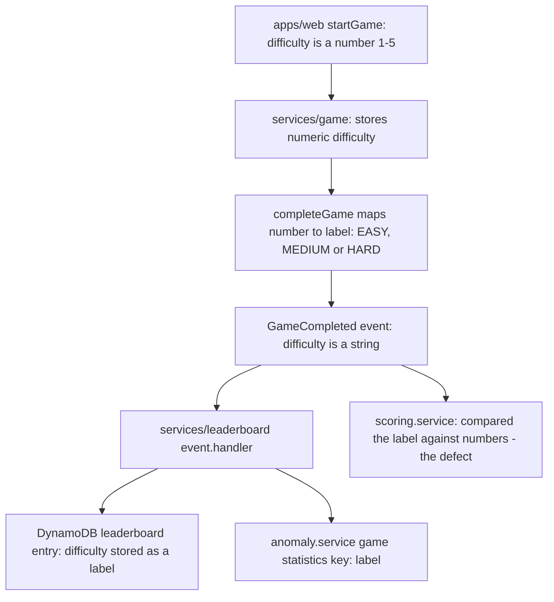

# U1 Prerequisite Enablement - Functional Design

**Unit**: U1 Prerequisite Enablement
**Stage**: CONSTRUCTION - Functional Design
**Requirements**: PRE-1 (PRE-1.1, PRE-1.2), PRE-2 (SECURITY-04, SECURITY-09, SECURITY-15)
**Stories**: CB-5.1, CB-5.2, CB-5.3
**Packages touched**: `services/leaderboard`, `apps/web`
**Scope note**: This unit contains no Circuit Builder feature code. No `GameType` was added (PRE-1.3).

---

## 1. PRE-1: The `Difficulty` type mismatch

### 1.1 Observed failure

`npx tsc --noEmit` in `services/leaderboard` failed with 30 instances of TS2365 across 15 call sites in
`src/services/scoring.service.ts`, all on the same expression:

```ts
const maxScoreByDiff = difficulty <= 1 ? 5000 : difficulty <= 2 ? 6500 : 8000;
```

`Difficulty` is a string enum in `src/types/index.ts` (`EASY`, `MEDIUM`, `HARD`, `BEGINNER`,
`INTERMEDIATE`, `ADVANCED`), so comparing it with `<=` against a number is not a legal TypeScript
operation. Because `ts-jest` type-checks as it compiles, three test suites could not run at all:
`scoring.service.test.ts`, `scoring.service.property.test.ts`, and `event.handler.test.ts`.

### 1.2 Root cause: where the number becomes a string

The unit-of-work brief assumed difficulty travels as a number 1-4 all the way through. It does not.
`apps/web` and `services/game` do use numbers, but the Game Service converts difficulty to a label
before it ever reaches the Leaderboard Service. In
`services/game/src/services/game.service.ts`, inside `completeGame`:

```ts
await this.eventPublisher.publishGameCompleted({
  ...
  difficulty: game.difficulty <= 1 ? 'EASY' : game.difficulty <= 2 ? 'MEDIUM' : 'HARD',
  ...
});
```

`services/game/src/types/index.ts` declares the event contract accordingly:
`GameCompletedEvent.difficulty: string`.

So the Leaderboard Service only ever sees `'EASY' | 'MEDIUM' | 'HARD'`. The broken expression is the
*same* ternary as the Game Service line above: it was copied from a module where `difficulty` really
is numeric into one where it is a label. The string enum in the Leaderboard Service is correct for
the data the service receives; the numeric comparison is the defect.



**Text alternative:** The web app sends a numeric difficulty (1 to 5) to `startGame`. The Game Service
stores that number. When a game completes, the Game Service converts the number into one of the
labels `EASY`, `MEDIUM` or `HARD` and publishes it in the `GameCompleted` event as a string. The
Leaderboard Service event handler consumes that string, persists it as a label on the DynamoDB
leaderboard entry, and uses it as part of the game-statistics key in the anomaly service. The
`scoring.service` module was the only consumer that treated the value as a number, which is the
defect.

Two independent pieces of evidence confirm the label form is the right one:

| Evidence | Implication |
|---|---|
| `scoring.service.loadConfiguration()` keys every `difficultyMultipliers` map with `[Difficulty.EASY]`, `[Difficulty.MEDIUM]`, `[Difficulty.HARD]` | Config lookups require label keys |
| `anomaly.service.getDifficultiesForGameType()` returns `[Difficulty.EASY, ...]` and those values form part of the DynamoDB game-statistics key | Labels are already persisted; switching to numbers would orphan existing rows |

Changing `Difficulty` to a numeric type would therefore have broken the multiplier lookups, the
anomaly-statistics key, and the data already written to DynamoDB. It was rejected.

### 1.3 Fix chosen

Keep `Difficulty` as the string enum. Remove the illegal numeric comparison and replace it with a
named constant that reproduces the existing runtime result exactly.

```ts
const MAX_SCORE_CAP = 8000;
...
finalScore = Math.min(MAX_SCORE_CAP, Math.max(0, Math.round(finalScore)));
```

**Why 8000 and not the tiered caps.** In JavaScript, `'EASY' <= 1` coerces the label with
`Number('EASY')`, which is `NaN`, and every relational comparison with `NaN` is `false`. Both branches
of the ternary were therefore always false, for every label, so the cap has always resolved to 8000.
Verified directly:

```
"EASY"  <=1: false  <=2: false  => cap 8000
"MEDIUM" <=1: false <=2: false  => cap 8000
"HARD"  <=1: false  <=2: false  => cap 8000
"BEGINNER" / "INTERMEDIATE" / "ADVANCED" / undefined => cap 8000
```

Applying the tiered caps (Easy 5000, Medium 6500, Hard 8000) that the deleted comment describes would
*lower* the maximum achievable score for easy and medium games across every existing game. That is a
product decision about live scoring, not a type fix, so it was not made. The constant is documented
in place with the reason.

### 1.4 Behavioural findings: documented, not fixed

Three behavioural defects surfaced. No production behaviour was changed for any of them; the owner
decided each case explicitly.

| # | Finding | Decision |
|---|---|---|
| B1 | The per-difficulty score cap has never taken effect; every difficulty is capped at 8000 | Preserve 8000. Enforcing the tiered caps would reduce easy and medium maximum scores for every existing game. |
| B2 | `languageLearning` defines multipliers only for `EASY`/`MEDIUM`/`HARD`. A `LANGUAGE_LEARNING` game arrives with `BEGINNER`/`INTERMEDIATE`/`ADVANCED`, so `config.difficultyMultipliers[difficulty]` is `undefined` and silently falls back to `1.0` | **Confirmed bug, not intended behaviour.** Left in place; the two affected tests now pin the `1.0` fallback with comments stating they pin a bug pending a decision. |
| B3 | `calculateRanks` documented "entries with the same score get the same rank" but breaks ties on `completionTime` | The implementation is defensible - in a timed game, the faster of two equal scores ranking higher is reasonable - and the comment was simply stale. The doc comment and the two affected tests were corrected to describe the tie-break. Whether completion time should break score ties at all remains an open product question. |

B1 and B2 have no production impact today, because `calculateScore` is never called outside tests:
the event handler uses `detail.score` from the Game Service as the single source of truth and only
calls `validateScore`, which does not read `difficulty`. B3 does affect production output, which is
why only its documentation, never its logic, was touched.

**B2 exact fix and consequence, for whoever decides it.** Add the three missing keys to
`languageLearning.difficultyMultipliers` in `scoring.service.loadConfiguration()`:
`[Difficulty.BEGINNER]: 1.0`, `[Difficulty.INTERMEDIATE]: 1.5`, `[Difficulty.ADVANCED]: 2.0`,
mirroring the `EASY`/`MEDIUM`/`HARD` values. Consequence: Language Learning scores rise by up to 2x
for intermediate and advanced play the moment `calculateScore` becomes a live code path. Today that
path is reached only from tests, so the change would be inert on merge and would activate later
without further notice - which is exactly why it needs a deliberate decision rather than a quiet fix.
The same naming drift should be checked for any other game that adopts its own difficulty labels.

### 1.5 Test suite state

The unit's completion criterion for tests was revised by the owner once this investigation showed the
original wording - "restore the leaderboard test suite to passing" - rested on the assumption that the
`Difficulty` mismatch was the only thing broken. It was not. The criterion is now:

1. `npx tsc --noEmit` exits 0 in `services/leaderboard` - this was the actual blocker for later units
2. Suites that previously could not compile now compile and run
3. Pre-existing failures unrelated to the `Difficulty` fix are documented, not fixed

Changes made to tests, all behaviour-preserving:

| Suite | Change |
|---|---|
| `event.handler.test.ts` | Failed to compile on TS2322 because its fixture omitted the required `score` field - a type error inside the package being repaired - so `score` was added. Four assertions still expected the handler to call `scoringService.calculateScore`, which it deliberately no longer does; they were re-pointed at the behaviour the handler actually implements, forwarding the event score to `createLeaderboardEntry`. Now 15/15. |
| `leaderboard.service.test.ts` | `should handle tied scores with same rank` renamed to `should break a score tie on completion time` and its assertions corrected to 1, 2, 3, with a comment recording that this pins current behaviour rather than endorsing it (B3). |
| `leaderboard.service.property.test.ts` | The rank-consistency property now asserts that equal scores share a rank only when completion times also match, and that otherwise the faster entry ranks better (B3). This also removes the seed-dependent flake. |
| `scoring.service.test.ts` | The two Language Learning multiplier assertions changed from 1.5 and 2.0 to 1, each with a comment stating plainly that it pins a confirmed bug pending a decision (B2). |

Production code change for documentation only: the stale doc comment on
`leaderboard.service.calculateRanks` now describes the completion-time tie-break it has always
implemented, and points at the open product question. No logic was altered.

Remaining failures are pre-existing with root causes unrelated to `Difficulty`, and are left in place
by decision. They are itemised with evidence in the implementation summary.

---

## 2. PRE-2 / SECURITY-04: HTTP security headers

### 2.1 Where the headers are set

`apps/web` is a static Vite build served by Vercel, with no server middleware. Response headers are
therefore configured in `apps/web/vercel.json` under `headers`, with `source: "/(.*)"` so they apply
to every response. `headers` and `rewrites` are independent: the existing SPA rewrite
(`/(.*)` to `/index.html`) is unchanged and still resolves client-side routes, and the header block
adds no routing behaviour.

### 2.2 Required headers, staged by breakage risk

The owner directed that the headers be split rather than all enforced at once, because a CSP cannot be
proven correct without a browser and a wrong directive takes the whole application offline.

| Header | Value | Mode | Note |
|---|---|---|---|
| `Strict-Transport-Security` | `max-age=31536000; includeSubDomains` | **enforcing** | one year, meets the baseline minimum |
| `X-Content-Type-Options` | `nosniff` | **enforcing** | |
| `X-Frame-Options` | `DENY` | **enforcing** | no page in the app is framed; see 2.4 |
| `Referrer-Policy` | `strict-origin-when-cross-origin` | **enforcing** | |
| `Content-Security-Policy-Report-Only` | see directive table below | **report-only** | browser applies nothing, logs would-be violations to the console |

The four enforcing headers carry essentially no breakage risk and deliver protection immediately. The
CSP ships report-only first. There is no `report-uri` or `report-to` directive, so violations are
console-only and nothing is collected server-side; verification is manual against the checklist in
`apps/web/SECURITY-HEADERS.md`.

Because `X-Frame-Options: DENY` is enforcing, framing protection is live now regardless of the
report-only `frame-ancestors 'none'`.

**Flipping to enforcement is a one-line change**: rename the header key
`Content-Security-Policy-Report-Only` to `Content-Security-Policy` in `apps/web/vercel.json`, leaving
the value untouched. JSON has no comment syntax and Vercel validates each header entry against a
`{ key, value }` schema, so that instruction, the policy, and the verification checklist live in
`apps/web/SECURITY-HEADERS.md`, adjacent to `vercel.json`.

**This is partial, deliberately staged satisfaction of SECURITY-04, not full compliance.** See 4.

### 2.3 CSP directive table

Every entry below was derived from the repository, not assumed.

| Directive | Value | Why each source is allowed |
|---|---|---|
| `default-src` | `'self'` | Baseline floor. Also covers `media-src`, `worker-src` and `manifest-src`, none of which the app uses: no `<audio>`/`<video>` element, no `new Worker`, no web manifest. |
| `script-src` | `'self'` | The built `dist/index.html` contains no inline `<script>` and no `onclick`-style handler; the only script is `/assets/index-*.js`. The bundle contains no `eval(` and no `new Function(`, so `'unsafe-eval'` is not needed. `@vercel/analytics` and `@vercel/speed-insights` resolve to the same-origin paths `/_vercel/insights/script.js` and `/_vercel/speed-insights/script.js` in a production build (the `va.vercel-scripts.com` variants in the package are the development and `dsn` code paths only). |
| `style-src` | `'self' 'unsafe-inline' https://fonts.googleapis.com` | `https://fonts.googleapis.com` serves the Poppins stylesheet, requested twice: a `<link rel="stylesheet">` in `index.html` and an `@import url(...)` at the top of `src/styles/index.css` that survives into the bundled CSS. `'unsafe-inline'` justification in 2.5. |
| `font-src` | `'self' https://fonts.gstatic.com` | The Google stylesheet references its woff2 files on `fonts.gstatic.com`. The built CSS contains no `data:` font URI, so `data:` is not allowed here. |
| `img-src` | `'self' data: https://upload.wikimedia.org` | `'self'` for `/vite.svg` and bundled assets. `data:` is required: the bundle emits `data:image/svg+xml` assets, `src/utils/puzzleUtils.ts` builds `data:image/svg+xml;base64,...` and calls `canvas.toDataURL()` for jigsaw pieces, and `src/pages/admin/LanguageMaintenancePage.tsx` uses a `data:` SVG as an image fallback. `upload.wikimedia.org` hosts the portrait images in `src/utils/historyQuizData.ts` (History Quiz). |
| `connect-src` | `'self'` | Same-origin fetches plus the Vercel analytics beacon `/_vercel/insights/event`. |
| | `https://*.execute-api.us-east-1.amazonaws.com` | The GraphQL endpoints for the auth, game and leaderboard services. A wildcard is used deliberately: three different API Gateway host IDs are in play across deployments - `3ra5uzpv5g` (`apps/web/.env.production`), `7pwns5lkof` (the env the `web` Vercel project actually builds with) and `l8ra6nktb6` (the hard-coded fallback in `src/context/AuthContext.tsx` and `src/pages/admin/AdminDashboard.tsx`) - and the host used by the `web-prod` project cannot be read from the repository. Pinning the wrong host would take the whole application offline. Tightening option in 2.6. |
| | `https://api.dashden.com` | Fallback leaderboard endpoint hard-coded in `src/api/leaderboard.ts`. |
| | `https://cognito-idp.us-east-1.amazonaws.com` | Amplify Auth calls the Cognito user-pool API here for sign-in, sign-up, confirmation, and session refresh. |
| | `https://*.auth.us-east-1.amazoncognito.com` | Hosted-UI OAuth code exchange (`/oauth2/token`) for Google sign-in. Three domain prefixes exist across deployments: `memory-game-dev` (default in `src/config/amplify.ts`), `memory-game-prod` (`.env.production`) and `dashden-prod` (the `web` project env). |
| | `https://ipapi.co` | Locale/country lookup in `src/api/language.ts`. |
| `frame-src` | `'none'` | No `<iframe>` exists in `src/`, `public/` or `index.html`, and the bundle creates none. Stripe and Cognito are both reached by top-level navigation, not by embedding. |
| `object-src` | `'none'` | No plugin content. |
| `base-uri` | `'self'` | Prevents injected `<base>` retargeting of relative URLs. |
| `form-action` | `'self'` | No form posts cross-origin. Stripe Checkout and the Cognito hosted UI are entered with `window.location.href`, which `form-action` does not govern. |
| `frame-ancestors` | `'none'` | Modern equivalent of `X-Frame-Options: DENY`; both are set. |

Not included, and why: no `wss:` in `connect-src` because `env.apiWsUrl` is declared in
`src/config/env.ts` but never read - there is no `WebSocketLink` or `GraphQLWsLink` in the app; no
`https://js.stripe.com` in `script-src` and no `https://*.stripe.com` in `frame-src` because
`@stripe/stripe-js` is listed in `package.json` but never imported, so Stripe.js never loads in the
browser; no `blob:` anywhere because `createObjectURL` is never called.

### 2.4 Framing decision

`X-Frame-Options: DENY` and `frame-ancestors 'none'` are safe because nothing in the application is
framed. `public/traffic-sim.html` was checked specifically, since a same-origin static page embedded
in an iframe would have forced `SAMEORIGIN`: `git grep -i traffic-sim` across the repository returns
no match, so the page is not embedded, linked, or routed anywhere. It is a leftover standalone
prototype of what became the React Traffic Lab game.

### 2.5 `'unsafe-inline'` in `style-src`: explicit justification

The security baseline requires any use of `'unsafe-inline'` to be justified in writing. It is used for
styles only, never for scripts.

1. **Framer Motion injects a stylesheet at runtime.** The production bundle contains
   `document.createElement("style")` followed by `sheet.insertRule(...)` inside Framer Motion's
   `AnimatePresence` pop-layout path. Per the
   [MDN `style-src` reference](https://developer.mozilla.org/en-US/docs/Web/HTTP/Reference/Headers/Content-Security-Policy/style-src),
   the specification treats the CSSOM methods that parse CSS strings - `insertRule()` and `cssText`
   setters - as requiring `'unsafe-eval'` in `style-src`, and browsers differ in how much of that they
   enforce. Framer Motion exposes a `MotionConfig nonce` prop precisely because this element trips CSP
   in practice. Framer Motion drives animation throughout the application, so a policy that blocks it
   has an app-wide failure mode. (Content was rephrased for compliance with licensing restrictions.)
2. **React style props.** The app uses `style={{ ... }}` extensively. React applies these through the
   CSSOM rather than as an HTML `style` attribute, which browsers generally do not block, but several
   browsers still emit `style-src-attr` violation reports for them.
3. **The nonce alternative is unavailable.** A per-response nonce requires a server or edge function to
   generate it. This deployment is static output plus `vercel.json`; there is no request-time hook, so
   a nonce-based `style-src` cannot be implemented without adding middleware - a larger change than
   this unit allows.

Residual risk is CSS-based exfiltration and style-driven UI redressing. `script-src` stays at `'self'`
with no `'unsafe-inline'` and no `'unsafe-eval'`, which is where the material XSS exposure would be.

### 2.6 Known consequence and tightening path

| Item | Detail |
|---|---|
| `/traffic-sim.html` will stop working once the policy enforces | The page loads `https://cdn.tailwindcss.com`, an inline `<script>`, and inline `onclick` handlers. All three violate `script-src 'self'`. The page is unreferenced anywhere in the repository, so no application route or link is affected. Decision: **leave it broken, and do not delete it.** Deleting a file is destructive and not a side effect that belongs in a security-headers change - the owner may know why it exists. A scoped loose-CSP carve-out was rejected as the worst option, because it would permanently weaken a security control for a file nothing uses and set a precedent for further exceptions. Recommended as separate, deliberate cleanup by the owner. |
| Wildcard tightening | Once the `web-prod` project's `VITE_*` endpoint values and Cognito domain are confirmed, the two wildcards can be replaced with the exact hosts. |
| Preview deployments | The Vercel preview toolbar loads from `https://vercel.live`, which this policy would block once enforcing. Production is unaffected. |

---

## 3. PRE-2 / SECURITY-09 and SECURITY-15: error handling

### 3.1 ErrorBoundary behaviour change

`apps/web/src/main.tsx` previously stored `error.message + '\n' + error.stack` in component state and
rendered it into a `<pre>`, so any unhandled render error printed a stack trace to the user.

| Aspect | Before | After |
|---|---|---|
| State | `{ hasError: boolean; error: string }` holding message and stack | `{ hasError: boolean }` only, so no error text can reach the DOM |
| User-visible text | Red heading plus the full message and stack trace | "Something went wrong" and "Sorry, this page could not be displayed. Please try again." |
| Recovery | "Go to Hub" button | "Reload page" and "Go to Hub" buttons |
| Logging | `console.error('BOUNDARY:', error.message, info.componentStack)` | `console.error('Unhandled UI error:', error.name)` |

Only `error.name` is logged. The message, the stack, and the React component stack are all dropped:
an error message can carry request or response fragments, and the component stack discloses internal
structure. `error.name` keeps a breadcrumb that something failed and what class of error it was.

The screen keeps inline `style` props rather than Tailwind classes, matching the existing code, so the
fallback still renders if the stylesheet is the thing that failed. Those props are applied through the
CSSOM and are not affected by `style-src`.

### 3.2 Fail-closed review of auth error paths

Reviewed, no change needed. Every error path denies rather than grants.

| Path | Error behaviour | Verdict |
|---|---|---|
| `src/context/AuthContext.tsx` `checkAuthSession` | `catch` clears the stored user and token, `finally` sets `isLoading` false; `user` stays `null`, so `isAuthenticated` (`!!user`) is `false` | Fails closed |
| `src/components/common/ProtectedRoute.tsx` | Renders `Loading` while `isLoading`, then `Navigate` to login when `!isAuthenticated`; children render only on success | Fails closed |
| `src/hooks/useAdminGuard.ts` | `catch { setIsAdmin(false) }`; initial state is `null` and `AdminDashboard` only loads data when `isAdmin === true` | Fails closed |
| `src/api/client.ts` Apollo `onError` | On `Unauthorized`/`Token expired` clears tokens and redirects to `/login` | Fails closed |
| `ErrorBoundary` | Replaces the subtree with the fallback screen; renders no protected content, and "Go to Hub" targets a protected route that re-runs the guard | Fails closed |

Two pre-existing issues were found in this review and are **not** changed here, because both sit
outside PRE-2's scope and belong to rules PRE-3 defers:

- `src/api/client.ts` logs the first 50 characters of the Amplify token to the console
  (`'[Auth Link] Token from Amplify:'`). Partial, signature-free, but still token material in logs -
  SECURITY-03, deferred.
- `src/pages/admin/AdminDashboard.tsx` and `src/pages/admin/LanguageMaintenancePage.tsx` render
  `err.message` into the page. Admin-only screens, and the authoritative admin check is server-side -
  SECURITY-08/09 on existing surfaces, deferred.

---

## 4. Security baseline compliance

| Rule | Status | Basis |
|---|---|---|
| SECURITY-01 Encryption | N/A | No data store is created or configured by this unit. |
| SECURITY-02 Access logging | N/A | No network intermediary is created or configured. |
| SECURITY-03 App logging | Compliant for changed code | The ErrorBoundary logs only `error.name`; no token, PII, or stack. Pre-existing token logging in `src/api/client.ts` is recorded above and deferred per PRE-3. |
| SECURITY-04 HTTP headers | **Partial - deliberately staged, not met** | Four of the five headers are enforcing: HSTS at 31536000 with `includeSubDomains`, `nosniff`, `X-Frame-Options: DENY`, and `strict-origin-when-cross-origin`. The CSP is present as `Content-Security-Policy-Report-Only`, so no CSP is enforced yet and the rule is **not** satisfied. `'unsafe-inline'` is used for `style-src` only and justified in 2.5; `script-src` has neither `'unsafe-inline'` nor `'unsafe-eval'`. To complete the rule: load the app in a browser, walk every page and flow in the checklist in `apps/web/SECURITY-HEADERS.md` on both `dev.dashden.app` and `dashden.app`, confirm zero violation reports, then rename the header key to `Content-Security-Policy`. |
| SECURITY-05 Input validation | N/A | No API handler or input surface is added or altered. |
| SECURITY-06 Least privilege | N/A | No IAM policy or role is touched. |
| SECURITY-07 Network config | N/A | No VPC or firewall layer in this architecture. |
| SECURITY-08 Access control | Compliant for changed code | No authorization logic changed; all reviewed error paths deny by default (3.2). |
| SECURITY-09 Hardening | Compliant | No stack trace or internal detail is reachable in the UI from the ErrorBoundary. `X-Content-Type-Options: nosniff` is set. |
| SECURITY-10 Supply chain | N/A | No dependency added, removed, or upgraded. |
| SECURITY-11 Secure design | N/A | No new security-critical logic introduced. |
| SECURITY-12 Authentication | N/A | The Cognito flow is unchanged. |
| SECURITY-13 Integrity | Compliant for changed code | No external script is added. The policy blocks the unpinned `cdn.tailwindcss.com` script on the orphan prototype page rather than allowing it (2.6). |
| SECURITY-14 Alerting | N/A | No alerting or retention configuration is in scope. |
| SECURITY-15 Exception handling | Compliant | A top-level boundary exists at the app entry point, returns a generic response, and all reviewed error paths fail closed (3.2). |

SECURITY-04 is intentionally incomplete and is recorded as such rather than claimed. The staging was
an explicit owner decision, taken because enforcing an unverified CSP on a live production app risks
an outage; the remaining step is browser verification, not further code.
