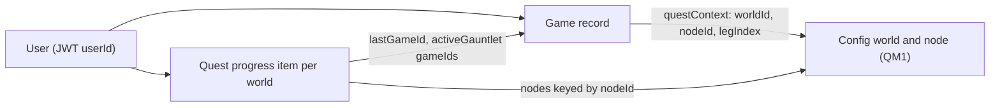

# Domain Entities - QM2 Backend and Table
**Stage**: CONSTRUCTION - Functional Design (minimal), unit QM2
**Basis**: `quest-map-component-methods.md`, QM1 `domain-entities.md` and `packages/shared/src/quest/types.ts` (pure types are defined there and not repeated), plan `quest-map-backend-functional-design-plan.md`
**Scope**: what QM2 persists and returns. Technology details of the table are in the infrastructure design.

---

## 1. Stored: quest progress item (one per user per world)

Logical key: `userId` (from the verified JWT) + `worldId` (a config world id, for launch content `brain-peaks` or `science-island`).

| Attribute | Type | Required | Notes |
|---|---|---|---|
| `userId` | string | yes | Partition key. Never taken from input |
| `worldId` | string | yes | Sort key. Always a config world id (validated before any write) |
| `nodes` | map `nodeId -> NodeProgress` | yes | `NodeProgress` = `stars` (0 to 3), `bestScore`, `firstClearedAt` (`''` until 1 star), `lastPlayedAt`, `lastGameId?` |
| `totalStars` | number | yes | Convenience copy. Recomputed by the evaluator on every read and write; never trusted |
| `badges` | list of `BadgeId` | yes | Empty list allowed. Awarded once |
| `activeGauntlet` | map | no | `nodeId`, `legs` list of `{gameId, score}`, `startedAt`, `lastActivityAt`. Omitted when no attempt is active |
| `version` | number | yes | 1 on first save, +1 on each save. Optimistic lock |
| `updatedAt` | string (ISO 8601) | yes | Set from the service clock |

An item is created lazily by the first completion in a world. Reads of a missing item mean `emptyWorldProgress`.

## 2. Existing entity extended: game record
`Game` (table `memory-game-games-{env}`, key `userId` + `gameId`) gains optional `questContext: { worldId, nodeId, legIndex }`. Stored value is the validated, stripped object (zod output of Q3), never the raw input. Games without the attribute behave exactly as today.

## 3. Derived, never stored
| Entity | Built from | Where |
|---|---|---|
| `ValidatedQuestStart` | parsed context + config lookups | `QuestService.validateStart` |
| `QuestResultPayload` | evaluator outcome + gauntlet status | `QuestService.applyCompletion`, returned as `completeGame.quest` (or `null`) |
| `QuestProgressView` | config + stored items + catalog availability + rate-limit usage + tier | `QuestService.getProgressView` |
| `RateLimitInfo` (read-only) | the rate-limit record read by `checkLimit` | `RateLimiterService.getUsage` |

## 4. Relationships

**Text alternative:** A user owns one progress item per world and many game records. A game record points at a config world and node through its quest context. The progress item is keyed by node id and remembers the last game id applied to each node and the game ids of the active boss attempt, which is how duplicate completions are recognised.

## 5. Constraints
- Item size stays far below the 400 KB DynamoDB limit (about 9 nodes per world, one attempt of at most 3 legs).
- `worldId` and `nodeId` stored in the item always passed config lookup, so no user-controlled string becomes a key or a map key.
- No attribute holds PII.
