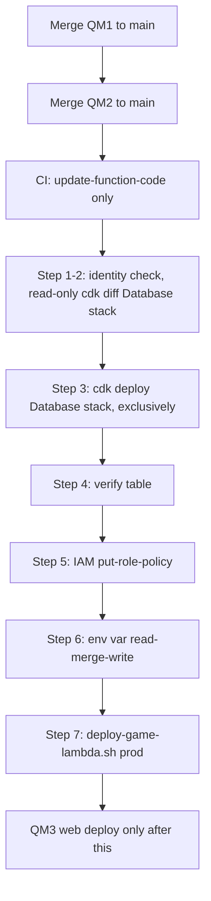

# Deployment Architecture - QM2 Backend and Table
**Stage**: CONSTRUCTION - Infrastructure Design (minimal), unit QM2
**Basis**: `infrastructure-design.md`, `quest-map-unit-of-work-dependency.md` section 3, `.github/workflows/deploy-lambdas.yml`, `scripts/deploy-game-lambda.sh`

> **STATUS: NOT EXECUTED.** Every command in sections 3 to 7 is a written procedure. No AWS, CDK or `aws` command has been run for this feature. The owner runs them later, one step at a time, with approval. Stop at the first unexpected result.
>
> **Prod facts**: profile `dashden-new`, account `342278407349`, region `us-east-1`, Lambda `MemoryGame-GameService-prod`, table `memory-game-quest-progress-prod`. The default profile is the old account (`848403890404`) and must never be used for prod.
>
> **Forbidden against prod** (open item O3): `infrastructure/scripts/deploy.sh prod`, `cdk deploy --all`, `cdk deploy MemoryGame-Lambda-prod`, `--require-approval never`. A CDK deploy of the Lambda stack would replace the Game Lambda code with a root-level bundle while the live handler is `dist/index.handler`, breaking every game start and completion. `cdk diff` cannot reveal this.

---

## 1. Release flow


**Text alternative:** QM1 and QM2 are merged to main. CI updates the function code only. The owner then checks identity, runs a read-only CDK diff of the Database stack, deploys only that stack, verifies the table, adds the IAM policy, merges the environment variable, runs the canonical Game Lambda deploy script, and only then deploys the web app.

Until step 6, quest operations fail closed and normal games are unaffected (the variable is not in `validateEnvironment()`).

## 2. Owner-run prod steps (summary)
| # | Action | Mutates? |
|---|---|---|
| 0 | Merge QM1, then QM2, to `main`; CI runs `update-function-code` | CI |
| 1 | Confirm the CLI identity is account `342278407349` | No |
| 2 | `cdk diff MemoryGame-Database-prod` must show exactly one new table plus added Outputs/exports | No |
| 3 | `cdk deploy MemoryGame-Database-prod --exclusively` (approval prompt on) | Yes |
| 4 | Verify the table (key schema, billing, SSE, PITR) | No |
| 5 | `put-role-policy` on the Game Lambda role, table ARN only | Yes |
| 6 | Env var by read-merge-write | Yes |
| 7 | `./scripts/deploy-game-lambda.sh prod` | Yes |

## 3. Step 1 - confirm identity (read-only)
```powershell
aws sts get-caller-identity --profile dashden-new --region us-east-1
```
Expected: `Account` is `342278407349`. Anything else: stop.

## 4. Step 2 - read-only CDK diff (gate)
Run from a clean checkout of `main` that contains QM2 (`git status` clean, correct commit).
```powershell
cd infrastructure
npx cdk diff MemoryGame-Database-prod -c environment=prod --profile dashden-new --exclusively
```
**Pass** only if the diff shows all of:
- exactly one new resource, of type `AWS::DynamoDB::Table`, with `TableName` `memory-game-quest-progress-prod`, key schema `userId` HASH and `worldId` RANGE, `PAY_PER_REQUEST`, SSE enabled, point-in-time recovery enabled, `DeletionPolicy`/`UpdateReplacePolicy` `Retain`;
- under `[+] Outputs` only added entries (the explicit `QuestProgressTableName` and the CDK-generated cross-stack export entries for the table name and ARN) that reference the new table.

**Stop (O1) if** any existing resource is modified, replaced or removed; any existing table appears; any Output or export is removed or changed; or the stack does not exist. Then use the fallback in section 9, or ask the owner. `-c environment=prod` is the same context flag the existing deploy script uses.

## 5. Step 3 and 4 - deploy the table and verify
```powershell
# Step 3 (mutating). Leave the approval prompt on. Never add --require-approval never.
npx cdk deploy MemoryGame-Database-prod -c environment=prod --profile dashden-new --exclusively
cd ..

# Step 4 (read-only)
aws dynamodb describe-table --table-name memory-game-quest-progress-prod --profile dashden-new --region us-east-1 --query "Table.{Status:TableStatus,Keys:KeySchema,Billing:BillingModeSummary.BillingMode,SSE:SSEDescription.Status,Arn:TableArn}"
aws dynamodb describe-continuous-backups --table-name memory-game-quest-progress-prod --profile dashden-new --region us-east-1 --query "ContinuousBackupsDescription.PointInTimeRecoveryDescription.PointInTimeRecoveryStatus" --output text
```
Expected: `Status` ACTIVE; keys `userId` HASH and `worldId` RANGE; `Billing` PAY_PER_REQUEST; `SSE` ENABLED; PITR `ENABLED`; `Arn` `arn:aws:dynamodb:us-east-1:342278407349:table/memory-game-quest-progress-prod`.

## 6. Step 5 - IAM policy on the live Game Lambda role
Least privilege: four actions, the one table ARN, read and write in separate statements, no index resource, no wildcard.
```powershell
$fn   = 'MemoryGame-GameService-prod'
$tmp  = Join-Path $env:TEMP 'quest-map-prod'
New-Item -ItemType Directory -Force $tmp | Out-Null

# Role ARN of the live function; the role name is the last path segment
$roleArn  = aws lambda get-function-configuration --function-name $fn --profile dashden-new --region us-east-1 --query Role --output text
if ($LASTEXITCODE -ne 0 -or -not $roleArn) { throw 'could not read role' }
$roleName = ($roleArn -split '/')[-1]
"Role: $roleName"      # confirm it is the Game Lambda's role before continuing

$policy = @'
{
  "Version": "2012-10-17",
  "Statement": [
    {
      "Sid": "QuestProgressRead",
      "Effect": "Allow",
      "Action": ["dynamodb:GetItem", "dynamodb:Query"],
      "Resource": "arn:aws:dynamodb:us-east-1:342278407349:table/memory-game-quest-progress-prod"
    },
    {
      "Sid": "QuestProgressWrite",
      "Effect": "Allow",
      "Action": ["dynamodb:PutItem"],
      "Resource": "arn:aws:dynamodb:us-east-1:342278407349:table/memory-game-quest-progress-prod"
    }
  ]
}
'@
$policyFile = Join-Path $tmp 'quest-policy.json'
[IO.File]::WriteAllText($policyFile, $policy, (New-Object Text.UTF8Encoding($false)))

# Mutating: adds one NEW inline policy. Existing policies are not touched.
aws iam put-role-policy --role-name $roleName --policy-name QuestProgressTableAccess --policy-document ("file://" + ($policyFile -replace '\\','/')) --profile dashden-new --region us-east-1

# Verify (read-only)
aws iam get-role-policy --role-name $roleName --policy-name QuestProgressTableAccess --profile dashden-new --region us-east-1
```
Expected: the returned document equals the one above. Note: `UpdateItem` was removed after Code Generation confirmed the quest repository uses only GetItem, Query and PutItem (SECURITY-06).

## 7. Step 6 - environment variable by read-merge-write
`aws lambda update-function-configuration --environment` **replaces all variables**. Passing only the new one would delete the others (Stripe ARNs, table names, `EVENT_BUS_NAME` and more). This procedure reads, backs up, merges and verifies. The backup file holds the full configuration (secret ARNs): it lives in `$env:TEMP`, outside the repository, and is deleted at the end.
```powershell
$fn  = 'MemoryGame-GameService-prod'
$tmp = Join-Path $env:TEMP 'quest-map-prod'
New-Item -ItemType Directory -Force $tmp | Out-Null

# 1. Read the live configuration and keep a backup
$raw = aws lambda get-function-configuration --function-name $fn --profile dashden-new --region us-east-1 --output json
if ($LASTEXITCODE -ne 0) { throw 'read failed' }
$rawText = $raw -join "`n"
[IO.File]::WriteAllText((Join-Path $tmp 'config-backup.json'), $rawText, (New-Object Text.UTF8Encoding($false)))
$cfg = $rawText | ConvertFrom-Json
if (-not $cfg.Environment -or -not $cfg.Environment.Variables) { throw 'no existing variables found; stop and review' }

# 2. Copy every existing variable, then add the new one
$vars = [ordered]@{}
foreach ($p in $cfg.Environment.Variables.PSObject.Properties) { $vars[$p.Name] = [string]$p.Value }
$before = $vars.Count
if ($vars.Contains('QUEST_PROGRESS_TABLE_NAME')) { throw 'variable already set; stop and review' }
$vars['QUEST_PROGRESS_TABLE_NAME'] = 'memory-game-quest-progress-prod'
"Before: $before variables. To write: $($vars.Count) variables."   # must be before + 1

# 3. Write the full merged map
$envFile = Join-Path $tmp 'env.json'
[IO.File]::WriteAllText($envFile, (@{ Variables = $vars } | ConvertTo-Json -Depth 5 -Compress), (New-Object Text.UTF8Encoding($false)))

# 4. Mutating
aws lambda update-function-configuration --function-name $fn --environment ("file://" + ($envFile -replace '\\','/')) --profile dashden-new --region us-east-1 --query "{State:LastUpdateStatus,Count:length(Environment.Variables)}"
aws lambda wait function-updated --function-name $fn --profile dashden-new --region us-east-1

# 5. Verify: count is before + 1, every old variable unchanged, Handler unchanged
$after = (aws lambda get-function-configuration --function-name $fn --profile dashden-new --region us-east-1 --output json) -join "`n" | ConvertFrom-Json
$afterVars = @{}; foreach ($p in $after.Environment.Variables.PSObject.Properties) { $afterVars[$p.Name] = [string]$p.Value }
"After: $($afterVars.Count) variables (expected $($before + 1)). Handler: $($after.Handler) (expected dist/index.handler)"
foreach ($p in $cfg.Environment.Variables.PSObject.Properties) { if ($afterVars[$p.Name] -ne [string]$p.Value) { "CHANGED: $($p.Name)" } }
if ($afterVars['QUEST_PROGRESS_TABLE_NAME'] -ne 'memory-game-quest-progress-prod') { 'MISSING NEW VARIABLE' }
```
Expected: `After` equals `before + 1`, no `CHANGED:` line, no `MISSING` line, handler `dist/index.handler`. If anything differs, restore from `config-backup.json` using the same merge approach (write back the original `Environment.Variables` map) and stop.

Cleanup after step 7 passes:
```powershell
Remove-Item -Recurse -Force (Join-Path $env:TEMP 'quest-map-prod')
```

## 8. Step 7 - canonical code deploy
```powershell
./scripts/deploy-game-lambda.sh prod
```
This is the workspace's only approved Game Lambda code deploy (rebuilds the zip from scratch, checks the handler, smoke tests). CI already published the same source on merge; this step is the canonical, verified deploy and keeps the env var (the script does not touch environment variables).

Post-checks (read-only): a Game Service smoke call, and, once QM3 is live, loading the map as a signed-in user. PL1 to PL3 (themes published, catalog `ACTIVE`, thresholds calibrated) are separate owner checks from `quest-map-unit-of-work.md`.

## 9. Fallback if the Database stack is not what is live (O1)
Use only if the step 2 gate says stop and the owner agrees. Not executed.
```powershell
aws dynamodb create-table --table-name memory-game-quest-progress-prod `
  --attribute-definitions AttributeName=userId,AttributeType=S AttributeName=worldId,AttributeType=S `
  --key-schema AttributeName=userId,KeyType=HASH AttributeName=worldId,KeyType=RANGE `
  --billing-mode PAY_PER_REQUEST `
  --sse-specification Enabled=true,SSEType=KMS `
  --profile dashden-new --region us-east-1
aws dynamodb wait table-exists --table-name memory-game-quest-progress-prod --profile dashden-new --region us-east-1
aws dynamodb update-continuous-backups --table-name memory-game-quest-progress-prod `
  --point-in-time-recovery-specification PointInTimeRecoveryEnabled=true --profile dashden-new --region us-east-1
```
`SSEType=KMS` without a key id uses the AWS managed key `aws/dynamodb`, the same as `AWS_MANAGED`. Then continue at step 4 (verify) and step 5. A CLI-created table is outside CloudFormation; CDK later would need an import, so record this in the owner notes.

## 10. Rollback
| What | How |
|---|---|
| Code | Revert the commit, then `./scripts/deploy-game-lambda.sh prod` (no automated rollback in `deploy-lambdas.yml`) |
| Env var | Same read-merge-write as step 6, with `QUEST_PROGRESS_TABLE_NAME` removed from the map; verify the count is previous minus one |
| IAM | `aws iam delete-role-policy --role-name <role> --policy-name QuestProgressTableAccess --profile dashden-new --region us-east-1` |
| Table | Keep it (`RETAIN`, additive, empty or holding player progress). Deleting is a separate, explicitly approved decision |
| Web | Vercel rollback (QM3) |

## 11. Dev
The table is created by the CDK Database stack in dev. The dev Lambda is `MemoryGame-GameService-dev` (default profile, old account). Whether the dev Lambda is CDK-deployed end to end was not inspected; the owner confirms, and otherwise uses the same steps 5 to 7 with the default profile, the dev table ARN (account `848403890404`) and `./scripts/deploy-game-lambda.sh dev`. Unverified.
