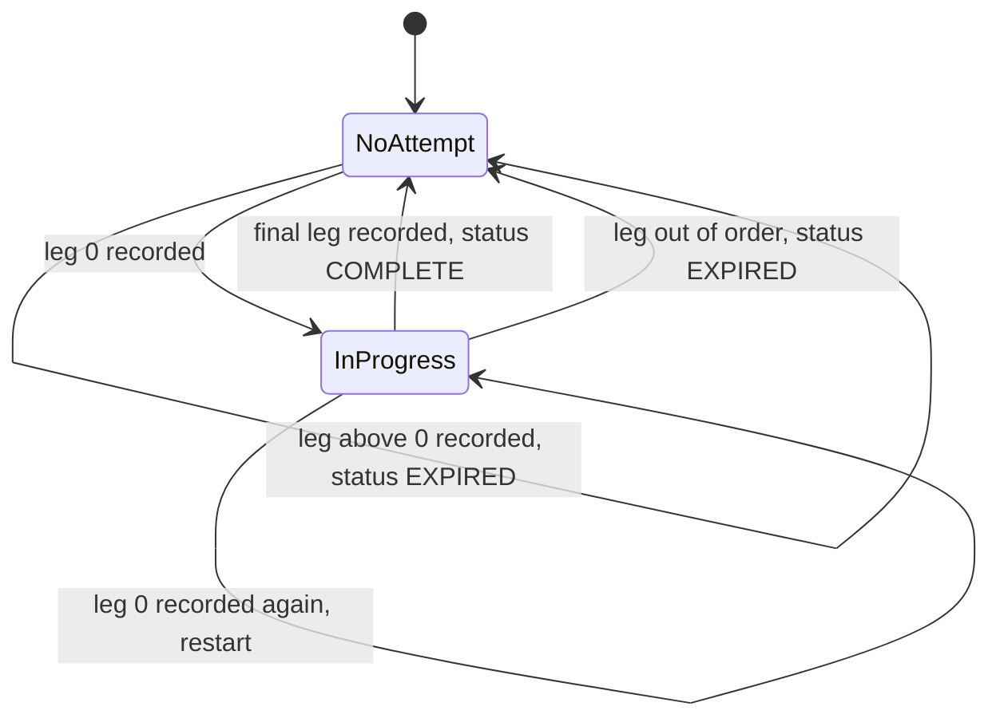

# Business Logic Model - QM1 Shared Quest Core

**Stage**: CONSTRUCTION - Functional Design, unit QM1
**Basis**: `quest-map-component-methods.md` (signatures), `domain-entities.md`, `business-rules.md`
**Properties for every function below**: pure, deterministic, no I/O, no `Date.now()` (time is an argument), inputs never mutated (NFR-QM-12). The same functions can evaluate a v2 weekly node list: they take a `QuestWorld`-shaped list, not the two launch worlds.

---

## 1. Score to stars - `starsForScore(thresholds, score)`

```text
if score is not a finite number         -> 0
if score >= thresholds[2]               -> 3
else if score >= thresholds[1]          -> 2
else if score >= thresholds[0]          -> 1
else                                    -> 0
```
Thresholds are inclusive lower bounds. A score exactly on a threshold earns that star. For a BOSS the `score` is the combined score of all legs. The numbers are in `thresholds.md`.

## 2. Derived helpers (internal, shared by the functions below)

```text
availablePath(world, ctx) = world.nodes without ids in ctx.unavailableNodeIds      (boss included, bonus never)
starsOf(progress, nodeId) = progress?.nodes[nodeId]?.stars ?? 0
effectiveBonusThreshold   = min(world.bonusStarThreshold, 3 * length(availablePath))
```

## 3. Totals - `totalStars(world, progress, ctx)`

`sum(starsOf(node) for node in availablePath(world, ctx))`. The stored `WorldProgress.totalStars` is ignored. Unavailable nodes and the bonus node add nothing, even if they hold stars. The maximum is `3 * length(availablePath)`.

## 4. Node statuses - `computeNodeStatuses(world, progress, ctx)`

One pass over `world.nodes` in path order with a running flag `unlocked` (initially `true`, so node 1 is available):

```text
for node in world.nodes:
    if node.id in ctx.unavailableNodeIds:     status = UNAVAILABLE
    else if starsOf(node) > 0:                status = AVAILABLE      (stars imply available)
    else if unlocked:                         status = AVAILABLE
    else:                                     status = LOCKED

    # does the NEXT node unlock?
    if starsOf(node) > 0:                     unlocked = true         (FR-QM-5: 1 star or more unlocks n+1)
    else if node is UNAVAILABLE:              unlocked = unlocked     (counts as passed, but only if it was itself reachable)
    else:                                     unlocked = false        (0 stars: n+1 stays locked)
```

Bonus node (not part of the chain):

```text
if bonus.id in ctx.unavailableNodeIds:                      UNAVAILABLE
else if starsOf(bonus) > 0:                                 AVAILABLE
else if totalStars(...) >= effectiveBonusThreshold:         AVAILABLE
else:                                                       LOCKED
```

Why `unlocked = unlocked` for an unavailable node: a removed game must not open the path past nodes the player never reached (for example node 5 removed while node 4 is unplayed must leave node 6 locked). A removed game also must not block the path once its predecessor is passed (QM-13, AC18). Why "stars imply available" and unlock the next node: if a config edit inserts a new node in front of nodes the player already starred, the player's earlier progress is not taken away (FR-QM-11, "no progress is lost").

`isNodeStartable(world, nodeId, progress, ctx)` = the computed status of `nodeId` is `AVAILABLE`; an unknown id returns `false`. Replaying a starred node is therefore allowed. World tier access is **not** checked here (QM2 does it, FR-QM-6).

## 5. Apply a result - `applyNodeResult(world, progress, { nodeId, score, nowIso, gameId? }, ctx)`

```text
1. node = path node or bonus node with id nodeId; if none: throw Error('Unknown quest node')
2. base = progress ?? emptyWorldProgress(world.id, nowIso)          (copy, never mutate)
3. before = computeNodeStatuses(world, progress, ctx) and bonus status; badgesBefore = base.badges
4. s = (score is finite and >= 0) ? score : 0
5. earned    = starsForScore(node.thresholds, s)                    # this play
   prev      = base.nodes[nodeId]
   bestScore = max(prev?.bestScore ?? 0, s)
   bestStars = max(prev?.stars ?? 0, earned)                        # never decreases
6. next = {
     stars: bestStars, bestScore,
     firstClearedAt: prev.firstClearedAt if it is non-empty, else (bestStars >= 1 ? nowIso : ''),
     lastPlayedAt: nowIso,
     lastGameId: gameId ?? prev?.lastGameId }                        # set even when the score did not improve
7. nodes' = base.nodes with nodeId -> next
   progress' = { ...base, nodes: nodes', totalStars: totalStars(world, {nodes'}, ctx), updatedAt: nowIso,
                 badges: union(base.badges, computeBadges(...)) }    # activeGauntlet, version, worldId copied unchanged
8. after = statuses of progress'
   newlyUnlocked = ids (path order, then bonus) with before == LOCKED and after == AVAILABLE
9. badgesAwarded = badges of progress' not in base.badges
   worldCleared  = WORLD_CLEARED in badgesAwarded                    # one-shot flag (plan Q1)
10. return { progress', stars: earned, bestStars, score: s, newlyUnlocked, worldCleared, badgesAwarded }
```

Consequences (the property tests of the unit of work assert these):
- A lower score never lowers `stars` or `bestScore` (steps 5 and 6).
- Applying the same result twice gives the same `progress'` as applying it once; the second outcome reports `newlyUnlocked: []`, `badgesAwarded: []`, `worldCleared: false`. All fields of the result (`nowIso`, `gameId`) are written the same way on the second pass.
- `newlyUnlocked` never contains a node that was already `AVAILABLE`, `UNAVAILABLE` or the node just played.
- The unlock chain is monotonic: the set of `AVAILABLE` nodes after a result is a superset of the set before it (stars only rise; the helper rules only look at `stars > 0`, `ctx` and the bonus total, which only rises).
- `activeGauntlet` is not touched here. For a boss, `QuestService` calls `recordLeg` first, stores its `attempt` (or clears it) and then calls `applyNodeResult` with the combined score when the status is `COMPLETE`.

`firstClearedAt` is the empty string until the first result of 1 star or more (plan Q4). `version` is the repository's concern (QM2).

## 6. Badges - `computeBadges(world, progress, ctx)`

Returns `progress.badges` plus anything newly earned, in the fixed order `WORLD_CLEARED`, `WORLD_MASTERED`. A badge is never removed, even if config later changes (FR-QM-13: awarded once).

```text
boss = last node of world.nodes
WORLD_CLEARED  earned when
    starsOf(boss) >= 1
    OR ( boss is unavailable AND boss is reached )          # reached = the unlocked flag at the boss in the chain of section 4
WORLD_MASTERED earned when
    availablePath is not empty AND every node in availablePath has 3 stars
```

The bonus node never counts for either badge. "Reached" for an unavailable boss means every earlier node was passed (starred, or unavailable and itself reachable), so the badge still needs the player to play the world (plan Q2, business rule R-BADGE-3).

## 7. Gauntlet rules

### 7.1 Expiry - `isGauntletExpired(attempt, nowMs)`

```text
last = Date.parse(attempt.lastActivityAt)
if last is not finite                 -> true                 (fail closed, plan Q9)
return (nowMs - last) >= GAUNTLET_TTL_MS
```
A clock that is behind `lastActivityAt` gives a negative age, which is not expired. The age is measured from the last **completed** leg, never from `startedAt`.

### 7.2 Leg start - `canStartLeg(attempt, node, legIndex, nowMs)`

```text
if node.kind != BOSS                         -> legIndex == 0
if legIndex is not an integer or < 0 or >= node.legs.length -> false
if legIndex == 0                             -> true          (always allowed: starting over replaces any attempt)
else true only if: attempt exists AND attempt.nodeId == node.id
                   AND NOT isGauntletExpired(attempt, nowMs)
                   AND attempt.legs.length == legIndex
```
This is the **only** place expiry is evaluated. A leg that passed `canStartLeg` is never rejected at completion for taking long.

### 7.3 Recording a leg - `recordLeg(attempt, node, { legIndex, gameId, score, nowIso })`

```text
a. Idempotent on gameId (checked first):
   if attempt exists and attempt.nodeId == node.id and attempt.legs[legIndex]?.gameId == gameId
       -> return { attempt (unchanged), status: IN_PROGRESS }          # nothing is written
b. if legIndex is not an integer or < 0 or >= node.legs.length         -> { attempt: undefined, status: EXPIRED }
c. legIndex == 0:
       newAttempt = { nodeId, legs: [{gameId, score}], startedAt: nowIso, lastActivityAt: nowIso }   # replaces any attempt
       if node.legs.length == 1 -> { attempt: undefined, status: COMPLETE, combinedScore: score }
       else                     -> { attempt: newAttempt, status: IN_PROGRESS }
d. legIndex > 0:
       require attempt exists AND attempt.nodeId == node.id AND attempt.legs.length == legIndex
           else -> { attempt: undefined, status: EXPIRED }              # out of order
       updated = { ...attempt, legs: [...attempt.legs, {gameId, score}], lastActivityAt: nowIso }
       if legIndex == node.legs.length - 1 -> { attempt: undefined, status: COMPLETE, combinedScore: combineLegScores(updated.legs scores) }
       else                                -> { attempt: updated, status: IN_PROGRESS }
```

`combineLegScores(scores)` = the sum, where a non-finite or negative entry counts as 0.

A duplicate of the **final** leg arrives with no attempt left (a COMPLETE result clears it). `recordLeg` cannot see it and would return `EXPIRED` for `legIndex > 0`. That is why `QuestService` first compares `NodeProgress.lastGameId` with the game id and, on a match, returns the stored result without calling `recordLeg` (and without any write). Named QM1/QM2 tests: duplicate non-final leg keeps the attempt; duplicate final leg changes nothing; duplicate of a lower-scoring final leg changes nothing and reports `COMPLETE` (`lastGameId` is set even when the result did not improve).

Leg state machine (`legs.length` counts completed legs):



Text alternative: with no attempt, recording leg 0 starts one. While in progress, recording the next leg continues it, a duplicate game id changes nothing, and recording leg 0 again restarts it. Recording the final leg completes and clears the attempt. Recording a leg out of order, or any leg above 0 with no attempt, returns EXPIRED and leaves no attempt. Idle expiry is not a transition of `recordLeg`: `canStartLeg` refuses to start the next leg after 30 minutes idle, and the player starts over at leg 0.

## 8. Context schema - `questContextSchema`

```text
z.object({
  worldId:  string, regex ^[a-z0-9-]{1,40}$,
  nodeId:   string, regex ^[a-z0-9-]{1,40}$,
  legIndex: number, integer, 0 to 2        (no string coercion)
})                                          # zod default object mode: unknown keys are stripped
```
It checks shape only. A non-object, a missing field, a wrong type or a failing pattern all fail `safeParse`, and the caller maps that to the one generic quest error (NFR-QM-5, SECURITY-05). Existence of the world or node, tier, unlock state and leg order are `QuestService` checks (FR-QM-8).

## 9. Config validation - `validateQuestConfig(worlds, deps)`

Returns `string[]`; an empty array means valid. Each message starts with `<worldId>/<nodeId>:` so a failing test names the node. The rules V1 to V17 are in `business-rules.md` section 5. The test in QM1 runs it against the real `QUEST_WORLDS` with `deps` built from the real constants and from `GUIDED_LEVELS` (`levelDifficulty = id => GUIDED_LEVELS[id]?.difficulty`), expects `[]`, and has one negative case per rule.

## 10. Worked examples (World 1, seed thresholds)

| Situation | Result |
|---|---|
| New player, nothing stored | Node 1 `AVAILABLE`, nodes 2 to 8 `LOCKED`, bonus `LOCKED` |
| `bp-01-memory` score 2100 (thresholds 1800 / 2300 / 2650) | 1 star; node 2 unlocks; `newlyUnlocked: ['bp-02-math']` |
| Replay of `bp-01-memory` with 1500 | `stars: 0` for this play, `bestStars: 1`, `bestScore` stays 2100 |
| `bp-03-words` scores 1500 (below 1600) | 0 stars; `bp-04-sequence` stays locked |
| 14 path stars reached | `bp-bonus-sequence` becomes `AVAILABLE` and is listed in `newlyUnlocked` |
| `bp-04-sequence` game removed, node 3 starred | `bp-04-sequence` is `UNAVAILABLE`; `bp-05-geo` is `AVAILABLE`; `maxStars` falls from 24 to 21; bonus threshold stays 14 (`min(14, 21)`) |
| `bp-boss` leg 0 then leg 1 (3200, 3300), combined 6500 | Thresholds 5550 / 7000 / 7400: 1 star; `WORLD_CLEARED` awarded; `worldCleared: true` |
| Same boss, leg 1 played 35 minutes after leg 0 | `canStartLeg(..., 1, ...)` is false; the player starts again at leg 0 |
| Boss game removed, nodes 1 to 7 all starred | Boss `UNAVAILABLE`, boss reached: `WORLD_CLEARED` is awarded on the next `applyNodeResult` or `computeBadges` call |
