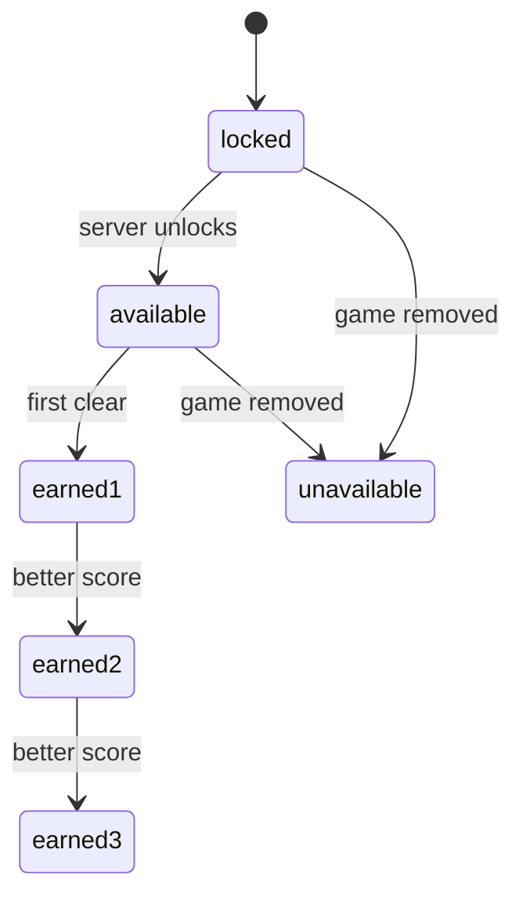

# Functional Design - QM3 Web Map, Launch and Result
**Stage**: CONSTRUCTION - Functional Design (minimal), unit QM3
**Basis**: `quest-map-requirements.md` (FR-QM-3, 4, 6, 7, 14 to 18, NFR-QM-2, 3, 4), `quest-map-components.md` (W1 to W8, W11, U1, R1, R2), `quest-map-component-methods.md` section 3, `quest-map-backend/functional-design/` (view model rules R-VIEW-*)
**Owner questions**: delegated; recommended answers applied and marked **(D)**.
**Principle**: the server decides (statuses, stars, unlocks, remaining plays). The web renders and launches. Nothing here recomputes unlock logic.

---
## 1. Node states (FR-QM-4)
The view model gives each node `status` (`LOCKED`, `AVAILABLE`, `UNAVAILABLE`), `stars` (0 to 3) and `kind` (`GAME`, `BOSS`, `BONUS`). The visual state is a pure function of those three fields plus world access.

| Visual state | Condition | Look | Tappable | Accessible name key (`quest.node.aria.*`) |
|---|---|---|---|---|
| locked | `status = LOCKED` | grey, lock icon | Yes, opens the panel in "locked" form (explains why, no Play) **(D)** | `locked` |
| available | `AVAILABLE`, stars 0 | accent colour, pulsing ring (static under reduced motion) | Yes | `available` |
| earned 1/2/3 | `AVAILABLE`, stars 1 to 3 | filled stars under the node | Yes (replay) | `earned` with star count |
| unavailable | `UNAVAILABLE` (game removed, FR-QM-18) | dashed outline, "off" icon | Yes, panel shows the notice, no Play | `unavailable` |
| boss / bonus | `kind` BOSS or BONUS, combined with any state above | larger node (boss), diamond shape (bonus) | as the state | state key plus `boss` or `bonus` |

Rules:
- State is never conveyed by colour alone: every state has a distinct icon or shape plus the accessible name (NFR-QM-3).
- Stars never go down on screen: the node shows `stars` from the server (best ever).
- Locked World 2 for a FREE user: `accessible = false`. All nodes render `locked`, stored stars stay visible, and the panel for any node shows the paywall form (section 2).
- Unavailable nodes show no stars and add no weight to the world's `maxStars` (server sends the numbers; the web does not adjust them).

---
## 2. Node panel content (FR-QM-7)
`QuestNodePanel` opens on node selection: a bottom sheet on phones, a side card from 640px. It is a labelled dialog: focus moves to the title, Escape or the Close button closes it, focus returns to the node button.

| Section | Content | Source |
|---|---|---|
| Title | Node name | `quest.nodes.<nodeId>.name` |
| Kind tag | "Boss" or "Bonus" when applicable | `kind` |
| Legs list | One row per leg: game name `quest.games.<themeId>`, difficulty label (Easy / Medium / Hard / Expert for 1 to 4). Boss with 2 or 3 legs shows "Leg 1 of N" order and the text that legs must be played in order within 30 minutes | `legs` |
| Star goals | Three goals "1 star: X points", "2 stars: Y", "3 stars: Z"; the reached ones are marked; for a boss the label says "combined score" | `thresholds`, `stars` |
| Best score | "Best: N" if `bestScore > 0` | `bestScore` |
| Active run | For a boss with `activeGauntlet` on this node: "Run in progress: legsDone of legsTotal, expires at HH:MM". The Play button then says "Continue run" and launches leg `legsDone` | `activeGauntlet` |
| Plays left | Same `PlaysLeftBar` value as the map, shown above the button | `rateLimit` |
| Primary action | "Play" (or "Replay" if stars > 0, "Continue run" as above) | state |

Forms by state:
- **available / earned**: full panel and Play button. Play calls `buildLaunchUrl(leg, ref)` for the leg to run (leg 0, or `activeGauntlet.legsDone`) and `navigate()`s to it. If `buildLaunchUrl` returns `null`, the button is disabled and a generic "not available right now" line is shown (cannot happen with a green config test, defensive).
- **locked (world accessible)**: title, goals and legs are shown; no Play; line "Earn a star on the previous node to unlock". For the bonus node: "Collect N stars in this world to unlock" using the world's star totals from the view (the needed number is `bonusStarThreshold` capped as the server does; the web shows the server-sent count when present, else omits the number **(D)**).
- **locked (world not accessible, FREE user)**: title, legs, goals, and a "Subscribe to unlock World 2" link to `ROUTES.SUBSCRIPTION`. No Play. The `QuestPaywallHit` metric is server-side only; the web sends nothing.
- **unavailable**: title and the line "This game is not available right now. Skipping it counts as passed." No Play.
- **0 plays left** (`rateLimit.remaining = 0`) on an available node: Play stays enabled; the start fails on the server and R1 sends the player to `ROUTES.RATE_LIMIT` (FR-QM-17). The panel additionally shows the plays-left text so it is not a surprise **(D)**.

`catalogGameId` is never sent to the client and never shown.

---
## 3. Map screen and layout rules (FR-QM-3, NFR-QM-2)

### 3.1 Page structure
`QuestMapPage` (route `ROUTES.QUEST_MAP`, inside protected `AppLayout`):
1. Header: title, `PlaysLeftBar` (used / limit, "N plays left today", reset time).
2. Optional notice region (`role="status"`) for `startFailed=quest`.
3. One section per world, in `order`: world title, `totalStars / maxStars`, `QuestWorldPath`. A world that is not accessible adds a "Locked: subscribers only" label and the subscription link under its title.
4. States: loading (skeleton, no stale data shown), error (message plus Retry that calls `refetch`), loaded. `useQuestProgress` uses `network-only`, so each visit and each return from a game shows current data.

`?startFailed=` is read once on mount, then removed from the URL with `replace`: `rate` navigates to `ROUTES.RATE_LIMIT` with `{ rateLimited: true }` and `replace: true`; `quest` shows the notice "That node is not available right now" and triggers `refetch`; any other value is ignored.

### 3.2 Path layout from config coordinates
Each node carries `map: { x, y }` in 0 to 100 percent of the map box. Configured World 1 runs from `y = 92` (node 1, bottom) up to the boss at `y = 10` (top), so the journey reads **bottom to top** on every screen size. The bonus node is the last item in `nodes` and sits off the main line using its own coordinates.

| Rule | Decision |
|---|---|
| Layout switch | One breakpoint at 640px (Tailwind `sm`). Below it: vertical layout. From 640px: map-box layout |
| Map box (>= 640px) | `position: relative`, `width: 100%`, `max-width: 720px`, centred, `aspect-ratio: 4 / 5`. Each node is absolutely placed at `left: x%`, `top: y%` with `transform: translate(-50%, -50%)` |
| Winding path | One SVG overlay, `viewBox="0 0 100 100"`, `preserveAspectRatio="none"`, `pointer-events: none`, `aria-hidden`. The path is drawn through the path nodes in `nodes` order (bonus excluded) with smooth quadratic segments (midpoint control technique), stroke with `vector-effect: non-scaling-stroke`. The bonus node gets a short dashed connector from the boss. The completed part (segments up to the last node with stars > 0) uses the accent colour, the rest grey |
| Vertical layout (< 640px, down to 320px) | A single column. Row height 96px, rows in path order from the bottom (node 1) to the top (boss), bonus as the top row. Each node's horizontal position is `clamp(x, 15, 85)` percent of a lane whose width is the container minus 24px side padding, so at 320px (288px lane) the 48px node never leaves the viewport. The SVG path is drawn in the same lane with the same curve rule |
| Touch target | Node button at least 48 x 48 CSS px in both layouts (boss 64px). Adjacent nodes are never closer than 56px centre to centre in the vertical layout (row height 96px guarantees it) |
| Overlap guard | Desktop coordinates come from config; the config test (QM1) already requires distinct coordinates. The web adds one unit test: for each world, no two nodes are closer than 8 units in the 0 to 100 box **(D)** |
| No horizontal scroll | The page never scrolls horizontally at 320px; labels under nodes are the node name, truncated to one line with the full name in the accessible name |
| Initial scroll | On load, scroll the first `AVAILABLE` node with the lowest stars (the "frontier") into view, `behavior: 'auto'` under reduced motion, otherwise `'smooth'` |
| DOM and keyboard order | Nodes are rendered in path order (node 1 first, bonus last) in an `<ol>`, independent of visual position, so tab order follows progress |
| Reduced motion | `useReducedMotion()`: no pulsing ring, no smooth scroll, no panel slide; state is still conveyed by icon and name. Unlock animation belongs to QM4 |
| Text size | Text uses rem units; at 200% browser zoom the vertical layout still fits at 320px without horizontal scroll |

World order on screen is the `order` field, stacked vertically; each world has its own map box.

### 3.3 Hub card (W7), banner (W5)
- Hub card above the grid in `GameHubPage`: title, one line, link to `ROUTES.QUEST_MAP`. Always rendered for signed-in users, no network request.
- `QuestBanner` renders only when `parseQuestParam(location.search)` is valid. It shows node name, the 3-star goal only (the banner has no progress data, so it does not compute the next unreached goal **(D)**) and a "Back to map" link. If the node id is unknown to the client it shows only "Playing from Quest Map" and the link. The banner needs the node's name and goal, which come from `useQuestProgress` data; no data yet means the generic text.

---
## 4. Result section and return (FR-QM-15, rule R2)
`QuestResultSection({result})` renders inside `ScoreBreakdownModal` when `useQuestResult()` is non-null.

| Case | Content |
|---|---|
| Plain node | Stars earned this run (0 to 3), "Best: bestStars", goal ladder with the reached goal marked, score vs next threshold |
| Boss, leg k of N completed (`gauntlet.status = IN_PROGRESS`) | "Leg k of N done", this leg's score, button "Next leg" (launches `gauntlet.nextLeg` with `legIndex = k`) and "Back to map". No stars yet |
| Boss, final leg (`COMPLETE`) | Combined score, stars, goal ladder |
| `EXPIRED` | "This run expired. Start the boss again from leg 1." and "Back to map" only |
| `newlyUnlocked` not empty | Line "Unlocked: <node names>" (names from `quest.nodes.<id>.name`; unknown ids are skipped); the only button is "Back to map" **(D)** |
| `worldCleared` | Line "World cleared!" (the animation and badge shelf are QM4) |
| Store empty in quest mode (`quest: null`) | "Progress could not be saved, replay to retry" and "Back to map" |

Decision **(D)**: v1 has no "Next node" shortcut. After a clear the only forward action is "Back to map", except "Next leg" inside a boss run. This avoids a second navigation path and a start from stale data. The in-modal text for unlocks still names what opened.

Rule R2 behaviour is fixed by the components doc: "Play again" is never rendered in quest mode, and the X, overlay and "Close" all call `navigate(ROUTES.QUEST_MAP)` without calling the page's `onClose`. "Next leg" uses `buildLaunchUrl` from `gauntlet.nextLeg` plus `{ worldId, nodeId, legIndex }` and `navigate()`; the store is cleared by the next `startGame`.

---
## 5. Final launch contract (W2, R1, U1)

### 5.1 Quest parameter
`quest=<worldId>:<nodeId>:<legIndex>` appended to the game URL. `parseQuestParam(search)` splits on `:` into exactly 3 parts, requires ids matching `^[a-z0-9-]{1,40}$` and `legIndex` an integer 0 to 2, and returns `null` on anything else; it never throws. When several `quest` parameters exist, the first is used. The web does not check that the world or node exists; the server does (generic rejection).

### 5.2 Launch table
`buildLaunchUrl(leg, ref)` returns `null` when `leg.themeId` has no row. Difficulty names for word-style pages: 1 = `easy`, 2 = `medium`, 3 = `hard` (4 is only valid for Circuit Builder). `SpaceEntryDifficulty` is `'easy' | 'medium' | 'hard'` (read in `utils/spaceEntryConfig`), which closes the "not verified" item in the components doc.

| themeId | Route constant | Query built |
|---|---|---|
| ANIMALS, FRUITS, VEHICLES, SPACE, OCEAN, FORMULA1 (card themes) | `ROUTES.GAME` (`/game`) | `?theme=<themeId>&difficulty=<1-3 name>` (Memory Match page falls back to these when router state is empty; see W8) |
| MATH_CHALLENGE | `MATH_GAME` | `?difficulty=<name>` |
| WORD_PUZZLE | `WORD_PUZZLE_GAME` | `?difficulty=<name>` |
| SEQUENCE_MEMORY | `SEQUENCE_MEMORY_GAME` | `?difficulty=<name>` plus `&theme=<pageTheme>` only if the leg has `pageTheme` |
| PATTERN_RECALL | `PATTERN_RECALL_GAME` | `?theme=<pageTheme>&difficulty=<name>`; `pageTheme` required, otherwise `null` |
| GEO_QUIZ | `GEO_QUIZ_GAME` | `?difficulty=<name>` (the page's accepted values are confirmed when the row test is written; if it does not read the parameter, the row stays and the page default applies **(D)**) |
| MATH_MAZE | `MATH_MAZE_GAME` | `?difficulty=<name>` |
| BUBBLE_POP | `BUBBLE_POP_GAME` | `?difficulty=<name>` |
| BOND_AND_BURN | `BOND_AND_BURN_GAME` | `?difficulty=<name>` |
| SPACE_ENTRY | `SPACE_ENTRY_GAME` | `?difficulty=<name>` |
| TRAFFIC_LAB | `TRAFFIC_LAB_GAME` | `?difficulty=<name>` |
| MINI_GOLF | `MINI_GOLF_GAME` | `?difficulty=<name>` |
| SCRATCH_CODING | `SCRATCH_CODING_GAME` | `?difficulty=<name>` |
| CIRCUIT_BUILDER | `CIRCUIT_BUILDER_GAME` | `?difficulty=<1-4 number>&level=<params.levelId>`; `levelId` required, otherwise `null` |

Every row also carries `nameKey = quest.games.<themeId>`. The final URL is `<route>?<query>&quest=<worldId>:<nodeId>:<legIndex>`. All values are URL-encoded with `URLSearchParams`; no value is concatenated raw.

Table shape note: 6 card themes share one route and 13 other themeIds have one row each, so there is one test per themeId (19). Hub-launched games are untouched: without a valid `quest` the URL builder is not involved.

### 5.3 Start, failure and result path
1. Page loads from the node URL and calls `startGame` as it does today.
2. `startGame` sets `questContext` from the URL (valid only), clears the result store, and on failure applies R1: rate-limit error to `?startFailed=rate`, any other error to `?startFailed=quest`, via `window.location.replace`, returning a never-resolving promise. A start that resolves with a non-empty `id` returns `canPlay: true` in quest mode.
3. `completeGame` stores `result.quest` in the result store (or clears it when `null`); `ScoreBreakdownModal` reads it (R2).

### 5.4 Page edits (W8)
Only two pages change:
- **Memory Match** (`GamePage.tsx`, `useGame.ts`): when `location.state` has no theme or difficulty, read `?theme=` and `?difficulty=`. Validate `theme` against `GAME_THEMES` and `difficulty` against the `DifficultyLevel` names; invalid or missing means the existing redirect to setup. `StartGameModal` stays, so a node opens with one extra click.
- **Circuit Builder** (`CircuitBuilderGamePage.tsx`): when a valid `quest` is present, hide the result-panel buttons that leave the quest ("Next level", "Back to setup").
The other 11 pages are not edited.

---
## 6. Validation and error handling

| Input / operation | Rule | On failure |
|---|---|---|
| `quest` URL parameter | Format in 5.1 | Treated as absent: page behaves as hub-launched (no banner, no quest context) |
| `startFailed` URL parameter | Only `rate` and `quest` | Ignored, removed from URL |
| `getQuestProgress` | Network, auth or server error | Page error state with Retry; logged with `console.error` of the status only, no payload. Recoverable. Banner and hub card are unaffected |
| `getQuestProgress` returns a node with unknown `kind`/`status` | Render as locked and non-startable | No crash |
| `buildLaunchUrl` null | Disable Play, show generic notice | Recoverable |
| Start failure from the game page | R1 | Redirect to the map (rate: rate-limit page) |
| Authentication expiry on the map | Existing Apollo/auth handling applies; the map shows its error state | Not verified how this surfaces; manual check item |
| Locale key missing | `t()` falls back to the key in dev; completeness test fails CI | n/a |

Invariants and owners: unlock and stars are enforced by the server only (the web never computes them); access to World 2 is enforced by the server on start (the web only hides Play); launch-URL shape is enforced by the launch table and its per-row tests.

---
## 7. Locale keys (W11, QM3 part)
Namespaces added to en, es, pt: `quest.title`, `quest.playsLeft`, `quest.worlds.<worldId>.name`, `quest.nodes.<nodeId>.name`, `quest.games.<themeId>` (every themeId in the launch table), `quest.difficulty.1..4`, `quest.node.aria.*`, `quest.panel.*`, `quest.banner.*`, `quest.result.*`, `quest.notice.*`, `quest.hub.*`. The completeness test fails if any key present in en is missing in es or pt, and checks the `quest.games.*` coverage of the launch table, plus the world and node ids from the shared config.

---
## 8. Testability
Unit (vitest, no browser): `parseQuestParam` matrix; `buildLaunchUrl` per row (19 themeIds, including `null` cases for missing `pageTheme`/`levelId`); visual-state mapping function (status, stars, kind, accessible to class and aria key); position helper (desktop percent and phone `clamp`); node spacing guard; R1 and R2 tests named in the unit-of-work doc; result section cases in section 4; hub card without any request; card-theme drift test.
Manual only (no browser tooling, U8): 320px layout, no horizontal scroll, keyboard order, accessible names, reduced motion, the 13 pages opened from a node.

---
## 9. Security Baseline compliance (this stage)
| Rule | Status | Basis |
|---|---|---|
| SECURITY-01 | N/A | No storage or transport added by this stage |
| SECURITY-02 | N/A | No gateway or load balancer |
| SECURITY-03 | Compliant | Section 6: client logs status only, never tokens or payloads |
| SECURITY-04 | N/A | No header or HTML-serving change |
| SECURITY-05 | Compliant | Strict `quest` parse (5.1), allowlisted `startFailed`, `URLSearchParams` encoding, no `dangerouslySetInnerHTML`; all text through `t()` |
| SECURITY-06 | N/A | No IAM change |
| SECURITY-07 | N/A | No network configuration |
| SECURITY-08 | Compliant | Server owns access and progress; the client cannot grant stars or World 2 access (section 6 invariants) |
| SECURITY-09 | Compliant | Generic notice for every quest failure; no server internals shown |
| SECURITY-10 | N/A | No new dependency |
| SECURITY-11 | Compliant | Misuse cases: forged `quest` param (server rejects, generic notice), manipulated `startFailed` (allowlisted) |
| SECURITY-12 | N/A | No auth flow change |
| SECURITY-13 | N/A | Integrity logging is server-side (QM2) |
| SECURITY-14 | N/A | No new deployed component |
| SECURITY-15 | Compliant | Every failure path has a defined UI state (section 6); no unhandled rejection from the never-resolving R1 promise |
No blocking finding.
