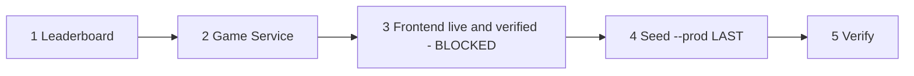

# U7b Reporting and Data (web slice): Implementation Summary

Nothing was committed. HEAD is still a328c74. All changes are uncommitted working-tree edits.

## Files changed

Edited (apps/web/src):
- `pages/hub/GameHubPage.tsx` (GAME_FILTER_MAP)
- `components/hub/GameTile.tsx` (PREMIUM_GAMES)
- `api/leaderboard.ts` (GameType)
- `components/leaderboard/GameTypeFilter.tsx`
- `components/dashboard/RecentImprovements.tsx`
- `pages/admin/AdminDashboard.tsx` (GAME_NAMES, GAME_ICONS)
- `pages/dashboard/HistoryPage.tsx`, `AchievementsPage.tsx`, `StatisticsPage.tsx` (GAME_INFO)
- `locales/en.json`, `es.json`, `pt.json` (`games.circuit-builder.*`)

Added:
- `apps/web/src/__tests__/circuitBuilderRegistry.test.ts`
- `aidlc-docs/construction/reporting-and-data-web/` (this file and the functional design)
- `.agents/tasks/u7b/verification.md`

Not touched: packages/shared, services/leaderboard, infrastructure, .github, services/game (daily-email deliberately unchanged, see functional design), the protected web files, the circuitBuilder.* translation block, circuit-builder pages and levels.

## Tests

| | apps/web |
|---|---|
| Before | 613 passed |
| After | 629 passed in 31 files (+16, all in the new registry test file) |

tsc --noEmit exit 0. `npm run build` exit 0. Per-file eslint on the changed files: no findings on any line changed here; it exits 1 only because of 3 pre-existing `no-explicit-any` errors (AdminDashboard lines 219 and 270, StatisticsPage line 54) and 2 pre-existing hook warnings in lines not edited. The new test file is lint clean. services/game was not touched, so no tsc or jest run there.

## How the check was proven to fail

1. Permanent: 14 mutation cases in the same test file remove or alter one entry in an in-memory copy of the source (filter map, premium list, both GameType values, each display map, PAID_GAMES, review registry, emitted event gameType, route registration, es translations). Each asserts the failure list is non-empty and names the registry. A guard fails the case if the mutation does not change the source, so a stale pattern cannot give a false pass.
2. Executed live mutation, reverted: `'circuit-builder'` was removed from PREMIUM_GAMES in `GameTile.tsx` on disk. The run exited 1 with `[apps/web GameTile.tsx PREMIUM_GAMES] add 'circuit-builder' (backend blocks Free users, the tile needs the paid badge)`. The file was restored and the suite passes again.

## Go-live order

1. Deploy Leaderboard (accepts CIRCUIT_BUILDER events).
2. Deploy Game Service (PAID_GAMES, event gameType, review registry).
3. Deploy the frontend and verify it live. CURRENTLY BLOCKED on the Vercel decision in `aidlc-docs/construction/game-surface/SHARED-ENGINE-IMPORT-DECISION.md`.
4. Seed with `--prod` LAST.
5. Verify: tile in the hub under Science & Math with the paid badge, Free user blocked, setup route loads, a completed game appears on the leaderboard under CIRCUIT_BUILDER.

Seeding before the frontend is live shows players a tile that leads nowhere. Rollback requires deleting BOTH the theme row and the catalog row.

Text alternative: deploy Leaderboard, then Game Service, then the frontend (blocked on the Vercel decision) and verify it live, then seed production last, then verify end to end.

## Open items

- Daily email list: not changed; owner decision recorded in the functional design.
- Other games' registry omissions are listed in the functional design and left as they were.
- Not verified: behavior in a browser or against live services (no deploys or external calls were allowed).
