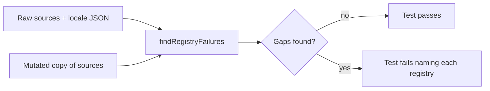

# U7b Reporting and Data (web slice): Functional Design

Scope: register Circuit Builder in every web hub, leaderboard and display registry, and add an automated consistency check (story CB-5.4, FR-CB-45). Only Circuit Builder is added.

## Identifiers

| Form | Value | Used by |
|------|-------|---------|
| Catalog / hub id | `circuit-builder` | GAME_FILTER_MAP, PREMIUM_GAMES, `games.<id>.*` translations |
| Theme / event / leaderboard value | `CIRCUIT_BUILDER` | GameType enums, display maps, review registry, PAID_GAMES |
| Route | `/circuit-builder/setup` | `ROUTES.CIRCUIT_BUILDER_SETUP` |
| Hub category | `Science & Math` | existing GAME_FILTER_MAP value and FILTER_CHIPS id |

The review join in `GameHubPage.tsx` uses `game.gameId.toUpperCase().replace(/-/g, '_')`, so `circuit-builder` becomes `CIRCUIT_BUILDER`. The check asserts both the rule and the result.

## Registry table

| # | Registry (file) | Entry | Id form | Status before U7b |
|---|-----------------|-------|---------|-------------------|
| 1 | `apps/web/src/config/constants.ts` ROUTES | `CIRCUIT_BUILDER_SETUP/GAME/SANDBOX` | route path | Present (U4/U5) |
| 2 | `apps/web/src/App.tsx` routes | `<Route path={ROUTES.CIRCUIT_BUILDER_SETUP}>` and game, sandbox | route constant | Present (U4/U5) |
| 3 | `apps/web/src/pages/hub/GameHubPage.tsx` GAME_FILTER_MAP | `'circuit-builder': 'Science & Math'` | kebab | Added |
| 4 | `apps/web/src/components/hub/GameTile.tsx` PREMIUM_GAMES | `'circuit-builder'` | kebab | Added |
| 5 | `apps/web/src/api/leaderboard.ts` GameType | `CIRCUIT_BUILDER = 'CIRCUIT_BUILDER'` | UPPER_SNAKE | Added |
| 6 | `apps/web/src/components/leaderboard/GameTypeFilter.tsx` | `{ value: GameType.CIRCUIT_BUILDER, label: 'Circuit Builder', icon: '⚡' }` | enum | Added |
| 7 | `apps/web/src/components/dashboard/RecentImprovements.tsx` gameTypeInfo | `[GameType.CIRCUIT_BUILDER]: { icon: '⚡', name: 'Circuit Builder' }` | enum | Added |
| 8 | `apps/web/src/pages/admin/AdminDashboard.tsx` GAME_NAMES and GAME_ICONS | `CIRCUIT_BUILDER: 'Circuit Builder'`, `CIRCUIT_BUILDER: '⚡'` | UPPER_SNAKE | Added |
| 9 | `apps/web/src/pages/dashboard/HistoryPage.tsx` GAME_INFO | `CIRCUIT_BUILDER: { icon '⚡', name 'Circuit Builder', color '#f59e0b' }` | UPPER_SNAKE | Added |
| 10 | `apps/web/src/pages/dashboard/AchievementsPage.tsx` GAME_INFO | same entry | UPPER_SNAKE | Added |
| 11 | `apps/web/src/pages/dashboard/StatisticsPage.tsx` GAME_INFO | same entry | UPPER_SNAKE | Added (found by grep, not on the original list) |
| 12 | `apps/web/src/locales/{en,es,pt}.json` `games.circuit-builder.{title,description,category}` | EN "Circuit Builder", ES "Constructor de Circuitos", PT "Construtor de Circuitos" | kebab | Added |
| 13 | `services/leaderboard/src/types/index.ts` GameType | `CIRCUIT_BUILDER = 'CIRCUIT_BUILDER'` | UPPER_SNAKE | Present (U7a) |
| 14 | `services/game/src/services/game.service.ts` PAID_GAMES | `CIRCUIT_BUILDER_THEME_ID` | UPPER_SNAKE | Present (U6) |
| 15 | `services/game/src/services/game.service.ts` event `gameType` | `CIRCUIT_BUILDER_THEME_ID` (`'CIRCUIT_BUILDER'`) | UPPER_SNAKE | Present (U6) |
| 16 | `services/game/src/services/review.service.ts` gameTypes | `'CIRCUIT_BUILDER'` | UPPER_SNAKE | Present (U6) |
| 17 | `services/game/src/daily-email.ts` ALL_GAMES / GAME_NAMES | not added | n/a | Missing, deliberately not changed (see below) |

Rows 13 to 16 are read by the check but not edited here.

Behavior note for row 10: Achievements builds one "5,000 points" achievement per key of GAME_INFO, and the "play every game" achievement counts those keys. Adding the entry adds one per-game achievement and raises that total by one. This is the intended effect of registering the game.

## Daily email decision

`daily-email.ts` ALL_GAMES stops at SPACE_ENTRY, so it already omits Scratch Coding, Bond and Burn, Traffic Lab, Mini Golf, Language Pronunciation and Color by Number. The file has no test, contains mojibake in its emoji strings, and deploys straight to the production Lambda. Adding Circuit Builder would also suggest a paid game to Free users in "games you have not tried". That is not clearly additive and safe, so it was not changed. Owner decision needed: whether the email should list paid games at all.

## Other games' pre-existing omissions (noticed, not fixed)

- Mini Golf missing from GAME_FILTER_MAP (tile vanishes under every category filter) and from web PREMIUM_GAMES (no paid badge though backend PAID_GAMES blocks Free users).
- Web PREMIUM_GAMES lists only space-entry, scratch-coding, bond-and-burn (plus Circuit Builder now). Backend PAID_GAMES also has TRAFFIC_LAB, MINI_GOLF, LANGUAGE_PRONUNCIATION.
- Web `GameType` enum in `api/leaderboard.ts` has no LANGUAGE_PRONUNCIATION (the earlier miss is still present there). GAME_FILTER_MAP was not audited for it either.
- HistoryPage and AchievementsPage GAME_INFO stop at TIC_TAC_TOE: no entries for Math Maze through Mini Golf except where noted. StatisticsPage GAME_INFO stops at SCRATCH_CODING.
- AdminDashboard GAME_NAMES and GAME_ICONS have no Language Pronunciation entry (not exhaustively audited for others).
- `review.service.ts` gameTypes lacks games after MATH_MAZE (other than Circuit Builder).
- `daily-email.ts` ALL_GAMES: see above.

## Consistency check design

File: `apps/web/src/__tests__/circuitBuilderRegistry.test.ts` (Vitest, node environment, no jsdom). Sources are read as raw text through `import.meta.glob(..., { query: '?raw' })` because apps/web has no `@types/node`; this follows `circuitSandboxIsolation.test.ts`.

`findRegistryFailures(sources)` returns one message per gap in the form `[file registry] fix`. The real test asserts the list is empty. A second suite feeds mutated copies of the sources (one entry removed or changed) and asserts the failure list is non-empty and names the registry.

Text alternative: raw registry sources and the three locale files go into one function. It returns a list of gaps. An empty list passes the test; any gap fails it with the registry name. The same function is also run on deliberately damaged copies of the sources to prove it reports the damage.

## Extension compliance (security baseline)

Applicable rules are N/A for this slice: no new endpoints, auth, data stores or dependencies. The check is read-only and sends nothing outside the repo. No secrets involved.
