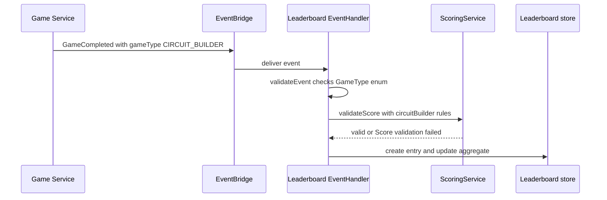
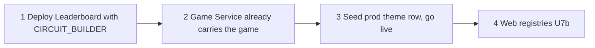

# Functional Design: U7a Reporting and Data (backend slice)

## 1. Scope and slice boundary

U7a covers the Leaderboard service, the two seed/verify scripts, and these docs. U7b (apps/web: filters, registries, routes, locales) is a separate slice and is not designed or changed here. No change is made to the Game Service, shared package, infrastructure or workflows.

## 2. Game identifier map

One game, several identifiers. They are not interchangeable.

| Purpose | Value | Source |
|---|---|---|
| Themes table key, `PAID_GAMES` member, review registry id | `CIRCUIT_BUILDER` | `services/game/src/utils/circuit-builder.ts` L14 (`CIRCUIT_BUILDER_THEME_ID`) |
| Event `gameType` published on GameCompleted | `CIRCUIT_BUILDER` | `services/game/src/services/game.service.ts` ~L543, `completeCircuitBuilderGame` |
| Leaderboard enum | `GameType.CIRCUIT_BUILDER = 'CIRCUIT_BUILDER'` | `services/leaderboard/src/types/index.ts` |
| Catalog `gameId` | `circuit-builder` | seed script |
| Route | `/circuit-builder/setup` | seed script |

What U7b must reuse: the leaderboard API enum value in `apps/web` (`api/leaderboard.ts`, `GAME_FILTER_MAP`, `PREMIUM_GAMES`) must be `CIRCUIT_BUILDER`; the catalog id used for routes and filter keys must be `circuit-builder`.

A drift-guard test (`services/leaderboard/tests/circuit-builder.game-type.test.ts`) reads the constant from the Game Service source and fails if it no longer equals `GameType.CIRCUIT_BUILDER`.

## 3. Difficulty mapping

The Game Service publishes `game.difficulty <= 1 ? 'EASY' : <= 2 ? 'MEDIUM' : 'HARD'`.

| Game difficulty | Published string | Accepted by Leaderboard |
|---|---|---|
| 1 | EASY | yes |
| 2 | MEDIUM | yes |
| 3 | HARD | yes |
| 4 (Super Hard) | HARD | yes |

Finding: Super Hard is indistinguishable from Hard on the leaderboard. This is existing project-wide behaviour of the Game Service. No change was made to it.

## 4. Score and completion-time bounds

New `circuitBuilder` entry in the embedded `ScoringService.loadConfiguration()` (not in the orphaned `scoring.config.json`):

| Bound | Value | Evidence |
|---|---|---|
| minCompletionTime | 1 s | Game Service clamps completion time to at least 1 |
| maxCompletionTime | 3600 s | `CB_MAX_COMPLETION_TIME = 3600` |
| minScore | 0 | Game Service clamp floor |
| maxScore | 8000 | `CB_SCORE_CAP` |

Score formula: `clamp(0, 8000, round(1700 * diffMult(1.0/1.5/2.0/2.5) * speedBonus(0.90-1.15) * (0.5 + quality(0-1))))`. Theoretical max is 1700 x 2.5 x 1.15 x 1.5 = 7331, under the cap. Canonical level scores are 2210 (protected) and 2040 (unprotected), per `aidlc-docs/construction/backend-integration/code/implementation-summary.md`.

Why `mathChallenge` was not reused: its window is 10 to 600 s. A legitimate game longer than 10 minutes would be rejected, and `EventHandler` would throw "Score validation failed", so the player would get no leaderboard entry and no visible error.

Residual tradeoff: the window is wide, so it catches impossible values only. Outlier detection relies on `AnomalyService` statistics (latent, see section 8) and on Game Service re-evaluation, which is the real authority on the score.

Other additive changes: `GameType` enum member, `ScoringConfig.circuitBuilder`, a `calculateScore` case (switch exhaustiveness only; the handler never calls it), the OVERALL time-based fan-out list, and `getDifficultiesForGameType` (latent).

## 5. Seed and verify contract

Theme row (themes table): `themeId` S `CIRCUIT_BUILDER`, `name` S `Circuit Builder`, `status` S `PUBLISHED`.

Catalog row: `gameId` `circuit-builder`, `title` `Circuit Builder`, `description` (one sentence), `icon` `⚡`, `route` `/circuit-builder/setup`, `status` `ACTIVE`, `displayOrder` N `23`, `ageRange` `8-16`, `category` `Science & Math`.

displayOrder 23: the highest value across the repo seed scripts is 22 (Mini Golf). Games seeded outside the repo are not visible, so the verify script runs a best-effort read-only query on the catalog `StatusIndex` and prints a WARN (never a failure) if another ACTIVE game also uses 23.

| Aspect | Seed script | Verify script |
|---|---|---|
| Default environment | DEV (`memory-game-*-dev`, no profile) | DEV |
| Production | only with exact `--prod`: `memory-game-*-prod`, profile `dashden-new`, account 342278407349 | same, read-only |
| Unknown argument | usage, exit 2 | usage, exit 2 |
| Prod guard | must type `SEED-PROD`, else exit 1 | none needed |
| AWS verbs | `put-item` x2 | `get-item` (one read per checked field), `query` x1 |
| Idempotent | yes, identical overwrite, no condition expression | yes |

Verify exit codes: 0 pass, 1 check failed, 2 usage, 3 AWS CLI error (distinguished from a missing row).

## 6. Flows

Text alternative: the Game Service publishes GameCompleted with gameType CIRCUIT_BUILDER to EventBridge. The Leaderboard EventHandler checks the gameType against the GameType enum, then asks ScoringService to validate score, time and accuracy using the circuitBuilder rules. If valid, it writes the leaderboard entry and updates the user aggregate. If the enum lacks the value or validation fails, the event is rejected and no entry exists.

Text alternative: production order is Leaderboard deploy first, then the Game Service (already deployed with the game), then the production theme-row seed which makes the game playable, then the web registries in U7b. Seeding before the Leaderboard deploy makes the game playable while its scores are silently dropped.

## 7. ORDERING WARNING

Deploy the Leaderboard GameType BEFORE seeding the theme row in prod. Otherwise players complete levels and silently get no leaderboard entry.

## 8. Known pre-existing defects left untouched

- `services/leaderboard/scoring.config.json` is orphaned: nothing loads it, the config is embedded in `loadConfiguration()`.
- 9 stale Leaderboard tests fail (6 in `auth.util.test.ts`, 2 in `scoring.service.test.ts`, 1 in `leaderboard.repository.test.ts`); see `aidlc-docs/construction/prerequisite-enablement/code/implementation-summary.md` section 5.
- Language Learning has a difficulty-multiplier gap.
- `anomaly.service` difficulty labels cover only a few older games, and `updateGameStatistics` has no caller, so the Circuit Builder case added there is latent.

## 9. Extension compliance (security baseline)

| Rule | Status | Rationale |
|---|---|---|
| SECURITY-01 Encryption | N/A | No new data store or transport; scripts use the AWS CLI over TLS |
| SECURITY-03 Logging | Compliant | Existing handler logging and CloudWatch metrics cover the new game type |
| SECURITY-05 Input validation | Compliant | Bounds for score, time and accuracy; unknown gameType still rejected; script arguments allow-listed |
| SECURITY-06 Least privilege | N/A | No IAM changes; scripts need only DynamoDB put/get/query on named tables |
| SECURITY-08 Access control | N/A | No auth or endpoint change |
| SECURITY-09 Hardening | Compliant | Dev is the default, prod needs explicit flag and typed confirmation |
| SECURITY-10 Supply chain | Compliant | No new dependency |
| SECURITY-12 Credentials | Compliant | Named profile only, no secrets in scripts or docs |
| SECURITY-15 Fail-safe | Compliant | Unknown args exit 2; AWS errors distinguished from missing rows; rejection is the default for unknown values |
| SECURITY-02, 04, 07, 11, 13, 14 | N/A | No network, headers, design, integrity pipeline or alerting changes in this slice |
