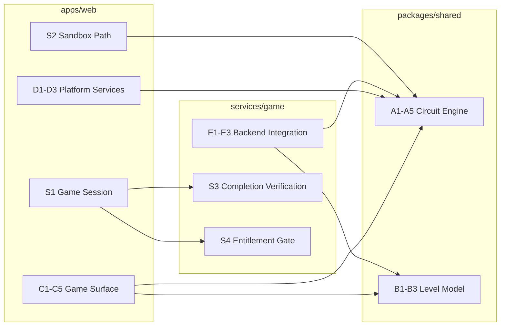
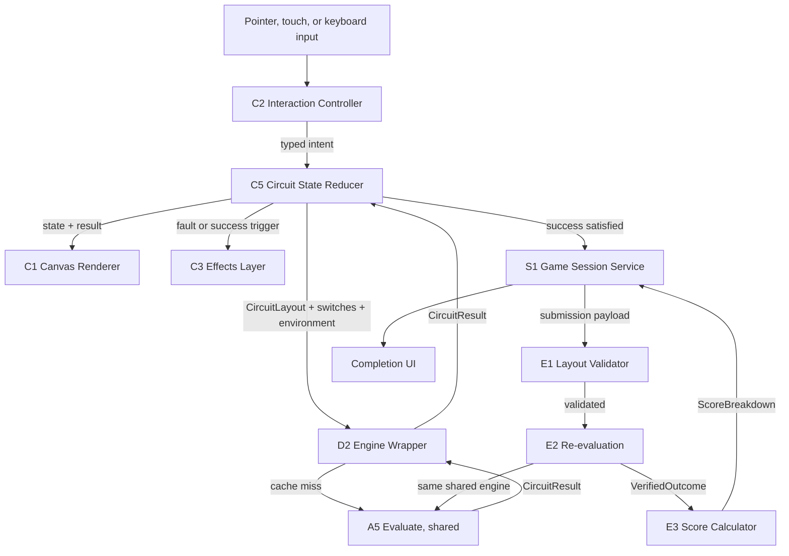

# Circuit Builder - Component Dependencies

**Created**: 2026-10-29
**Stage**: INCEPTION - Application Design, Phase 4
**Basis**: `circuit-builder-components.md`, `circuit-builder-services.md`

---

## 1. Dependency Matrix

Rows depend on columns. `X` marks a direct dependency.

| | A1 | A2 | A3 | A4 | A5 | B1 | B2 | B3 | C1 | C2 | C3 | C4 | C5 | D1 | D2 | D3 | E1 | E2 | E3 |
|---|---|---|---|---|---|---|---|---|---|---|---|---|---|---|---|---|---|---|---|
| **A1** Netlist | | | | | | | | | | | | | | | | | | | |
| **A2** Topology | X | | | | | | | | | | | | | | | | | | |
| **A3** Solver | | X | | | | | | | | | | | | | | | | | |
| **A4** Faults | X | X | | | | | | | | | | | | | | | | | |
| **A5** Facade | X | X | X | X | | | | | | | | | | | | | | | |
| **B1** Level | | | | | | | | | | | | | | | | | | | |
| **B2** Success | | | | | | X | | X | | | | | | | | | | | |
| **B3** Machine | | | | | | | | | | | | | | | | | | | |
| **C1** Renderer | | | | | | X | | X | | | | | | | | X | | | |
| **C2** Interaction | | | | | | X | | | X | | | | | | | | | | |
| **C3** Effects | | | | | | | | | | | | | | | | X | | | |
| **C4** Tray | | | | | | X | | | | | | | X | | | | | | |
| **C5** Reducer | | | | | | X | X | | | | | | | | X | | | | |
| **D1** Audio | | | | | | | | | | | | | | | | X | | | |
| **D2** Wrapper | | | | | X | | | | | | | | | | | | | | |
| **D3** Prefs | | | | | | X | | | | | | | | | | | | | |
| **E1** Validator | | | | | | X | | | | | | | | | | | | | |
| **E2** Re-eval | | | | | X | X | X | X | | | | | | | | | X | | |
| **E3** Score | | | | | | X | | | | | | | | | | | | X | |

### Verification
- **No circular dependency.** The matrix is lower-triangular within each group, and cross-group edges flow only in one direction: `C` and `E` depend on `A` and `B`; `A` and `B` depend on nothing outside themselves.
- **`A` group depends on nothing in `B`, `C`, `D`, or `E`.** The engine is self-contained, satisfying `FR-CB-15`.
- **`B` depends only on `B` and nothing platform-specific.** Level definitions and predicates stay shared.
- **No component in `A` or `B` imports a browser or Node-only API**, satisfying Phase 5.6 and keeping `packages/shared` platform-neutral.

---

## 2. Cross-Package Dependency Contract

**Text alternative:** The shared package contains the circuit engine and the level model and depends on nothing else. The web app's game surface and platform services depend on the shared engine and level model. The game service's backend integration also depends on the same shared engine and level model. The web app's game session service calls the game service's completion verification and entitlement gate across the network. The sandbox path depends only on the shared engine and makes no backend call. The defining property is that both the web app and the game service depend on one shared engine, and neither depends on the other's internals.

### Contract terms

| Term | Commitment |
|---|---|
| **Exported surface** | `services/game` imports only `evaluate` from the engine and `evaluateSuccess`, `getLevel`, `getMachine` from the level model |
| **Purity** | No mutable module state; identical input yields identical output |
| **Platform neutrality** | No `window`, `document`, `fs`, `process`, or Web Audio reference |
| **Additive change only** | Per the execution plan, the engine must not alter any existing `packages/shared` export, because merging that path triggers the production Lambda deploy |
| **Bundling** | The existing deploy script already bundles `@memory-game/shared` into the Game Lambda, so no packaging change is required |
| **Versioning** | Browser and server always run the same commit, so no runtime version negotiation exists. A breaking engine change requires both to deploy together, which the three-stage delivery sequence accommodates |

---

## 3. Communication Patterns

| Pattern | Participants | Mechanism |
|---|---|---|
| **Intent dispatch** | C2 → C5 | Interaction controller emits typed intents; the reducer applies them. Unidirectional. |
| **Evaluation call** | C5 → D2 → A5 | Reducer requests evaluation after each transition through the memoizing wrapper. Synchronous and pure. |
| **Render read** | C1, C3 ← C5 | Renderers read state and the latest result. They never mutate. |
| **Effect trigger** | C5 → C3 | Fault or success transitions trigger effects by coordinate. Fire and forget. |
| **Preference read** | C1, C3, D1 ← D3 | Reactive read-only preference access. |
| **Session call** | S1 → S3, S4 | Authenticated GraphQL over the existing `/game/graphql` route with the Cognito ID token. |
| **Verification call** | S3 → E1 → E2 → E3 | Sequential pipeline; each stage may reject and short-circuit the rest. |
| **Event publish** | S3 → Leaderboard | Existing event path, unchanged. |

### Key invariant
The reducer is the only writer of circuit state. Renderers, the effects layer, and the tray are all readers. This is what makes the pointer and keyboard paths equivalent: both reduce to the same intent dispatch, so neither has privileged access.

---

## 4. Data Flow

**Text alternative:** Pointer, touch, and keyboard input all enter the interaction controller, which emits a typed intent to the circuit state reducer. The reducer passes the layout, switch states, and environment to the engine wrapper, which either returns a cached result or calls the shared evaluation facade. The resulting circuit result flows back to the reducer, which feeds the canvas renderer for visual state and triggers the effects layer on fault or success. When the success condition is satisfied, the reducer notifies the game session service, which sends a submission payload to the layout validator on the server. Validated submissions pass to re-evaluation, which calls the same shared evaluation facade, then to the score calculator, whose score breakdown returns to the session service for display. The engine appears at two points in this flow, in the browser wrapper and in server re-evaluation, and both are the same shared code.

### Flow properties
- **Single input funnel**: all three input modalities converge at `C2`, so adding keyboard support required no second pipeline.
- **Engine invoked twice, implemented once**: the browser call drives feedback, the server call establishes truth.
- **Server path is strictly sequential with early rejection**: validation, then re-evaluation, then scoring, and any stage can reject.
- **Sandbox omits the entire right-hand branch**: `S2` stops after the reducer and renderer, which is how `FR-CB-31` is structurally guaranteed.

---

## 5. Design Validation

| Check | Result | Evidence |
|---|---|---|
| Every component traces to a requirement | Pass | Coverage table in `circuit-builder-components.md` |
| `FR-CB-15` engine purity | Pass | `A` group has no outbound dependency; memoization isolated in `D2` |
| `FR-CB-16` shared placement | Pass | `A` and `B` in `packages/shared`; both `apps/web` and `services/game` depend on them |
| `NFR-CB-5` keyboard model supported | Pass | `C2` separated from `C1`; both input paths emit the same intents and share one selection state |
| `FR-CB-21`/`FR-CB-22` server re-evaluation | Pass | `E2` depends on `A5` and `B2`, the identical functions the browser uses |
| No circular dependency | Pass | Matrix verification in Section 1 |
| `packages/shared` platform-neutral | Pass | Contract terms in Section 2; audio deliberately excluded per Q7 |
| Additive-only shared change | Pass | Contract term; required because the path triggers production deploy |

---

## 6. Residual Risks Carried Into Construction

1. **`faultCount` cannot be server-reconstructed.** Faults are historical events, so a final layout cannot prove how many occurred. Functional Design must decide how to bound it, most plausibly by clamping to a per-level maximum. This is the one remaining piece of client-reported data in the scoring path and is recorded rather than hidden.
2. **Engine merge deploys backend Lambdas before backend work begins.** Mitigated by the additive-only contract term, but it means the engine merge is production-affecting even though no behavior changes.
3. **Numeric bounds are not yet set.** `E1` validation and `D2` memo sizing both depend on targets that NFR Requirements must quantify, including the component ceiling that `NFR-CB-4` implies but never defines.
