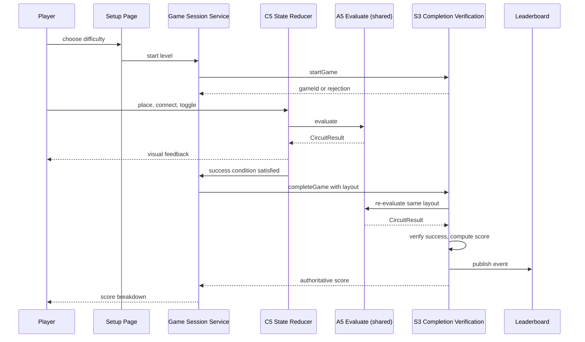

# Circuit Builder - Services

**Created**: 2026-10-29
**Stage**: INCEPTION - Application Design, Phase 3
**Basis**: `circuit-builder-components.md`, `circuit-builder-component-methods.md`

**Scope note**: Service definitions and orchestration patterns. Detailed business rules are deferred to Functional Design.

---

## S1 — Game Session Service (`apps/web`)

**Purpose**: Orchestrate the lifecycle of a guided level from start through completion.

**Responsibilities**
- Call `startGame` with `themeId` and the numeric difficulty, and hold the returned game id
- Interpret a rejected start, distinguishing paywall from rate limit, and route accordingly
- Track elapsed time for the attempt
- On success detection, assemble the submission payload and call `completeGame`
- Surface the server-returned score and breakdown to the completion UI
- Handle submission failure without losing the player's result from view

**Orchestration**

1. Setup page confirms access, then navigates with the chosen difficulty
2. Game page mounts and the service calls `startGame`
3. On success, the timer starts and play begins
4. The reducer drives play; the service does not participate in editing
5. When `evaluateSuccess` reports satisfied, the service assembles `selectSubmissionPayload` output plus metrics
6. The service calls `completeGame` and awaits the authoritative score
7. The completion UI displays the server score

**Design note**: The service deliberately does not compute a score locally. `FR-CB-21` makes the server authoritative, so a local score would only create a value that can disagree with the real one. The existing `useGame` hook pattern computes locally as a fallback; Circuit Builder does not follow that part of the precedent.

*Requirements: FR-CB-32, FR-CB-21 · Stories: CB-1.4, CB-4.1, CB-4.2*

---

## S2 — Sandbox Session Path (`apps/web`)

**Purpose**: Provide free-play that is deliberately disconnected from the backend.

**Responsibilities**
- Initialize the reducer with a sandbox level definition having an unrestricted component budget
- Run the identical engine evaluation as guided play
- Call neither `startGame` nor `completeGame`
- Produce no score, no leaderboard entry, and consume no daily allowance

**Orchestration**

1. Player selects sandbox from the setup page
2. The game page mounts with `S2` instead of `S1`
3. Play proceeds entirely locally
4. Exiting discards state with no submission

**Design note**: This is a separate path rather than a flag on `S1`, so there is no code path where a sandbox session could accidentally create a backend session. `FR-CB-31` is enforced structurally, not by a conditional.

*Requirements: FR-CB-27, FR-CB-31 · Stories: CB-1.5*

---

## S3 — Completion Verification Service (`services/game`)

**Purpose**: Produce the authoritative outcome and score for a submitted attempt.

**Responsibilities**
- Validate the submission through `E1` before any processing
- Re-evaluate through `E2` using the shared engine and shared success predicate
- Reject submissions failing validation or the success condition
- Compute the score through `E3` from verified metrics
- Persist the game record and emit the leaderboard event
- Return the score breakdown in the existing response shape

**Orchestration**

1. `completeGame` receives the submission
2. `E1` validates bounds, types, and payload size; a rejection returns a generic error
3. `E2` calls the shared `evaluate`, then the shared `evaluateSuccess`
4. An unsatisfied success condition is rejected with no score recorded
5. `E3` computes the score from verified metrics
6. The existing persistence and event-publishing path proceeds unchanged
7. The response carries the score breakdown the existing modal already consumes

**Failure handling**: every step fails closed. A validation failure, a re-evaluation rejection, or an engine error results in no score and no leaderboard event, never a default or partial score. This satisfies `NFR-CB-21`.

*Requirements: FR-CB-21, FR-CB-22, FR-CB-26, FR-CB-23 · Security: SECURITY-05, SECURITY-11, SECURITY-15 · Stories: CB-4.4, CB-4.5*

---

## S4 — Entitlement Gate (existing, extended)

**Purpose**: Enforce paid access server-side.

**Responsibilities**
- Add the Circuit Builder theme identifier to the authoritative paid list in `GameService.startGame`
- Continue to reject a Free-tier start regardless of browser state

**Orchestration**: no new orchestration. This is a registry addition to an existing gate, which is why the component inventory lists no new entitlement component.

**Design note**: The browser-side badge and redirect remain advisory. `CB-1.3` requires the gate to hold on direct route navigation, which it does because the check lives in `startGame` rather than in routing.

*Requirements: FR-CB-35, FR-CB-36 · Stories: CB-1.2, CB-1.3*

---

## S5 — Audio Orchestration (`apps/web`)

**Purpose**: Make sound work within browser autoplay constraints without breaking gameplay.

**Responsibilities**
- Defer audio context creation until the first user gesture in the session
- Preload sounds after unlock, not before
- Consult the sound preference on every play request
- Dispose on game unmount

**Orchestration**

1. Game page mounts; audio is not yet initialized
2. The player's first interaction, typically selecting a tray component, triggers `initializeOnGesture`
3. Preload begins in the background; play requests before preload completes are dropped silently rather than queued indefinitely
4. Success or fault events request playback, which is a no-op when muted
5. Unmount disposes the context

**Design note**: Gesture unlock is tied to the first interaction rather than to a dedicated prompt, because requiring an explicit "enable sound" click would add friction for a game aimed at children. The tradeoff is that a success sound could be missed in the rare case a level completes with no prior interaction, which is not reachable in practice since building a circuit requires interaction.

*Requirements: NFR-CB-12 to NFR-CB-16 · Stories: CB-6.5, CB-6.6*

---

## Service Interaction Diagram

**Text alternative:** The player chooses a difficulty on the setup page, which asks the Game Session Service to start a level. That service calls `startGame` on the Game Service and receives either a game id or a rejection. During play the player dispatches actions to the state reducer, which calls the shared evaluation facade and returns a circuit result that drives visual feedback. When the success condition is satisfied, the reducer notifies the session service, which calls `completeGame` with the circuit layout. The Game Service re-evaluates that same layout using the identical shared engine, verifies the success condition, computes the score from verified metrics, publishes a leaderboard event, and returns the authoritative score, which the session service presents to the player. The notable property is that the engine appears twice, once in the browser for live feedback and once on the server for verification, and both invocations run the same shared code.

---

## Service Boundary Summary

| Service | Package | Creates backend session | Authoritative for score |
|---|---|---|---|
| S1 Game Session | `apps/web` | Yes | No |
| S2 Sandbox Path | `apps/web` | No | N/A, no score |
| S3 Completion Verification | `services/game` | N/A | **Yes** |
| S4 Entitlement Gate | `services/game` | Gates it | N/A |
| S5 Audio Orchestration | `apps/web` | No | N/A |

The single authoritative scoring point is `S3`, which is the architectural expression of `FR-CB-21`.
