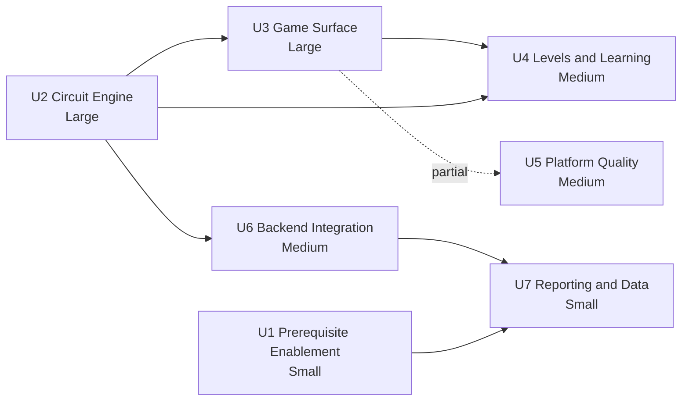

# Circuit Builder - Unit Dependency Matrix

**Created**: 2026-10-29
**Stage**: INCEPTION - Units Generation

---

## 1. Dependency Matrix

Rows depend on columns.

| | U1 | U2 | U3 | U4 | U5 | U6 | U7 |
|---|---|---|---|---|---|---|---|
| **U1** Prerequisite Enablement | — | | | | | | |
| **U2** Circuit Engine | | — | | | | | |
| **U3** Game Surface | | X | — | | | | |
| **U4** Levels and Learning | | X | X | — | | | |
| **U5** Platform Quality | | | (X) | | — | | |
| **U6** Backend Integration | | X | | | | — | |
| **U7** Reporting and Data | X | | | | | X | — |

`X` = hard dependency. `(X)` = partial; only U5's keyboard model needs U3's interaction controller, while audio, localization, and reduced-motion work are independent.

**Acyclic**: verified. No unit appears in its own transitive dependency set.

---

## 2. Critical Path

**Text alternative:** The critical path runs U2 Circuit Engine, then U3 Game Surface, then U4 Levels and Learning, which is Large then Large then Medium. A parallel branch runs U2 to U6 Backend Integration to U7 Reporting and Data. U1 Prerequisite Enablement is independent of everything except that it also feeds U7. U5 Platform Quality has only a partial dependency on U3, shown as a dashed link, because just its keyboard model needs the interaction controller. U4 also depends directly on U2 for level definitions and success predicates. The longest chain is U2, U3, U4.

**Critical path**: U2 → U3 → U4. These three contain all the hard correctness work and two of the three Large/Medium-heavy units.

---

## 3. Parallelization

| Can run in parallel | Why |
|---|---|
| U1 and U2 | No shared files. U1 touches `services/leaderboard` and two `apps/web` files; U2 touches only `packages/shared`. |
| U3 and U6 | Both depend on U2 but not on each other. One is browser rendering, the other is Lambda validation and scoring. |
| U5 and U3 (mostly) | Audio, localization, and reduced motion are independent of canvas internals. Only the keyboard model must wait for U3's interaction controller. |
| U4 and U6 | U4 is content and pedagogy in the browser; U6 is server verification. |

**Cannot parallelize**
- U3 before U2, since the canvas has nothing to render without engine results
- U4 before U3, since levels need a working canvas to be playable
- U7 before U1 and U6, since a leaderboard game type needs a compiling service and a working backend
- U6's score calculation before U2's numeric bounds decision, since validation limits come from there

---

## 4. Coordination Points

| Point | Units | What must agree |
|---|---|---|
| **Engine public surface** | U2 → U3, U4, U6 | The `evaluate` facade signature and `CircuitResult` shape. Changing it after U3 and U6 consume it means rework in both. |
| **Numeric bounds** | U2 → U6, U3 | Component ceiling, connection ceiling, voltage range, short-circuit threshold. U6 validation and U3 memo sizing both read these. |
| **Success predicates** | U2 → U4, U6 | Browser and server call the identical function, so the predicate signature and level identifiers must be fixed before either consumes them. |
| **Fault codes** | U2 → U4, U5 | Stable codes drive tooltip selection and translation keys. Renaming a code after localization lands breaks translations silently. |
| **Submission payload** | U3 → U6 | `selectSubmissionPayload` output must match the validator's expected schema exactly. |
| **Game identifier** | U6 → U7 | The uppercase theme id and the lowercase catalog id must agree across `PAID_GAMES`, `PREMIUM_GAMES`, `GAME_FILTER_MAP`, leaderboard types, review registry, and the seed script. This is where the documented drift occurred for prior games. |

---

## 5. Testing Checkpoints

| After | Verify |
|---|---|
| U1 | `services/leaderboard` type-check and tests pass; CSP does not break existing pages |
| U2 | Engine property tests pass, including a bridge topology; purity confirmed; no existing shared export altered |
| U3 | Series and parallel behavior visibly correct; pointer and keyboard share selection state |
| U4 | Each concept perceivable, not merely computed; sandbox makes no backend call |
| U5 | Keyboard-only level completion; reduced motion; no untranslated text |
| U6 | Free-tier rejected on direct navigation; invalid layout rejected; all paths fail closed |
| U7 | Registry consistency check passes; catalog verification passes; end-to-end flow works |

---

## 6. Rollback Posture

| Unit | Deployment target | Rollback |
|---|---|---|
| U1 (leaderboard part) | Lambda via GitHub Actions | **No automated rollback.** Revert commit and re-deploy. |
| U1 (web part) | Vercel | Instant rollback. |
| U2 | Lambda via GitHub Actions, as a side effect | **No automated rollback.** Additive-only constraint exists specifically to make this safe. |
| U3, U4, U5 | Vercel | Instant rollback. |
| U6 | Lambda via GitHub Actions | **No automated rollback.** Must be small and independently revertible. |
| U7 (code) | Both | Mixed. |
| U7 (data) | DynamoDB rows | Manual. The verification command detects a bad state but does not undo it. |

**Consequence for merge ordering**: the three units touching Lambdas (U1 partial, U2, U6) should merge separately from one another, never bundled, so a production problem can be traced to one change and reverted without also reverting unrelated work.

---

## 7. Update Strategy

- **Approach**: Hybrid. Sequential along the critical path, parallel across the independent branches.
- **Recommended order**: U1 and U2 in parallel, then U3 and U6 in parallel, then U4 and U5 in parallel, then U7 last.
- **Version compatibility**: not applicable at runtime. Browser and server always run the same commit, so there is no negotiation. A breaking engine change requires U3, U4, and U6 to deploy together.
- **Failure mid-sequence**: because U2 is additive-only and U3 through U5 are frontend-only with instant rollback, a failure after U2 leaves production in a working state with an unused shared module present. That is the specific reason the additive-only constraint is a completion criterion.
