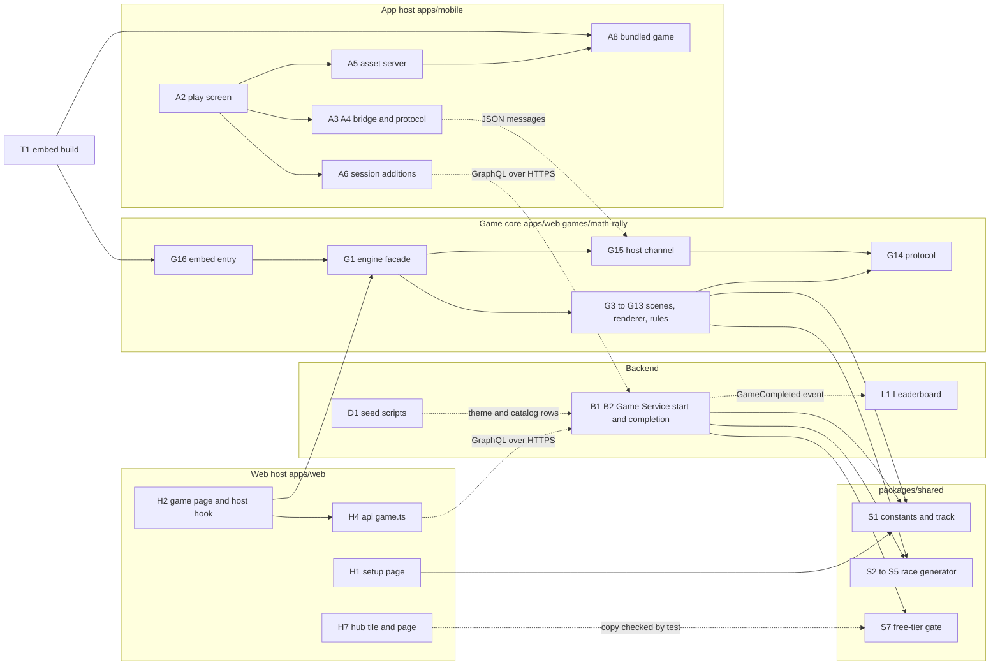
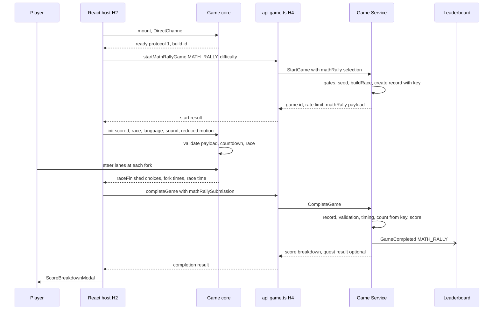
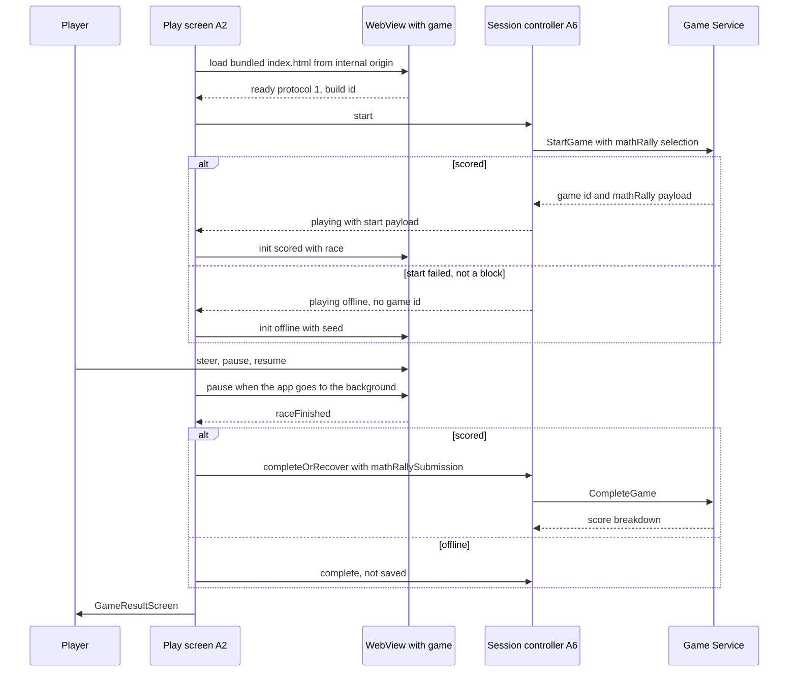

# Math Rally - Component Dependencies

**Created**: 2026-11-25
**Stage**: INCEPTION - Application Design
**Basis**: `math-kart-components.md` (component ids), `math-kart-services.md` (orchestrations)

---

## 1. Dependency Graph

**Text alternative:** The shared package holds three groups: constants and track layout (S1), the seeded race generator (S2 to S5) and the free-tier gate (S7). The game core's scenes and rules (G3 to G13) use S1, the generator and the protocol module (G14). The engine facade (G1) wraps the scenes and the host channel (G15), which uses the protocol. The embed entry (G16) mounts the facade for the app. On the web, the game page (H2) mounts the facade and calls the API module (H4); the setup page (H1) reads the race constants for the path counts; the hub tile (H7) keeps its own copy of the free-difficulty list next to the existing paid list, checked against the shared one by the consistency test. The Game Service start and completion code (B1, B2) uses S1, the generator and the gate, and sends GameCompleted events to the Leaderboard (L1). The web API module and the app's session additions (A6) call the Game Service over HTTPS. The app play screen (A2) uses the bridge and protocol (A3, A4), the asset server (A5) and the session additions. The asset server serves the bundled game (A8), which the embed build (T1) produces from the embed entry. The app bridge exchanges JSON messages with the game's host channel. The seed scripts (D1) write the theme and catalog rows the Game Service reads. Solid arrows are code dependencies; dotted arrows are run-time communication, except the dotted link from the hub tile to the gate, which is a copied list kept equal by a test.

---

## 2. Dependency Matrix

Rows depend on columns. "C" = compile-time import, "R" = run-time call or message, "B" = build-time copy. Empty = no dependency.

| | S1 | S2-S5 | S7 | G1 | G3-G13 | G14 | G15 | G16 | H4 | B1-B2 | L1 | A3-A4 | A5 | A6 | A8 |
|---|---|---|---|---|---|---|---|---|---|---|---|---|---|---|---|
| S2-S5 | C | | | | | | | | | | | | | | |
| G3-G13 | C | C | | | | C | | | | | | | | | |
| G1 | | | | | C | | C | | | | | | | | |
| G15 | | | | | | C | | | | | | | | | |
| G16 | | | | C | | | C | | | | | | | | |
| H1, H3 | C | | | | | | | | C | | | | | | |
| H2 | | | | C | | C | C | | C | | | | | | |
| H4 | | | | | | | | | | R | | | | | |
| B1-B2 | C | C | C | | | | | | | | R | | | | |
| A2 | | | | | | | | | | | | C | C | C | |
| A3-A4 | | | | | | | R | | | | | | | | |
| A5 | | | | | | | | | | | | | | | R |
| A6 | | | | | | | | | | R | | | | | |
| T1 | | | | | | | | B | | | | | | | B |

Checks: the matrix has no cycle (the shared core depends on nothing; the game core depends only on the shared core; hosts depend on the game core and the API; the backend depends only on the shared core). The game core has no edge to H, A, B or L components (FR-MK-42). `apps/mobile` has no compile-time dependency on TypeScript code; it receives the game only as built files (A8). The leaderboard has no compile-time dependency on the shared package (finding F11).

---

## 3. Communication Patterns

| From | To | Pattern | Contract |
|---|---|---|---|
| Web host H2 | Game core | In-memory messages through `DirectChannel` (validated on both sides, same code as the app path) | Methods file Section 4 |
| App bridge A3 | Game core | Game to host: `flutter_inappwebview.callHandler('mathRally', json)`; host to game: `evaluateJavascript('window.__mathRallyReceive(<json string literal>)')` | Same contract; 16 KB |
| Web H4, App A6 | Game Service | GraphQL over HTTPS with the Cognito ID token (existing clients) | `startGame` adds `mathRally`; `completeGame` adds `mathRallySubmission` |
| Game Service | Leaderboard | EventBridge GameCompleted event (existing) | `gameType: 'MATH_RALLY'`, server counts |
| Game core | Asset files | Phaser loader, same-origin XHR and image loads | Web `/games/math-rally/`; app `./` |
| App A5 | WebView | Android asset loader on `https://appassets.androidplatform.net/`; iOS custom scheme `dashden-game://app/` | Allowlisted paths only |
| T1 | A8 | Build-time copy into `apps/mobile/assets/math_rally/` | `build-info.json` |

---

## 4. Data Flow: Scored Race on the Web

**Text alternative:** The React host mounts the game core with an in-memory channel. The game reports ready with protocol 1 and its build id. The host asks the API module to start a Math Rally game; the module sends the StartGame operation with the Math Rally selection. The Game Service runs its gates, draws a seed, builds the race, stores the record with the answer key and returns the game id, rate-limit information and the race payload. The host sends init with the race, language, sound and reduced-motion settings. The game validates the payload, counts down and runs the race while the player steers at each fork. At the finish the game sends the chosen lanes, fork times and race time. The host calls completeGame with the submission; the Game Service checks the stored record, validates the submission and timings, counts correct answers from its own key, computes the score, publishes the GameCompleted event to the Leaderboard and returns the breakdown and any quest result. The host shows the result modal.

---

## 5. Data Flow: Race in the App (Scored and Offline)

**Text alternative:** The play screen loads the bundled page into the WebView from the app-internal origin. The game reports ready. The screen asks the session controller to start, which sends StartGame with the Math Rally selection. If the server returns a game and race payload, the screen sends init in scored mode with the race. If the start failed for a reason other than a block, the round is offline: the screen sends init in offline mode with a random seed and the game builds the race itself. The player steers, pauses and resumes; the screen also pauses the game when the app goes to the background. At the finish the game sends raceFinished. A scored round is submitted through completeOrRecover and the server returns the breakdown; an offline round completes locally as not saved. The screen then shows the result screen.

---

## 6. Deploy-Time Couplings

| Coupling | Risk | Guard |
|---|---|---|
| `packages/shared/**` is a CI trigger path for three Lambdas | Shared edits redeploy Game, Leaderboard and Email Sender | MR2 is additive only; no existing export changes |
| Web H4 needs `mathRally` in the start response | Web live before the Game Service would get no payload | Release order (Game Service before web) and the tile appears only after the seed (D1 last) |
| App A8 bundle vs. game source | Stale bundle in an app release | Build id in `ready`, `--check-only` in the release checklist |
| Leaderboard window vs. Game Service output | Silent event drop | L1 test of AC-38.1 extremes; Leaderboard deployed first |
| Free-difficulty copies (shared, web, app) | Presentation drift | H9 consistency test and the app parity test; server gate decides anyway |
