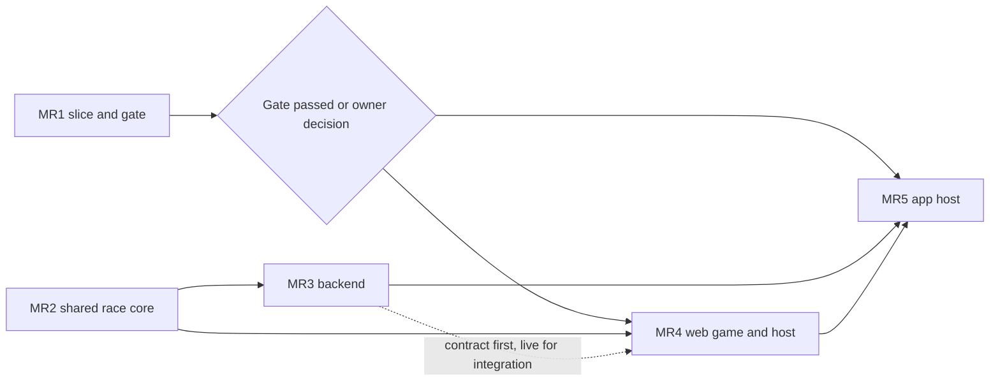

# Math Rally - Unit Dependencies, Release Order and Rollback

**Created**: 2026-11-25
**Stage**: INCEPTION - Units Generation
**Basis**: `math-kart-unit-of-work.md`, `math-kart-component-dependency.md`

---

## 1. Dependency Matrix

Rows depend on columns. "H" = hard (cannot start or finish without it), "C" = contract only (can build against a frozen contract and fixtures, needs the real thing for integration checks), "G" = gate (needs the MR1 gate passed or an owner decision).

| Unit | MR1 | MR2 | MR3 | MR4 | MR5 |
|---|---|---|---|---|---|
| MR1 Vertical slice and gate | - | | | | |
| MR2 Shared race core | | - | | | |
| MR3 Backend | | H | - | | |
| MR4 Web game and host | G | H | C | - | |
| MR5 App host | G | H | H | H | - |

No cycles: MR1 and MR2 depend on nothing; MR3 only on MR2; MR4 on MR1, MR2, MR3; MR5 on all four.

**Text alternative:** MR1 ends at a gate: either the performance gate passes or the owner decides how to continue. MR4 and MR5 start only after that gate. MR2 has no dependency and feeds MR3 and MR4. MR3 needs MR2; MR4 can build against MR3's frozen contract and needs MR3 live for its integration checks. MR5 needs MR3 live and MR4's game core and protocol.

---

## 2. Sequencing

- **Critical path**: MR1 (gate) then MR4 then MR5. The gate is the main schedule risk (R1).
- **Parallel work**: MR2 runs alongside MR1 (pure TypeScript, useful whatever the gate decides, because the server generator is needed in every outcome, including a Flame port). MR3 can start as soon as MR2 merges, still in parallel with MR1.
- **Contract freeze**: the start payload, the submission and the bridge messages (methods file Sections 1 and 4) are frozen at the end of MR2 Functional Design. MR4 builds against fixtures until MR3 is live.
- **If the gate fails**: MR2 and MR3 are kept (the backend does not depend on the renderer). MR4 and MR5 wait for the owner's decision (Q29). A Flame decision would replace MR4's game core and MR5's WebView parts, not the backend.

---

## 3. Production Release Order

Nothing below runs during Inception. Every production AWS command uses `--profile dashden-new` (account `342278407349`), per the workspace deployment rules, and needs the owner's explicit go-ahead.

| Step | Action | Command or mechanism | Check before moving on |
|---|---|---|---|
| 1 | Merge MR2 | CI `deploy-lambdas.yml` redeploys Game, Leaderboard and Email Sender (no behaviour change) | CI run green; Game Lambda handler still `dist/index.handler` |
| 2 | Merge MR3 | CI deploys `MemoryGame-LeaderboardService-prod` and `MemoryGame-GameService-prod`. Manual redeploy, if ever needed: `./scripts/deploy-game-lambda.sh prod` (never a hand-made zip) | Existing games start and complete; a FREE start of a paid game is still refused; no `MathRallySubmissionRejected` or errors in logs |
| 3 | Deploy web MR4 | From `apps/web/`: `npx vercel link --project web-prod --yes && npx vercel --prod --yes`, then `npx vercel link --project web --yes` and restore `.env.local` with dev values | Hub unchanged (no catalog row yet); `/math-rally/setup` loads; entry chunk size as measured |
| 4 | Release the app MR5 | Android build on Windows; iOS build and submission on the owner's Mac; store review | `--check-only` passed; build id recorded |
| 5 | Seed (go-live) | `scripts/seed-math-rally.sh --prod` (typed confirmation), then `scripts/verify-math-rally-seed.sh --prod` | Tile visible on web; one scored race completes and appears on the leaderboard |

Step 4 may follow step 5 if the owner wants web first: older app versions never list Math Rally, and the new app version lists it as soon as it is installed because the catalog row already exists. This choice is the owner's and is recorded at release time.

**Why this order**: the Leaderboard must accept `MATH_RALLY` before any event is published (a rejected event silently produces no entry); the Game Service must return `mathRally` before any host asks for it; the hub tile must lead to a live page, so the seed is last (same rule as the Circuit Builder seed script header).

---

## 4. Rollback

| Unit | Rollback | Data left behind |
|---|---|---|
| MR1 | Revert the merge; the dev route disappears | None |
| MR2 | Revert; CI redeploys the Lambdas | None |
| MR3 | First remove the catalog row (hides the tile) and set the theme row to a non-`PUBLISHED` status (blocks new starts), then revert and let CI redeploy, or redeploy the previous build with `./scripts/deploy-game-lambda.sh prod`. No automated rollback exists | Game records with a `mathRally` attribute stay (harmless to other code paths); leaderboard entries stay |
| MR4 | Promote the previous Vercel deployment of `web-prod` (instant) | None |
| MR5 | Remove the catalog row (the app hides the tile); ship a fixed app version; store releases cannot be rolled back | None |

---

## 5. Testing Checkpoints

| When | What |
|---|---|
| End of MR1 | Gate report reviewed by the owner (pass, or decision) |
| End of MR2 | Shared property tests; contract freeze |
| Before merging MR3 | All `services/game` and `services/leaderboard` suites; existing behaviour of the paid gate for every current paid game |
| Before deploying MR4 | Vitest, `tsc`, build, bundle report, manual web checklist, MR3 live in production |
| Before releasing MR5 | Dart tests, `flutter analyze`, manual device checklist on Android and iPhone, gate re-run in the WebView, `--check-only` |
| After the seed | One scored race per host, leaderboard entry, History entry, FREE user refused at Super Hard |
