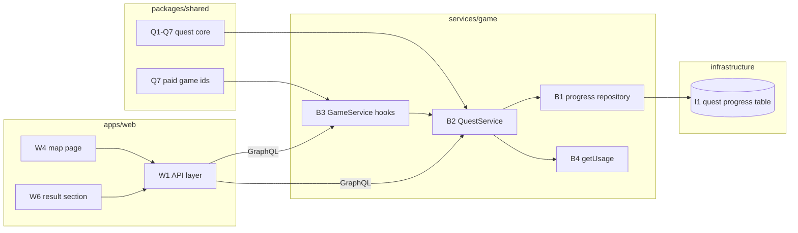

# Quest Map v1 - Component Dependencies

**Created**: 2026-11-01
**Stage**: INCEPTION - Application Design
**Basis**: `quest-map-components.md`, `quest-map-services.md`

---

## 1. Dependency Matrix

Rows depend on columns. `X` is a direct dependency. Components are grouped by package: Q (shared), B (Game Service), I (infrastructure), W (web).

| | Q1 | Q2 | Q3 | Q4 | Q5 | Q6 | Q7 | B1 | B2 | B3 | B4 | B5 | B7 | B8 | I1 | I2 | W1 | W2 | W3 | W4 | W5 | W6 |
|---|---|---|---|---|---|---|---|---|---|---|---|---|---|---|---|---|---|---|---|---|---|---|
| **Q1** Config |  | X |  |  |  |  |  |  |  |  |  |  |  |  |  |  |  |  |  |  |  |  |
| **Q2** Types |  |  |  |  |  |  |  |  |  |  |  |  |  |  |  |  |  |  |  |  |  |  |
| **Q3** Schema |  | X |  |  |  |  |  |  |  |  |  |  |  |  |  |  |  |  |  |  |  |  |
| **Q4** Evaluator | X | X |  |  |  |  |  |  |  |  |  |  |  |  |  |  |  |  |  |  |  |  |
| **Q5** Gauntlet |  | X |  |  |  |  |  |  |  |  |  |  |  |  |  |  |  |  |  |  |  |  |
| **Q6** Validator | X | X |  |  |  |  | X |  |  |  |  |  |  |  |  |  |  |  |  |  |  |  |
| **Q7** Paid ids |  |  |  |  |  |  |  |  |  |  |  |  |  |  |  |  |  |  |  |  |  |  |
| **B1** Repository |  | X |  |  |  |  |  |  |  |  |  |  |  |  | X | X |  |  |  |  |  |  |
| **B2** QuestService | X | X | X | X | X |  |  | X |  |  | X |  | X |  |  |  |  |  |  |  |  |  |
| **B3** GameService hooks |  | X |  |  |  |  | X |  | X |  |  |  | X | X |  |  |  |  |  |  |  |  |
| **B4** getUsage |  |  |  |  |  |  |  |  |  |  |  |  |  |  |  |  |  |  |  |  |  |  |
| **B5** Handler |  |  |  |  |  |  |  |  | X | X |  |  |  |  |  |  |  |  |  |  |  |  |
| **B7** Metrics |  |  |  |  |  |  |  |  |  |  |  |  |  |  |  |  |  |  |  |  |  |  |
| **B8** GameRepository |  | X |  |  |  |  |  |  |  |  |  |  |  |  |  |  |  |  |  |  |  |  |
| **I1** Table |  |  |  |  |  |  |  |  |  |  |  |  |  |  |  |  |  |  |  |  |  |  |
| **I2** Lambda wiring |  |  |  |  |  |  |  |  |  |  |  |  |  |  | X |  |  |  |  |  |  |  |
| **W1** API |  |  |  |  |  |  |  |  |  |  |  | X |  |  |  |  |  | X | X |  |  |  |
| **W2** Launch table |  |  |  |  |  |  |  |  |  |  |  |  |  |  |  |  |  |  |  |  |  |  |
| **W3** Result store |  |  |  |  |  |  |  |  |  |  |  |  |  |  |  |  |  |  |  |  |  |  |
| **W4** Map page |  |  |  |  |  |  |  |  |  |  |  |  |  |  |  |  | X | X |  |  |  |  |
| **W5** Banner |  |  |  |  |  |  |  |  |  |  |  |  |  |  |  |  | X | X |  |  |  |  |
| **W6** Modal section |  |  |  |  |  |  |  |  |  |  |  |  |  |  |  |  |  | X | X |  |  |  |

W-to-B dependencies are runtime over the GraphQL API (W1 to B5), not code imports.

B3 (GameService) depends on B2 (QuestService) through an **optional trailing constructor parameter** built and injected by B5 (GameHandler); existing tests that construct GameService with seven arguments are unaffected, and a quest request without the service fails closed.

Components left out of the matrix to keep it readable, with their only edges: **B6** validation depends on Q3 (parsed inside B2, not in the schema); **I3** app wiring depends on I1 and I2; **W7** hub card depends on the route constant and W4; **W8** page adjustments depend on W1 and W2 (Memory Match) and W3 (Circuit Builder); **W9** badge shelf and **W10** achievements section depend on W1; **W11** locales have no code dependency but are consumed by W4 to W10 (key coverage tested in QM3/QM4). `QUEST_KNOWN_THEME_IDS` (in Q7) is used by Q6 and pinned to web `GAME_THEMES` by a QM3 test.

### Verification
- **No cycles.** Q depends on nothing outside Q. B depends on Q and I only at runtime wiring. W depends on B only through the API contract. I depends on nothing.
- **Q1 to Q7 have no I/O, no clock, no Node or browser API** (NFR-QM-12). `packages/shared` stays platform-neutral.
- **`apps/web` does not import `packages/shared`** for this feature (plan Q1). W2 keeps its own per-game table. The two sides meet at one named contract: `themeId` values and the `QuestProgressView` shape. A drift shows as an unlaunchable node (hidden with a console warning), never a wrong score, since stars are computed server-side only.
- **B3 calls B2 at exactly two sites** (both `completeGame` exits) plus the `startGame` check; rules never leak into B3.

---

## 2. Cross-Package Contract

**Text alternative:** The shared quest core feeds the Quest Service, and the shared paid-game list feeds the Game Service hooks. The hooks call the Quest Service, which uses the progress repository (backed by the new table) and the rate limiter's usage reader. The web API layer talks to the Game Service over GraphQL only, and the map page and result section sit on top of that API layer.

---

## 3. Data Flow Summary

| Flow | Path |
|---|---|
| Load map | W4 → W1 `getQuestProgress` → B5 → B2 → B1 (table), catalog, B4 → view model back |
| Launch node | W4 → W2 builds URL → game page → `api/game.startGame` reads `quest` → B3 → B2 `validateStart`. On failure, rule R1 redirects to W4 `?startFailed=` (the page never sees the error) |
| Finish node | game page → `api/game.completeGame` → B3 → B2 `applyCompletion` → B1 conditional save → `quest` in response → W3 store → W6 |
| Return | W6 "Back to map" (also the only close path in quest mode, rule R2) → W4 refetches (network-only) → unlock marker from W3 `newlyUnlocked` |

## 4. External Dependencies

- DynamoDB: `memory-game-quest-progress-{env}` (new), existing `games`, `rate-limits`, `catalog`, `subscriptions` tables.
- CloudWatch `PutMetricData` (already allowed to the Game Lambda).
- No third-party service or SDK added.
