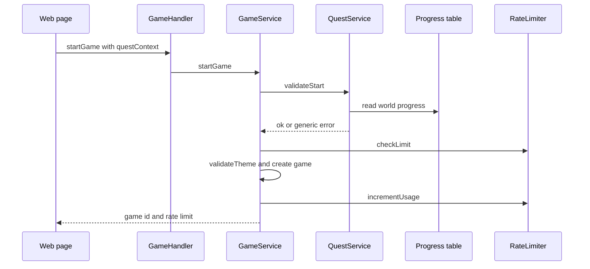
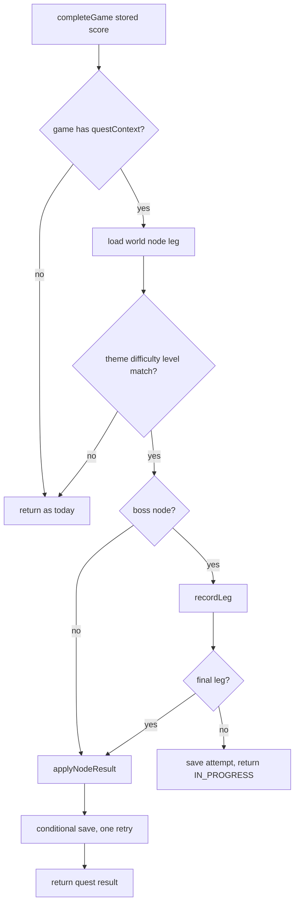

# Quest Map v1 - Services and Orchestration

**Created**: 2026-11-01
**Stage**: INCEPTION - Application Design
**Basis**: `quest-map-components.md`, `quest-map-component-methods.md`. Code read: `services/game/src/services/game.service.ts`, `rate-limiter.service.ts`, `repositories/*.ts`, `handlers/game.handler.ts`, `utils/validation.ts`, `utils/error-mapper.ts`, `index.ts`.

---

## 1. Services

| Service | Package | Role |
|---|---|---|
| QuestService (B2) | `services/game` | Orchestrates repository, catalog, rate limiter and the pure shared rules. Owns the generic quest error |
| GameService (B3, existing) | `services/game` | Gains two hook points. Contains no quest rules itself |
| RateLimiterService (B4, existing) | `services/game` | Gains read-only `getUsage` |
| Shared evaluator and gauntlet rules (Q4, Q5) | `packages/shared` | All quest decisions. Pure, so the same code can serve a v2 Weekly Challenge (NFR-QM-12) |

Security-critical logic (tier gate, unlock check, leg order) lives only in Q4, Q5 and B2, not scattered in handlers (SECURITY-11).

---

## 2. Flow 1 - `startGame` with quest context

Exact order inside `GameService.startGame` (existing steps unchanged, quest steps marked **new**):

1. Handler: `startGameInputSchema` parses; `questContext` is `z.unknown().optional()` (same pattern as `circuitSubmission`), so zod never emits its own error text for it.
2. `subscriptionRepository.getTier(userId)` (existing).
3. **New**: if `questContext` is present, `QuestService.validateStart(...)`. Read-only. This runs **before** the existing paid-game and difficulty-4 gates so that every quest failure returns the single generic message (FR-QM-8 AC8), and **before** `rateLimiter.checkLimit` so a failed check consumes no play.
4. Existing paid-game gate and difficulty-4 gate (kept as defense in depth).
5. `rateLimiter.checkLimit`, then `themeRepository.validateTheme` (existing).
6. `gameRepository.create({..., questContext})` (the stored context is the validated, stripped object).
7. `rateLimiter.incrementUsage`, `publishGameStarted` (existing), then **new** `publishQuestMetric('QuestNodeStarted', worldId)`.

**Injection (decided).** `GameService` gets `questService?: QuestService` as an **optional trailing** constructor parameter (after the seven existing ones). `GameHandler` builds the `QuestService` and passes it. Two existing suites call `new GameService(...)` with seven arguments (`tests/unit/services/game.service.circuit.test.ts:114`, `tests/integration/event-flow.test.ts:49`); they are not edited and still type-check, which keeps FR-QM-19 ("existing suites pass unchanged"). With no service injected, a request **without** `questContext` behaves exactly as today, and a request **with** `questContext` fails closed with the same generic quest error before any play is consumed (never silently treated as a normal play). `finalizeQuest` returns `undefined` when no service is injected.

`validateStart` checks, in order: parse with Q3 (shape, regex, `legIndex` 0 to 2); world exists; node exists (path or bonus); `legIndex < node.legs.length`; world access (PAID world needs tier other than FREE); `leg.themeId === themeId` and `leg.difficulty === difficulty`; read progress; read catalog and refuse an unavailable node; `isNodeStartable`; for `legIndex > 0`, `canStartLeg` against `activeGauntlet`. The boss attempt is **not written at start**; it is created when leg 0 completes, so a start that fails later (rate limit, theme missing) leaves no orphan state.



**Text alternative:** The page sends `startGame` with a quest context. The Game Service first asks the Quest Service to validate it, which reads progress and either approves or raises one generic error. Only then does the Game Service check the daily limit, validate the theme, create the game record with the context, and increment usage.

---

## 3. Flow 2 - `completeGame` hook (both exits)

`GameService.completeGame` has two return points: the generic path and `completeCircuitBuilderGame`. Both get the same two-line addition just before `return`:

```ts
const quest = await this.finalizeQuest(userId, game, score, { levelId: submission?.levelId });
return { game: completedGame, achievements, scoreBreakdown, quest };
```

`finalizeQuest` returns `undefined` immediately when `game.questContext` is absent (no I/O, so non-quest plays are untouched). Otherwise it calls `QuestService.applyCompletion` inside a try and catch. It runs **after** the game record is updated, so the score is already stored. **The `GAME_ALREADY_COMPLETED` status check is not atomic** (`gameRepository.update` has no `ConditionExpression`; the check is a read followed by a write), so two in-flight completions of the same `gameId` (double click, a client retry after a timeout) can both reach the hook. Idempotency therefore comes from two other things: the monotonic merge in `applyNodeResult` (plain nodes) and the `gameId` check in `recordLeg` (boss legs, below). This corrects the earlier reading of FR-QM-9 AC9 ("existing status check"); the requirement text is unchanged and is met by those two mechanisms.

`applyCompletion` steps: look up world, node and leg from the stored context; confirm `game.themeId`, `game.difficulty` and, for Circuit Builder, `levelId` still match the leg (config may have changed since start) else log and return `undefined`; read progress (or empty); if the node is a boss run `recordLeg`:

| Leg result | Progress written | `quest.gauntlet.status` | Stars |
|---|---|---|---|
| Non-final leg, in order | `activeGauntlet` updated | `IN_PROGRESS` with `nextLeg` | 0 |
| Final leg | attempt cleared, `applyNodeResult` with combined score | `COMPLETE` | from combined score |
| Duplicate of a leg already recorded (`attempt.legs[legIndex]?.gameId === gameId`) | nothing written | `IN_PROGRESS` with the same `nextLeg` | 0 |
| Duplicate of the final leg (attempt already cleared, node result already stored) | nothing written | `COMPLETE`, stars from the stored best result for the node | stored best |
| Out of order (`legs.length !== legIndex` and not a duplicate, for example the attempt was replaced in another tab) | attempt cleared | `EXPIRED` | 0 |

The duplicate rows come first in `recordLeg`. A duplicate non-final completion therefore keeps the attempt instead of clearing it. For a duplicate of the final leg the hook sees no attempt and `game.gameId` equal to the node's last stored leg marker; to make that detectable, `NodeProgress` keeps `lastGameId` (the last gameId applied to this node, whether or not it improved the result, so a duplicate of a lower-scoring final leg is also recognised and not reported as `EXPIRED`). Test: "duplicate of a lower-scoring final leg changes nothing and reports `COMPLETE`". `applyCompletion` returns the current stored result without error when `lastGameId === game.gameId`.

The 30-minute rule is **not** evaluated here. Expiry is checked only at leg start, in `validateStart` through `canStartLeg`, measured from `lastActivityAt` (the last completed leg). A leg that passed that check is never expired at completion, so a leg started at minute 29 and finished at minute 33 still counts (named test). `lastActivityAt` is set when leg 0 is recorded and again on every later leg. Non-boss nodes call `applyNodeResult` directly. Save with `saveWorld(expectedVersion)`. On `QuestVersionConflictError`: re-read, re-apply, save once more. A second conflict or any other error: log with ids, publish `QuestProgressWriteFailed`, return `undefined`. Metrics on success: `QuestNodeCleared` when stars go from 0 to at least 1, `QuestWorldCleared` when `worldCleared`.



**Text alternative:** After a game completes, if it carries a quest context the service checks that the stored game still matches the leg. A boss leg is recorded; a non-final leg saves the attempt and returns in-progress, while the final leg or a plain node applies the result. The save is conditional with one retry, then the quest result is returned.

---

## 4. Flow 3 - `getQuestProgress`

Authenticated query, no input. Steps: `getTier`; `listWorlds(userId)`; `catalog.listAvailableGames()` (cached 60 s in the service instance); `rateLimiter.getUsage(userId, tier)`; for each config world compute statuses with the shared evaluator and map to `QuestProgressView`. A PAID world is `accessible: false` for FREE and all its nodes are `LOCKED`, but stored stars still show. When tier is FREE and World 1 has the `WORLD_CLEARED` badge, publish `QuestPaywallHit`. **Definition decided here:** it counts map loads by a FREE user who has cleared World 1 (an impression of the lock), because the web blocks the locked world client-side and a server rejection would almost never fire. It measures reach, not unique users. This is a read operation with a metric side effect; it is the only one, it never throws (metric failures are ignored), and the owner sees the definition in story QM-15. Requirement Q12 only says "paywall hit".

`getUsage` reads the same record `checkLimit` reads: no record or expired `resetAt` means `used: 0`; otherwise `used = count`, `remaining = limit - count`, limit from `getTierLimit`. It is the source for FR-QM-17 and must not use `canStartGame`.

**Correction to the requirements text:** Q2 quotes the limits from `packages/shared/src/constants/rate-limits.ts` (LIGHT 10, STANDARD 30, PREMIUM 100). The server enforces `RateLimiterService.getTierLimit` (FREE 3, LIGHT 20, STANDARD 100, PREMIUM 1000). The FREE value, which drives the Q2 reasoning, is the same in both. Quest Map uses the enforced values. The two lists disagree today; fixing that is out of scope.

---

## 5. Error Handling

| Operation and condition | Recoverable? | Caller receives | Log |
|---|---|---|---|
| `startGame`: bad shape, unknown world or node, `legIndex` out of range, tier too low, theme or difficulty mismatch, locked node, wrong leg order, expired attempt, unavailable node | Yes (client can pick another node) | `ValidationError` with the one message `This quest is not available right now.` (`QUEST_UNAVAILABLE_MESSAGE`) | `warn`: userId, a reason code from a fixed enum, world and node ids **only if** they passed config lookup. Never raw input |
| `startGame`: progress or catalog read fails, or `QUEST_PROGRESS_TABLE_NAME` unset | Fatal for this request; fails closed, no play consumed | Mapped error (`Database error occurred`, or `Quest progress is not configured`); never the SDK message | `error` |
| `startGame` without `questContext` | n/a | Exactly today's behavior | none added |
| `completeGame` hook: any failure, including a second version conflict | Fatal for the reward only; the game is already stored | Normal success response with `quest: null` | `error` plus metric `QuestProgressWriteFailed`. A replay recovers the result (R3 accepted) |
| `completeGame` hook: stored game no longer matches config | Not an error | Success with `quest: null` | `warn` |
| `getQuestProgress`: any read failure | Fatal for the request | Mapped error; the map page shows its retry state | `error` |
| Metric publish fails | Ignored | nothing | `error` (existing `MetricsPublisher` behavior) |

`ConditionalCheckFailedException` is caught inside B1 and thrown as `QuestVersionConflictError` before it reaches `mapDynamoDBError` (which would turn it into a 409 `CONFLICT` seen by clients).

## 6. Input Validation

| Input | Required | Rules | On failure |
|---|---|---|---|
| `questContext` (startGame) | Optional | object; `worldId`, `nodeId` match `^[a-z0-9-]{1,40}$` and exist in config; `legIndex` integer 0 to 2 and below the node's leg count; unknown keys stripped | Generic quest error, no play consumed |
| `getQuestProgress` | none | no client input; `userId` from the verified JWT | n/a |
| `circuitSubmission.levelId` (existing, reused) | Existing | already bounded by `validateCircuitSubmission`; compared to `leg.params.levelId` | No quest result (play still counts as a normal play) |
| Web `quest` URL parameter | Optional | `^[a-z0-9-]{1,40}:[a-z0-9-]{1,40}:[0-2]$`; anything else is ignored (play proceeds as a normal game) | Ignored; the server is the authority anyway |

## 7. Invariants and Who Owns Them

| Invariant | Owner | Why there |
|---|---|---|
| Stars and best score never decrease | `applyNodeResult` (pure) plus the conditional write | Pure rule is testable; the write closes the concurrency window |
| Only `completeGame` can change progress | Service surface: no mutation takes stars | The strongest control is the absence of a write path |
| Failed validation consumes no play | Order of steps in `startGame` (quest check before `checkLimit`) | Ordering is the only place that can guarantee it; covered by a test |
| World 2 needs a paid tier | `QuestService.validateStart` (plus existing `PAID_GAMES` gate) | Server-side; the web lock is cosmetic |
| Leg k+1 needs leg k | `canStartLeg` (shared) read by `validateStart` | Same rule reused in `recordLeg` |
| Config is valid | Config test in CI, not runtime | Catches typos before release |

## 8. Release-Order Behavior (NFR-QM-14)

- **Game code before the table exists** (the expected order, because merging QM2 triggers CI first): `QUEST_PROGRESS_TABLE_NAME` is intentionally **not** added to `validateEnvironment()` in `index.ts`, so ordinary games keep working. Quest operations fail closed.
- **Infrastructure before code**: not the planned order. Table, env var and IAM are applied **without** CDK replacing Game Lambda code (CDK deploys only `MemoryGame-Database-prod`; env var and IAM by CLI); see `quest-map-unit-of-work-dependency.md` Section 3.
- **Web before backend**: the map page would show its error state (a retry state, no data change). The hub card is always rendered (FR-QM-16); the release order (web only after the backend and table are live) is the safety net, with open item O2 gating the QM3 merge.

## 9. Testability

- **Unit, pure (jest + fast-check, `packages/shared`)**: stars mapping, statuses, unlock chain, bonus threshold, monotonic apply, idempotent apply, gauntlet order and expiry (including: leg started 29 minutes after the last activity and completed at 33 counts; leg start at 31 minutes after the last activity is rejected), config validator (including a negative test per rule).
- **Unit with fakes (`services/game`)**: `validateStart` rejection matrix and "no allowance consumed" via a fake rate limiter; both `completeGame` exits call the hook (spy on `finalizeQuest`); `startGame` with `questContext` and no injected `QuestService` is rejected with the generic quest error and consumes no play (named test: "quest context without QuestService fails closed"); named gauntlet tests "duplicate non-final leg completion keeps the attempt" and "duplicate final leg completion changes nothing" (also in `packages/shared` `gauntlet.test.ts` at the `recordLeg` level); one retry on conflict; fail-soft on repository error; `getUsage` for missing, expired and active records.
- **Not unit-testable here**: DynamoDB conditional-write behavior against real DynamoDB (none seen in `services/game/tests`, which has 8 files and no DynamoDB harness); covered by a manual dev-account check, or by a prod read-only check after deploy.
- **Web (vitest)**: `parseQuestParam`, `buildLaunchUrl` per table row, store clear-on-start, modal quest section, locale completeness for the `quest` block. Map accessibility, 320 px layout and reduced motion are MANUAL (U8).
