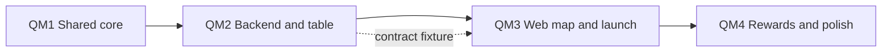

# Quest Map v1 - Unit Dependencies

**Created**: 2026-11-01
**Stage**: INCEPTION - Units Generation
**Basis**: `quest-map-unit-of-work.md`

---

## 1. Dependency Matrix

Rows depend on columns.

| | QM1 | QM2 | QM3 | QM4 |
|---|---|---|---|---|
| **QM1** Shared core | | | | |
| **QM2** Backend and table | X | | | |
| **QM3** Web map and launch | | X (API contract; build can start on a fixture) | | |
| **QM4** Rewards and polish | | | X | |

No cycles. QM3 and QM1 are not directly linked because the web app does not import `packages/shared` for this feature (plan Q1). The one shared fact web needs, the Memory Match card theme ids in `QUEST_KNOWN_THEME_IDS`, is exported as a separate `QUEST_CARD_THEME_IDS` array and checked by a QM3 vitest that reads `packages/shared/src/constants/quest-themes.ts` through a Vite `?raw` import (no node `fs`: `apps/web` has no `@types/node`) and compares that array with `GAME_THEMES`; it is a test-time link, not a runtime import.



**Text alternative:** QM1 comes first, then QM2, then QM3, then QM4. QM3 may start earlier against a fixture of the `QuestProgressView` response, but it cannot be integration-tested until QM2 is deployed.

## 2. Critical Path and Parallelism

- **Critical path**: QM1, QM2, QM3. QM4 is a short tail.
- **Parallel**: QM3 UI work (map layout, launch table, locales) can run alongside QM2 once `QuestProgressView` and `QuestResultPayload` are frozen (they are, in `quest-map-component-methods.md`). Merge order still follows the table below.

## 3. Release Order

**Warning (read before any prod infrastructure step):** CI does not run CDK, but the CDK `LambdaStack` owns the Game Lambda **code** (`NodejsFunction`, `handler: 'handler'`, root-level CDK bundle). The live prod Game Lambda instead runs a `dist/`-prefixed zip with `Handler = dist/index.handler`, set out-of-band by `scripts/deploy-game-lambda.sh`. `cdk diff` compares templates, not live configuration, so it cannot show this difference. **A CDK deploy of `MemoryGame-Lambda-prod` would break prod game start and completion until the script runs again, and no diff gate would warn about it.** Therefore for this feature:

- CDK deploys **only** `MemoryGame-Database-prod` (`--exclusively`). That stack owns no Lambda code.
- The env var and IAM policy are applied with the AWS CLI (below).
- `./scripts/deploy-game-lambda.sh prod` stays the only Game Lambda code deploy.
- Never run `infrastructure/scripts/deploy.sh prod`, `cdk deploy --all`, `cdk deploy MemoryGame-Lambda-prod` or `--require-approval never` against prod (open item O3).

All AWS commands use `--profile dashden-new` (account `342278407349`, region `us-east-1`), need owner approval, and were **not run** in this stage. They are a plan to be checked in Construction.

| Step | Action | Who | Effect |
|---|---|---|---|
| 1 | Merge QM1 to `main` | Owner | CI redeploys Game, Leaderboard and Email Sender Lambdas; no behavior change (additive) |
| 2 | Merge QM2 to `main` | Owner | CI updates `MemoryGame-GameService-prod`. Quest operations exist but fail closed because `QUEST_PROGRESS_TABLE_NAME` is unset; normal play is unaffected (the variable is not in `validateEnvironment()`) |
| 3 | Clean checkout of `main`: `cd infrastructure && npx cdk diff MemoryGame-Database-prod -c environment=prod --profile dashden-new` (read-only) | Owner | The diff shows exactly one new `AWS::DynamoDB::Table` (`memory-game-quest-progress-prod`) and only added `Outputs`/exports that reference it (expected, not verified; confirmed on `cdk synth` in dev during QM2 Infrastructure Design). Any modified or replaced resource, any change to an existing table, or any removed export: stop (O1) |
| 4 | `npx cdk deploy MemoryGame-Database-prod -c environment=prod --profile dashden-new --exclusively` (approval prompt left on) | Owner | Table exists (`RETAIN`, PITR, managed encryption) |
| 5 | IAM: `aws iam put-role-policy --role-name <role> --policy-name QuestProgressTableAccess --policy-document file://quest-policy.json --profile dashden-new`. `<role>` comes from `aws lambda get-function-configuration --function-name MemoryGame-GameService-prod --query Role`. The policy document has one statement: `dynamodb:GetItem`, `PutItem`, `UpdateItem`, `Query` on `arn:aws:dynamodb:us-east-1:342278407349:table/memory-game-quest-progress-prod` only | Owner | Game Lambda may use the table; no other permission changes |
| 6 | Env var by **read-merge-write**: save the current `Environment` to a backup file, add `QUEST_PROGRESS_TABLE_NAME=memory-game-quest-progress-prod` to the full map, write the whole merged map back with `aws lambda update-function-configuration --environment file://env.json`. Verify afterwards that the variable count is previous plus one. Delete the temp files | Owner | Quest operations start working. `--environment` replaces all variables, so a partial map would wipe the others (Stripe, table names) |
| 7 | `./scripts/deploy-game-lambda.sh prod` | Owner | **Canonical Game Lambda code deploy** (workspace deployment rule), with its handler check and smoke test |
| 8 | Pre-launch checks PL1 to PL3; resolve O2 (does Vercel build on merge?) | Owner | Data, thresholds and web deploy path confirmed |
| 9 | Merge QM3, deploy web to `web-prod` | Owner | The hub card is always shown (FR-QM-16), so web goes live only after steps 2 to 7 |
| 10 | QM4 deploy | Owner | Badges and animation |

Env var step, PowerShell sketch (to be validated in Construction; the temp files contain secrets ARNs and must be removed):
```powershell
$cfg = aws lambda get-function-configuration --function-name MemoryGame-GameService-prod --profile dashden-new --region us-east-1 | ConvertFrom-Json
$cfg.Environment | ConvertTo-Json -Depth 5 | Out-File env-backup.json -Encoding ascii
$vars = @{}; $cfg.Environment.Variables.PSObject.Properties | ForEach-Object { $vars[$_.Name] = $_.Value }
$vars['QUEST_PROGRESS_TABLE_NAME'] = 'memory-game-quest-progress-prod'
@{ Variables = $vars } | ConvertTo-Json -Depth 5 | Out-File env.json -Encoding ascii
aws lambda update-function-configuration --function-name MemoryGame-GameService-prod --environment file://env.json --profile dashden-new --region us-east-1
```

**If the owner wants CDK to deploy the Lambda stack anyway:** announce an outage window, run `./scripts/deploy-game-lambda.sh prod` immediately after the CDK deploy, and first check that `aws lambda get-function-configuration --query Handler` equals the handler CDK would set. Until then, `lambda-stack.ts` carries the change only as the declarative record.

Rollback: web by Vercel rollback; backend by reverting and running `./scripts/deploy-game-lambda.sh prod` (no automated rollback in `deploy-lambdas.yml`); the table stays (`RETAIN`, additive); the env var and inline policy can be removed with the same read-merge-write and `aws iam delete-role-policy`. Fallback if the Database stack is not what is live (O1): create the table by `aws dynamodb create-table` with the same key schema and settings, then continue at step 5.

## 4. Coordination Points

- **Contract**: `QuestProgressView` and `QuestResultPayload` (QM2 produces, QM3 consumes). Frozen at design time.
- **Id agreement**: `themeId` values must exist in the QM3 launch table; a missing one hides the node and logs a warning, it never produces a wrong score.
- **Locale keys**: node and world ids defined in QM1 config need matching `quest.nodes.<id>` and `quest.worlds.<id>` keys in QM3, enforced by the quest locale completeness test plus a test that reads node ids from a fixture.
