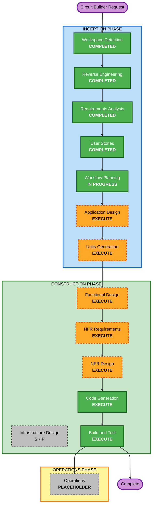

# Circuit Builder - Execution Plan

**Created**: 2026-10-29
**Stage**: INCEPTION - Workflow Planning
**Basis**: reverse engineering artifacts, `circuit-builder-requirements.md`, `circuit-builder-stories.md`, `circuit-builder-personas.md`

**Note on file naming**: An `execution-plan.md` already exists in this directory from the original Memory Game inception. This Circuit Builder file is kept separate so the earlier artifact is preserved.

---

## 1. Detailed Analysis Summary

### 1.1 Transformation Scope

- **Transformation type**: Application feature addition with a new shared module. Not an architectural or deployment-model transformation.
- **Primary changes**: A new circuit-simulation engine in `packages/shared`, a new canvas-based game surface in `apps/web`, server-side result re-evaluation in `services/game`, and a new game type in `services/leaderboard`.
- **Related components**: `apps/web`, `packages/shared`, `services/game`, `services/leaderboard`, `scripts/`, locale files, and the DynamoDB catalog and theme data.
- **Not affected**: AWS CDK stacks, API Gateway routes, Cognito configuration, DynamoDB table definitions, and the Flutter mobile app.

### 1.2 Change Impact Assessment

| Impact area | Affected | Description |
|---|---|---|
| **User-facing changes** | Yes | An entirely new game with a new interaction model, a new hub tile, and a mobile full-screen canvas mode that deviates from the standard shell. |
| **Structural changes** | Yes, moderate | A new shared module consumed by both the browser and a Lambda. No change to service boundaries or deployment topology. |
| **Data model changes** | Yes, additive only | New catalog and theme rows, a new circuit-layout payload shape, and a new leaderboard game type. No table schema changes. |
| **API changes** | Yes, additive only | `completeGame` accepts a circuit layout for re-evaluation. No breaking contract change for existing games. |
| **NFR impact** | Yes | New rendering performance concerns, a new accessibility surface, a new audio capability, and a shift from client-reported to server-verified results. |

### 1.3 Component Relationships

- **Primary components**: `apps/web` (game surface), `packages/shared` (circuit engine)
- **Infrastructure components**: none requiring change
- **Shared components**: `packages/shared`, newly consumed by `services/game` for re-evaluation
- **Dependent components**: `services/game` (entitlement, validation, scoring), `services/leaderboard` (game type, scoring acceptance)
- **Supporting components**: `scripts/` (data seeding and verification), locale files, display registries across History, Achievements, Recent Improvements, and Admin Dashboard

| Component | Change type | Change reason | Priority |
|---|---|---|---|
| `services/leaderboard` | Minor, then additive | Existing build failure must be repaired, then a game type added | Critical |
| `apps/web` (security) | Minor | Required headers and error-disclosure fix | Critical |
| `packages/shared` | Major, additive | New circuit engine consumed by two runtimes | Critical |
| `apps/web` (game) | Major, additive | New pages, canvas, tray, levels, audio | Critical |
| `services/game` | Minor, additive | Paid gate, bounded validation, re-evaluation, review registry | Critical |
| Display registries | Configuration only | Game must appear in all reporting surfaces | Important |
| Locale files | Configuration only | Full English, Spanish, Portuguese content | Critical |
| `scripts/` and data | Configuration only | Catalog and theme rows plus verification | Critical |
| AWS CDK | None | No new cloud resource required | N/A |

### 1.4 Risk Assessment

- **Risk level**: **High**
- **Rollback complexity**: **Difficult for backend, easy for frontend.** Merging matching backend paths to `main` deploys to production Lambdas immediately, and `deploy-lambdas.yml` has no test, smoke, canary, or rollback stage. The Vercel-hosted frontend supports instant rollback.
- **Testing complexity**: **Moderate.** The circuit engine is highly testable as a pure module, but drag, wiring, keyboard, reduced motion, and mobile layout have no automated coverage in this repository.

**Specific risk drivers**
1. The Leaderboard service does not currently compile, and the fix touches scoring logic used by every existing game.
2. Security remediation changes every page. An overly strict Content-Security-Policy can break existing functionality including external fonts.
3. `packages/shared` is a trigger path for the production deploy workflow, so engine work deploys backend Lambdas even before backend integration begins.
4. The documented registry drift means a game can appear to work while being invisible or unrated in other surfaces.

**Risk mitigations already embedded in the plan**
- Three-stage delivery isolates the production-affecting backend change into its own reviewable step.
- The registry consistency check (CB-5.4) converts silent drift into a loud failure.
- The catalog and theme verification command (CB-5.5) converts a silent data problem into an explicit check.
- Server-side re-evaluation removes the client-authoritative scoring path for this game.

---

## 2. Workflow Visualization

**Text alternative:** The Circuit Builder request flows through the Inception phase in order: Workspace Detection, Reverse Engineering, Requirements Analysis, and User Stories are all complete; Workflow Planning is in progress; Application Design and Units Generation will execute next. It then enters the Construction phase, where Functional Design, NFR Requirements, and NFR Design will execute per unit, Infrastructure Design is skipped because no cloud resource changes are required, and Code Generation followed by Build and Test always execute. The Operations phase remains a placeholder. Of fourteen stages, twelve execute and two do not: Infrastructure Design is skipped and Operations is a placeholder.

---

## 3. Phases to Execute

### INCEPTION PHASE
- [x] Workspace Detection (COMPLETED)
- [x] Reverse Engineering (COMPLETED)
- [x] Requirements Analysis (COMPLETED, comprehensive depth)
- [x] User Stories (COMPLETED, 39 stories, 5 personas)
- [x] Workflow Planning (IN PROGRESS)
- [ ] **Application Design — EXECUTE**
  - **Rationale**: Three genuinely new components need their interfaces defined before coding. The circuit engine needs a public API, a circuit graph data model, and a component model. The audio service needs an interface. The canvas surface needs decomposition into tray, grid, renderer, and interaction layers. A new dependency path is also being created, where `packages/shared` becomes a runtime dependency of `services/game` for re-evaluation, and that contract must be explicit before two runtimes depend on it.
- [ ] **Units Generation — EXECUTE**
  - **Rationale**: The work decomposes into seven units across four packages with hard ordering constraints already identified in the story dependency map. The requirements fix a three-stage delivery sequence that needs formalizing into units for the per-unit construction loop. Without this, the prerequisite work and the engine extraction risk being interleaved with feature work, which the risk assessment specifically warns against.

### CONSTRUCTION PHASE
- [ ] **Functional Design — EXECUTE** (per unit, primarily the engine and game units)
  - **Rationale**: Several data models and algorithms need detailed design: the circuit graph representation, connectivity and series/parallel resolution, the Ohm's law solver, short-circuit detection thresholds, the level definition schema, the target machine definition, and the three-factor scoring formula. These are the most error-prone parts of the feature and the hardest to correct after coding.
- [ ] **NFR Requirements — EXECUTE** (per unit, standard depth)
  - **Rationale**: Executing specifically to quantify targets the requirements left open rather than to re-derive the 28 existing NFRs. `NFR-CB-4` requires smooth rendering at "the maximum supported component count" without defining that maximum. Needed values include the component and connection ceiling, a frame budget, the short-circuit resistance threshold, and the payload size limit for `completeGame`.
- [ ] **NFR Design — EXECUTE** (per unit)
  - **Rationale**: Follows from NFR Requirements. Patterns needed include the canvas render loop and dirty-region strategy, the audio lifecycle and gesture-unlock pattern, the keyboard interaction model for a discrete grid, and the reduced-motion fallback approach.
- [ ] **Infrastructure Design — SKIP**
  - **Rationale**: No cloud resource changes are required. The feature adds no DynamoDB table, no Lambda function, no API Gateway route, and no Cognito change, and reuses the existing authenticated `/game/graphql` and `/leaderboard/graphql` routes. The one deployment-configuration change, adding HTTP security headers, lands in `apps/web/vercel.json` and is handled inside the prerequisite unit rather than as an infrastructure design exercise. Catalog and theme rows are data operations covered by CB-5.5, not infrastructure.
- [ ] **Code Generation — EXECUTE** (always, per unit)
  - **Rationale**: Implementation is required.
- [ ] **Build and Test — EXECUTE** (always)
  - **Rationale**: Build verification and the test suite are required, including the manual verification protocol defined in the stories.

### OPERATIONS PHASE
- [ ] Operations — PLACEHOLDER
  - **Rationale**: Reserved for future deployment and monitoring workflows.

---

## 4. Package Change Sequence

### Module update strategy
- **Update approach**: Hybrid. Sequential where dependencies force it, parallel where packages are independent.
- **Critical path**: `services/leaderboard` build repair, then `packages/shared` engine, then `services/game` integration.
- **Coordination points**: the `packages/shared` engine contract shared by browser and Lambda; the leaderboard game-type contract duplicated between `services/leaderboard` and `apps/web`; and the catalog and theme data contract that gates both tile visibility and `startGame` validation.
- **Testing checkpoints**: after each stage, and specifically before any backend merge, because merging deploys to production immediately.
- **Rollback strategy**: frontend rolls back instantly through Vercel. Backend has no automated rollback, so each backend merge must be independently revertible and kept small.

### Sequence

| Order | Package | Change | Depends on | Can parallelize with |
|---|---|---|---|---|
| 1 | `services/leaderboard` | Repair `Difficulty` type mismatch; restore type-check and tests | — | 2 |
| 2 | `apps/web` | Security headers in `vercel.json`; remove stack-trace exposure in `ErrorBoundary` | — | 1 |
| 3 | `packages/shared` | New circuit engine as a pure, deterministic module | — | — |
| 4 | `apps/web` | Game implementation: canvas, tray, levels, sandbox, audio, localization, accessibility | 3 | 5 |
| 5 | `services/game` | Paid gate, bounded validation, server-side re-evaluation, review registry | 3 | 4 |
| 6 | `services/leaderboard` and `apps/web` | Add game type and display metadata across reporting surfaces | 1, 5 | — |
| 7 | `scripts/` and DynamoDB data | Seed catalog and theme rows; run the verification command | 4, 5 | — |

**Caution on order 3**: `packages/shared` is a trigger path in `deploy-lambdas.yml`, so merging the engine deploys the Game, Leaderboard, and Email Sender Lambdas even though no backend behavior has changed yet. The engine must therefore be additive and not alter any existing shared export.

---

## 5. Preliminary Unit Decomposition

To be formalized in Units Generation. Shown here so the sequencing above is legible.

| Unit | Scope | Stage | Primary stories |
|---|---|---|---|
| U1 Prerequisite Enablement | Leaderboard build repair, security headers, error-disclosure fix | S1 | CB-5.1, CB-5.2, CB-5.3 |
| U2 Circuit Engine | Pure engine in `packages/shared` plus unit and property tests | S2 | CB-4.3, CB-2.7 |
| U3 Game Surface | Canvas, tray, placement, wiring, switches, glow rendering | S2 | CB-2.1 to CB-2.6 |
| U4 Levels and Learning | Level definitions, Mars Rover, concept sequencing, tooltips, progressive disclosure | S2 | CB-1.4, CB-1.5, CB-3.1 to CB-3.9, CB-4.1 |
| U5 Platform Quality | Audio service, keyboard model, reduced motion, mobile canvas, localization | S2 | CB-6.1 to CB-6.6 |
| U6 Backend Integration | Paid gate, bounded validation, re-evaluation, scoring, review registry | S3 | CB-1.1 to CB-1.3, CB-4.2, CB-4.4, CB-4.5 |
| U7 Reporting and Data | Leaderboard game type, display metadata, registry check, seeding and verification | S3 | CB-4.6, CB-4.7, CB-5.4, CB-5.5 |

---

## 6. Effort Shape

No calendar estimate is given, because team size and velocity for this project are unknown and the user declined a deadline constraint (Q26=A). Relative sizing against the units above:

| Unit | Relative size | Notes |
|---|---|---|
| U1 Prerequisite Enablement | Small | Bounded fixes, but CSP needs care to avoid breaking existing pages |
| U2 Circuit Engine | Large | The hardest correctness work; highly testable |
| U3 Game Surface | Large | New canvas interaction model with no close precedent |
| U4 Levels and Learning | Medium | Content-heavy once the engine exists |
| U5 Platform Quality | Medium | Audio service is small; keyboard model is the larger part |
| U6 Backend Integration | Medium | Well-understood pattern, but production-affecting |
| U7 Reporting and Data | Small | Mostly registry entries and a seed script, plus the consistency check |

**Stage count**: 12 of 14 stages execute. Infrastructure Design is skipped and Operations is a placeholder.

---

## 7. Success Criteria

- **Primary goal**: A paid player can learn series, parallel, resistance, and short-circuit behavior by building working circuits that power a Mars Rover, with results verified server-side.
- **Key deliverables**: a pure circuit engine in `packages/shared`; a canvas game surface; a sandbox plus six to eight guided levels; a reusable audio service; full English, Spanish, and Portuguese content; server-authoritative scoring; and complete reporting integration.
- **Quality gates**:
  1. Engine unit and property tests pass
  2. `services/game` and `services/leaderboard` type-check and tests pass
  3. `apps/web` type-check, lint, and build pass
  4. Registry consistency check passes (CB-5.4)
  5. Catalog and theme verification passes (CB-5.5)
  6. The 17-item manual verification protocol is executed and recorded
  7. Security Baseline holds for all new code, with the five scoped prerequisite rules remediated
- **Integration testing**: the full flow from hub tile through level completion to leaderboard entry works end to end, and the free-tier gate holds on direct navigation.
- **Operational readiness**: no new monitoring is introduced; this feature inherits existing logging and alarms, and the deferred SECURITY-14 gaps remain recorded debt.
