# Math Rally - Execution Plan

**Created**: 2026-11-25
**Stage**: INCEPTION - Workflow Planning
**Basis**: `../reverse-engineering/math-kart-delta-notes.md`, `../requirements/math-kart-requirements.md` (56 FR, 26 NFR), `../requirements/math-kart-requirement-verification-questions.md` (38 questions, owner answers of 2026-11-25 including Q7, Q20, Q21, Q22), `../user-stories/math-kart-stories.md` (28 stories), `../user-stories/math-kart-personas.md`, and the application design files
**Name**: "Math Rally" (Q22). Files keep the `math-kart-` prefix in this inception run; Section 8 schedules the rename.

---

## 1. Detailed Analysis Summary

### 1.1 Transformation Scope
- **Type**: Application feature addition with one new technology (a game engine) and one new hosting pattern (a game in a WebView). Not an architectural or deployment-model change: no new service, table, queue, environment variable or IAM change.
- **Primary changes**: a pure race core in `packages/shared`; a Phaser 4 game core and a lazy React host in `apps/web`; a third completion exit and a start branch in the Game Service; a game type in the Leaderboard; a WebView screen with a bundled copy of the game in `apps/mobile`; seed scripts.
- **Not affected**: Cognito, API Gateway routes and CORS, infrastructure stacks, Quest Map configuration, daily email, other games' scoring.

### 1.2 Change Impact

| Area | Affected | Description |
|---|---|---|
| User-facing | Yes | New game on web and in the app, setup screens, result reuse, hub tile, leaderboard and history entries, 3 languages |
| Structural | Yes, contained | First lazy route on the web; first WebView-hosted game in the app; new `games/` folder in `apps/web` |
| Data model | Yes, additive | Optional `mathRally` attribute on the existing games table; new theme and catalog rows |
| API | Yes, additive | `startGame` returns `mathRally` for `MATH_RALLY` only; `completeGame` accepts `mathRallySubmission`; no new operation |
| NFR | Yes | Phone frame rate in a WebView, download budgets, server-side anti-cheat, WebView hardening, child privacy, IP safety |

### 1.3 Component Relationships

| Component | Change type | Reason | Priority |
|---|---|---|---|
| `packages/shared` | Minor, additive | Race core and free-tier gate used by server and game | Critical |
| `services/game` | Moderate, additive | Start branch, completion exit, score breakdown, gate wiring | Critical |
| `services/leaderboard` | Minor | Game type and validation window | Critical |
| `apps/web` | Major (new engine), isolated in a lazy chunk | Game core, host pages, registries, partly-free hub | Critical |
| `apps/mobile` | Moderate | New plugin, bridge, screens, bundled assets, registry, partly-free hub | Critical |
| `scripts/` | Minor | Seed and verify scripts | Important |
| `infrastructure/` | None | No resource change | n/a |

### 1.4 Risk Assessment
- **Risk level**: **High**. Reasons: an engine that is new to the repository and whose version and size are unverified (U1, U3); phone performance of a forked pseudo-3D road inside a WebView is unknown (R1); two production Lambdas deploy on merge with no automated rollback; an app store release that cannot be rolled back; IP look-alike risk (R7).
- **Rollback complexity**: **Moderate**. Web rolls back instantly on Vercel; the Lambdas by revert and redeploy; the game can be hidden at once by removing its catalog row; app releases cannot be rolled back, only replaced.
- **Testing complexity**: **Complex**. Pure logic is highly testable (generator, timing, scoring, lanes, joystick, protocol). Rendering, feel, frame rate, WebView behaviour, audio and accessibility need manual device checks; no browser or device test tooling exists (requirements gap 12).

**Top risk drivers and mitigations**
1. **R1 Phone performance** - MR1 runs first and ends at a measurable gate; named levers before any escalation; the owner decides on Flame.
2. **R2 Phaser 4 maturity** - pinned at MR1 start; capabilities checked one by one; any change of engine or version goes to the owner.
3. **R3 WebView quirks** - MR1 spike on both platforms before MR5; plugin features (U6) checked first.
4. **R4 iOS on the owner's Mac only** - iOS steps written as owner tasks with exact commands; scheduled at the end of MR1 and MR5.
5. **Production deploy on merge** - MR2 and MR3 additive; Math Rally paths unreachable until the seed; release order in `../application-design/math-kart-unit-of-work-dependency.md` Section 3.
6. **R16 Free-difficulty drift** - one shared constant, copies checked by tests, server decides.

---

## 2. Workflow Visualization

```mermaid
flowchart TD
    Start(["Math Rally request"])

    subgraph INCEPTION["INCEPTION PHASE"]
        WD["Workspace Detection<br/><b>COMPLETED</b>"]
        RE["Reverse Engineering delta<br/><b>COMPLETED</b>"]
        RA["Requirements Analysis<br/><b>COMPLETED</b>"]
        US["User Stories<br/><b>COMPLETED</b>"]
        WP["Workflow Planning<br/><b>COMPLETED</b>"]
        AD["Application Design<br/><b>COMPLETED</b>"]
        UG["Units Generation<br/><b>COMPLETED</b>"]
    end

    subgraph CONSTRUCTION["CONSTRUCTION PHASE per unit MR1 to MR5"]
        FD["Functional Design<br/><b>EXECUTE all units</b>"]
        NFRA["NFR Requirements<br/><b>EXECUTE MR1 MR5</b>"]
        NFRD["NFR Design<br/><b>EXECUTE MR1 MR4</b>"]
        ID["Infrastructure Design<br/><b>SKIP</b>"]
        CG["Code Generation<br/><b>EXECUTE</b>"]
        BT["Build and Test<br/><b>EXECUTE once</b>"]
    end

    subgraph OPERATIONS["OPERATIONS PHASE"]
        OPS["Operations<br/><b>PLACEHOLDER</b>"]
    end

    Start --> WD
    WD --> RE
    RE --> RA
    RA --> US
    US --> WP
    WP --> AD
    AD --> UG
    UG --> FD
    FD --> NFRA
    NFRA --> NFRD
    NFRD --> ID
    ID --> CG
    CG --> BT
    BT --> OPS
    BT --> End(["Complete"])

    style WD fill:#4CAF50,stroke:#1B5E20,stroke-width:3px,color:#fff
    style RE fill:#4CAF50,stroke:#1B5E20,stroke-width:3px,color:#fff
    style RA fill:#4CAF50,stroke:#1B5E20,stroke-width:3px,color:#fff
    style US fill:#4CAF50,stroke:#1B5E20,stroke-width:3px,color:#fff
    style WP fill:#4CAF50,stroke:#1B5E20,stroke-width:3px,color:#fff
    style AD fill:#4CAF50,stroke:#1B5E20,stroke-width:3px,color:#fff
    style UG fill:#4CAF50,stroke:#1B5E20,stroke-width:3px,color:#fff
    style FD fill:#FFA726,stroke:#E65100,stroke-width:3px,stroke-dasharray: 5 5,color:#000
    style NFRA fill:#FFA726,stroke:#E65100,stroke-width:3px,stroke-dasharray: 5 5,color:#000
    style NFRD fill:#FFA726,stroke:#E65100,stroke-width:3px,stroke-dasharray: 5 5,color:#000
    style ID fill:#BDBDBD,stroke:#424242,stroke-width:2px,stroke-dasharray: 5 5,color:#000
    style CG fill:#4CAF50,stroke:#1B5E20,stroke-width:3px,color:#fff
    style BT fill:#4CAF50,stroke:#1B5E20,stroke-width:3px,color:#fff
    style OPS fill:#BDBDBD,stroke:#424242,stroke-width:2px,stroke-dasharray: 5 5,color:#000
    style INCEPTION fill:#BBDEFB,stroke:#1565C0,stroke-width:3px,color:#000
    style CONSTRUCTION fill:#C8E6C9,stroke:#2E7D32,stroke-width:3px,color:#000
    style OPERATIONS fill:#FFF59D,stroke:#F57F17,stroke-width:3px,color:#000
    style Start fill:#CE93D8,stroke:#6A1B9A,stroke-width:3px,color:#000
    style End fill:#CE93D8,stroke:#6A1B9A,stroke-width:3px,color:#000

    linkStyle default stroke:#333,stroke-width:2px
```

**Text alternative:**
Phase 1 INCEPTION, all completed: Workspace Detection, Reverse Engineering (delta note), Requirements Analysis, User Stories, Workflow Planning, Application Design, Units Generation.
Phase 2 CONSTRUCTION, run for each unit MR1 to MR5 in the order of Section 5: Functional Design (execute for all units, depth per unit in Section 3), NFR Requirements (execute for MR1 and MR5), NFR Design (execute for MR1 and MR4), Infrastructure Design (skip), Code Generation (execute), then Build and Test once after all units. Arrows pass through skipped stages only to show their place.
Phase 3 OPERATIONS: placeholder.
Green means done or always runs, orange means conditional execute, grey means skip.

---

## 3. Phases to Execute

### INCEPTION PHASE
- [x] Workspace Detection (COMPLETED; worktree `.worktrees/math-kart`, branch `feat/math-kart` from `c6ccf0f`)
- [x] Reverse Engineering (COMPLETED as a delta note; the full set at `a328c74` is stale)
- [x] Requirements Analysis (COMPLETED, comprehensive depth; owner answers recorded, no open question)
- [x] User Stories (COMPLETED, standard depth: 4 personas, 28 stories)
- [x] Workflow Planning (COMPLETED, this document)
- [x] Application Design (COMPLETED: components, methods, services, dependencies, concept)
- [x] Units Generation (COMPLETED: 5 units)

### CONSTRUCTION PHASE

| Stage | MR1 Slice and gate | MR2 Shared core | MR3 Backend | MR4 Web | MR5 App |
|---|---|---|---|---|---|
| Functional Design | **Minimal**: track and speed constants for the slice, fork geometry, quality profiles, gate protocol and devices | **Standard**: operand ranges per question kind, distractor rules per kind, track distances meeting the layout contracts, timing tolerance | **Minimal**: score constants meeting AC-32.4, rejection text, completion sequence check | **Standard**: HUD layout at 320 and 1280 px, feedback timings, setup page, host state transitions, partly-free hub wording | **Standard**: play-screen states and overlays, lifecycle and Back rules, offline round |
| NFR Requirements | **Standard**: Phaser version pin and licence, size budget method, frame-time measurement method, WebView plugin pin and feature checklist | SKIP | SKIP | SKIP | **Minimal**: WebView settings per platform as confirmed in MR1, iOS audio session, app size check |
| NFR Design | **Minimal**: performance patterns (pooling, level of detail, render scale, delta clamp) | SKIP | SKIP | **Minimal**: CSP change if needed, lazy loading and prefetch, accessibility patterns | SKIP |
| Infrastructure Design | SKIP | SKIP | SKIP | SKIP | SKIP |
| Code Generation | EXECUTE | EXECUTE | EXECUTE | EXECUTE | EXECUTE |

**Rationale**
- **Functional Design everywhere**: each unit has numbers or rules the requirements leave open on purpose (content ranges, score constants, layout sizes, screen states).
- **NFR Requirements for MR1 and MR5**: these are where the stack is still being confirmed (Phaser 4 version and size, WebView plugin features). The other units add no NFR beyond what NFR-MK-1 to 26 already state.
- **NFR Design for MR1 and MR4**: performance patterns for the renderer, and CSP and accessibility patterns for the web host. MR3's security patterns are fully specified in `math-kart-services.md`.
- **Infrastructure Design skipped**: no cloud resource is added or changed; one new CloudWatch metric is published from code into the existing namespace.
- **Code Generation**: always. **Build and Test**: always, once after MR5, including the manual device checklists and pre-launch checks PL1 to PL7.

### OPERATIONS PHASE
- [ ] Operations - PLACEHOLDER

---

## 4. Security Baseline at Each Stage

The Security Baseline extension is enabled (`aidlc-state.md`, Extension Configuration; Q37). The design-stage compliance table is in `../application-design/math-kart-components.md` Section 7: no blocking finding. Construction re-checks SECURITY-03, 04, 05, 08, 09, 10, 11, 13 and 15 per unit at Code Generation and Build and Test; SECURITY-01, 02, 06, 07, 12 and 14 stay N/A unless a unit adds a store, gateway, IAM change, network change, auth change or alarm.

---

## 5. Package Change Sequence

- **Approach**: hybrid. MR1 and MR2 in parallel; MR3 after MR2; MR4 after the gate; MR5 last.
- **Critical path**: MR1 gate, MR4, MR5.
- **Coordination points**: start payload, submission and bridge messages (frozen at the end of MR2 Functional Design); free-difficulty constant and its two copies; theme id `MATH_RALLY` across server, leaderboard, web and app.
- **Testing checkpoints**: `../application-design/math-kart-unit-of-work-dependency.md` Section 5.

| Order | Package | Unit | Depends on | Production effect on merge |
|---|---|---|---|---|
| 1a | `apps/web` (dev route only) | MR1 | none | None (dev route excluded from production builds) |
| 1b | `packages/shared` | MR2 | none | Redeploys three Lambdas, no behaviour change |
| 2 | `services/game`, `services/leaderboard`, `scripts/` | MR3 | MR2 | Deploys two Lambdas; Math Rally unreachable until the seed |
| 3 | `apps/web` | MR4 | MR1 gate, MR2, MR3 | Vercel deploy when run; no tile until the seed |
| 4 | `apps/mobile` (+ embed build in `apps/web`) | MR5 | MR3, MR4 | Store release |
| 5 | Data | seed | 2 to 4 live | Go-live |

---

## 6. Effort Shape

No calendar estimate (no velocity data for this kind of work in this repository). Relative size: MR1 Large, MR2 Medium, MR3 Large, MR4 Large, MR5 Large. Stage count: 5 x Functional Design, 2 x NFR Requirements, 2 x NFR Design, 5 x Code Generation, 1 x Build and Test. The biggest uncertainty is MR1: if the gate fails, MR4 and MR5 wait for an owner decision and their size may change completely.

---

## 7. Success Criteria

- **Primary goal**: a child can race Math Rally on a phone in the app and on dashden.app, pick the road with the right answer using a one-thumb joystick or the keyboard, and get a score the server computed.
- **Key deliverables**: the five units of `../application-design/math-kart-unit-of-work.md`; seed and verify scripts; the paid-switch checklist (FR-MK-54); the gate report.
- **Quality gates**
  1. `packages/shared`: `npx jest`, `npx tsc --noEmit`
  2. `services/game` and `services/leaderboard`: `npx jest`, `npx tsc --noEmit`; existing suites unchanged (pre-existing failures unchanged)
  3. `apps/web`: `npx vitest run`, `npx tsc --noEmit`, `npm run build`, bundle report within NFR-MK-3
  4. `apps/mobile`: `flutter analyze`, `flutter test`; embed `--check-only`
  5. Gate (NFR-MK-1, NFR-MK-2) passed on the reference devices with the full game
  6. Manual checklists of MR1, MR4 and MR5 recorded; pre-launch checks PL1 to PL7 recorded
  7. Security Baseline holds for all new code
- **Integration testing**: one scored race per host through to the leaderboard and History; a FREE user refused at Super Hard; with an injected paid list in tests, FREE Easy allowed and Medium refused.
- **Operational readiness**: existing metrics plus `MathRallySubmissionRejected`; no new alarm (pre-existing SECURITY-14 debt).

---

## 8. First Construction Step: Rename the Files

The owner named the game "Math Rally" (Q22) during this inception run. To keep the workflow's review and report steps working, the inception files keep the `math-kart-` prefix. The first Construction step (before MR1 Functional Design) is:
1. `git mv` every `aidlc-docs/**/math-kart-*.md` file to `math-rally-*.md` (15 files: delta notes, questions, requirements, personas, stories, application-design plan, execution plan, components, component methods, services, component dependency, unit of work, unit dependency, story map, concept; count re-checked at rename time).
2. Update every relative link between them in one commit (search for `math-kart-`).
3. Keep the `MK` id labels (FR-MK, NFR-MK, MK-n, MKP) so traceability and the audit log stay readable.
4. Leave the branch name `feat/math-kart` and the worktree `.worktrees/math-kart` as they are, or rename them only with the owner's agreement.
