# Quest Map v1 - Execution Plan

**Created**: 2026-11-01
**Stage**: INCEPTION - Workflow Planning
**Basis**: reverse engineering artifacts, `quest-map-requirements.md`, `quest-map-stories.md`, `quest-map-personas.md`, plus code, CDK and workflow files read for this stage
**File naming**: prefixed so `execution-plan.md` and `circuit-builder-execution-plan.md` stay intact.

---

## 1. Detailed Analysis Summary

### 1.1 Transformation Scope
- **Type**: Application feature addition. Not an architectural or deployment-model change.
- **Primary changes**: a pure quest module in `packages/shared`; a quest service, repository and two hooks in `services/game`; one new DynamoDB table; a map page and small hooks into existing screens in `apps/web`.
- **Not affected**: `services/leaderboard`, catalog and review registries, backend `AchievementType` enum and tracker, Cognito, API Gateway routes (the existing `/game/graphql` route carries the new operation), Flutter app.

### 1.2 Change Impact

| Area | Affected | Description |
|---|---|---|
| User-facing | Yes | New screen, new launch path into 13 games, result screen additions, 3 locales |
| Structural | Yes, small | One new shared module and one new service class; no topology change |
| Data model | Yes, additive | New table `memory-game-quest-progress-{env}`; optional `questContext` on the game record |
| API | Yes, additive | Optional `questContext` input, `quest` result field, one new query |
| NFR | Yes | Server-side access control for a paid world, input validation, accessibility of a new screen |

### 1.3 Component Relationships

| Component | Change type | Reason | Priority |
|---|---|---|---|
| `packages/shared` | Minor, additive | New module and one extracted constant | Critical |
| `services/game` | Minor, additive | Hooks in `startGame` and both `completeGame` exits | Critical |
| `infrastructure` | Minor | One table, env var, IAM statement | Critical |
| `apps/web` | Moderate | New route and page; changes to `api/game.ts` (start-failure rule R1), `AppLayout`, `ScoreBreakdownModal` (result rule R2); two page edits (Memory Match, Circuit Builder) | Critical |
| Locale files | Configuration | en, es, pt keys | Critical |
| `services/leaderboard` | None | Events unchanged (FR-QM-19) | n/a |

### 1.4 Risk Assessment
- **Risk level**: **Medium**. Lower than Circuit Builder (High) because there is no new engine, no repair of a failing service and no security-header change. Higher than Low because two production Lambdas deploy on merge and a paid-world boundary is introduced.
- **Rollback complexity**: **Moderate**. Frontend rolls back instantly on Vercel. `deploy-lambdas.yml` has no test, smoke or rollback stage, so a backend rollback is a revert plus redeploy. The new table is `RETAIN` and additive and can stay.
- **Testing complexity**: **Moderate**. Rules are pure and highly testable. Map accessibility, mobile layout and reduced motion have no automated coverage (U8).

**Risk drivers and mitigations**
1. Touching the shared `ScoreBreakdownModal` (22 importers): mitigated by the store approach, which needs no prop changes.
2. A dozen game pages in the launch path: several handle a failed start badly today (hub, setup page, or silent unscored play, see `quest-map-components.md` U1). Mitigated by two central rules, R1 in `api/game.ts` and R2 in `ScoreBreakdownModal`, so only two pages are edited (R1 also returns `canPlay: true` for a valid quest start, so the last allowed play works on the four pages that read `canPlay`); the manual checklist opens all 13 pages once from a node.
3. `packages/shared/**` is a Lambda trigger path: QM1 is additive only.
4. Slow free progression (3 plays a day) may hurt retention (R1): accepted by the owner (Q2=A); the map shows remaining plays.
5. Stars inherit client-reported scoring trust (NFR-QM-7): stated limit, stars have no money value.
6. **Infrastructure deploy can break prod (HIGH, found in review).** The CDK `LambdaStack` declares `handler: 'handler'` (root-level bundle) but the live Game Lambda runs `dist/index.handler`, set out-of-band by `scripts/deploy-game-lambda.sh`; `cdk diff` compares templates, not live config, so it cannot catch this. Mitigation: CDK deploys only `MemoryGame-Database-prod` (`--exclusively`); env var by read-merge-write and IAM by `put-role-policy`; `deploy-game-lambda.sh prod` is the only Game Lambda code deploy; never `deploy.sh prod`, `--all` or `cdk deploy MemoryGame-Lambda-prod` (open item O3). Whether prod stacks are CDK-managed is still unverified (O1).
7. Web could reach production before the backend (Vercel Git integration unverified, O2): the hub card is always shown (FR-QM-16), so the release order is the guard and O2 must be answered before the QM3 merge. A map opened before the backend is live shows its retry state and changes no data.

---

## 2. Infrastructure Deployment (U4 finding)

- `.github/workflows/deploy-lambdas.yml` is the only workflow. Trigger: push to `main`, paths `services/game/src/**`, `services/leaderboard/src/**`, `services/email-sender/**`, `packages/shared/**`. It only runs `aws lambda update-function-code`. **It does not run CDK.**
- Infrastructure is deployed manually: `infrastructure/scripts/deploy.sh <env>` runs `build-lambdas.sh` and then `cdk deploy --all -c environment=<env> --require-approval never` over all seven stacks in `infrastructure/bin/memory-game.ts`; `infrastructure/package.json` has `deploy:prod`.
- **The CDK `LambdaStack` also owns Game and Auth Lambda code** (`NodejsFunction`, `handler: 'handler'`, `entry` `services/game/src/index.ts`, `lambda-stack.ts`), while the live Game Lambda handler is `dist/index.handler` (set by `scripts/deploy-game-lambda.sh`, which ships a `dist/`-prefixed zip). `cdk diff` cannot see live handler drift, so a CDK deploy of `MemoryGame-Lambda-prod` would fail every game start and completion until the script re-runs. **Decided procedure** (commands in `quest-map-unit-of-work-dependency.md` Section 3): `cdk diff` then `cdk deploy MemoryGame-Database-prod --exclusively` (only the new table and its added Outputs/exports); `QUEST_PROGRESS_TABLE_NAME` added by read-merge-write of the full environment map (`update-function-configuration --environment` replaces all variables); IAM by `aws iam put-role-policy` scoped to the one table ARN; `lambda-stack.ts` keeps the change as the declarative record, but `cdk deploy MemoryGame-Lambda-prod` is not run against prod until the mismatch is reconciled (open item O3); `./scripts/deploy-game-lambda.sh prod` is the only Game Lambda code deploy (CI on merge publishes the same source).
- The CDK Game Lambda gets table names as environment variables and one shared IAM statement in `infrastructure/lib/stacks/lambda-stack.ts`. The new table needs a new env var and its own statement there, plus a new `DatabaseStack` field and wiring in `infrastructure/bin/memory-game.ts`.
- **Not verified**: that the live prod stacks in account `342278407349` are CDK-managed. `prodConfig.account` reads `CDK_DEFAULT_ACCOUNT`, and the CDK Stripe secret ARNs hard-code the old account `848403890404`. If the Database stack is not what is live, the table is created with `aws dynamodb create-table` (same key schema and settings). Open item O1, resolved by a read-only `cdk diff MemoryGame-Database-prod` with owner approval. Open item O3: reconcile CDK handler/bundling with the live `dist/index.handler`.

---

## 3. Workflow Visualization

```mermaid
flowchart TD
    Start(["Quest Map v1 request"])

    subgraph INCEPTION["INCEPTION PHASE"]
        WD["Workspace Detection<br/><b>COMPLETED</b>"]
        RE["Reverse Engineering<br/><b>COMPLETED</b>"]
        RA["Requirements Analysis<br/><b>COMPLETED</b>"]
        US["User Stories minimal<br/><b>COMPLETED</b>"]
        WP["Workflow Planning<br/><b>COMPLETED</b>"]
        AD["Application Design<br/><b>COMPLETED</b>"]
        UG["Units Generation<br/><b>COMPLETED</b>"]
    end

    subgraph CONSTRUCTION["CONSTRUCTION PHASE per unit QM1 to QM4"]
        FD["Functional Design<br/><b>EXECUTE QM1 QM2 QM3</b>"]
        NFRA["NFR Requirements<br/><b>SKIP</b>"]
        NFRD["NFR Design<br/><b>SKIP</b>"]
        ID["Infrastructure Design<br/><b>EXECUTE QM2 only</b>"]
        CG["Code Generation<br/><b>EXECUTE</b>"]
        BT["Build and Test<br/><b>EXECUTE once</b>"]
    end

    subgraph OPERATIONS["OPERATIONS PHASE"]
        OPS["Operations<br/><b>PLACEHOLDER</b>"]
    end

    Start --> WD
    WD --> RE
    RE --> RA
    RA --> US
    US --> WP
    WP --> AD
    AD --> UG
    UG --> FD
    FD --> NFRA
    NFRA --> NFRD
    NFRD --> ID
    ID --> CG
    CG --> BT
    BT --> OPS
    BT --> End(["Complete"])

    style WD fill:#4CAF50,stroke:#1B5E20,stroke-width:3px,color:#fff
    style RE fill:#4CAF50,stroke:#1B5E20,stroke-width:3px,color:#fff
    style RA fill:#4CAF50,stroke:#1B5E20,stroke-width:3px,color:#fff
    style US fill:#4CAF50,stroke:#1B5E20,stroke-width:3px,color:#fff
    style WP fill:#4CAF50,stroke:#1B5E20,stroke-width:3px,color:#fff
    style AD fill:#4CAF50,stroke:#1B5E20,stroke-width:3px,color:#fff
    style UG fill:#4CAF50,stroke:#1B5E20,stroke-width:3px,color:#fff
    style FD fill:#FFA726,stroke:#E65100,stroke-width:3px,stroke-dasharray: 5 5,color:#000
    style ID fill:#FFA726,stroke:#E65100,stroke-width:3px,stroke-dasharray: 5 5,color:#000
    style NFRA fill:#BDBDBD,stroke:#424242,stroke-width:2px,stroke-dasharray: 5 5,color:#000
    style NFRD fill:#BDBDBD,stroke:#424242,stroke-width:2px,stroke-dasharray: 5 5,color:#000
    style CG fill:#4CAF50,stroke:#1B5E20,stroke-width:3px,color:#fff
    style BT fill:#4CAF50,stroke:#1B5E20,stroke-width:3px,color:#fff
    style OPS fill:#BDBDBD,stroke:#424242,stroke-width:2px,stroke-dasharray: 5 5,color:#000
    style INCEPTION fill:#BBDEFB,stroke:#1565C0,stroke-width:3px,color:#000
    style CONSTRUCTION fill:#C8E6C9,stroke:#2E7D32,stroke-width:3px,color:#000
    style OPERATIONS fill:#FFF59D,stroke:#F57F17,stroke-width:3px,color:#000
    style Start fill:#CE93D8,stroke:#6A1B9A,stroke-width:3px,color:#000
    style End fill:#CE93D8,stroke:#6A1B9A,stroke-width:3px,color:#000

    linkStyle default stroke:#333,stroke-width:2px
```

**Text alternative:**
Phase 1 INCEPTION: Workspace Detection (completed), Reverse Engineering (completed), Requirements Analysis (completed), User Stories at minimal depth (completed), Workflow Planning (completed), Application Design (completed), Units Generation (completed).
Phase 2 CONSTRUCTION, run for each of units QM1 to QM4 in order: Functional Design (execute for QM1, QM2, QM3), NFR Requirements (skip), NFR Design (skip), Infrastructure Design (execute for QM2 only), Code Generation (execute), then Build and Test once after all units. The arrows pass through the skipped stages only to show their place in the sequence.
Phase 3 OPERATIONS: placeholder.
Green means done or always runs, orange means conditional execute, grey means skip.

---

## 4. Phases to Execute

### INCEPTION PHASE
- [x] Workspace Detection (COMPLETED)
- [x] Reverse Engineering (COMPLETED; artifacts at HEAD `a328c74`, Circuit Builder code read in the working tree)
- [x] Requirements Analysis (COMPLETED, standard depth, approved 2026-10-30)
- [x] User Stories (COMPLETED, minimal depth: 3 personas, 15 stories)
- [x] Workflow Planning (COMPLETED, this document)
- [x] Application Design (COMPLETED, 4 files)
- [x] Units Generation (COMPLETED, 4 units)

### CONSTRUCTION PHASE
Per-unit depth:

| Stage | QM1 Shared core | QM2 Backend and table | QM3 Web map and launch | QM4 Rewards |
|---|---|---|---|---|
| Functional Design | **Standard**: threshold numbers and max-score table, node ids, map coordinates, boss-unavailable rule | **Minimal**: exact `applyCompletion` sequence and conflict-retry cases | **Minimal**: node states, panel content, map layout rules | SKIP |
| NFR Requirements | SKIP | SKIP | SKIP | SKIP |
| NFR Design | SKIP | SKIP | SKIP | SKIP |
| Infrastructure Design | SKIP | **Minimal**: table, env var, IAM, CLI-based prod procedure and O3 | SKIP | SKIP |
| Code Generation | EXECUTE | EXECUTE | EXECUTE | EXECUTE |

**Rationale**
- **Functional Design, QM1 (standard)**: the numbers (thresholds per node, bonus threshold) and the world-complete rule when the boss is unavailable are the main unknowns; Q4=B requires them to come from the score formula, and a wrong choice is hard to change after players have stars.
- **Functional Design, QM2/QM3 (minimal)**: the flows are already specified in `quest-map-services.md`; a short design note per unit settles remaining edge cases.
- **Functional Design, QM4 (skip)**: two presentational pieces with no new rules.
- **NFR Requirements (skip)**: the 14 NFR-QM already carry targets (NFR-QM-1 etc.), and no tech-stack choice is open (stack locked in `quest-map-components.md`).
- **NFR Design (skip)**: the only NFR patterns needed (conditional write with one retry, fail-closed access, fail-soft reward, generic error) are specified in `quest-map-services.md` Sections 3 to 7. Security Baseline compliance is checked at Code Generation and Build and Test.
- **Infrastructure Design, QM2 only**: the only unit that adds a cloud resource. Records table definition, env var, IAM statement and the manual deploy sequence that keeps CDK away from Game Lambda code (Section 2).
- **Code Generation**: always. **Build and Test**: always, once after QM4, including the manual checklist (PL1 to PL6).

### OPERATIONS PHASE
- [ ] Operations - PLACEHOLDER

---

## 5. Package Change Sequence

- **Approach**: Sequential on the critical path (QM1, QM2, QM3), with QM3 UI work able to start early against a contract fixture.
- **Coordination points**: `QuestProgressView` and `QuestResultPayload` shapes; `themeId` values shared by config and the web launch table; node and world ids shared by config and locale keys.
- **Testing checkpoints**: after each unit with its commands (see `quest-map-unit-of-work.md`); before any backend merge, because merging deploys to production.

| Order | Package | Change | Depends on |
|---|---|---|---|
| 1 | `packages/shared` | QM1 quest core (additive) | none |
| 2 | `services/game`, then `infrastructure` | QM2: merge (CI deploys code; quest calls fail closed until the table exists), then Database-stack-only CDK deploy, IAM and env var by CLI, then `deploy-game-lambda.sh prod` | 1 |
| 3 | `apps/web` | QM3 map, launch, result section (hub card always shown; O2 resolved before merge) | 2 |
| 4 | `apps/web` | QM4 badges and animation | 3 |

Caution on order 1: merging `packages/shared` redeploys three Lambdas; keep it additive.

---

## 6. Effort Shape

No calendar estimate (no velocity data for this project). Relative size: QM1 Medium, QM2 Large, QM3 Large, QM4 Small. Stage count: 4 units x (Code Generation) + 3 Functional Design + 1 Infrastructure Design + Build and Test. About 40% of Circuit Builder's stories (15 of 39) and 4 units instead of 7.

---

## 7. Success Criteria

- **Primary goal**: A free player can clear World 1 on a map with server-verified stars; a paid player can play World 2, replay for 3 stars and earn both badges.
- **Quality gates**
  1. `packages/shared`: `npx jest`, `npx tsc --noEmit`
  2. `services/game`: `npx jest`, `npx tsc --noEmit`; existing suites unchanged
  3. `infrastructure`: `npm run build`; read-only `cdk diff MemoryGame-Database-prod` shows exactly one new `AWS::DynamoDB::Table` (`memory-game-quest-progress-prod`) and only added Outputs/exports that reference it (expected, not verified); any modified or replaced resource, change to an existing table, or removed export: stop (O1)
  4. `apps/web`: `npx vitest run`, `npx tsc --noEmit`, `npm run build`
  5. Config validation test, quest locale completeness test and launch-table test pass
  6. Pre-launch checks PL1 to PL6 recorded
  7. Security Baseline holds for all new code (compliance table in `quest-map-components.md`)
- **Integration testing**: hub card to map to node launch to result to map, for one free node and one boss, plus the FREE-user World 2 rejection by a hand-crafted request.
- **Operational readiness**: five CloudWatch metrics emitted; no new alarm (pre-existing SECURITY-14 debt).
