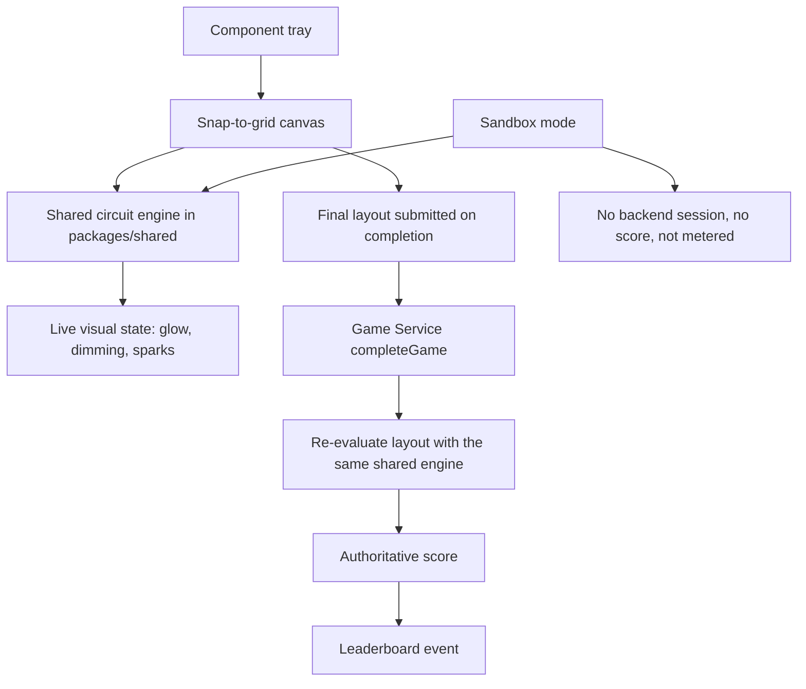

# Circuit Builder - Requirements

**Feature**: Circuit Builder, an interactive educational circuit-simulation mini-game for dashden.app
**Created**: 2026-10-29
**Depth**: Comprehensive
**Analyzed repository HEAD**: `a328c74`
**Source decisions**: `circuit-builder-requirement-verification-questions.md` (26 questions, all answered and approved 2026-10-29)
**Reverse engineering basis**: `aidlc-docs/inception/reverse-engineering/`

---

## 1. Intent Analysis

| Dimension | Assessment |
|---|---|
| **Request type** | New Feature |
| **Request clarity** | Clear on gameplay, physics behavior, and visual intent. Initially incomplete on entitlement, result integrity, accessibility, localization, and delivery, now resolved through the approved question set. |
| **Scope estimate** | Multiple Components — web app, Game Service, Leaderboard Service, shared package, DynamoDB catalog and theme data, locale files, and several display registries |
| **Complexity estimate** | Complex — introduces a numeric physics engine, a canvas interaction model, a particle effect, and an audio service, none of which have precedent in the codebase |
| **Primary risk** | A browser-simulated result feeding a competitive leaderboard, plus a 15-point integration surface with documented registry drift |

### Original request summary

Build an interactive educational web mini-game titled Circuit Builder that teaches electricity, conductivity, and boolean logic through active experimentation, covering series versus parallel circuits, resistance, and short-circuit faults. It requires a component tray, a snap-to-grid canvas with drag-and-drop onto terminal nodes, real-time current evaluation, distinct series and parallel behavior, a short-circuit fault with a spark effect and educational tooltip, a celebratory success state when a target machine is powered, a dark-mode tech aesthetic with glowing energized traces, and responsive scaling across desktop and mobile browsers.

---

## 2. Prerequisite Work (Delivery Stage 1)

The user selected Option B at the reverse-engineering gate: fix blockers before Circuit Builder code lands. The following is in scope and must be merged and verified before any Circuit Builder feature code.

### PRE-1: Repair the Leaderboard service build
The Leaderboard service currently fails type-check and tests because `Difficulty` is typed as a string in `services/leaderboard/src/types/index.ts` while scoring code in `services/leaderboard/src/services/scoring.service.ts` treats it as numeric.

- **PRE-1.1** Reconcile the `Difficulty` type so type-check passes.
- **PRE-1.2** Restore the Leaderboard test suite to passing.
- **PRE-1.3** No Circuit Builder `GameType` may be added until PRE-1.1 and PRE-1.2 are complete.

### PRE-2: Security remediation, scoped set (Q1=B)
| Rule | Required change |
|---|---|
| SECURITY-04 | Add `Content-Security-Policy`, `Strict-Transport-Security`, `X-Content-Type-Options`, `X-Frame-Options`, and `Referrer-Policy` to web responses. |
| SECURITY-09 | Stop rendering `error.message` and `error.stack` to end users in the `ErrorBoundary` in `apps/web/src/main.tsx`. |
| SECURITY-15 | Ensure error paths fail closed and a global handler returns a safe generic response. |
| SECURITY-05 | Satisfied for this feature by FR-CB-26; existing unbounded handlers remain deferred debt. |
| SECURITY-11 | Satisfied for this feature by FR-CB-21 through FR-CB-25. |

### PRE-3: Deferred debt, explicitly accepted
SECURITY-01, 03, 06, 08, 10, 12, 13, and 14 remain non-compliant and are accepted as pre-existing debt for this feature. The Security Baseline still applies in full to all new Circuit Builder code. These are recorded in `aidlc-docs/aidlc-state.md`.

---

## 3. Functional Requirements

### 3.1 Canvas and components

- **FR-CB-1** The game presents a snap-to-grid canvas on which components occupy discrete grid cells.
- **FR-CB-2** A component tray provides: Variable Voltage Battery, Solar Panel, Wire, Switch, Resistor, LED Bulb, Electric Motor, and Buzzer. The Resistor is added beyond the original request because resistance is a stated learning objective that otherwise has no teaching instrument (Q10=D).
- **FR-CB-3** Components are placed by dragging from the tray onto the canvas, and snap to the nearest valid grid cell.
- **FR-CB-4** Components expose discrete terminal nodes. Connections are formed terminal-to-terminal.
- **FR-CB-5** Placed components can be moved, rotated where meaningful, and removed.
- **FR-CB-6** Connections can be individually deleted without removing the connected components.
- **FR-CB-7** The Variable Voltage Battery exposes an adjustable voltage value within a defined safe range.
- **FR-CB-8** The Switch has an open and a closed state, toggleable during simulation.

### 3.2 Circuit simulation engine

- **FR-CB-9** The engine computes numeric results using Ohm's law, including per-branch current, voltage drop, and total resistance (Q9=D).
- **FR-CB-10** The engine continuously evaluates whether a closed conductive path exists from the positive terminal to the negative terminal through at least one valid load.
- **FR-CB-11** Series behavior: when multiple loads share a single path, opening a switch, removing a component, or deleting a connection removes power from the entire chain.
- **FR-CB-12** Parallel behavior: when loads occupy independent branches, removing or breaking one branch leaves the remaining branches powered.
- **FR-CB-13** Loads reflect received current in their presentation. Bulbs in series appear dimmer than the equivalent parallel arrangement, derived from the computed current rather than hard-coded.
- **FR-CB-14** Short-circuit detection: a conductive path from positive to negative with no load, or with resistance below a defined threshold, is a fault condition.
- **FR-CB-15** The engine is a pure, framework-free module with no React or DOM dependency, and is deterministic for a given circuit state.
- **FR-CB-16** The engine resides in `packages/shared` so the browser and the Game Service execute the identical evaluator (supports FR-CB-21).

### 3.3 Fault and success feedback

- **FR-CB-17** On a short circuit, the game renders a canvas particle spark effect at the fault location, visibly pops the fuse, and de-energizes the circuit.
- **FR-CB-18** A short circuit displays an educational tooltip explaining in age-appropriate language why the fault occurred and how to correct it.
- **FR-CB-19** A short circuit does not end the attempt. The player may reset the fuse and continue the same attempt, incurring the scoring penalty in FR-CB-24 (Q16=A).
- **FR-CB-20** When the level's target machine is fully powered, the game renders a celebratory animation, glowing energized trace lines along the powered path, and a success sound, then presents the completion result.

### 3.4 Result integrity and scoring

- **FR-CB-21** Scoring is server-authoritative. On completion the browser submits the final circuit layout, and the Game Service re-evaluates it using the shared engine from FR-CB-16 to determine success and compute the score (Q14=C).
- **FR-CB-22** The Game Service rejects a submission whose layout does not satisfy the level's success condition when re-evaluated.
- **FR-CB-23** The score reflects completion time, component efficiency where fewer components scores higher, and a penalty for each short circuit incurred (Q15=C).
- **FR-CB-24** Each short circuit applies a defined score penalty.
- **FR-CB-25** Time is weighted modestly relative to efficiency and fault avoidance, so an elegant fault-free circuit can outscore a faster careless one.
- **FR-CB-26** All new Circuit Builder inputs are validated against a bounded schema: component counts, grid coordinates, connection counts, voltage values, and elapsed time all have explicit limits, and unknown component or connection types are rejected.

### 3.5 Levels, sandbox, and progression

- **FR-CB-27** The MVP ships a sandbox mode and approximately six to eight guided levels (Q12=E).
- **FR-CB-28** Guided levels sequence the concepts: closed circuit, switch control, series, parallel, short-circuit fault, resistance, and variable voltage.
- **FR-CB-29** The MVP target machine is a Mars Rover, defined as data so additional machines are content rather than code (Q11=A).
- **FR-CB-30** Target machine definitions bind components to in-world roles, for example motors driving wheels, the solar panel charging, LEDs as headlights, and the buzzer as an alert.
- **FR-CB-31** Sandbox mode is local-only. It calls neither `startGame` nor `completeGame`, does not consume a daily game allowance, and produces no score or leaderboard entry. This resolves the gap between FR-CB-27 and FR-CB-21 identified during answer validation and approved by the user.
- **FR-CB-32** Guided levels create a backend session through `startGame` and complete through `completeGame`.
- **FR-CB-33** The game supports all four existing difficulty levels, sending the conventional numeric value 1 through 4 to `startGame` (Q13=A).
- **FR-CB-34** Numeric values are progressively disclosed by difficulty. Easy presents a purely visual boolean experience; Super Hard exposes full numeric circuit analysis (Q6=D, Q9=D).

### 3.6 Entitlement and catalog placement

- **FR-CB-35** Circuit Builder requires a paid subscription at any tier: Light, Standard, or Premium (Q5=B).
- **FR-CB-36** The game identifier is added to `PAID_GAMES` in `services/game/src/services/game.service.ts`, which is the authoritative gate.
- **FR-CB-37** The game identifier is added to `PREMIUM_GAMES` in `apps/web/src/components/hub/GameTile.tsx` so the paid badge renders. Omitting this is the exact Mini Golf defect documented in reverse engineering.
- **FR-CB-38** A `GAME_FILTER_MAP` entry in `apps/web/src/pages/hub/GameHubPage.tsx` assigns the category `Science & Math`, which is a verified existing category value (Q7).
- **FR-CB-39** The catalog `ageRange` is set for a broad 8 to 16 audience (Q6=D).
- **FR-CB-40** A DynamoDB catalog row and a published theme row are created so the tile appears and `startGame` theme validation passes.

### 3.7 Leaderboard and reporting integration

- **FR-CB-41** Circuit Builder submits scores to the leaderboard following PRE-1 completion (Q2=A).
- **FR-CB-42** A Circuit Builder `GameType` is added consistently to `services/leaderboard/src/types/index.ts` and `apps/web/src/api/leaderboard.ts`.
- **FR-CB-43** Display metadata is added to the leaderboard filter, History, Achievements, Recent Improvements, and Admin Dashboard surfaces.
- **FR-CB-44** The game is added to the review aggregation registry in `services/game/src/services/review.service.ts` so star ratings appear on the hub tile.
- **FR-CB-45** An automated consistency check asserts that every Circuit Builder registry entry is present and agreement holds across surfaces (Q3=A).

---

## 4. Non-Functional Requirements

### 4.1 Interaction and rendering

- **NFR-CB-1** Interaction uses canvas-based hit-testing on a logical coordinate system, following the `MiniGolfGamePage` and `miniGolfPhysics.ts` precedent (Q17=C). `dnd-kit` is not used.
- **NFR-CB-2** Pointer and touch input are both supported, with a tap fallback for placement.
- **NFR-CB-3** Animation frames and event listeners are cleaned up on unmount, following the Mini Golf precedent.
- **NFR-CB-4** Rendering remains smooth on mid-range mobile hardware at the maximum supported component count.

### 4.2 Accessibility

- **NFR-CB-5** Core actions are keyboard operable: selecting a component, placing it on a grid cell, toggling a switch, and connecting one terminal to another. The discrete grid makes this tractable (Q18=B).
- **NFR-CB-6** The known accessibility gap is freeform wire routing and full screen-reader narration of an arbitrary circuit graph. This is documented rather than silently omitted.
- **NFR-CB-7** `prefers-reduced-motion` is honored. Spark particles and celebration animations are reduced or replaced with a static indication. Required regardless of Q18 scope.

### 4.3 Presentation

- **NFR-CB-8** Visual design matches the existing dark-mode tech aesthetic, using Tailwind and Framer Motion already present in the app.
- **NFR-CB-9** Energized paths render as high-contrast glowing trace lines; de-energized paths are visually distinct at a glance.
- **NFR-CB-10** On desktop the game renders inside the standard `AppLayout` shell. On mobile a full-screen canvas mode is permitted (Q22=C).
- **NFR-CB-11** The layout is responsive across desktop, tablet, and mobile browsers.

### 4.4 Audio

- **NFR-CB-12** A small reusable audio service is created rather than page-local audio (Q19=A).
- **NFR-CB-13** The service honors the browser user-gesture requirement for playback.
- **NFR-CB-14** The service honors the existing stored sound preference and provides a mute control.
- **NFR-CB-15** Audio is cleaned up on navigation and does not continue after the game unmounts.
- **NFR-CB-16** Missing or unsupported audio degrades silently without breaking gameplay.

### 4.5 Localization

- **NFR-CB-17** Complete translations are provided for English, Spanish, and Portuguese, including level text and educational tooltips (Q21=A). The educational text is the product, so partial translation is not acceptable.
- **NFR-CB-18** Catalog title, description, and category translation keys are added for all three locales.

### 4.6 Security

- **NFR-CB-19** All new operations validate input against a bounded schema before processing (SECURITY-05).
- **NFR-CB-20** No sensitive data, tokens, or personally identifying information appears in new log output (SECURITY-03 applied to new code).
- **NFR-CB-21** All new external calls have explicit error handling and fail closed (SECURITY-15).
- **NFR-CB-22** User-facing errors are generic, with no stack traces or internal details (SECURITY-09).
- **NFR-CB-23** Security-critical logic, specifically result re-evaluation and entitlement checks, is server-side and not bypassable from the browser (SECURITY-08, SECURITY-11 for new code).

### 4.7 Testability

- **NFR-CB-24** The circuit engine has unit and property tests covering connectivity, open and closed switches, series versus parallel behavior, resistance and current bounds, short-circuit detection, and scoring determinism (Q24=A). `fast-check` is already available.
- **NFR-CB-25** Backend tests cover theme acceptance, the paid gate, bounded input validation, layout re-evaluation, score computation, and leaderboard event mapping.
- **NFR-CB-26** The known testing gap is automated coverage of drag, wiring, mobile viewport, and reduced motion. These are verified manually for the MVP because the repository has no browser or viewport test tooling.

### 4.8 Platform scope

- **NFR-CB-27** Responsive web (`apps/web`) is the delivery target. The Flutter mobile app is out of scope for implementation (Q8=B).
- **NFR-CB-28** Because the engine is pure and framework-free, a future Flutter port would reimplement rendering only, not physics. This is documented, not built.

---

## 5. Result Integrity Data Flow

**Text alternative:** The component tray feeds the snap-to-grid canvas. Canvas state is evaluated by the shared circuit engine located in `packages/shared`, which drives live visual feedback such as glow, dimming, and spark effects. On level completion the browser submits the final layout to the Game Service `completeGame` operation, which re-evaluates that layout using the same shared engine to produce the authoritative score, which then feeds a leaderboard event. Sandbox mode uses the same engine for local evaluation but creates no backend session, produces no score, and does not consume a daily game allowance.

---

## 6. Out of Scope

- Flutter mobile implementation (design documents a future port only)
- Additional target machines beyond the Mars Rover, including the theme park ride
- Per-level or partial free access, since the whole game is paid
- Remediation of SECURITY-01, 03, 06, 08, 10, 12, 13, and 14 as pre-existing debt
- A shared game-registry refactor migrating existing games onto a single source of truth
- Moving catalog and theme seeding into the GitHub Actions deployment path
- Browser, component, viewport, and reduced-motion automated test tooling
- Alternating current, capacitance, inductance, transistors, and logic gates beyond the stated boolean path behavior

---

## 7. Assumptions and Constraints

### Assumptions
- Light, Standard, and Premium tiers all grant equal Circuit Builder access, with no per-tier content differences.
- The existing numeric difficulty convention of 1 through 4 is retained.
- Existing Cognito authentication and the API Gateway JWT authorizer are used unchanged.
- No new DynamoDB table is required; existing catalog, theme, game, and leaderboard tables suffice.

### Constraints
- Backend commits and deployments must go through GitHub Actions. Local production AWS deployment is not authorized for this feature.
- Merging matching backend paths to `main` deploys to production Lambdas immediately, with no test, smoke, or rollback stage in the workflow. This dictates the staged delivery in Section 8.
- The production AWS account is `342278407349`, accessed with the `dashden-new` profile.
- `packages/shared` is already bundled into the Game Lambda by the existing deploy script, which is what makes server-side re-evaluation viable.
- Catalog and theme rows are seeded outside CI/CD, so a deployed route can be invisible without the verification in Section 8.

---

## 8. Delivery and Verification

### Staged delivery (Q25=C)
1. **Stage 1, prerequisites.** PRE-1 Leaderboard build repair and PRE-2 scoped security remediation, merged and verified first.
2. **Stage 2, frontend Circuit Builder.** Engine, canvas, tray, levels, sandbox, audio, localization, and UI. Produces a demonstrable game.
3. **Stage 3, backend integration.** Paid gate, bounded validation, server-side re-evaluation, leaderboard `GameType`, review registry, and catalog and theme seeding.

### Data registration (Q23=B)
- **VER-1** A committed `scripts/seed-circuit-builder.sh` creates the catalog row and published theme row.
- **VER-2** An idempotent verification command confirms both rows exist and are valid, converting a silent data problem into an explicit check.

### Definition of done
- Circuit engine unit and property tests pass.
- Game Service and Leaderboard type-check and tests pass.
- Web type-check, lint, and build pass.
- The registry consistency check from FR-CB-45 passes.
- Catalog and theme verification from VER-2 passes.
- Manual verification is recorded for drag and wiring, mobile layout, reduced motion, keyboard core actions, and audio behavior.

---

## 9. Success Criteria

1. A paid user can open Circuit Builder from the hub, where the tile shows the paid badge and appears under the `Science & Math` filter.
2. A free user is correctly blocked by the backend gate and directed to subscribe.
3. A player can build a closed circuit that powers the Mars Rover and sees the celebration, glowing traces, and success sound.
4. Breaking a series circuit removes power from the whole chain; breaking one parallel branch leaves the others powered.
5. Connecting positive to negative without a load produces a spark, pops the fuse, shows the educational tooltip, and allows the attempt to continue.
6. Bulbs in series are visibly dimmer than the same bulbs in parallel, derived from computed current.
7. A tampered or invalid layout submitted to `completeGame` is rejected by server-side re-evaluation.
8. Sandbox play consumes no daily allowance and creates no score or leaderboard entry.
9. Scores appear on the leaderboard and in History, Achievements, and Admin surfaces.
10. The game is fully playable in English, Spanish, and Portuguese, tooltips included.
11. The game is usable on a phone, and core actions are keyboard operable.
12. With reduced motion enabled, spark and celebration animations are suppressed or simplified.

---

## 10. Security Compliance

Security Baseline is enabled for this feature (Q4=A). Statuses below describe the requirements as specified, to be re-verified during design and construction.

| Rule | Status for this feature | Basis |
|---|---|---|
| SECURITY-01 Encryption | N/A for new code | No new data store introduced; existing tables use managed encryption. Pre-existing gaps deferred per PRE-3. |
| SECURITY-02 Access logging | Compliant | Existing API Gateway access logging covers the new operations. |
| SECURITY-03 App logging | Compliant for new code | NFR-CB-20. Pre-existing logging gaps deferred per PRE-3. |
| SECURITY-04 HTTP headers | Addressed | PRE-2. |
| SECURITY-05 Input validation | Addressed | FR-CB-26, NFR-CB-19. |
| SECURITY-06 Least privilege | N/A for new code | No new IAM policy required. Pre-existing gaps deferred per PRE-3. |
| SECURITY-07 Network config | N/A | No VPC or network layer in this architecture. |
| SECURITY-08 Access control | Compliant for new code | NFR-CB-23; paid gate and re-evaluation are server-side. Pre-existing Auth route gap deferred per PRE-3. |
| SECURITY-09 Hardening | Addressed | PRE-2, NFR-CB-22. |
| SECURITY-10 Supply chain | N/A for new code | No new third-party dependency planned. Pre-existing gaps deferred per PRE-3. |
| SECURITY-11 Secure design | Addressed | FR-CB-21 through FR-CB-25 close the result-spoofing path for this game. |
| SECURITY-12 Authentication | N/A for new code | Existing Cognito flow reused unchanged. Pre-existing gaps deferred per PRE-3. |
| SECURITY-13 Integrity | N/A for new code | No new external script or deserialization of untrusted input. Pre-existing gaps deferred per PRE-3. |
| SECURITY-14 Alerting | N/A for new code | No new alerting required. Pre-existing retention and alarm gaps deferred per PRE-3. |
| SECURITY-15 Exception handling | Addressed | PRE-2, NFR-CB-21. |

**No blocking security finding for this stage.** The deferred rules are an explicit, user-approved scope decision recorded in `aidlc-docs/aidlc-state.md`, not an unaddressed gap.

---

## 11. Decision Traceability

| Question | Decision | Requirements |
|---|---|---|
| Q1=B | Scoped security remediation | PRE-2, PRE-3 |
| Q2=A | Fix Leaderboard, participate | PRE-1, FR-CB-41 to FR-CB-43 |
| Q3=A | Correct entries plus consistency check | FR-CB-45 |
| Q4=A | Security Baseline enforced | Section 10 |
| Q5=B | Paid, any tier | FR-CB-35 to FR-CB-37 |
| Q6=D | Broad 8 to 16 | FR-CB-34, FR-CB-39 |
| Q7 | `Science & Math` | FR-CB-38 |
| Q8=B | Web now, port documented | NFR-CB-27, NFR-CB-28 |
| Q9=D | Numeric, progressively disclosed | FR-CB-9, FR-CB-34 |
| Q10=D | All components plus resistor | FR-CB-2 |
| Q11=A | Mars Rover | FR-CB-29, FR-CB-30 |
| Q12=E | Sandbox plus 6 to 8 levels | FR-CB-27, FR-CB-31 |
| Q13=A | Four difficulties | FR-CB-33 |
| Q14=C | Server-authoritative | FR-CB-16, FR-CB-21, FR-CB-22 |
| Q15=C | Time, efficiency, fault penalty | FR-CB-23 to FR-CB-25 |
| Q16=A | Short circuit does not fail the level | FR-CB-19 |
| Q17=C | Canvas hit-testing | NFR-CB-1, NFR-CB-2 |
| Q18=B plus reduced motion | Keyboard core actions, documented gap | NFR-CB-5 to NFR-CB-7 |
| Q19=A | Reusable audio service | NFR-CB-12 to NFR-CB-16 |
| Q20=A | Canvas particles | FR-CB-17 |
| Q21=A | Full en, es, pt | NFR-CB-17, NFR-CB-18 |
| Q22=C | Standard desktop, full-screen mobile | NFR-CB-10 |
| Q23=B | Seed script plus verification | VER-1, VER-2 |
| Q24=A | Engine and backend tests | NFR-CB-24 to NFR-CB-26 |
| Q25=C | Three-stage delivery | Section 8 |
| Q26=A | No deadline | Section 8 ordering |
