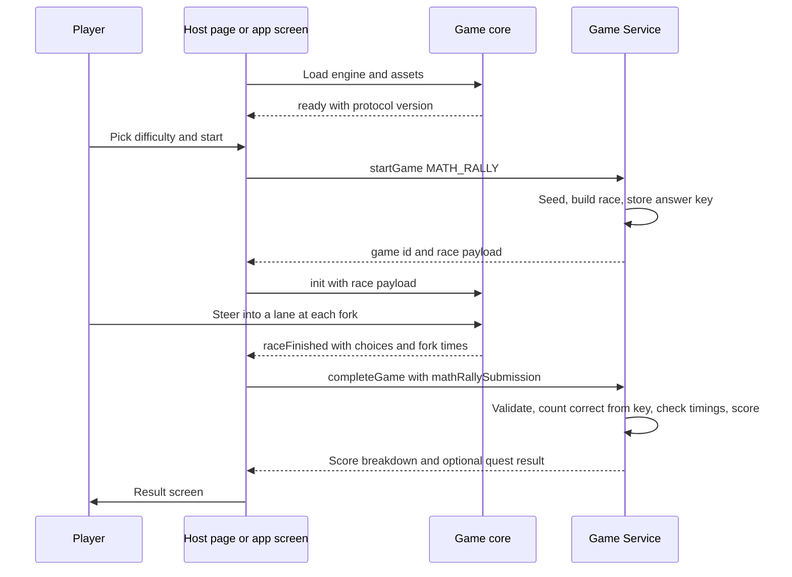

# Math Rally - Requirements

**Feature**: Math Rally (final name, owner answer to Q22), a kart-racing math game for dashden.app and the DashDen Flutter app. Benji is the in-game driver, not part of the title.
**File names**: the files of this inception run keep the `math-kart-` prefix; the first Construction step renames them to `math-rally-`. Ids keep their `MK` labels (FR-MK, NFR-MK, MK-n, MKP).
**Created**: 2026-11-25
**Depth**: Comprehensive (new rendering engine, a second host platform, a new server-scored game type)
**Source decisions**: `math-kart-requirement-verification-questions.md` (38 questions). Owner answers of 2026-11-25 are binding for Q1, Q2, Q6, Q7, Q10 to Q14 and Q19 to Q22 (Q7 and Q20 to Q22 relayed by the orchestrator later that day); the rest are **Recommended, pending owner approval**. No question is open.
**Reverse engineering basis**: `../reverse-engineering/math-kart-delta-notes.md` (code read at `c6ccf0f`), on top of the stale baseline at `a328c74`.
**Not written here**: design, components, units. Those follow in Application Design and Units Generation.

---

## 1. Intent Analysis

| Dimension | Assessment |
|---|---|
| Request type | New Feature (new game) |
| Clarity | Clear core loop (question at the top, one answer per road branch, steer to the right one). Open items (feel, rules, scoring authority, embedding, budgets) resolved in the question file |
| Scope | Cross-system: web app (new engine, first lazy route), Game Service, Leaderboard service, shared package, DynamoDB seed data, locales, Flutter app (first WebView-hosted game) |
| Complexity | Complex. No precedent in the repository for a game engine, pseudo-3D rendering, lazy loading, or a WebView-hosted game |
| Primary risks | Phone performance of the forked road in a WebView; Phaser 4 facts unverified in this session; IP look-alike risk; registry drift across 15+ places |

### Original request (owner, 2026-11-25, verbatim in `aidlc-docs/audit.md`)
Benji drives a go-kart toward a fork. A math question shows at the top; each path carries an answer; the player steers onto the path with the right answer. It must feel "Mario-Kart style" with a cool scene, and be easy to control on a keyboard or on a phone with a joystick at the bottom.

### Agreed context ("Option A")
Build the game once with Phaser 4 (pattern: the official React plus Vite template, `phaserjs/template-react`) inside `apps/web` as a lazy-loaded route, and run the same game inside the Flutter app in a WebView with its files bundled in the app. A native Flame port is a fallback only. The game uses the existing `startGame`/`completeGame` flow, a server-computed score, the leaderboard, the hub tile and catalog, and must be launchable from Quest Map later. Audience 8 to 16; languages en, es, pt. "Mario-Kart style" is inspiration only.

### Personas (detail in `../user-stories/math-kart-personas.md`)
- **MKP1 Benji, the young racer** (8 to 10, phone in the app, one thumb, Easy and Medium, FREE tier).
- **MKP2 Sofia, the older student** (12 to 16, laptop keyboard and phone, Hard and Super Hard, chases the leaderboard).
- **MKP3 Ana, the parent** (decides whether the child plays and whether to pay; cares about safety and learning).
- **MKP4 The owner-operator** (registers, deploys, switches the tier, checks performance).

---

## 2. Decision Status

| Topic | Decision | Status |
|---|---|---|
| Rendering | Pseudo-3D road behind the kart, Phaser 4 (Q1) | Owner answer; feasibility gated by the slice (Q29) |
| Answer feedback | Red X plus sound and lower score when wrong; positive feedback when right (Q2) | Owner answer |
| Paths per fork | Easy 2, Medium 3, Hard 4 (Q6) | Owner answer |
| Super Hard | 4 paths, 5 s window, Super Hard content; paid-only by the existing rule (Q7) | Owner answer |
| Math content and distractors | Per-level table and mistake-based distractors (Q10, Q11) | Owner answer |
| Controls and accessibility | Lane steering, auto-accelerate, bottom joystick, pause, reduced motion; no gamepad in v1 (Q12 to Q14) | Owner answer |
| Tier at launch | Free (Q19) | Owner answer |
| Paid switch | Manual planned change with a written checklist that includes the per-difficulty gate (Q20) | Owner answer |
| FREE users after the switch | Easy (difficulty 1) stays free permanently; Medium, Hard and Super Hard become paid; server-side per-difficulty gate; plays count against the normal shared FREE allowance of 3 per 24 h (Q21) | Owner answer; allowance reading is the analyst's interpretation of "(3 plays per day)" |
| Name | "Math Rally"; ids `MATH_RALLY`, `math-rally`, `/math-rally/...`, namespace `mathRally` (Q22) | Owner answer |
| Art sources and IP limits; Security Baseline | CC0 or original art; baseline enforced (Q30, Q37) | Owner context (agreed earlier) |
| Everything else | Q3 to Q5, Q8, Q9, Q15 to Q18, Q23 to Q29, Q31 to Q36, Q38 | Recommended, pending approval |

---

## 3. Scope

**In v1**
- One race mode, one track theme (Q32), four difficulties, solo against the clock (Q15).
- Web: setup page and a lazy-loaded game route on dashden.app; result through the existing result modal.
- App: native setup and result screens, race in a WebView running the bundled build of the same game.
- Server-built races and server re-scoring (Q16), dedicated score breakdown (Q17), leaderboard participation (Q18).
- Registration in every hub, leaderboard, display and review registry, with a consistency test and seed and verify scripts.
- Quest Map launch readiness without a node (Q35).
- The per-difficulty free gate on the server and the matching partly-free presentation on web and in the app, inert while the game is free (FR-MK-55, FR-MK-56, Q21).
- en, es, pt; accessibility set from Q14.

**Out of v1**
- Native Flame port (fallback only, by owner decision after the gate, Q29).
- Other karts on track, multiplayer, items and power-ups (Q4, Q15).
- Gamepad (Q13), extra reading-time option (Q14 C), more track themes (Q32), kart customisation, unlockables.
- A Quest Map node (Q35); executing the paid switch (its checklist and the per-difficulty gate ship in v1, the switch itself is a later owner decision, Q20).
- A separate daily play counter for Math Rally (Q21: the normal shared FREE allowance applies).
- Ads or any monetisation inside the game.
- Decimal answers (Q10).
- Playing the race with a screen reader (documented gap, NFR-MK-7).
- Custom commissioned art (later; v1 uses CC0 and original art, Q30).
- Daily email listing (same exclusion as Circuit Builder, delta notes Section 2).
- Remediation of pre-existing security debt, including enforcing the CSP (recorded in `aidlc-state.md`).
- Device, browser and viewport automated test tooling (does not exist; manual checks are specified instead).

---

## 4. Functional Requirements and Acceptance Criteria

Acceptance criteria are numbered `AC-<FR>.<n>`. The tag after each criterion says how it is verified: **[U]** unit or property test, **[I]** backend or integration test, **[M]** manual check with written steps in Construction.

### 4.0 Tunable race parameters

All values live in one shared constants module in `packages/shared` so the game and the server read the same numbers. Super Hard values are the owner's answer to Q7.

| Parameter | Difficulty 1 Easy | 2 Medium | 3 Hard | 4 Super Hard |
|---|---|---|---|---|
| Paths per fork | 2 | 3 | 4 | 4 |
| Forks per race | 10 | 12 | 15 | 15 |
| Minimum reading window at top speed | 8 s | 7 s | 6 s | 5 s |
| Perfect-race score ceiling (target) | about 3000 | about 4500 | about 6000 | about 8000 |
| Who can play at launch (game free) | Everyone | Everyone | Everyone | Paid tiers only (existing rule) |
| Who can play after a paid switch (Q21) | Everyone | Paid tiers only | Paid tiers only | Paid tiers only |

### 4.1 Scene and race

**FR-MK-1 Pseudo-3D scene.** The race is drawn as a road seen from behind and above the kart: road segments projected toward a horizon, roadside objects drawn as sprites that grow as they approach, and a layered sky and hills background. One bright countryside theme (Q32). Background music is optional in v1 and ships only if it fits the asset budget (NFR-MK-3); it follows the same sound toggle as the effects.
- AC-1.1 At 320 x 568 and 1280 x 720 the road narrows toward a horizon, the kart sits at the bottom centre, and roadside objects scale up as they approach. [M]
- AC-1.2 The scene uses only assets listed in the credits manifest (NFR-MK-20). [U: manifest check]

**FR-MK-2 Benji and his kart.** The player's kart is driven by Benji, an original cartoon character, seen from behind. The kart leans when changing lanes and shows a flame or dust effect during a boost.
- AC-2.1 No Nintendo character, kart, item or logo appears (NFR-MK-20). [M]

**FR-MK-3 Countdown and auto-acceleration.** After the race data arrives the race starts with a 3-2-1-Go countdown. The kart then accelerates to cruise speed by itself; there is no throttle or brake input (Q12).
- AC-3.1 No steering input is accepted during the countdown; after "Go" the kart reaches cruise speed without input. [M]

**FR-MK-4 Fixed race length.** A race consists of exactly N forks (Section 4.0), then a finish line (Q5).
- AC-4.1 Every race records exactly N decisions, whatever the answers. [U]
- AC-4.2 The HUD shows fork progress as "k / N". [M]

**FR-MK-5 Race clock.** The game measures race time from "Go" to the finish line, excluding paused time, and the time each decision line is crossed.
- AC-5.1 Pausing for 60 s adds 0 s to the reported race time (within 0.1 s). [U: clock logic with an injected time source]

### 4.2 Questions and forks

**FR-MK-6 Question banner.** Each question appears in a banner at the top of the screen as soon as the previous fork's branches rejoin the road, and stays until the kart crosses that fork's decision line.
- AC-6.1 Exactly one question is visible at a time; the banner never covers the signs. [M]

**FR-MK-7 Forks and signs.** Each fork splits the road into as many branches as the difficulty's path count. Each branch has a sign with one answer; exactly one answer is correct.
- AC-7.1 Fork k shows the options of question k in the order the server sent them; exactly one equals the correct answer. [U]

**FR-MK-8 Reading window.** The time from the question appearing to the decision line is at least the minimum reading window (Section 4.0), even if the kart drives at its maximum (boosted) speed the whole way (Q8).
- AC-8.1 For every difficulty, the shared track constants satisfy: distance from question start to decision line divided by maximum speed is at least the window. [U]

**FR-MK-9 Lane steering and selection.** Before each fork the road has one lane per branch. Each left or right action moves the kart one lane; actions beyond the outer lanes do nothing. The lane occupied when the kart crosses the decision line is the chosen branch. The kart keeps its lane between forks (Q9).
- AC-9.1 Lane logic returns the occupied lane index at the decision line as the choice; a left action in lane 0 leaves it in lane 0. [U]
- AC-9.2 When the next fork has a different lane count, the kart is placed in the nearest valid lane before the question appears. [U]

**FR-MK-10 Right-answer feedback.** On the correct branch the game shows a green check icon, plays a chime (if sound is on), adds one coin to the HUD counter and gives a boost of about 1 s (Q2, Q4).
- AC-10.1 The coin counter always equals the number of correct answers so far. [U]

**FR-MK-11 Wrong-answer feedback.** On a wrong branch the game shows a red X icon, plays an error sound (if sound is on), shows the correct answer for at least 1.5 s (for example "7 x 8 = 56"), and the kart rides a bumpy branch at about 60% speed for about 1.5 s. No spin-out, no lives; the race continues (Q2, Q3).
- AC-11.1 After a wrong pick the correct answer is on screen for at least 1.5 s. [M]
- AC-11.2 Feedback is distinguishable without colour (icon shape plus text). [M]

**FR-MK-12 Rejoin.** After each fork the branches merge back into one road before the next question appears.
- AC-12.1 In the shared track layout, every merge point lies before the next question's start point. [U]

### 4.3 Math content

**FR-MK-13 Content per difficulty.** Questions follow the owner-approved table (Q10):

| Difficulty | Content |
|---|---|
| 1 Easy | Addition and subtraction within 20; no negative results |
| 2 Medium | Times tables 2 to 10; exact division; addition and subtraction within 100 |
| 3 Hard | Two-step expressions with order of operations; fraction of a quantity; percentages of round numbers (10, 25, 50%); squares up to 12 |
| 4 Super Hard | Negative numbers in all four operations; adding simple fractions; percentages; powers and square roots; one-step equations |

- AC-13.1 For 1000 generated races per difficulty, every question is of a kind listed for that difficulty and every correct answer is in range (for example no negative answer below difficulty 4). [U, property]

**FR-MK-14 Answer format.** Answers and distractors are whole numbers or simple fractions written `a/b`, at most 4 characters, never decimals.
- AC-14.1 No generated option exceeds 4 characters or contains a decimal separator. [U, property]

**FR-MK-15 Distractors.** Wrong options come from common mistakes (Q11): off by 1 or 2, off by 10, neighbouring times-table product, wrong operation, swapped digits, sign error (difficulty 4), adding numerators and denominators. All options in a fork are distinct and only one is correct.
- AC-15.1 For every generated fork: options are distinct, exactly one equals the correct answer, and at least one distractor comes from a mistake rule when the rule applies to the question kind. [U, property]

**FR-MK-16 Position balance.** The correct option's position is uniformly random per fork, with no more than 3 forks in a row in the same position.
- AC-16.1 Over 10 000 generated forks per path count, each position's share is within 2 percentage points of 1/paths, and no run exceeds 3. [U, property]

**FR-MK-17 No repeats.** A race never asks the same question twice.
- AC-17.1 Within any generated race, no two prompts are identical. [U, property]

**FR-MK-18 Seeded generator.** Question generation is a pure, deterministic function of (seed, difficulty, generator version) in `packages/shared`, with no clock, network or `Math.random`.
- AC-18.1 The same inputs produce an identical race; different seeds produce different races in at least 99% of 1000 trials. [U]

**FR-MK-19 Language-neutral prompts.** A question is data (a kind plus operands), not text. The game renders it with a localised template (for example "3/4 of 20", "3/4 de 20"); operator symbols are the same in all languages.
- AC-19.1 Every prompt kind has a template in en, es and pt (locale completeness test). [U]

### 4.4 Controls

**FR-MK-20 Keyboard.** Left arrow or A moves one lane left; Right arrow or D moves one lane right; P or Escape pauses and resumes; Enter or Space activates the focused menu button. During the race the arrow keys do not scroll the page.
- AC-20.1 Each mapped key produces exactly one lane action per press. [U: input mapping]
- AC-20.2 With the race running, pressing arrow keys does not scroll the page. [M]

**FR-MK-21 Touch joystick.** A horizontal virtual joystick sits at the bottom centre, sized for one thumb. Moving the knob past a threshold sends one lane action; holding past it repeats after a short delay; releasing re-centres. A pause button sits in the top area, away from the joystick.
- AC-21.1 Joystick logic emits one action per threshold crossing and repeats at a fixed interval while held. [U]
- AC-21.2 On a 320 px wide phone the joystick and pause button are at least 44 x 44 px and usable with one thumb in portrait. [M]
- AC-21.3 Touching the game area does not scroll, zoom or select text. [M]

**FR-MK-22 Pause.** Pause is available at any time via the button or key, and starts automatically when the browser tab is hidden or the app goes to the background. While paused the race and its clock stop. The pause menu offers Resume, Sound on/off and Quit (with confirmation).
- AC-22.1 Hiding the tab or backgrounding the app pauses the race. [M]
- AC-22.2 Quit abandons the race: no `completeGame` call, no score; the play stays consumed (Q36). [M]

### 4.5 HUD, finish and results

**FR-MK-23 HUD.** The HUD shows the question banner, fork progress, coin count and race time, plus the pause button.
- AC-23.1 HUD text uses the player's language and meets NFR-MK-6. [M]

**FR-MK-24 Finish.** Crossing the finish line plays a short celebration (static with reduced motion), then the host shows the result: the server score breakdown, correct answers out of N, and race time. Web reuses `components/game/ScoreBreakdownModal.tsx`; the app reuses `lib/game/framework/game_result_screen.dart`.
- AC-24.1 The score shown is the one returned by `completeGame`; the client never shows a locally computed score as final. [M]

### 4.6 Session, scoring and fairness (Game Service)

**FR-MK-25 Start only when ready.** The host calls `startGame` only after the game engine and first-race assets have loaded and the game has reported `ready`, so a device that cannot run the game never consumes a daily play.
- AC-25.1 With asset loading forced to fail, no `startGame` request is sent. [M]

**FR-MK-26 Server-built race.** For `themeId` `MATH_RALLY`, `startGame` draws a seed from a cryptographic random source, builds the race with the shared generator (FR-MK-18), stores the seed, generator version, path count and the answer key on the game record, and returns the race payload (Section 6). Other games' `startGame` responses do not change.
- AC-26.1 The response holds N questions with the path count's number of options each; the stored key has N entries in range. [I]
- AC-26.2 A `startGame` response for any other theme has exactly the fields it has today. [I]

**FR-MK-27 Client sends choices, never a score.** `completeGame` for a Math Rally game reads only `gameId`, `completionTime`, `attempts` and a `mathRallySubmission` holding the chosen option per fork and the time each decision line was crossed. Client values for `correctAnswers`, `totalQuestions`, `score` or accuracy are ignored for this game.
- AC-27.1 A submission that adds `correctAnswers: 15` to a race with 3 correct choices scores as 3 correct. [I]

**FR-MK-28 Bounded validation.** The submission is validated against a strict schema before use (SECURITY-05): exactly N choices, each an integer from 0 to paths - 1; exactly N fork times, integers in milliseconds, strictly increasing, the last not after `completionTime`; `completionTime` within 1 to 3600 s; unknown keys rejected.
- AC-28.1 Each of these cases is rejected: N - 1 choices, a choice of 4 at 3 paths, a string choice, equal consecutive fork times, an extra key. [I]

**FR-MK-29 Re-scoring.** The server counts correct answers by comparing the choices with the stored key; that count is the only accuracy input.
- AC-29.1 Choices matching the key on 7 of 10 forks give accuracy 0.7 in the breakdown. [I]

**FR-MK-30 Timing plausibility.** The server rejects a race that is faster than the kart allows: the time to fork k may not be below the shared minimum for fork k (distance at maximum speed, minus a small tolerance for frame timing).
- AC-30.1 A submission whose first fork time is half the minimum is rejected; one at exactly the minimum is accepted. [I]

**FR-MK-31 Rejection behaviour.** Any validation, key or timing failure returns one generic message, writes nothing, publishes no event, leaves the game `IN_PROGRESS`, logs a warning with the stage name only, and emits a rejection metric (Circuit Builder precedent).
- AC-31.1 After a rejected submission the game record is unchanged and a corrected submission for the same game can still complete it. [I]

**FR-MK-32 Score breakdown.** A dedicated Math Rally breakdown returns the existing `ScoreBreakdown` shape: base x difficulty multiplier (1.0, 1.5, 2.0, 2.5) x time factor x accuracy factor (0.5 + accuracy) (Q17).
- AC-32.1 With time fixed, one more correct answer always raises the score. [U]
- AC-32.2 With answers fixed, a faster race never lowers the score, and the time factor's whole range moves the score by at most 10% either way. [U]
- AC-32.3 A race with 0 correct answers scores at most one third of an all-correct race at the same time. [U]
- AC-32.4 A perfect race at the fastest plausible time scores within 5% of the ceiling in Section 4.0 (design picks constants to meet it). [U]
- AC-32.5 The final score never exceeds 6000 at difficulty 1 to 3 while the game is free, nor 8000 otherwise; the cap is chosen from `PAID_GAME_THEME_IDS` membership, so the paid switch needs no score code change. [U]

**FR-MK-33 Same side effects as other games.** A completed Math Rally game updates the game record, tracks achievements (non-blocking), publishes metrics, publishes a GameCompleted event with `gameType` `MATH_RALLY` and server-derived `correctAnswers` and `totalQuestions`, invalidates the statistics cache, and runs the Quest Map hook (`finalizeQuest`).
- AC-33.1 A completed game produces exactly one event whose accuracy equals the server's count divided by N. [I]
- AC-33.2 A game started with a valid `questContext` returns a `quest` result on completion. [I]

**FR-MK-34 Existing gates unchanged.** One race is one play against the daily allowance; FREE users are refused at difficulty 4; a replayed `completeGame` for a completed game is refused (existing status check). The only change to the start gates is the additive per-difficulty exception of FR-MK-55, which affects no game other than those listed in it.
- AC-34.1 Existing Game Service tests pass unchanged. [I]

### 4.7 Registration and reporting

**FR-MK-35 Identifiers.** Theme id `MATH_RALLY`; catalog id `math-rally`; web routes `/math-rally/setup` and `/math-rally/game`; app routes `/math-rally/setup` and `/math-rally/play` (registry convention); hub category `Science & Math`; catalog `ageRange` `8-16`; display name "Math Rally"; locale namespace `mathRally` plus `games.math-rally.*` (Q22, owner answer).
- AC-35.1 The consistency test (FR-MK-37) asserts each form. [U]

**FR-MK-36 Registries.** Every registry in `math-kart-delta-notes.md` Section 2 holds Math Rally, plus the app's `kGameRegistry` and `kGameTypeMeta` (`apps/mobile/lib/stats/game_meta.dart`). Not added: `PREMIUM_GAMES` and the paid lists while free; `daily-email.ts`. Added at launch although inert while the game is free: the Easy-only exception for `MATH_RALLY` in the shared, web and app free-difficulty lists (FR-MK-55, FR-MK-56).
- AC-36.1 The hub shows the tile on web and in the app under "Science & Math", and the leaderboard filter, History, Achievements, Statistics, Recent Improvements and Admin views name the game. [M]

**FR-MK-37 Consistency test.** A test in the style of `apps/web/src/__tests__/circuitBuilderRegistry.test.ts` fails when any web or backend registry lacks Math Rally, including a mutation suite. It also fails when `MATH_RALLY` is in `PAID_GAME_THEME_IDS` but missing from web `PREMIUM_GAMES` or the app's paid copy, or the reverse, and when the free-difficulty exception (FR-MK-55) differs between the shared constant, the web copy and the app copy.
- AC-37.1 Removing any single registry entry makes the test fail and name that registry. [U]

**FR-MK-38 Leaderboard.** `services/leaderboard` gains `GameType.MATH_RALLY` with a dedicated validation entry whose bounds mirror what the Game Service can emit (Q18).
- AC-38.1 The fastest plausible perfect race at difficulty 4 and a 3600 s race both pass leaderboard validation. [U]

**FR-MK-39 Seed and verify scripts.** `scripts/seed-math-rally.sh` and `scripts/verify-math-rally-seed.sh` follow the Circuit Builder scripts: DEV default, exact `--prod` flag with profile `dashden-new`, typed confirmation, idempotent writes of one theme row and one catalog row, read-only verify with distinct exit codes, and the production order warning (Leaderboard, Game Service, web and app live, seed last).
- AC-39.1 An unknown argument exits 2; `--prod` without the typed confirmation writes nothing. [M: dry run with the AWS CLI absent or stubbed]

### 4.8 Web host

**FR-MK-40 Setup page.** `/math-rally/setup` offers the four difficulties (for FREE users, Super Hard is shown locked with the existing upgrade path at launch; after a paid switch Medium and Hard are locked too, FR-MK-56), a "How to play" panel showing keyboard and joystick controls, and Start. A URL with `?difficulty=easy|medium|hard` (the Quest Map launch kind) skips setup.
- AC-40.1 A FREE user sees Super Hard locked and cannot start it. [M]

**FR-MK-41 Lazy route.** The game route is loaded with `React.lazy`; Phaser and all game code live only in that chunk and its assets.
- AC-41.1 In a production build, the entry chunk contains no Phaser module (bundle report). [M: build report]
- AC-41.2 Opening the hub and every non-Math-Rally page requests no Math Rally chunk or asset. [M: network panel]

**FR-MK-42 Game core independent of hosts.** The game core (scenes, renderer, input, rules) has no React, Flutter or network dependency. It talks to its host only through the message contract in FR-MK-49, so the same build runs in the React page and in the app.
- AC-42.1 The game core's import graph contains no `react`, no `@apollo/client` and no `fetch` or XHR call outside asset loading. [U: import check]

**FR-MK-43 React host.** The page creates exactly one game instance, also under `React.StrictMode` double mounting, destroys it on unmount, and does the API calls through `apps/web/src/api/game.ts` (so the Quest Map `quest` parameter keeps working).
- AC-43.1 Mounting, unmounting and remounting the page in development leaves one live game instance and no running audio. [M]

**FR-MK-44 Engine failure.** If the engine cannot start (for example no WebGL) or fails mid-race (context lost, asset error), the host shows a short generic message with a way back to the hub; no stack trace or engine detail is shown.
- AC-44.1 With WebGL disabled in the browser, the page shows the message and no `startGame` is sent. [M]

### 4.9 App host (Flutter WebView)

**FR-MK-45 App screens.** The app adds a native setup screen (difficulty picker in the existing style), a play screen hosting the WebView, and uses the existing result screen. Math Rally appears in the hub through `kGameRegistry`.
- AC-45.1 The app hub lists Math Rally once the catalog row is active; older app versions do not list it. [M]

**FR-MK-46 Bundled files, app-internal origin.** The game build ships inside the app's assets and is served to the WebView from an app-internal origin (Q23). The page makes no network request; navigation away from that origin is blocked; pop-ups are blocked.
- AC-46.1 With the device in airplane mode, a race already started loads and plays with no missing assets. [M]
- AC-46.2 An attempt by the page to navigate to an external URL is refused. [M]

**FR-MK-47 Flutter owns the API.** The play screen calls `startGame` and `completeGame` through the existing `GameSessionController` and `GameApi` (with `mathRallySubmission` added to `completeExtraKeys`), and passes the race payload into the WebView. The WebView never receives a token (Q24).
- AC-47.1 No message sent to the WebView contains a token or the user's email or username. [U: Dart bridge test]

**FR-MK-48 Lifecycle and settings.** The race pauses when the app goes to the background and on Android Back (pause menu, then quit). The game receives the app's sound and reduced-motion settings at `init`. Leaving the screen disposes the WebView.
- AC-48.1 Backgrounding and returning shows the race paused. [M]

**FR-MK-49 Message contract.** Host and game exchange versioned JSON messages (Q25). Game to host: `ready` (with protocol and build version), `raceFinished` (submission), `pauseChanged`, `exitRequested`, `error` (code only). Host to game: `init` (race payload, difficulty, language, sound, reduced motion), `pause`, `resume`, `setSound`. Each receiver validates type, size (at most 16 KB per message) and schema, and ignores anything else.
- AC-49.1 Dart and TypeScript validators reject an unknown type, an oversize message and a wrong-typed field. [U]
- AC-49.2 When `ready` reports an unsupported protocol version, the app shows a generic "update the app" message and does not call `startGame`. [U]

**FR-MK-50 Offline race in the app.** When `startGame` fails for a reason other than rate limit, paywall or quest, the app runs an unscored race with questions from the bundled generator, as its other games do (Q34). Web keeps the rule other web games follow: rate limit goes to the rate-limit page, a quest failure to the map (existing `api/game.ts`), anything else back to the hub with a short message.
- AC-50.1 In airplane mode from the setup screen, the app starts an unscored race and the result screen says it was not saved. [M]

**FR-MK-51 Build linkage.** The app's bundled game is produced from the same source by a documented build command, and carries a build identifier tying it to its source commit.
- AC-51.1 The build identifier reported in `ready` matches the commit the bundle was built from. [M]

### 4.10 Quest Map readiness and tier

**FR-MK-52 Quest Map launch contract.** The web game route accepts the `difficulty` launch kind (`?difficulty=easy|medium|hard&quest=<world>:<node>:<leg>`); the app play screen accepts a `QuestContext`; the completion branch runs the Quest Map hook. No node is added in v1 (Q35).
- AC-52.1 A test game started with a valid `questContext` and completed returns a `quest` result (covered by AC-33.2). [I]

**FR-MK-53 Free at launch.** `MATH_RALLY` is absent from `PAID_GAME_THEME_IDS`, web `PREMIUM_GAMES` and the app's paid copy; difficulty 4 stays paid by the existing rule (Q7, Q19).
- AC-53.1 A FREE user can start difficulty 1 to 3 and is refused at difficulty 4. [I]

**FR-MK-54 Paid switch readiness.** The switch to paid (if the owner decides it, Q20) is a written checklist: (1) confirm the Easy-only exception for `MATH_RALLY` is present in the shared, web and app free-difficulty lists and that the FR-MK-55 and FR-MK-56 tests pass; (2) add `MATH_RALLY` to the three paid lists; (3) deploy the Game Service; (4) deploy web; (5) release the app. FR-MK-37, AC-32.5, FR-MK-55 and FR-MK-56 then hold without other code changes.
- AC-54.1 The checklist exists in the construction docs before launch and names the per-difficulty gate check as its first step. [M]

**FR-MK-55 Per-difficulty free gate (server).** `startGame` lets a FREE user start a paid game at a difficulty listed for that game in a shared free-difficulty exception (`MATH_RALLY`: difficulty 1 only, Q21), and refuses every other difficulty of a paid game with the existing paid-game message. The gate is a pure function in `packages/shared` called by the Game Service; client checks are presentation only. It ships in v1 and changes nothing while `MATH_RALLY` is free. An allowed Easy race counts against the normal FREE allowance (3 plays per 24 hours shared across all games, existing rate limiter); there is no separate Math Rally counter (analyst's interpretation of the owner's "(3 plays per day)").
- AC-55.1 With `MATH_RALLY` in the paid list (test input), a FREE user can start difficulty 1 and is refused at 2, 3 and 4; a paid user can start 1 to 4. [U, I]
- AC-55.2 With the real lists at launch, a FREE user can start 1 to 3 and is refused at 4 (same outcome as AC-53.1). [I]
- AC-55.3 Every paid game without an exception still refuses FREE users at every difficulty; existing paid-gate tests pass unchanged. [I]
- AC-55.4 An allowed FREE Easy start increments the same rate-limit record as any other game; no new counter or table exists. [I]

**FR-MK-56 Partly-free presentation (web and app).** When a paid game has a free-difficulty exception, FREE users are not sent away from it. Web: the hub tile shows the paid badge plus a short "Easy is free" note and opens setup instead of redirecting to the subscription page; the setup page shows the free difficulty as playable and the others locked with the paid badge and the existing upgrade link. App: the hub tile stays playable with the paid badge; the setup screen shows the free difficulty as playable and the others locked in the app's neutral "not on your plan" state, with no price or purchase UI (`kPaidGamePresentation`). One pure lock rule per host decides a level's state: locked when difficulty is 4 for a FREE user, or when the game is paid and the difficulty is not in its exception.
- AC-56.1 Web, with `math-rally` in `PREMIUM_GAMES` (test input): for a FREE user the lock rule returns playable for Easy and locked for Medium, Hard and Super Hard, and the hub does not redirect to the subscription page. [U]
- AC-56.2 App, with `MATH_RALLY` in the paid copy (test input): the hub tile is playable with the paid badge, and the setup screen locks Medium, Hard and Super Hard without purchase UI. [U: Dart widget or logic test]
- AC-56.3 At launch (game free), both hosts lock only Super Hard for FREE users. [U]
- AC-56.4 If a host shows a level as playable but the server refuses it (for example an app released before the switch), the player sees the existing paid-required message, and the refused start consumes no play (the gate runs before the rate limiter). [I]

---

## 5. Non-Functional Requirements

### Performance and size
- **NFR-MK-1 Frame rate.** Target 60 fps on the reference devices (Q28). Gate on the reference Android phone inside the WebView over a full race: median at least 50 fps and slowest 1% of frames at least 30 fps (Q29). Failing the gate after optimisation stops work and goes to the owner. Measured with a development-only frame-time overlay; not present in production builds.
- **NFR-MK-2 Input response.** A lane action shows visible kart movement within 100 ms (checked with slow-motion video on the reference devices).
- **NFR-MK-3 Download budget (targets, unmeasured).** Game code chunk (Phaser plus game) at most 450 KB gzip; first-race art and sound at most 1.5 MB; the site's entry chunk grows by at most 2 KB gzip; the app grows by at most 4 MB (Q27).
- **NFR-MK-4 Load time (target).** From opening the game route to "ready" at most 4 s on a mid-range phone over a typical 4G connection on first visit, and at most 2 s on later visits (cached).
- **NFR-MK-5 Cleanup.** Leaving the game destroys the engine instance and releases its WebGL context, listeners, timers and audio; five races in a row show no steady memory growth (manual check in browser devtools).

### Usability and accessibility
- **NFR-MK-6 Legibility.** On a 320 px wide screen with 4 paths: question text at least 28 CSS px, sign text at least 20 CSS px bold, contrast at least 4.5:1 against its background, sign labels at most 4 characters (FR-MK-14). Signs for the current fork are also shown as lane labels near the kart when the scene's signs would be smaller than that size.
- **NFR-MK-7 Accessibility.** Reduced motion (from the OS setting on web through `services/presentationPreferences.ts`, from the app on mobile) removes shake, spin, flashing and speed lines and makes the celebration static. Feedback never relies on colour alone. Full keyboard play. Setup and result screens work with a screen reader. Documented gap: the race cannot be played with a screen reader; on web the current question and options are mirrored to an ARIA live region (Q14). Full WCAG conformance needs a manual assistive-technology review and is not asserted here.
- **NFR-MK-8 Photosensitivity.** Nothing flashes more than 3 times per second.
- **NFR-MK-9 Localisation.** All text exists in en, es and pt, each string in exactly one place (Q33, refined in Application Design): host-page strings (hub tile, setup, how to play, host errors, result extras) under the `mathRally` namespace of `apps/web/src/locales/*.json`, from which the app's ARB files are regenerated with `apps/mobile/tools/convert_locales.mjs`; in-race strings (prompt templates, HUD, feedback, pause menu, countdown) in `apps/web/src/games/math-rally/locales/{en,es,pt}.json`, imported only by the game code, so they stay out of the site's entry chunk (NFR-MK-3) and ship inside both game builds (in-canvas text needs no network; the host only passes the language code). A Math Rally locale completeness test (same pattern as `src/locales/__tests__/questLocaleCompleteness.test.ts`) covers both sets; `localeCompleteness.test.ts` keeps passing.
- **NFR-MK-10 Fonts offline.** The game uses a bundled font with an open licence (for example SIL OFL) or system fonts; it does not load Google Fonts.

### Security (Security Baseline enabled, Q37)
- **NFR-MK-11 Input validation (SECURITY-05).** `mathRallySubmission` and every bridge message are validated with a strict schema and size limits (FR-MK-28, FR-MK-49). Prompt and option strings from the server are rendered as canvas text, never as HTML.
- **NFR-MK-12 Access control (SECURITY-08).** `userId` comes from the verified JWT only; the existing ownership and status checks apply; the tier gate, including the per-difficulty exception, stays server-side (FR-MK-55); the WebView never holds a token (FR-MK-47).
- **NFR-MK-13 Secure design (SECURITY-11).** Misuse cases handled: invented answers (server key), answers to unissued questions (key per game), impossible speed (FR-MK-30), replayed completion (status check), probing for which check failed (one generic message), tampered bridge messages (validation), FREE user at difficulty 4 (server gate). **Stated limit:** the game knows each correct answer for instant feedback, so a script can play perfectly; the score then equals a perfect human race and cannot exceed it. Acceptable because scores carry no money value.
- **NFR-MK-14 Fail closed and safe errors (SECURITY-09, SECURITY-15).** All new external calls have explicit error handling; errors shown to players are generic; game records are only written after validation passes; the existing global error boundary catches render errors.
- **NFR-MK-15 Logging (SECURITY-03).** New server logs carry ids, difficulty, counts, score and rejection stage only; never choices, the answer key, tokens, emails or usernames. App and game logs never include tokens.
- **NFR-MK-16 Supply chain (SECURITY-10, SECURITY-13).** Phaser is pinned to an exact version with the lockfile committed; the WebView plugin is pinned through `pubspec.lock`; `npm audit` and `flutter pub outdated` are run and recorded at construction; licences of Phaser, the plugin, any copied template code and every asset are recorded. No script, font or asset loads from a CDN.
- **NFR-MK-17 Headers and CSP (SECURITY-04).** The game works under the current CSP without `unsafe-eval` and without inline scripts. If the engine needs an extra source (for example `blob:` for images or audio), it is added narrowly to `apps/web/vercel.json` and documented. The app's bundled page carries its own restrictive CSP: every source limited to its own app-internal origin (`'self'`), so nothing leaves the device. `connect-src` is `'self'` rather than `'none'` because the engine loads its own atlases and sounds with XHR from that origin (corrected in Application Design).
- **NFR-MK-18 WebView hardening (SECURITY-09).** In release builds web-content debugging is off, file access is off, only the app-internal origin loads, pop-ups and external navigation are blocked, and the JavaScript bridge exposes only the message channel.

### Privacy, IP and content
- **NFR-MK-19 Child privacy.** No new personal data is collected or stored; per-fork choices are scored and discarded (only counts and score are kept); the game makes no third-party or remote request and shows no ads; Benji is fictional with no likeness or details of the real child (Q31).
- **NFR-MK-20 IP safety.** No Nintendo characters, names, items, sounds, music, track names or trade dress; no item boxes. A credits manifest lists source, licence and URL for every art, sound and font file (Q30). The final name "Math Rally" gets a quick trademark search before launch, and no title may follow the "<Name> Kart" pattern (R6).
- **NFR-MK-21 Age-appropriate content.** All text is friendly and non-competitive in tone toward wrong answers (no "you lose"); difficulty labels match the existing games.

### Quality
- **NFR-MK-22 Testability.** Pure modules (generator, distractors, timing bounds, scoring, lane and joystick logic, race clock, message validators) have unit and property tests (`fast-check` is already used in `packages/shared` and `apps/web`). Backend tests cover the start payload, validation, re-scoring, timing, rejection and side effects. Dart tests cover the bridge and play-screen state without a real WebView. Rendering, feel, devices, audio and WebView behaviour are checked manually against written steps.
- **NFR-MK-23 Compatibility.** API changes are additive; non-Math-Rally games are unaffected; deploy order follows FR-MK-39; older app versions keep working and do not list the game.
- **NFR-MK-24 Supported platforms (targets).** Current and previous major versions of Chrome, Safari, Firefox and Edge on desktop; Safari on iOS and Chrome on Android of the reference devices; the app on the iOS and Android versions the app already supports. A browser without WebGL gets FR-MK-44's message (whether Phaser 4 offers a Canvas fallback is unverified, U4).
- **NFR-MK-25 Technology stack (locked once approved).** Phaser 4 (exact version pinned at the start of construction), TypeScript, Vite, React 18 host in `apps/web`; Flutter with one WebView plugin chosen in the mobile spike; Node Lambda Game Service and Leaderboard unchanged in stack. Not used: three.js, Flame (fallback only, owner decision), any analytics or ads SDK in the game.
- **NFR-MK-26 Metrics.** Existing `metricsPublisher` metrics cover started and completed games; a new metric counts rejected Math Rally submissions by stage. No personal data in metrics.

---

## 6. Data and Score Contract Sketch

Field names are indicative; Application Design fixes them.

```text
startGame(input: { themeId: "MATH_RALLY", difficulty: 1-4, questContext? })
  returns the existing fields plus
  mathRally: {
    protocolVersion: 1
    forks: N                         (Section 4.0)
    paths: 2 | 3 | 4
    readSeconds: number              (minimum reading window)
    questions: [                     (N entries)
      { kind: "add" | "times" | "fractionOf" | ..., operands: [...],
        options: [string] (paths entries, each at most 4 chars),
        correctIndex: 0..paths-1 }
    ]
  }

Game record (existing table memory-game-games-{env}), new optional attribute:
  mathRally: { seed, generatorVersion, paths, forks, key: [int] (N entries) }

completeGame(input: { gameId, completionTime (s), attempts: N,
  mathRallySubmission: {
    choices: [int 0..paths-1]        (N entries)
    forkTimesMs: [int, strictly increasing] (N entries)
  } })
  returns the existing CompleteGameResponse (ScoreBreakdown shape unchanged, quest?)
```



**Text alternative:** The host (the React page on web or the Flutter screen in the app) first loads the game core and its assets; the game reports ready with its protocol version. When the player starts, the host calls `startGame`; the server picks a seed, builds the race, stores the answer key on the game record, and returns the questions. The host passes them to the game with `init`. The player steers into a lane at each fork. At the finish the game sends the chosen lanes and fork times to the host, which calls `completeGame`. The server validates the submission, counts correct answers from its own key, checks the timings against the kart's top speed, computes the score and returns the breakdown (plus a Quest Map result when launched from a node). The host shows the result screen.

---

## 7. Integration Points (read in code at `c6ccf0f`)

| Area | Files | Change |
|---|---|---|
| Shared | `packages/shared/src/index.ts`; new `packages/shared/src/math-rally/` | Generator, race constants, submission schema, timing bounds; export like `circuit` and `quest` |
| Shared paid list | `packages/shared/src/constants/paid-games.ts` | `PAID_GAME_THEME_IDS` not changed at launch (free); changed only by the paid switch. New at launch: the free-difficulty exception (`MATH_RALLY`: Easy) and the pure gate function (FR-MK-55) |
| Quest allowlist | `packages/shared/src/quest/themes.ts` | Not changed in v1 (no node) |
| Game Service | `services/game/src/services/game.service.ts` | `startGame` race build for `MATH_RALLY`; the paid gate calls the shared per-difficulty gate (FR-MK-55); a third completion exit (before generic logic, like `completeCircuitBuilderGame`) that calls `finalizeQuest` |
| Game Service | `services/game/src/services/score-calculator.service.ts` | Dedicated Math Rally breakdown |
| Game Service | `services/game/src/utils/validation.ts`, `src/types/index.ts`, `src/handlers/game.handler.ts`, `src/repositories/game.repository.ts` | `mathRallySubmission` passed as `unknown` then validated; start response mapping; persist the `mathRally` attribute |
| Game Service | `services/game/src/services/review.service.ts` | Add `MATH_RALLY` |
| Game Service docs | `services/game/schema.graphql` | Documentation only (handler routes by regex) |
| Leaderboard | `services/leaderboard/src/types/index.ts`, `src/services/scoring.service.ts` | `GameType.MATH_RALLY`, dedicated validation entry |
| Web | `apps/web/package.json`, lockfile | Add Phaser, exact pin |
| Web | `apps/web/src/App.tsx`, `src/config/constants.ts` | Lazy route, `ROUTES.MATH_RALLY_SETUP` and `MATH_RALLY_GAME` |
| Web | new `apps/web/src/pages/math-rally/`, new game core folder | Setup page, React host, game core |
| Web | `apps/web/src/api/game.ts` | `START_GAME` selection set and types for `mathRally`; `CompleteGameInput.mathRallySubmission` |
| Web | `src/components/hub/GameTile.tsx`, `src/pages/hub/GameHubPage.tsx` | Free-difficulty copy, "Easy is free" note and no subscription redirect for partly free games (FR-MK-56) |
| Web | `src/pages/hub/GameHubPage.tsx`, `src/api/leaderboard.ts`, `components/leaderboard/GameTypeFilter.tsx`, `components/dashboard/RecentImprovements.tsx`, `pages/admin/AdminDashboard.tsx`, `pages/dashboard/{History,Achievements,Statistics}Page.tsx` | Registry entries |
| Web | `src/locales/{en,es,pt}.json` | `games.math-rally.*` and `mathRally.*` |
| Web | new `src/__tests__/mathRallyRegistry.test.ts` | Consistency test |
| Web | `apps/web/vercel.json` | Only if the engine needs an extra CSP source (NFR-MK-17) |
| App | `apps/mobile/pubspec.yaml`, `pubspec.lock` | WebView plugin; game assets declared |
| App | `lib/config/paid_games.dart`, `lib/game/hub_logic.dart` | Free-difficulty copy and partly-free tile (FR-MK-56); the existing paid-list parity test also compares the exception |
| App | `lib/game/game_registry.dart`, `lib/stats/game_meta.dart`, `lib/ui/router.dart`, `lib/api/game_api.dart`, `lib/api/game_models.dart` | Registry, display meta, routes, start payload, `completeExtraKeys` |
| App | new `lib/game/math_rally/`, new screens under `lib/ui/screens/games/` | Bridge, play screen, setup screen |
| App | `android/app/src/main/AndroidManifest.xml`, `ios/Runner/Info.plist` | Only if the WebView plugin requires entries |
| Data | new `scripts/seed-math-rally.sh`, `scripts/verify-math-rally-seed.sh` | Theme and catalog rows |
| Not touched | `services/game/src/daily-email.ts`, Quest Map config, Cognito, API Gateway CORS, infrastructure stacks | |

---

## 8. Conflicts and Gaps Found in the Codebase

1. **Free game, paid Super Hard; no per-difficulty paid gate exists.** FREE users are refused at difficulty 4 on every game (`game.service.ts`), so "free" means difficulty 1 to 3 for FREE users (Q7, Q19). The paid gate today is all-or-nothing per theme, and the web hub redirects FREE users away from any `PREMIUM_GAMES` tile (`GameHubPage.tsx`) while the app marks such tiles unavailable (`hub_logic.dart`). The Q21 answer (Easy stays free after a switch) therefore needs a new server gate and matching host changes (FR-MK-55, FR-MK-56).
2. **Two cap layers and duplicated premium lists.** `PREMIUM_GAME_THEMES` appears twice and differs from `PAID_GAME_THEME_IDS`. Math Rally's own completion exit avoids them, and AC-32.5 ties its cap to the shared paid list.
3. **No lazy loading anywhere.** All routes are eager imports in `App.tsx`; Math Rally sets the first precedent (FR-MK-41).
4. **StrictMode double mount** in development (`main.tsx`); the React host must guard against two engine instances (FR-MK-43).
5. **CSP Report-Only, no `blob:` in `img-src`.** Possible engine needs are unverified (U5); handled by NFR-MK-17.
6. **Google Fonts in `index.html`.** Not usable by an offline app bundle (NFR-MK-10).
7. **CORS allows only dashden.app origins.** One reason the app host, not the WebView, calls the API (Q24).
8. **App games are native Dart ports.** Math Rally is the first WebView-hosted game; the app has no WebView dependency yet.
9. **Super Hard shows as HARD on the leaderboard** (U7a finding; existing behaviour, unchanged).
10. **Existing math generators are unseeded** (`mathUtils.ts`, `mazeEquations.ts`); Math Rally needs a new seeded generator (FR-MK-18).
11. **Quest World 1 forbids paid games**, so after a paid switch a Math Rally World 1 node would need the quest config validator to honour the Easy-only exception first (Q35, backlog).
12. **No browser, viewport or device test tooling** (as for Circuit Builder NFR-CB-26); feel and performance are manual (NFR-MK-22).

---

## 9. Risks

| Id | Risk | Mitigation |
|---|---|---|
| R1 | The forked pseudo-3D road is harder to draw well, or too slow on phones in a WebView | Vertical slice first with the NFR-MK-1 gate; owner decides on fallback (Q29, Q38) |
| R2 | Phaser 4 maturity: API gaps, fewer examples than Phaser 3, unknown size | Pin version early; spike verifies size and features; any change of engine version is escalated to the owner, not made silently |
| R3 | WebView quirks: iOS audio and silent switch, Android WebView version spread, touch and zoom behaviour | Mobile spike on both platforms before full integration (NFR-MK-18, FR-MK-46 to 48) |
| R4 | iOS builds only on the owner's Mac, so iOS feedback is slow | Schedule iOS checks as explicit owner tasks with written steps |
| R5 | Bundle budget missed | Measure in the slice; custom Phaser build or lighter assets (Q27 B) |
| R6 | Name and trademark (reduced by Q22): the title "Math Rally" has no "Benji" and no "Kart"; "Benji" remains as the driver character's name (Benji film franchise exists) | Quick trademark search on "Math Rally" before launch; character shown as an original cartoon with no franchise look; no "<Name> Kart" title |
| R7 | Look-alike IP: kart racing visuals drifting toward Mario Kart trade dress | NFR-MK-20 manifest and review of every asset; no item boxes, no Nintendo-like tracks or sounds |
| R8 | Four signs unreadable on 320 px phones | NFR-MK-6 sizes and lane labels; verify on the reference phone |
| R9 | Motion sickness or photosensitivity from fast scrolling roads | Reduced motion mode and NFR-MK-8 |
| R10 | Perfect-play scripts (accepted limit, NFR-MK-13) | Score cannot exceed a perfect human race; impossible timings rejected |
| R11 | Wrong production deploy order silently drops leaderboard events or shows a dead tile | FR-MK-39 order and warnings |
| R12 | After a paid switch the app's badge and level locks lag until an app release (older apps show Medium and Hard as playable) | Server gate is authoritative; a refused start costs no play and shows the existing paid-required message (AC-56.4); documented in the switch checklist (FR-MK-54) |
| R16 | The free-difficulty exception drifts between server, web and app | One shared constant; web and app copies checked by the consistency test and the app's parity test (FR-MK-37) |
| R13 | Scope creep (rivals, items, tracks, customisation) | Out-of-scope list; backlog |
| R14 | Content too hard or too easy for the stated ages | Owner playtest with Benji at each difficulty before launch; constants are tunable |
| R15 | App store review of a WebView game | Files are bundled, not downloaded, which avoids the "downloaded code" concern (*unverified against current store guidelines*, U11) |

---

## 10. Unverified Assumptions

No web access was available in this session, so external facts below were not checked.

- **U1** Phaser 4 has a stable release usable from npm; its exact version is not known here.
- **U2** `phaserjs/template-react` targets Phaser 4 and a React version compatible with the app's React 18.2; if not, only its pattern (a React component that owns the game instance and an event bridge) is reused.
- **U3** Phaser 4's gzip size fits NFR-MK-3.
- **U4** Phaser 4 offers a Canvas renderer fallback when WebGL is missing.
- **U5** Phaser 4 loads images or audio through `blob:` URLs (would need a CSP addition).
- **U6** A Flutter WebView plugin (candidate `flutter_inappwebview`) supports Android `WebViewAssetLoader` and an iOS custom scheme handler, and a JavaScript message channel, on the app's minimum OS versions.
- **U7** WebGL in the Android System WebView and in WKWebView reaches the frame-rate gate on the reference devices.
- **U8** Kenney.nl packs used are CC0 (checked per pack at download time and recorded in the manifest).
- **U9** The Vercel build resolves relative imports into `packages/shared` (inferred from the Quest Map production deploy of 2026-11-03).
- **U10** The owner has, or can get, a mid-range Android phone for the gate (Q28).
- **U11** Current App Store and Play policies accept a bundled HTML5 game in a WebView.
- **U12** Race length estimates (1.5 to 2 minutes) and load-time targets; nothing was measured.
- **U13** Flutter and the Android SDK are installed on this Windows machine (not checked); iOS needs the owner's Mac.
- **U14** Production theme and catalog tables accept the new rows as for Circuit Builder; production data was not queried and no AWS call was made.

---

## 11. Security Baseline Compliance (requirements stage)

| Rule | Status | Basis |
|---|---|---|
| SECURITY-01 Encryption | N/A for new code | No new store; one new attribute on the existing games table |
| SECURITY-02 Access logging | N/A | No new network intermediary; existing API Gateway logging covers the operations |
| SECURITY-03 App logging | Compliant (as specified) | NFR-MK-15 |
| SECURITY-04 HTTP headers | Compliant for new code; pre-existing CSP Report-Only remains | NFR-MK-17; app page CSP |
| SECURITY-05 Input validation | Compliant (as specified) | FR-MK-28, FR-MK-49, NFR-MK-11 |
| SECURITY-06 Least privilege | N/A | No new IAM role or policy |
| SECURITY-07 Network | N/A | No VPC or network change |
| SECURITY-08 Access control | Compliant (as specified) | NFR-MK-12, FR-MK-47, FR-MK-55 (server-side per-difficulty gate; host locks are presentation only) |
| SECURITY-09 Hardening | Compliant (as specified) | NFR-MK-14, NFR-MK-18, FR-MK-44 |
| SECURITY-10 Supply chain | Compliant (as specified); SBOM is pre-existing debt | NFR-MK-16 |
| SECURITY-11 Secure design | Compliant, with stated limit | FR-MK-26 to FR-MK-31, NFR-MK-13 |
| SECURITY-12 Authentication | N/A | Cognito flows unchanged; no token in the WebView |
| SECURITY-13 Integrity | Compliant (as specified) | No CDN loads; bridge messages schema-validated; bundle ships inside the signed app |
| SECURITY-14 Alerting | N/A for new code; pre-existing gaps remain | NFR-MK-26 adds a rejection metric only |
| SECURITY-15 Exception handling | Compliant (as specified) | FR-MK-31, FR-MK-44, NFR-MK-14 |

No blocking security finding at this stage. Statuses describe requirements as written and are re-checked in design and construction.

---

## 12. Decision Traceability

| Question | Decision | Requirements |
|---|---|---|
| Q1 | Pseudo-3D in Phaser 4 | FR-MK-1, FR-MK-2, NFR-MK-25 |
| Q2 | Feedback plus score effect | FR-MK-10, FR-MK-11, FR-MK-32 |
| Q3 | Slowdown, no lives | FR-MK-11 |
| Q4 | Coin plus boost | FR-MK-10 |
| Q5 | Fixed forks | FR-MK-4, Section 4.0 |
| Q6 | 2, 3, 4 paths | FR-MK-7, Section 4.0, NFR-MK-6 |
| Q7 | Super Hard 4 paths, 5 s, paid-only | Section 4.0, FR-MK-40, FR-MK-53 |
| Q8 | Reading window at top speed | FR-MK-6, FR-MK-8 |
| Q9 | Lane selection | FR-MK-9 |
| Q10 | Content table, no decimals | FR-MK-13, FR-MK-14 |
| Q11 | Mistake-based distractors | FR-MK-15, FR-MK-16 |
| Q12 | Keyboard and joystick | FR-MK-3, FR-MK-20, FR-MK-21 |
| Q13 | No gamepad | Section 3 |
| Q14 | Accessibility set | FR-MK-22, NFR-MK-6 to NFR-MK-8 |
| Q15 | No rivals | Section 3 |
| Q16 | Server-built race and re-scoring | FR-MK-25 to FR-MK-31, NFR-MK-13 |
| Q17 | Dedicated breakdown | FR-MK-32 |
| Q18 | Leaderboard entry | FR-MK-38 |
| Q19 | Free at launch | FR-MK-53 |
| Q20 | Manual paid switch with checklist | FR-MK-54, AC-32.5, FR-MK-37 |
| Q21 | Easy stays free after a switch; shared FREE allowance | FR-MK-55, FR-MK-56, FR-MK-54, FR-MK-40 |
| Q22 | "Math Rally" | FR-MK-35, NFR-MK-20, R6 |
| Q23 | Bundled files, app origin | FR-MK-46 |
| Q24 | Flutter owns the API | FR-MK-47 |
| Q25 | Message contract | FR-MK-49 |
| Q26 | Orientation, audio, lifecycle | FR-MK-21, FR-MK-48 |
| Q27 | Budgets | NFR-MK-3 |
| Q28 | Reference devices | NFR-MK-1 |
| Q29 | Performance gate | NFR-MK-1 |
| Q30 | CC0 and original art, manifest | FR-MK-1, NFR-MK-20 |
| Q31 | Benji fictional, no new data | NFR-MK-19 |
| Q32 | One track theme | FR-MK-1 |
| Q33 | One locale source | FR-MK-19, NFR-MK-9 |
| Q34 | Start failure per host | FR-MK-50 |
| Q35 | Quest-ready, no node | FR-MK-52 |
| Q36 | Quit abandons | FR-MK-22 |
| Q37 | Security Baseline on | Section 11 |
| Q38 | Vertical slice first | NFR-MK-1, R1 (unit order is set in Units Generation) |

**Counts**: 56 functional requirements (FR-MK-1 to FR-MK-56; FR-MK-55 and FR-MK-56 added for the Q21 owner answer), 26 non-functional requirements (NFR-MK-1 to NFR-MK-26).
