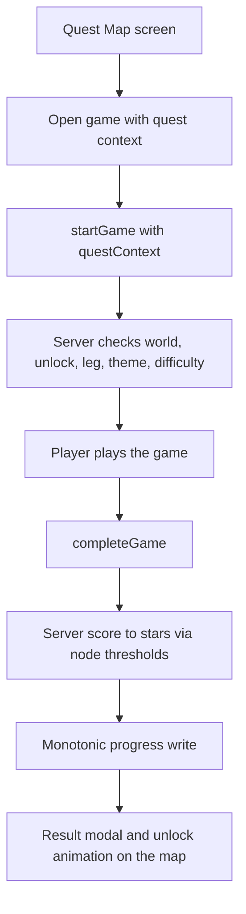

# Quest Map v1 - Requirements

**Feature**: Quest Map, an overworld of game nodes with stars, a boss per world, and a paid second world
**Depth**: Standard (lighter than `circuit-builder-requirements.md`, which is the style reference)
**Source decisions**: `quest-map-requirement-verification-questions.md` (13 questions, answers are **Recommended, pending owner approval**)
**Reverse engineering basis**: `aidlc-docs/inception/reverse-engineering/` (HEAD `a328c74`). Circuit Builder has been added since; code below was read in the current working tree.

---

## 1. Intent Analysis

| Dimension | Assessment |
|---|---|
| Request type | New Feature |
| Clarity | Clear concept; open decisions (paywall rule, allowance, thresholds, badges) resolved in the question file |
| Scope | Multiple components: web app, Game Service, shared package, one new DynamoDB table, locales |
| Complexity | Moderate. No new game logic. The risk is integration breadth (about a dozen game pages) and the free-tier interaction |
| Audience | Kids 8-16 and families; en, es, pt |

**Personas**: Free kid player (World 1, funnel); Paid player (both worlds, replays for 3 stars); Parent/buyer (sees the locked World 2 and decides on a subscription).

---

## 2. Scope

**In v1**: 2 worlds, a winding node path each, score-only star goals, a boss gauntlet per world, one bonus node per world, two badges per world, server-verified progress, map UI, in-game banner and return-to-map, hub entry point, static config in `packages/shared`.

**Out of v1 (deferred)**: Weekly Challenge and its weekly leaderboard (v2, see NFR-QM-12); lives or energy; tournaments, brackets, groups; non-score goals; player-chosen difficulty; Flutter app; CMS; new backend `AchievementType` values; per-game result re-verification; language games (need a language param, and pronunciation needs a microphone).

### Game inventory (read from code)
| Access | Games (themeId) | Source |
|---|---|---|
| Paid (blocked for FREE) | SPACE_ENTRY, SCRATCH_CODING, BOND_AND_BURN, TRAFFIC_LAB, MINI_GOLF, LANGUAGE_PRONUNCIATION, CIRCUIT_BUILDER | `PAID_GAMES`, `services/game/src/services/game.service.ts` |
| Free | Memory Match (themeId is a card theme such as ANIMALS, `GAME_THEMES` in `apps/web/src/config/constants.ts`), MATH_CHALLENGE, WORD_PUZZLE, LANGUAGE_LEARNING, SUDOKU, JIGSAW_PUZZLE, BUBBLE_POP, SEQUENCE_MEMORY, CODE_A_BOT, GEO_QUIZ, HISTORY_QUIZ, CIVICS_QUIZ, COLOR_BY_NUMBER, HANGMAN, TIC_TAC_TOE, MATH_MAZE, PATTERN_RECALL | themeIds from `startGame({ themeId })` calls in `apps/web/src/pages/*/`; absent from `PAID_GAMES` |

FREE users are also blocked at difficulty 4 on any game (`game.service.ts`), so World 1 difficulty is 1-3.

### Proposed launch content (tunable config; node durations unverified)
- **World 1 "Brain Peaks" (free games only)**: Memory Match d1, Math Challenge d1, Word Puzzle d1, Sequence Memory d2, Pattern Recall d2, Math Maze d2, Memory Match d3, **Boss** (Math Challenge d2 then Bubble Pop d2). Bonus: Pattern Recall d3.
- **World 2 "Science Island" (paid)**: Bond & Burn d1, Space Entry d1, Circuit Builder `cb-03-series-loop` (d2), Traffic Lab d2, Scratch Coding d1, Mini Golf d2, Circuit Builder `cb-05-series-vs-parallel` (d3), **Boss** (Bond & Burn d3, Space Entry d2, Traffic Lab d2). Bonus: Circuit Builder `cb-07-resistance-limits-current` (d4). Level ids from `packages/shared/src/circuit/guided-levels.ts`.

---

## 3. Functional Requirements and Acceptance Criteria

**FR-QM-1 Static config.** Worlds, nodes, legs (themeId, difficulty, optional params such as Circuit Builder `levelId`), thresholds, map coordinates, and access tier live in `packages/shared/src/quest/` and are exported from its `index.ts`.
- AC1: Adding a node needs a config entry and locale keys only; no other code changes.

**FR-QM-2 Config validation.** A test rejects invalid config.
- AC2: It fails if a themeId is unknown, ids are not unique, thresholds are not strictly ascending, a World 1 leg is in the paid set or has difficulty above 3, or a Circuit Builder leg's difficulty differs from its level's difficulty.

**FR-QM-3 Map screen.** A protected route `ROUTES.QUEST_MAP` renders worlds as a winding path of nodes.
- AC3: A signed-in user reaches it from the hub and sees both worlds; an unauthenticated user is redirected as for other protected routes.

**FR-QM-4 Node states.** Each node shows locked, available, 1, 2 or 3 stars; plus boss, bonus and unavailable variants.
- AC4: Each state is distinguishable without colour alone and exposes its state in its accessible name.

**FR-QM-5 Unlock rules (server-computed).** Node 1 is available; node n+1 unlocks when node n has at least 1 star; the bonus node unlocks at a per-world star total set in config.
- AC5: Completing node n with 0 stars leaves n+1 locked; with 1 star unlocks it. A locked node cannot be started even by a hand-crafted request (see FR-QM-8).

**FR-QM-6 World access.** World 1 is open to every signed-in user; World 2 requires a tier other than FREE.
- AC6: A FREE user sees World 2 locked with a link to `ROUTES.SUBSCRIPTION`. A FREE user's `startGame` with a World 2 context is rejected server-side. A lapsed subscriber keeps stored progress but cannot start World 2 nodes.

**FR-QM-7 Node launch.** Selecting an available node shows game, difficulty and the three star goals, then opens the game with quest context, bypassing the game's setup page.
- AC7: The game starts at the node's difficulty and, for Circuit Builder, its level.

**FR-QM-8 Session linkage.** `startGame` accepts an optional `questContext` (`worldId`, `nodeId`, `legIndex`). The server checks that the node exists, the world is accessible, the node is unlocked, the leg order holds, and the submitted `themeId` and `difficulty` match the leg. The context is stored on the game record.
- AC8: Any failed check returns one generic error and consumes no daily allowance. A request without `questContext` behaves exactly as today.

**FR-QM-9 Server-verified stars.** When a game with `questContext` completes, the server maps its server-computed score to stars using the node thresholds and updates progress. No mutation lets a client write stars or progress.
- AC9: `completeGame` returns `quest: { nodeId, stars, bestStars, newlyUnlocked, worldCleared }`. Stars equal the thresholds applied to the stored score. Replaying a completed game id changes nothing (existing status check).

**FR-QM-10 Boss gauntlet.** A boss has 2-3 legs, played in order. The server tracks one active attempt; the combined score is the sum of leg scores; stars use combined thresholds.
- AC10: Leg k+1 cannot start unless leg k of the same active attempt completed. An attempt idle for 30 minutes expires and restarts at leg 1. Every leg consumes one play.

**FR-QM-11 Replay and best score.** Any unlocked node can be replayed; best score and best stars are kept and never decrease.
- AC11: A lower-scoring replay leaves stored values unchanged. Concurrent completions cannot lower or lose a result.

**FR-QM-12 Bonus node.** One per world, unlocked by the star total; World 1's uses only free games.
- AC12: Below the threshold it is locked; at or above, available and starred like other nodes.

**FR-QM-13 Badges.** "World Cleared" (boss at 1 or more stars) and "World Mastered" (all path nodes at 3 stars), stored in the progress item.
- AC13: Each is awarded once, shown on the map and on the Achievements page, and the backend `AchievementType` enum is unchanged.

**FR-QM-14 In-game banner.** Game pages used by v1 nodes show a "Playing from Quest Map" banner with node name and goal.
- AC14: Banner appears only when launched from a node; games launched from the hub are unchanged.

**FR-QM-15 Result and return.** The shared result modal shows stars earned and offers "Back to map" and, if unlocked, "Next node". Returning plays an unlock animation.
- AC15: With reduced motion, the animation is replaced by a static indicator (NFR-QM-3).

**FR-QM-16 Hub entry.** `GameHubPage` shows a Quest Map card above the game grid; Quest Map is not a catalog game.
- AC16: The card links to the map and requires no catalog or review-registry entries.

**FR-QM-17 Allowance.** Quest plays count against the daily allowance (Q2). The progress response includes tier, limit and remaining plays; the map shows them and handles "out of plays" by routing as game pages do today (`ROUTES.RATE_LIMIT`).
- AC17: Remaining plays shown on the map match what `startGame` enforces. (`canStartGame` is a stub returning `used: 0`, so it must not be the source; see Section 7.)

**FR-QM-18 Removed games.** A node whose game is not `ACTIVE` in `listAvailableGames` shows as unavailable, counts as passed for unlocking, and is excluded from star totals.
- AC18: With a game deactivated, the player can still reach the boss and no progress is lost.

**FR-QM-19 Normal-game side effects unchanged.** Quest plays still record scores, leaderboard events and history like any play.
- AC19: Existing Game Service and Leaderboard tests pass unchanged.

---

## 4. Non-Functional Requirements

- **NFR-QM-1 Performance.** Progress read is one key-based Query by `userId`; target under 500 ms server-side p95. Map uses CSS/SVG, no heavy bitmaps. These are targets, not measured.
- **NFR-QM-2 Responsive.** Usable from 320 px width; vertical scrolling path on phones; touch targets at least 44 px.
- **NFR-QM-3 Accessibility.** Fully keyboard operable (focus order follows the path; Enter/Space launches). Node buttons have accessible names including state and stars. `prefers-reduced-motion` honoured. Sufficient contrast. Full WCAG conformance needs manual assistive-technology review and cannot be asserted from this document.
- **NFR-QM-4 i18n.** All world, node, banner, badge and error text exists in en, es, pt (`apps/web/src/locales/*.json`); the existing `localeCompleteness.test.ts` must pass with the new keys.
- **NFR-QM-5 Input validation (SECURITY-05).** Zod-validated: `worldId`/`nodeId` match `^[a-z0-9-]{1,40}$` and exist in config; `legIndex` is an integer 0-2; unknown keys are stripped; failure returns the generic error.
- **NFR-QM-6 Access control (SECURITY-08).** `userId` always comes from the verified JWT, never from input; progress is keyed by it; the tier gate is server-side.
- **NFR-QM-7 Secure design / anti-cheat (SECURITY-11).** Stars derive only from a server-created game session and its server-computed score. **Limit, stated plainly:** for non-Circuit-Builder games the server score uses client-reported `completionTime`, `correctAnswers` and `totalQuestions`, bounded only by `validateCompletionTime` (`services/game/src/utils/validation.ts`); stars therefore carry today's leaderboard trust level. Acceptable in v1 because stars grant no paid access or money value.
- **NFR-QM-8 Fail closed (SECURITY-15).** Quest validation errors are generic with no internals. If the progress write fails after a game is recorded, `completeGame` still succeeds without a `quest` field (same contract as achievement tracking), the error is logged and a metric emitted.
- **NFR-QM-9 Logging (SECURITY-03).** Log ids, stars and scores only; no tokens, emails or usernames.
- **NFR-QM-10 Data protection (SECURITY-01, 06).** New table uses `AWS_MANAGED` encryption, point-in-time recovery and `RETAIN`, as in `infrastructure/lib/stacks/database-stack.ts`; only the Game Lambda gets read/write on it.
- **NFR-QM-11 Analytics.** CloudWatch metrics via `metricsPublisher` (Q12): node started/cleared, world cleared, paywall hit. No PII.
- **NFR-QM-12 Reusable engine (v2 constraint).** Unlock and star evaluation are pure functions in `packages/shared` taking (node list, progress, result), so a fixed weekly node list can reuse them. Weekly Challenge is not built.
- **NFR-QM-13 Testability.** Unit and property tests (`fast-check` is in use by `packages/shared/src/circuit/evaluate.property.test.ts`) for the evaluator; backend tests for context validation, tier gate, boss attempts, monotonic updates; manual checks for map accessibility, mobile layout and reduced motion.
- **NFR-QM-14 Compatibility.** Additive API changes only; web and backend can deploy in either order without breaking non-quest play.

---

## 5. Data Model Sketch

```text
QuestWorld { id, order, accessTier: FREE | PAID, nameKey, nodes: QuestNode[], bonusNode, bonusStarThreshold }
QuestNode  { id, kind: GAME | BOSS | BONUS, legs: QuestLeg[] (1; 2-3 for BOSS), thresholds: [one, two, three], map: {x, y}, nameKey }
QuestLeg   { themeId, difficulty (1-4), params?: { levelId?, cardTheme? } }

Table memory-game-quest-progress-{env}   PK userId, SK worldId   (one small item per user per world)
  nodes: { [nodeId]: { stars, bestScore, firstClearedAt, lastPlayedAt } }
  totalStars, badges: string[], activeGauntlet?: { nodeId, legs: [{ gameId, score }], startedAt }
  version (conditional write, one retry on conflict), updatedAt

Game record (existing table memory-game-games-{env}, key userId + gameId): + questContext?: { worldId, nodeId, legIndex }
```



**Text alternative:** The map opens a game with quest context. `startGame` validates world, unlock state, leg order, theme and difficulty. After play, `completeGame` converts the server-computed score to stars using the node thresholds, writes progress monotonically, and the result modal returns the player to the map where unlocks animate.

---

## 6. Integration Points (all read in code)

- `packages/shared/src/index.ts` exports types, schemas, utils, constants, circuit; add `quest`. `types/entities.ts` `Game` gains optional `questContext`.
- `services/game/src/services/game.service.ts`: `startGame` (the `PAID_GAMES` list is a local constant; extract it so the config test can use it; add quest validation before `rateLimiter.checkLimit`); `completeGame` has two exits, the generic path and `completeCircuitBuilderGame`, so the quest hook must run from both.
- `services/game/src/utils/validation.ts` (`startGameInputSchema` add optional `questContext`); `handlers/game.handler.ts` (op switch add `getQuestProgress`; `completeGame` response mapping adds `quest`); `repositories/game.repository.ts` persists `questContext`; new quest progress repository.
- `infrastructure/lib/stacks/database-stack.ts` new table; Lambda env var and grant. `services/game/schema.graphql` is documentation only (its own comment says the handler routes by regex and validates with zod); update it for reference.
- Web: `api/game.ts` (start/complete operations, new query), `config/constants.ts` (`ROUTES`), `App.tsx` (route in the protected layout), `GameHubPage.tsx` (card), `components/game/ScoreBreakdownModal.tsx` (imported by 22 game pages), the game pages used by v1 nodes, `AchievementsPage.tsx`, `locales/{en,es,pt}.json`.
- Not touched: Leaderboard service, catalog, review registry, backend achievement enum and tracker.

---

## 7. Conflicts and Gaps Found in the Codebase

1. **Client/server paid lists disagree.** Web `PREMIUM_GAMES` (`GameTile.tsx`) lists 4 games; server `PAID_GAMES` lists 7. TRAFFIC_LAB and MINI_GOLF are missing client-side. Quest Map uses config-driven world access and must not use `PREMIUM_GAMES`.
2. **Free allowance.** FREE gets 3 plays per 24h (`rate-limits.ts`); World 1 plus replays spans days (Q2).
3. **`canStartGame` is a stub** (`used: 0`, `canPlay: true`, TODO in `game.service.ts`); FR-QM-17 needs a real source.
4. **Two achievement systems.** Backend: 8 fixed `AchievementType` values and a tracker; Web `AchievementsPage` computes its own badges from leaderboard history and never reads the backend table. Drift exists: SPEED_DEMON text says under 60 s but the tracker uses under 30 s; DIFFICULTY_CHAMPION says "48 pairs" but the code counts 5 difficulties; `GAME_INFO` lacks MATH_MAZE, PATTERN_RECALL, SPACE_ENTRY, SCRATCH_CODING, BOND_AND_BURN, TRAFFIC_LAB, MINI_GOLF.
5. **Client-reported scoring inputs** (NFR-QM-7).
6. **Launch path differs by game.** Math reads `?difficulty=` from the URL; Memory Match (`GamePage`) takes `location.state`; Circuit Builder needs `level` and its own submission contract.
7. `GAME_FILTER_MAP` lacks mini-golf; out of scope, noted.

---

## 8. Risks

R1 Slow free progression hurts retention rather than converting. R2 Stars forgeable as leaderboard scores are. R3 Progress write failure after completion loses stars (accepted, logged; replay recovers). R4 Thresholds miscalibrated. R5 Touching about a dozen game pages risks regressions. R6 Multi-tab concurrent completions (conditional write). R7 Config drift after catalog changes (FR-QM-2, FR-QM-18).

---

## 9. Security Compliance and Traceability

| Rule | Status | Basis |
|---|---|---|
| 01 Encryption, 06 Least privilege | Addressed for new table | NFR-QM-10 |
| 03 Logging, 09 Hardening, 15 Fail-safe | Addressed | NFR-QM-8, NFR-QM-9 |
| 05 Input validation | Addressed | NFR-QM-5 |
| 08 Access control, 11 Secure design | Addressed, with stated limit | NFR-QM-6, NFR-QM-7 |
| 02, 07, 10, 12, 13 | N/A | No new network layer, dependency, or auth flow |
| 04 Headers, 14 Alerting | Not changed by this feature | Pre-existing; see `aidlc-state.md` |

No new blocking finding. Decision links: Q1 FR-QM-2/6/8; Q2 FR-QM-17; Q3 FR-QM-1/7; Q4 FR-QM-1/NFR-QM-13; Q5 FR-QM-10; Q6 FR-QM-12; Q7 FR-QM-13; Q8 FR-QM-11; Q9 FR-QM-18; Q10 Scope; Q11 Section 2; Q12 NFR-QM-11; Q13 NFR-QM-7.

---

## 10. Unverified Assumptions

- U1 Every v1 game page can launch straight from a URL without its setup page (verified for Math only).
- U2 Chosen games are short enough for a node; durations not measured.
- U3 Enough real score data exists per game and difficulty to set thresholds; leaderboard data not queried.
- U4 A new DynamoDB table ships through the CDK stack and GitHub Actions; the prod deploy path not checked. No AWS was touched.
- U5 The rate limiter can expose current usage for FR-QM-17.
- U6 Theme rows for all chosen themeIds are PUBLISHED in prod (`validateTheme`); prod data not queried.
- U7 `ScoreBreakdownModal` accepts extra actions without per-page changes beyond props.
- U8 Browser, viewport and reduced-motion automated test tooling does not exist (as stated for Circuit Builder in NFR-CB-26); not rechecked.
- U9 Flutter app was not examined.
