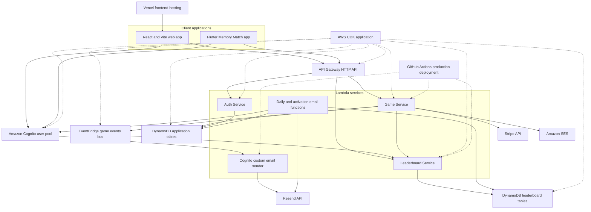

# System Architecture

## Verified against

- `apps/web/src/main.tsx` (application bootstrap), `apps/web/src/App.tsx` (`App`), and `apps/web/src/api/client.ts` (Apollo clients)
- `services/game/src/index.ts` (`handler`) and `services/game/src/handlers/game.handler.ts` (`GameHandler`)
- `services/leaderboard/src/index.ts` (`handler`), `services/leaderboard/src/handlers/event.handler.ts` (`EventHandler`), and `services/leaderboard/src/handlers/graphql.handler.ts` (`GraphQLHandler`)
- `services/auth/src/index.ts` (`handler`) and `services/email-sender/index.js` (`exports.handler`)
- `infrastructure/bin/memory-game.ts` and stacks under `infrastructure/lib/stacks/`
- `infrastructure/lib/config/environment-config.ts` (`devConfig`, `stagingConfig`, `prodConfig`)
- `.github/workflows/deploy-lambdas.yml` (`on.push`, deployment jobs)
- `apps/web/vercel.json`, `amplify.yml`, and `.kiro/steering/deployment.md`
- `services/game/src/services/game.service.ts` (`GameService`) and `services/game/src/services/event-publisher.service.ts` (`EventPublisherService`)
- `scripts/seed-mini-golf.sh` (current theme and catalog registration precedent)

## Scope

This is a source-level description of the checked-out repository. It does not assert that manually managed cloud resources match CDK, and it does not define a design for Circuit Builder. No Circuit Builder implementation was found outside `aidlc-docs` in the inspected snapshot.

## System overview

DashDen is a multi-project repository rather than an npm workspace. The principal customer application is a React and Vite single-page app. A separate Flutter application implements a Memory Match MVP. Backend responsibilities are split across Game, Leaderboard, Auth, custom email-sender, and ancillary email Lambda entry points. AWS CDK defines the core Cognito, API Gateway, Lambda, DynamoDB, EventBridge, SQS, CloudWatch, and SNS resources. Evidence: root `package.json` (no `workspaces` key), project manifests, `infrastructure/bin/memory-game.ts`, and `apps/mobile/pubspec.yaml`.

The browser calls Cognito directly through Amplify for normal authentication. It sends the Cognito ID token to two protected API Gateway HTTP routes: Game and Leaderboard. The API payloads look like GraphQL, but each Lambda extracts operation names from query strings and dispatches methods directly rather than using a GraphQL schema executor. Evidence: `apps/web/src/context/AuthContext.tsx` (`login`, `register`), `apps/web/src/api/client.ts` (`createAuthLink`), `infrastructure/lib/stacks/api-stack.ts` (`ApiStack`), `services/game/src/handlers/game.handler.ts` (`extractOperationName`, `routeOperation`), and `services/leaderboard/src/index.ts` (`handleHttpGraphQLRequest`).

## Architecture diagram

**Text alternative:** Vercel hosts the React web app; Flutter is a separate client. Both authenticate with Cognito and can call the API Gateway HTTP API. API Gateway invokes Auth, Game, or Leaderboard Lambdas. Game and Auth use application DynamoDB tables. Game publishes completion events to EventBridge and also invokes Leaderboard directly; Leaderboard stores entries and aggregates in separate tables. Game integrates with Stripe and SES. Cognito can invoke the custom email sender, while separate engagement functions read Cognito and DynamoDB data; both email paths use Resend. CDK defines the core AWS resources. GitHub Actions updates Game, Leaderboard, and the custom email-sender production Lambda, but not the engagement functions.

## Repository and component topology

| Component | Type | Runtime purpose | Important dependencies and evidence |
|---|---|---|---|
| `apps/web` | Browser application | Full game hub, authentication UI, mini-games, subscriptions, dashboard, leaderboard, reviews, profile, contact, and admin UI. | React 18, Vite 5, Apollo, Amplify, React Router, Tailwind, Framer Motion, i18next; `apps/web/package.json`; `apps/web/src/main.tsx` |
| `apps/mobile` | Flutter application | Memory Match mobile MVP with Cognito and Game API access. | Riverpod, `graphql_flutter`, pure-Dart Cognito, secure storage, `go_router`; `apps/mobile/pubspec.yaml`; `apps/mobile/lib/main.dart` (`DashDenApp`) |
| `services/game` | Node.js 20 Lambda application | Game sessions, access, limits, scoring, achievements, catalog, language, Stripe, reviews, email preferences, contact, and admin operations. | Runtime dependency on `@memory-game/shared`; `services/game/package.json`; `services/game/src/handlers/game.handler.ts` (`routeOperation`) |
| `services/leaderboard` | Node.js 20 Lambda application | Completion-event ingestion, anomaly checks, entries, aggregates, rankings, rank, and history. | Independent contracts and AWS SDK dependencies; `services/leaderboard/package.json`; `services/leaderboard/src/types/index.ts` |
| `services/auth` | Node.js 20 Lambda application | Older GraphQL-shaped account and profile API over Cognito and DynamoDB. | Auth handler/service/repositories; `services/auth/package.json`; `services/auth/src/handlers/auth.handler.ts` (`resolvers`) |
| `services/email-sender` | Node.js Lambda application | Cognito custom email delivery through Resend. | AWS Encryption SDK; `services/email-sender/package.json`; `services/email-sender/index.js` (`decryptCode`, `exports.handler`) |
| `packages/shared` | TypeScript library | Backend entities, enums, schemas, constants, calculations, and error/result types. | Consumed by Game and declared by Auth; not consumed by web, mobile, or Leaderboard; `packages/shared/src/index.ts`; package manifests |
| `infrastructure` | AWS CDK v2 application | Defines core identity, compute, API, data, event, and monitoring resources. | `infrastructure/bin/memory-game.ts`; `infrastructure/package.json` |
| `.github/workflows/deploy-lambdas.yml` | CI/CD workflow | Builds or bundles and deploys Game, Leaderboard, and custom email-sender code to production Lambdas. | Push to `main` with backend/shared path filters; three deployment jobs |
| `scripts` and root shell files | Operational tooling | Package Lambdas, seed catalog/theme data, and perform legacy/manual deployment and maintenance tasks. | `scripts/deploy-game-lambda.sh`, `scripts/seed-mini-golf.sh`, `deploy-frontend.sh` |

### Internal package relationships

- `services/game/package.json` declares `@memory-game/shared` as a file-based runtime dependency and imports its domain types in `services/game/src/services/game.service.ts`.
- `services/auth/package.json` declares the shared package only under `devDependencies`, although Auth source imports shared entities, for example `services/auth/src/repositories/user.repository.ts` (`User`, `SubscriptionTier`).
- `services/leaderboard`, `apps/web`, and `apps/mobile` maintain their own API and game-type models. For example, `GameType` exists independently in `services/leaderboard/src/types/index.ts` and `apps/web/src/api/leaderboard.ts`.
- CDK bundles service source directly. `infrastructure/lib/stacks/lambda-stack.ts` (`NodejsFunction` definitions) points at Auth and Game `src/index.ts`, while `infrastructure/lib/stacks/leaderboard-lambda-stack.ts` points at Leaderboard `src/index.ts`.

## Frontend architecture

### Bootstrap and routing

`apps/web/src/main.tsx` configures Amplify and mounts `BrowserRouter`, Apollo's `ApolloProvider`, TanStack's `QueryClientProvider`, Vercel Analytics, and Speed Insights under an error boundary. `apps/web/src/App.tsx` wraps the route tree in `AuthProvider`; login, registration, and password recovery are public, while hub, games, subscriptions, dashboards, leaderboard, profile, contact, and admin pages are under `ProtectedRoute` and `AppLayout`.

`ProtectedRoute` only enforces client navigation state. API Gateway authorizers and service-side ownership checks are the server trust boundary. Evidence: `apps/web/src/components/common/ProtectedRoute.tsx` (`ProtectedRoute`), `infrastructure/lib/stacks/api-stack.ts` (`HttpUserPoolAuthorizer`), and `services/game/src/services/game.service.ts` (`getGame`, `completeGame`).

### API clients

- `apps/web/src/api/client.ts` creates separate Auth and Game Apollo clients. `createAuthLink` obtains an Amplify ID token and falls back to the token copied into local storage.
- `apps/web/src/api/leaderboard.ts` creates a third Apollo client and duplicates the `GameType` and `Timeframe` contracts.
- `apps/web/src/api/game.ts` is the common browser wrapper for game start/completion, statistics/history, catalog, reviews, email preferences, and contact.
- Most game pages own their session lifecycle and local simulation. `apps/web/src/pages/mini-golf/MiniGolfGamePage.tsx` (`init`, `handleGameComplete`) is a complete current example.

## API Gateway and Lambda request architecture

| Route | Authorization in CDK | Integration | Runtime behavior | Evidence |
|---|---|---|---|---|
| `POST /auth/graphql` | None | Auth Lambda | Public GraphQL-shaped endpoint for the older Auth service. Protected Auth resolvers inspect a bearer token themselves. | `infrastructure/lib/stacks/api-stack.ts` (`AuthIntegration`, auth route); `services/auth/src/index.ts` (`executeGraphQL`) |
| `POST /game/graphql` | Cognito user-pool authorizer | Game Lambda | Reads API Gateway JWT claims and routes operations for game and adjacent product features. | `infrastructure/lib/stacks/api-stack.ts` (game route); `services/game/src/index.ts` (`handler`); `services/game/src/handlers/game.handler.ts` (`routeOperation`) |
| `POST /game/public` | None | Game Lambda | Runtime restricts this route to username-availability checks. | `infrastructure/lib/stacks/api-stack.ts` (public game route); `services/game/src/index.ts` (`isPublicRoute`, `isCheckUsername`) |
| `POST /leaderboard/graphql` | Cognito user-pool authorizer | Leaderboard Lambda | Converts HTTP input to an AppSync-like event, then independently validates the bearer JWT and consumes a DynamoDB token-bucket unit before routing the query. | `infrastructure/lib/stacks/api-stack.ts` (leaderboard route); `services/leaderboard/src/index.ts` (`handleHttpGraphQLRequest`); `services/leaderboard/src/handlers/graphql.handler.ts` (`handleQuery`) |

The Game Lambda also contains runtime branches for paths ending in `/webhook` and `/unsubscribe`, but `ApiStack` does not define those routes. Their externally deployed routing cannot be established from current CDK source. Evidence: `services/game/src/index.ts` (`handleStripeWebhook`, `handleUnsubscribe`, `handler`) and `infrastructure/lib/stacks/api-stack.ts` (`addRoutes` calls).

## Game lifecycle and event architecture

1. A game page calls `startGame` with a theme ID and numeric difficulty. API Gateway validates the Cognito token before invoking Game. Evidence: `apps/web/src/api/game.ts` (`startGame`) and `infrastructure/lib/stacks/api-stack.ts` (protected game route).
2. `GameService.startGame` reads the subscription, checks the paid-game and difficulty rules, checks the daily allowance, validates a published theme, writes an in-progress session, and increments usage. Evidence: `services/game/src/services/game.service.ts` (`startGame`).
3. The browser runs the game and supplies completion time, attempts, and optional performance counters. Evidence: `apps/web/src/api/game.ts` (`CompleteGameInput`) and current game pages such as `MiniGolfGamePage.handleGameComplete`.
4. `GameService.completeGame` checks ownership and status, validates generic metrics, computes and caps the score, persists completion, attempts achievements, and creates the completion event. Evidence: `services/game/src/services/game.service.ts` (`completeGame`) and `services/game/src/services/score-calculator.service.ts` (`calculateScoreBreakdown`).
5. `EventPublisherService.publishGameCompleted` writes to EventBridge and separately invokes the Leaderboard Lambda asynchronously. Both delivery failures are logged without failing game completion. Evidence: `services/game/src/services/event-publisher.service.ts`.
6. `EventHandler.handleGameCompletedEvent` validates the event and score, checks anomalies, creates a leaderboard entry, and updates an aggregate with retries. Evidence: `services/leaderboard/src/handlers/event.handler.ts`.
7. The immediate Game response contains a score breakdown but a `null` leaderboard rank; ranking is available on later Leaderboard reads. Evidence: `services/game/src/handlers/game.handler.ts` (`completeGame`) and `services/leaderboard/src/services/leaderboard.service.ts` (`getLeaderboard`).

The two completion-delivery paths can deliver the same event independently. The entry key can overwrite the same game score record, while `AggregateRepository.updateAggregate` performs a read followed by a put and has no event-id deduplication. This is an observed idempotency and concurrency boundary, not a proposed change. Evidence: `services/game/src/services/event-publisher.service.ts` (`publishGameCompleted`), `services/leaderboard/src/repositories/leaderboard.repository.ts` (`createEntry`), and `services/leaderboard/src/repositories/aggregate.repository.ts` (`updateAggregate`).

## Data architecture

`DatabaseStack` defines 15 on-demand, AWS-managed encrypted DynamoDB tables. Most durable tables use point-in-time recovery and `RETAIN`; the two rate-limit tables omit point-in-time recovery. Evidence: `infrastructure/lib/stacks/database-stack.ts` (`DatabaseStack`).

| Data area | CDK-defined tables | Role |
|---|---|---|
| Identity and preferences | `memory-game-users-{env}`, `memory-game-user-settings-{env}` | User/profile and settings records used by the older Auth service. |
| Game execution | `memory-game-games-{env}`, `memory-game-themes-{env}`, `memory-game-catalog-{env}` | User sessions, published theme validation, and hub catalog rows. |
| Entitlements and progression | `memory-game-subscriptions-{env}`, `memory-game-rate-limits-{env}`, `memory-game-achievements-{env}` | Active tier, daily starts, and backend achievement progress. |
| Language learning | `memory-game-language-words-{env}`, `memory-game-language-progress-{env}`, `memory-game-language-results-{env}` | Word content, per-language progress, and result history. |
| Leaderboards | `memory-game-leaderboards-{env}`, `memory-game-leaderboard-entries-{env}`, `memory-game-user-aggregates-{env}`, `memory-game-rate-limit-buckets-{env}` | One legacy leaderboard model plus current entries, aggregates, and API token buckets. |

Runtime code also references stores that current `DatabaseStack` does not define:

- `memory-game-reviews-*` in `services/game/src/services/review.service.ts` (`TABLE_NAME`, `ReviewService`).
- `memory-game-email-prefs-*` in `services/game/src/services/email-prefs.service.ts` (`TABLE_NAME`, `EmailPrefsService`) and email Lambda entry points.
- `GameStatistics` or `GAME_STATISTICS_TABLE_NAME` in `services/leaderboard/src/services/anomaly.service.ts` (`AnomalyService`).

Those tables may be manually managed in deployed environments, but their existence and permissions cannot be verified from CDK source.

## CDK stack integration

`infrastructure/bin/memory-game.ts` selects `dev`, `staging`, or `prod`, defaults to `dev`, and instantiates stacks in this dependency order:

| Stack | Main resources and connections | Evidence |
|---|---|---|
| `DatabaseStack` | The 15 DynamoDB tables and indexes summarized above. | `infrastructure/lib/stacks/database-stack.ts` (`DatabaseStack`) |
| `CognitoStack` | Self-sign-up user pool, email verification, optional SMS or TOTP MFA, email sign-in, public app client, authorization-code OAuth, and callback/logout URLs for local, dev, production, and mobile. | `infrastructure/lib/stacks/cognito-stack.ts` (`CognitoStack`) |
| `EventBridgeStack` | `MemoryGame-{env}` and `game-events-{env}` buses, seven-day archives/logs, and encrypted SQS dead-letter queues. | `infrastructure/lib/stacks/eventbridge-stack.ts` (`EventBridgeStack`) |
| `LambdaStack` | Node.js 20 Auth and Game `NodejsFunction` resources, environment variables, DynamoDB/Cognito/EventBridge/CloudWatch/Secrets Manager permissions, X-Ray, and one-month logs. | `infrastructure/lib/stacks/lambda-stack.ts` (`LambdaStack`) |
| `LeaderboardLambdaStack` | Node.js 20 Leaderboard Lambda, data permissions, and an EventBridge rule matching source `game-service` and detail type `GameCompleted`, with retry and DLQ configuration. | `infrastructure/lib/stacks/leaderboard-lambda-stack.ts` (`LeaderboardLambdaStack`) |
| `ApiStack` | HTTP API, Cognito authorizer, four routes, CORS allowlists, access logs, and default throttling. | `infrastructure/lib/stacks/api-stack.ts` (`ApiStack`) |
| `MonitoringStack` | SNS alarm topic, alarms and dashboards for Auth, Game, API, and selected legacy/core tables. Leaderboard is not passed into this stack. | `infrastructure/lib/stacks/monitoring-stack.ts` (`MonitoringStack`) |

### Source-defined integration drift

- CDK supplies `USERS_TABLE_NAME` and `USER_SETTINGS_TABLE_NAME`, while `services/auth/src/index.ts` (`handler`) requires `DYNAMODB_USERS_TABLE` and `DYNAMODB_USER_SETTINGS_TABLE`.
- CDK defines the Users partition key as `userId`, while `services/auth/src/repositories/user.repository.ts` operates on shared `User.id` in key paths.
- CDK does not supply Game's `LEADERBOARD_FUNCTION_NAME`, `REVIEWS_TABLE_NAME`, or `EMAIL_PREFS_TABLE_NAME`; runtime code uses defaults for these values. Evidence: `infrastructure/lib/stacks/lambda-stack.ts` (`GameFunction.environment`), `services/game/src/services/event-publisher.service.ts` (`LEADERBOARD_FUNCTION_NAME`), `services/game/src/services/review.service.ts` (`TABLE_NAME`), and `services/game/src/services/email-prefs.service.ts` (`TABLE_NAME`).
- Game runtime code invokes the Leaderboard Lambda directly and sends contact email through SES, while the source-defined Game role has no `lambda:InvokeFunction` or `ses:SendEmail` statement. Deployed permissions may therefore depend on manual configuration. Evidence: `services/game/src/services/event-publisher.service.ts` (`publishGameCompleted`), `services/game/src/services/contact.service.ts` (`submitContactForm`), and `infrastructure/lib/stacks/lambda-stack.ts` (Game role policies).
- `infrastructure/lib/stacks/lambda-stack.ts` contains Stripe secret ARNs for the old account, while `.kiro/steering/deployment.md` identifies `dashden-new` as production. This is configuration drift; no secret values were inspected or copied.
- `CognitoStack` contains an explicit production drift warning and leaves its Google provider block commented. The web still exposes `signInWithRedirect({ provider: 'Google' })`. Evidence: `infrastructure/lib/stacks/cognito-stack.ts` and `apps/web/src/context/AuthContext.tsx` (`loginWithGoogle`).

## External integration points

| Integration | Current use | Evidence |
|---|---|---|
| Amazon Cognito | Web/mobile sign-in, self-registration, email verification, OAuth, JWT issuance, user listing, and optional custom email triggers. | `apps/web/src/context/AuthContext.tsx`; `apps/mobile/lib/auth/cognito_service.dart`; `infrastructure/lib/stacks/cognito-stack.ts` |
| Stripe | Hosted subscription Checkout, billing portal, plan changes, signature-verified webhooks, and subscription record updates. | `services/game/src/services/stripe.service.ts` (`StripeService`); `apps/web/src/pages/subscription/RateLimitPage.tsx` |
| Resend | Cognito custom emails, daily digests, and activation messages. | `services/email-sender/index.js`; `services/game/src/daily-email.ts`; `services/game/src/activation-email.ts` |
| Amazon SES | Sends authenticated contact-form messages to support. | `services/game/src/services/contact.service.ts` (`ContactService.submitContactForm`) |
| Vercel | Hosts the active dev and production web projects; client telemetry uses Vercel Analytics and Speed Insights. | `.kiro/steering/deployment.md`; `apps/web/vercel.json`; `apps/web/src/main.tsx` |
| EventBridge and SQS | Routes, archives, logs, retries, and dead-letters game-completion events. | `infrastructure/lib/stacks/eventbridge-stack.ts`; `infrastructure/lib/stacks/leaderboard-lambda-stack.ts` |

## Frontend hosting and release

Current repository policy identifies Vercel as the active host:

- `dev.dashden.app` maps to Vercel project `web`.
- `dashden.app` maps to Vercel project `web-prod`.
- `apps/web/vercel.json` runs `npm run build`, publishes `dist`, and rewrites all paths to `index.html` for React Router deep links.

Evidence: `.kiro/steering/deployment.md` (`Frontend Deployment`) and `apps/web/vercel.json` (`buildCommand`, `rewrites`). `amplify.yml` and `deploy-frontend.sh` still describe AWS Amplify hosting, so they are legacy material relative to the current Vercel policy.

## CI/CD and deployment workflow

### Required backend path for the requested mini-game

For Circuit Builder, backend commits and production deployments must go through GitHub Actions. The permitted path is a reviewed Git change merged or pushed to `main`, followed by `.github/workflows/deploy-lambdas.yml`. Local production Lambda updates, local CDK deployment, and direct production DynamoDB seed commands are outside this feature's authorized path.

This feature-specific requirement is stricter than the repository's general manual-deployment instructions in `.kiro/steering/deployment.md` and `scripts/deploy-game-lambda.sh`. Those files document a manual fallback but are not the release path for Circuit Builder.

### Existing GitHub Actions behavior

`.github/workflows/deploy-lambdas.yml` is triggered by a push to `main` when these paths change:

- `services/game/src/**`
- `services/leaderboard/src/**`
- `services/email-sender/**`
- `packages/shared/**`

The workflow then runs all three jobs:

1. `deploy-game-lambda` installs and builds Shared and Game, assembles a fresh ZIP, configures AWS credentials, and publishes code to `MemoryGame-GameService-prod`.
2. `deploy-leaderboard-lambda` bundles `services/leaderboard/src/index.ts` with `npx esbuild`, creates a ZIP, and publishes code to `MemoryGame-LeaderboardService-prod`.
3. `deploy-email-sender` installs dependencies, packages `index.js` and `node_modules`, and publishes code to `DashDen-EmailSender`.

The workflow does not run lint, type-check, unit tests, integration tests, a CDK diff, account-identity assertion, smoke tests, or automatic rollback. It does not deploy Auth, ancillary daily/activation/pre-signup Lambdas, infrastructure, frontend, or DynamoDB catalog/theme data. These are observations from `.github/workflows/deploy-lambdas.yml`, not deployment recommendations.

### Catalog and theme delivery gap

The established Mini Golf registration script writes both a published `MINI_GOLF` theme row and a `mini-golf` catalog row, with `--profile dashden-new` for production. No current GitHub Actions job applies equivalent catalog or theme data. Therefore a new game's data registration is outside the existing GitHub Actions backend pipeline and remains an unresolved release-planning boundary under the feature-specific Actions-only requirement. Evidence: `scripts/seed-mini-golf.sh` and `.github/workflows/deploy-lambdas.yml`.

## Environments

| Concern | Development | Staging | Production | Evidence |
|---|---|---|---|---|
| CDK selection | Default when no context is supplied; `environment=dev`. | Supported with `environment=staging`. | Selected with `environment=prod`. | `infrastructure/bin/memory-game.ts` (`environment` switch) |
| AWS account policy | Default profile, account `848403890404`, designated old/dev/migration. | Uses `CDK_DEFAULT_ACCOUNT`; no separate profile policy is defined. | Profile `dashden-new`, account `342278407349`. | `.kiro/steering/deployment.md`; `infrastructure/lib/config/environment-config.ts` |
| Region | `us-east-1` | `us-east-1` | `us-east-1` | `infrastructure/lib/config/environment-config.ts` (`devConfig`, `stagingConfig`, `prodConfig`) |
| Web host | `dev.dashden.app`, Vercel project `web`. | No current frontend project is defined in deployment policy. | `dashden.app`, Vercel project `web-prod`. | `.kiro/steering/deployment.md` |
| Resource naming | Most resources end in `-dev`. | Most resources end in `-staging`. | Most resources end in `-prod`. | CDK stack constructors and table/function names |
| API CORS | `https://dev.dashden.app` plus local origins. | Current code follows the non-prod branch and allows the dev origin plus local origins. | `https://dashden.app` and `https://www.dashden.app` plus local origins. | `infrastructure/lib/stacks/api-stack.ts` (`corsPreflight`) |
| Game frontend URL | `https://dev.dashden.app`. | Current ternary also resolves to the dev URL. | `https://dashden.app`. | `infrastructure/lib/stacks/lambda-stack.ts` (`FRONTEND_URL`) |

The browser selects API and Cognito values from `VITE_*` build variables with source fallbacks. Evidence: `apps/web/src/config/env.ts` (`env`), `apps/web/src/api/client.ts`, and `apps/web/src/api/leaderboard.ts`.

## Existing patterns and extension points relevant to a new mini-game

This section is observational. It identifies existing integration surfaces and current inconsistencies; it does not choose a Circuit Builder design.

### Routing and page organization

- Most standalone games have setup and play constants in `apps/web/src/config/constants.ts` (`ROUTES`) and matching protected routes in `apps/web/src/App.tsx` (`App`). Game pages live under `apps/web/src/pages/<game-id>/`.
- Language routes are a counterexample: several are hard-coded in `App.tsx` rather than fully represented in `ROUTES`.
- Every protected game renders inside `AppLayout`, whose `<main>` uses a centered container with horizontal padding and vertical padding. A canvas surface therefore inherits that shell unless routing/layout behavior is deliberately changed later. Evidence: `apps/web/src/components/layout/AppLayout.tsx` (`AppLayout`).

### Game catalog and theme publication

- Hub tiles come from `GameCatalogRepository.getAllGames`; there is no compiled catalog fallback. A route alone does not make a tile visible. Evidence: `services/game/src/repositories/game-catalog.repository.ts` and `GameHubPage.loadGames`.
- `startGame` independently requires a published theme row. A catalog tile can therefore exist while session creation fails, and a route can exist without a tile. Evidence: `services/game/src/repositories/theme.repository.ts` (`validateTheme`).
- `scripts/seed-mini-golf.sh` shows the current two-record convention: kebab-case catalog ID and uppercase theme ID. It is a manual script, not an Actions-integrated deployment mechanism.
- Subject filtering is another registry in `GameHubPage.tsx` (`GAME_FILTER_MAP`). Mini Golf demonstrates drift: it has routes and a seed script but no map entry, so it appears under All and not under a subject filter.

### Authentication and access gating

- All current game routes are behind `ProtectedRoute`; Game API requests also pass through the API Gateway Cognito authorizer.
- Tile-level paid display and redirect use `GameTile.PREMIUM_GAMES`, setup pages may call `canStartGame`, and `GameService.startGame` contains the authoritative `PAID_GAMES` list plus the paid difficulty rule.
- These lists already disagree: backend-paid Traffic Lab, Mini Golf, and Language Pronunciation are absent from `GameTile.PREMIUM_GAMES`. Evidence: `apps/web/src/components/hub/GameTile.tsx` and `services/game/src/services/game.service.ts` (`startGame`).
- `GameService.canStartGame` currently returns placeholder availability and usage. It is reliable for the active tier but not for the remaining daily allowance. The actual limit check is in `startGame`.
- `startGame` creates the session and increments usage before setting response `canPlay` from the remaining count. On the final allowed start, it returns a valid session with `canPlay: false`; existing pages such as `MiniGolfGamePage.init` treat that flag as denial and navigate away. Evidence: `services/game/src/services/game.service.ts` (`startGame`) and `apps/web/src/pages/mini-golf/MiniGolfGamePage.tsx` (`init`).

### Session lifecycle, metrics, and scoring

- `apps/web/src/api/game.ts` supplies the common `startGame` and `completeGame` contract. Newer pages independently manage initialization, timer cleanup, errors, submission, and `ScoreBreakdownModal` state.
- The backend completion input supports generic counters such as `correctAnswers`, `totalQuestions`, `wordsFound`, and `totalWords`. A new game ID must be classified in `GameService.completeGame` if its attempt and accuracy semantics differ from Memory Match.
- Score targets, base score, multipliers, and caps live across `ScoreCalculatorService.calculateScoreBreakdown` and `GameService.completeGame`. The client supplies the metrics used to calculate scores.
- `apps/web/src/components/game/ScoreBreakdownModal.tsx` (`ScoreBreakdownModal`) is the common current completion and review UI. `apps/web/src/components/game/Confetti.tsx` (`Confetti`) is reusable but is tied to older completion UI paths rather than consistently used by newer games.

### Leaderboards and reporting

- A game type must be recognized by the Game Service event mapping, `services/leaderboard/src/types/index.ts` (`GameType`), and `apps/web/src/api/leaderboard.ts` (`GameType`). `LeaderboardService.getOverallTimeBasedLeaderboard` also has an explicit game-type list.
- `apps/web/src/components/leaderboard/GameTypeFilter.tsx` (`gameTypes`) has a separate label/icon array. Dashboard, Statistics, History, Achievements, Recent Improvements, admin analytics, and daily email contain more independent game metadata lists. Evidence includes `apps/web/src/pages/dashboard/StatisticsPage.tsx` (`GAME_INFO`), `apps/web/src/pages/dashboard/HistoryPage.tsx` (`GAME_INFO`), `apps/web/src/pages/dashboard/AchievementsPage.tsx` (`GAME_INFO`), `apps/web/src/components/dashboard/RecentImprovements.tsx` (`gameTypeInfo`), `apps/web/src/pages/admin/AdminDashboard.tsx` (`GAME_NAMES`, `GAME_ICONS`), and `services/game/src/daily-email.ts` (`ALL_GAMES`, `GAME_NAMES`).
- Contract drift is visible: `LANGUAGE_PRONUNCIATION` can be emitted by Game but is absent from the Leaderboard and web `GameType` enums. A completion event for that ID fails `EventHandler.validateEvent`.
- Ranking is asynchronous. New-game UI should not infer an immediate rank from the Game completion response because `GameHandler.completeGame` currently returns `leaderboardRank: null`.

### Reviews

- Supplying `gameType` to `ScoreBreakdownModal` enables one-to-five-star submission through `ReviewService.submitReview`.
- `ReviewService.getReviewStats` enumerates a fixed list that stops at Math Maze. Newer submitted IDs can be stored but are omitted from aggregate hub/admin review statistics unless that registry recognizes them.
- The reviews table and required Game Lambda permissions are not defined in current CDK.

### Localization

- `apps/web/src/i18n.ts` registers English, Spanish, and Portuguese, detects local-storage or browser language, and falls back to English.
- `GameTile` looks up `games.<catalog-id>.title`, `.description`, and `.category`, falling back to catalog strings.
- Page copy uses game-specific namespaces. Existing coverage is manual and inconsistent: Bond and Burn has both a catalog key and a page namespace, while Mini Golf has a `miniGolf` page namespace but no `games.mini-golf` catalog key in `apps/web/src/locales/en.json`, `es.json`, or `pt.json`.
- Some recent page strings remain hard-coded even where a namespace exists, as visible in `MiniGolfGamePage` and `MiniGolfSetupPage`.

### Audio and celebration

- `apps/web/src/config/env.ts` defines `features.enableSoundEffects`, but no source consumer exists.
- The production source has no shared sound-effect or jingle service. Existing audio paths are language-specific browser speech synthesis in `LanguageGamePage.playPronunciation` and microphone/Web Audio analysis in `useSpeechRecognition`.
- Visual celebration patterns include `Confetti` with Framer Motion and page-local overlays or CSS keyframes. A circuit spark effect or success jingle would therefore be a new game-local or shared capability, depending on later design.

### Drag, canvas, and responsive UI

- Tailwind classes are the primary styling mechanism, with Framer Motion available for selected effects. Newer games such as Mini Golf and Bond and Burn define their dark gradient treatment inside the page, while `AppLayout` supplies a light shared shell around every protected route. Evidence: `apps/web/package.json`, `apps/web/src/components/layout/AppLayout.tsx` (`AppLayout`), `apps/web/src/pages/mini-golf/MiniGolfGamePage.tsx`, and `apps/web/src/pages/bond-and-burn/BondAndBurnGamePage.tsx`.
- `MiniGolfGamePage` draws on a logical 600 by 600 canvas, converts mouse/touch viewport coordinates in `getCanvasPos`, scales with CSS, applies `touch-none`, and runs `physicsTick` through `requestAnimationFrame`.
- `BondAndBurnGamePage` is the closest active drag precedent. It combines native HTML drag events, touch-end bounds checking, and click/tap fallback.
- `@dnd-kit` packages are installed, and `pages/scratch-coding/BlockRenderer.tsx` calls `useDroppable`; however, no active `DndContext` or external `BlockRenderer` consumer exists in `apps/web/src`. It is not an established routed-game pattern.
- Current canvas and drag precedents do not provide a reusable keyboard-accessible canvas interaction model. That is a present-state accessibility boundary, not a design decision.

### Backend identity conventions

The same logical game is represented in several forms:

| Surface | Existing convention | Example evidence |
|---|---|---|
| Catalog row and translation key | Kebab case | `mini-golf` in `scripts/seed-mini-golf.sh`; `games.<gameId>` in `GameTile` |
| Browser route | Kebab-case URL | `/mini-golf/setup` in `ROUTES.MINI_GOLF_SETUP` |
| Theme validation and session | Uppercase underscore ID | `MINI_GOLF` in `MiniGolfGamePage.init` and `GameService.startGame` |
| Completion event and Leaderboard | Uppercase `GameType` | `MINI_GOLF` in both Leaderboard enums |
| Review key | Caller-supplied uppercase game type | `gameType="MINI_GOLF"` in `MiniGolfGamePage`; `ReviewService.submitReview` |

There is no single manifest that generates these registrations. A new game currently crosses route constants, route imports, catalog data, theme data, hub filters, paid lists, score branches, event types, leaderboard filters, review statistics, localization, reports, achievements, and email metadata.

### Release extension boundary

Frontend-only code can be built and deployed to the appropriate Vercel project under current policy. Any backend code for the requested mini-game must enter production through `.github/workflows/deploy-lambdas.yml`. Catalog/theme registration has no equivalent GitHub Actions path today, so later workflow planning must resolve that gap without assuming direct production CLI access.
