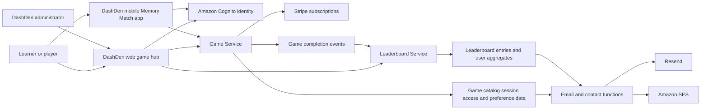

# Business Overview

## Verified against

- `apps/web/src/App.tsx` (`App`) and `apps/web/src/pages/hub/GameHubPage.tsx` (`GameHubPage`, `loadGames`, `GAME_FILTER_MAP`)
- `apps/web/src/context/AuthContext.tsx` (`AuthProvider`, `login`, `register`, `confirmEmail`, `loginWithGoogle`)
- `apps/web/src/api/game.ts` (`startGame`, `completeGame`, `listAvailableGames`, review and email-preference operations)
- `services/game/src/handlers/game.handler.ts` (`GameHandler.handleRequest`, `routeOperation`)
- `services/game/src/services/game.service.ts` (`GameService.startGame`, `completeGame`, `getGameHistory`, `getUserStatistics`, `canStartGame`)
- `services/game/src/services/score-calculator.service.ts` (`ScoreCalculatorService.calculateScoreBreakdown`)
- `services/leaderboard/src/handlers/event.handler.ts` (`EventHandler.handleGameCompletedEvent`) and `services/leaderboard/src/services/leaderboard.service.ts` (`LeaderboardService`)
- `services/game/src/services/stripe.service.ts` (`StripeService`), `services/game/src/services/review.service.ts` (`ReviewService`), `services/game/src/services/email-prefs.service.ts` (`EmailPrefsService`), and `services/game/src/services/contact.service.ts` (`ContactService`)
- `services/game/src/daily-email.ts` (`handler`) and `services/game/src/activation-email.ts` (`handler`)
- `apps/mobile/pubspec.yaml` and `apps/mobile/lib/main.dart` (`DashDenApp`)

## Scope note

DashDen is an existing educational game platform. The requested Circuit Builder mini-game is not present in the inspected application source or configuration. This document records the current business behavior that a later requirements and design phase can use as context; it does not define Circuit Builder behavior.

## Business context

**Text alternative:** Learners use the React web hub and a narrower Flutter Memory Match app. Both authenticate with Cognito and use the Game Service; the web app also reads the Leaderboard Service. The Game Service stores catalog, session, entitlement, and preference data, integrates with Stripe, and emits completion events. The Leaderboard Service stores rankings and aggregates. Separate email and contact paths use Resend or Amazon SES.

## Business description

DashDen provides authenticated educational mini-games spanning memory, mathematics, language, geography, history, civics, coding, science, and puzzles. The browser application is the broad product surface, while the Flutter application is currently a Memory Match MVP. The web hub obtains its visible game tiles from a DynamoDB-backed catalog rather than a compiled fallback list. Evidence: `apps/web/src/App.tsx` (`App` route registry), `apps/web/src/pages/hub/GameHubPage.tsx` (`loadGames`), `services/game/src/repositories/game-catalog.repository.ts` (`GameCatalogRepository.getAllGames`), and `apps/mobile/pubspec.yaml` (`description`).

The business model combines a free tier with paid Light, Standard, and Premium tiers. A subscription tier controls daily play allowances and access to selected games; paid checkout and plan management use Stripe. Game sessions and scores are recorded by the Game Service, while a separate Leaderboard Service receives completion events and builds time-based rankings. Evidence: `services/game/src/services/rate-limiter.service.ts` (`RateLimiterService.getTierLimit`), `services/game/src/services/game.service.ts` (`GameService.startGame`), `services/game/src/services/stripe.service.ts` (`StripeService`), and `services/leaderboard/src/services/leaderboard.service.ts` (`LeaderboardService.getLeaderboard`).

## Business transactions

| Transaction | Current behavior | Evidence |
|---|---|---|
| Register an account | The web app validates form input, checks `preferred_username` availability through the public Game route, and then calls Cognito through Amplify. Cognito email confirmation can be completed or resent from the registration page. Google redirect sign-up is also exposed. | `apps/web/src/pages/auth/RegisterPage.tsx` (`RegisterPage`, `onSubmit`, `onConfirmEmail`, `onResendCode`); `apps/web/src/context/AuthContext.tsx` (`register`, `confirmEmail`, `resendCode`, `loginWithGoogle`); `services/game/src/handlers/game.handler.ts` (`checkUsernameAvailable`) |
| Sign in and restore a session | Email/password and Google redirect authentication go directly from the web app to Cognito through Amplify. Login builds the local user model and stores the Cognito ID token for API calls; mount-time session restoration also queries the Game Service for the current tier. Logout clears the Amplify session and local auth data. | `apps/web/src/context/AuthContext.tsx` (`checkAuthSession`, `login`, `loginWithGoogle`, `logout`); `apps/web/src/api/client.ts` (`createAuthLink`) |
| Recover a password | Public forgot-password and reset-password pages exist, but their current submit handlers only log input and present success or navigation; they do not call Cognito or the Auth service. The older Auth Lambda implements request and confirm reset resolvers, and the custom email sender contains a Cognito forgot-password template, so the browser integration is incomplete rather than absent end to end. | `apps/web/src/pages/auth/ForgotPasswordPage.tsx` (`onSubmit`); `apps/web/src/pages/auth/ResetPasswordPage.tsx` (`onSubmit`); `services/auth/src/handlers/auth.handler.ts` (`requestPasswordReset`, `confirmPasswordReset`); `services/email-sender/index.js` (`buildEmail`) |
| Browse the game catalog | The hub concurrently requests catalog rows, review summaries, and tier information. The backend returns `ACTIVE` and `COMING_SOON` rows from the catalog status index, sorted by `displayOrder`; the browser then applies its own subject filter map. | `apps/web/src/pages/hub/GameHubPage.tsx` (`loadGames`, `GAME_FILTER_MAP`); `services/game/src/repositories/game-catalog.repository.ts` (`getAllGames`) |
| Check access before play | The hub and some setup pages use `canStartGame` to infer the subscription tier and may redirect free users. The current backend implementation always reports `canPlay: true` and zero usage, so the authoritative paid and allowance checks occur only in `startGame`. | `apps/web/src/components/hub/GameTile.tsx` (`PREMIUM_GAMES`); `apps/web/src/pages/mini-golf/MiniGolfSetupPage.tsx` (`checkAccess`); `services/game/src/services/game.service.ts` (`canStartGame`, `startGame`) |
| Start a game session | The Game Service reads the active subscription, rejects configured paid games for Free users, restricts difficulty 4 or above for Free users, enforces the daily limit, requires a published theme row, creates an in-progress game, and increments usage. | `services/game/src/services/game.service.ts` (`GameService.startGame`); `services/game/src/services/rate-limiter.service.ts` (`checkLimit`, `incrementUsage`); `services/game/src/repositories/theme.repository.ts` (`validateTheme`); `services/game/src/repositories/game.repository.ts` (`create`) |
| Play a mini-game | Game rules, timers, input, simulation, and result metrics generally run in the browser. For example, Mini Golf owns a canvas loop and physics utility, while Bond and Burn uses native drag, touch hit-testing, and tap input. | `apps/web/src/pages/mini-golf/MiniGolfGamePage.tsx` (`MiniGolfGamePage`, `render`, pointer handlers); `apps/web/src/utils/miniGolfPhysics.ts` (`physicsTick`); `apps/web/src/pages/bond-and-burn/BondAndBurnGamePage.tsx` (`handleDropElement`, drag and touch handlers) |
| Complete and score a game | The browser submits session ID, elapsed time, attempts, and optional accuracy counters. The Game Service validates generic bounds, calculates a deterministic score and breakdown, applies score caps, marks the session complete, and attempts achievement tracking. Client-supplied performance metrics are not reconstructed from game state on the server. | `apps/web/src/api/game.ts` (`CompleteGameInput`, `completeGame`); `services/game/src/utils/validation.ts` (`completeGameInputSchema`, `validateCompletionTime`); `services/game/src/services/game.service.ts` (`completeGame`); `services/game/src/services/score-calculator.service.ts` (`calculateScoreBreakdown`) |
| Track achievements and statistics | Completion invokes backend achievement checks without allowing an achievement failure to fail completion. The Game Service also calculates user statistics from completed sessions. The current web Achievements page separately derives badges from Leaderboard history. | `services/game/src/services/achievement-tracker.service.ts` (`trackCompletion`); `services/game/src/services/game.service.ts` (`getUserStatistics`); `apps/web/src/pages/dashboard/AchievementsPage.tsx` (`ACHIEVEMENTS`, `AchievementsPage`) |
| Create leaderboard records | Completion publishes a `GameCompleted` event to EventBridge and also asynchronously invokes the Leaderboard Lambda. The Leaderboard event handler validates the Game Service score, checks anomalies, writes an entry, updates the user aggregate, and emits metrics. Publication failures are logged and swallowed by the Game Service. | `services/game/src/services/event-publisher.service.ts` (`publishGameCompleted`); `services/leaderboard/src/handlers/event.handler.ts` (`handleGameCompletedEvent`); `services/leaderboard/src/repositories/leaderboard.repository.ts` (`createEntry`); `services/leaderboard/src/repositories/aggregate.repository.ts` (`updateAggregate`) |
| Read leaderboards and score history | Authenticated users can request daily, weekly, monthly, or all-time rankings, their rank, and their score history. The service keeps each user's best score for a ranked view and uses completion time as a secondary sort key. | `apps/web/src/api/leaderboard.ts` (`getLeaderboard`, `getUserRank`, `getUserScoreHistory`); `services/leaderboard/src/services/leaderboard.service.ts` (`getLeaderboard`, `getUserRank`, `getUserScoreHistory`, `calculateRanks`) |
| Buy or manage a subscription | The subscription page creates Stripe Checkout sessions for Free-to-paid changes and upgrades, calls `changePlan` for eligible downgrades, and opens the Stripe customer portal for management. Webhook handling updates the DynamoDB subscription and rate-limit tier; success-page verification provides a second path that updates the subscription record. | `apps/web/src/pages/subscription/RateLimitPage.tsx` (`handleSubscribe`, `handleManageSubscription`); `apps/web/src/pages/subscription/SubscriptionSuccessPage.tsx` (`SubscriptionSuccessPage`); `services/game/src/handlers/game.handler.ts` (`createCheckoutSession`, `changePlan`, `verifyCheckoutSession`); `services/game/src/services/stripe.service.ts` (`handleWebhook`) |
| Rate a game | The completion modal offers a one-to-five-star rating. The backend upserts one review per user and game type. Aggregate review statistics query a hard-coded game-type list, so a newly submitted game type is not automatically included in hub statistics. | `apps/web/src/components/game/ScoreBreakdownModal.tsx` (`ScoreBreakdownModal`); `services/game/src/services/review.service.ts` (`submitReview`, `getUserReview`, `getReviewStats`) |
| Manage email preferences | A player can toggle the daily digest on the Profile page; administrators can change preferences through the subscription-admin page. Preferences are persisted by the Game Service. | `apps/web/src/pages/profile/ProfilePage.tsx` (`toggleDigest`); `apps/web/src/api/game.ts` (`getEmailPrefs`, `setEmailPrefs`, `adminSetEmailPrefs`); `services/game/src/services/email-prefs.service.ts` (`EmailPrefsService`) |
| Receive engagement emails | The daily digest scans opted-in users and recent leaderboard and aggregate data, then sends personalized messages through Resend. The activation function finds verified Cognito users with no game records, checks activation opt-out state, and sends a first-play prompt. A public unsubscribe handler writes activation opt-out state. | `services/game/src/daily-email.ts` (`handler`, `sendViaResend`); `services/game/src/activation-email.ts` (`handler`, `isUserEligible`); `services/game/src/index.ts` (`handleUnsubscribe`) |
| Contact support | Authenticated users submit bug reports, feature requests, questions, or other messages. The Game Service validates subject and message length and sends the request through Amazon SES. | `apps/web/src/pages/contact/ContactPage.tsx` (`handleSubmit`); `services/game/src/services/contact.service.ts` (`ContactService.submitContactForm`) |
| Administer the product | Hard-coded admin identities can view analytics and users, maintain language data, change subscriptions and email preferences, confirm or delete users, request upload URLs, and clear leaderboard records through service-specific operations. | `services/game/src/handlers/game.handler.ts` (`isAdminUser`, admin cases in `routeOperation`); `services/leaderboard/src/handlers/graphql.handler.ts` (`clearAllRecordsResolver`); `apps/web/src/App.tsx` (admin routes) |
| Save language-learning progress | Language operations retrieve words, save a result, add XP, and return per-language progress in addition to the generic game-session flow used by language pages. | `services/game/src/handlers/language.handler.ts` (`getLanguageWords`, `saveLanguageGameResult`, `getUserLanguageProgress`, `getLanguageProgressByCode`) |

## Business rules visible in source

- A missing or non-active subscription resolves to `FREE`. Any tier above Free satisfies the current paid-game check; there is no game-by-tier entitlement matrix. Evidence: `services/game/src/repositories/subscription.repository.ts` (`getTier`) and `services/game/src/services/game.service.ts` (`PAID_GAMES` in `startGame`).
- Daily play allowances are 3 for Free, 20 for Light, 100 for Standard, and 1,000 for Premium, resetting at midnight UTC. Evidence: `services/game/src/services/rate-limiter.service.ts` (`getTierLimit`, `getNextMidnightUTC`).
- A session cannot start unless its uppercase theme identifier has a published record. Catalog visibility is a separate kebab-case catalog record. Evidence: `services/game/src/repositories/theme.repository.ts` (`validateTheme`), `services/game/src/repositories/game-catalog.repository.ts` (`getAllGames`), and `scripts/seed-mini-golf.sh` (theme and catalog writes).
- Game completion is accepted only for an existing in-progress session owned by the caller. Evidence: `services/game/src/services/game.service.ts` (`completeGame`) and `services/game/src/repositories/game.repository.ts` (`getById`, `update`).
- The Game Service computes the stored score; the Leaderboard Service validates and records that score rather than recalculating it for event ingestion. Evidence: `services/game/src/services/game.service.ts` (`completeGame`) and `services/leaderboard/src/handlers/event.handler.ts` (`handleGameCompletedEvent`).
- The immediate completion response always sets `leaderboardRank` to `null` because ranking is updated asynchronously. Evidence: `services/game/src/handlers/game.handler.ts` (`completeGame`).

## Business dictionary

| Term | Meaning in the current system | Evidence |
|---|---|---|
| Catalog game ID | Kebab-case identifier used by the hub row and translations, such as `mini-golf`. | `services/game/src/repositories/game-catalog.repository.ts` (`GameCatalogItem.gameId`); `apps/web/src/components/hub/GameTile.tsx` (`GameTile`) |
| Theme ID | Uppercase identifier sent to `startGame` and persisted on the game session. It now acts as a game-kind identifier as well as the original Memory Match theme concept. | `apps/web/src/api/game.ts` (`StartGameInput.themeId`); `services/game/src/services/game.service.ts` (`startGame`) |
| Game type | Uppercase identifier carried in completion events and leaderboard records. It is duplicated in Game Service mapping, Leaderboard enums, and the web API enum. | `services/game/src/services/game.service.ts` (`gameType` mapping in `completeGame`); `services/leaderboard/src/types/index.ts` (`GameType`); `apps/web/src/api/leaderboard.ts` (`GameType`) |
| Game session | A DynamoDB record keyed by user ID and game ID, with theme, difficulty, status, timestamps, attempts, and score. | `services/game/src/repositories/game.repository.ts` (`create`, `update`); `infrastructure/lib/stacks/database-stack.ts` (`gamesTable`) |
| Published theme | A theme record whose `status` is `PUBLISHED` or whose legacy `isPublished` value is true. It is required by `startGame`. | `services/game/src/repositories/theme.repository.ts` (`validateTheme`) |
| Difficulty | Numeric value from 1 through 5 at the Game API boundary; the completion event maps it to a label used by Leaderboard. | `services/game/src/utils/validation.ts` (`startGameInputSchema`); `services/game/src/services/game.service.ts` (`difficulty` mapping in `completeGame`) |
| Attempt | A client-reported game action count used for validation, score calculation, or performance metadata. Its exact gameplay meaning varies by mini-game. | `apps/web/src/api/game.ts` (`CompleteGameInput.attempts`); `services/game/src/services/game.service.ts` (`completeGame`) |
| Accuracy | A ratio derived from client-submitted counters, or from Memory Match attempts, and included in score breakdowns and leaderboard entries. | `services/game/src/services/game.service.ts` (`preAccuracy`, `accuracy`); `services/game/src/services/score-calculator.service.ts` (`calculateScoreBreakdown`) |
| Score breakdown | Base score, difficulty multiplier, speed bonus, accuracy bonus, final score, difficulty, elapsed time, and accuracy returned after completion. | `services/game/src/services/score-calculator.service.ts` (`ScoreBreakdown`); `apps/web/src/components/game/ScoreBreakdownModal.tsx` (`ScoreBreakdown`) |
| Subscription tier | `FREE`, `LIGHT`, `STANDARD`, or `PREMIUM`; used for access and daily allowances. | `packages/shared/src/types/enums.ts` (`SubscriptionTier`); `services/game/src/repositories/subscription.repository.ts` (`getTier`) |
| Paid game | A game whose uppercase theme ID appears in the Game Service `PAID_GAMES` list. Frontend paid badges use a separate list and can disagree. | `services/game/src/services/game.service.ts` (`PAID_GAMES`); `apps/web/src/components/hub/GameTile.tsx` (`PREMIUM_GAMES`) |
| Play allowance | Number of starts permitted per user and UTC day for a tier. Usage increments when a session starts, not when it completes. | `services/game/src/services/rate-limiter.service.ts` (`checkLimit`, `incrementUsage`); `services/game/src/services/game.service.ts` (`startGame`) |
| Leaderboard timeframe | `DAILY`, `WEEKLY`, `MONTHLY`, or `ALL_TIME`. Time-based indexes and user aggregates support the ranked views. | `services/leaderboard/src/types/index.ts` (`Timeframe`); `services/leaderboard/src/repositories/leaderboard.repository.ts` (`queryByGameTypeAndTimeframe`) |
| User aggregate | Per-user and per-game totals, average and best score, last-played timestamp, and daily, weekly, and monthly counters. | `services/leaderboard/src/types/index.ts` (`UserAggregate`); `services/leaderboard/src/repositories/aggregate.repository.ts` (`updateAggregate`) |
| Review | Integer rating from one to five, upserted for a user and game type. | `services/game/src/services/review.service.ts` (`ReviewInput`, `submitReview`) |
| Daily digest | Opt-in email assembled from recent leaderboard entries, aggregate history, rank, and untried-game suggestions. | `services/game/src/services/email-prefs.service.ts` (`EmailPrefs.dailyDigest`) and `services/game/src/daily-email.ts` (`handler`) |
| Achievement | A milestone checked after completion. The backend and the web Achievements page currently maintain separate rule sets. | `services/game/src/services/achievement-tracker.service.ts` (`trackCompletion`); `apps/web/src/pages/dashboard/AchievementsPage.tsx` (`ACHIEVEMENTS`) |

## Component-level business descriptions

### `apps/web`

- **Purpose:** Primary DashDen customer experience: account access, catalog discovery, all routed web mini-games, subscription UI, scores, leaderboards, dashboards, reviews, profile preferences, contact, and administration.
- **Responsibilities:** Authenticate through Amplify/Cognito; send Cognito ID tokens to service endpoints; run most game logic locally; submit generic completion metrics; render responsive and localized UI where translations exist.
- **Evidence:** `apps/web/src/main.tsx` (provider bootstrap), `apps/web/src/App.tsx` (`App`), `apps/web/src/context/AuthContext.tsx` (`AuthProvider`), and `apps/web/src/api/game.ts`.

### `apps/mobile`

- **Purpose:** Flutter iOS/Android Memory Match MVP rather than the full web catalog.
- **Responsibilities:** Authenticate against Cognito, keep tokens in secure storage, call the Game Service, and run a port of Memory Match gameplay.
- **Evidence:** `apps/mobile/pubspec.yaml`, `apps/mobile/lib/main.dart` (`DashDenApp`), `apps/mobile/lib/api/game_api.dart` (`GameApi.startGame`, `completeGame`), and `apps/mobile/lib/ui/router.dart` (`routerProvider`).

### `services/game`

- **Purpose:** Main application backend for game lifecycle and adjacent product capabilities.
- **Responsibilities:** Catalog reads, session start and completion, tier and play-limit enforcement, score calculation, achievements, statistics/history, language progress, Stripe operations, reviews, email preferences, contact messages, admin functions, and completion event publication.
- **Evidence:** `services/game/src/handlers/game.handler.ts` (`GameHandler.routeOperation`) and `services/game/src/services/game.service.ts` (`GameService`).

### `services/leaderboard`

- **Purpose:** Separate scoring-record and ranking backend.
- **Responsibilities:** Consume Game Service completion events, validate incoming scores, flag anomalies, persist leaderboard entries and aggregates, rate-limit reads, and answer ranking, rank, and history queries.
- **Evidence:** `services/leaderboard/src/index.ts` (`handler`), `services/leaderboard/src/handlers/event.handler.ts` (`EventHandler`), `services/leaderboard/src/handlers/graphql.handler.ts` (`GraphQLHandler`), and `services/leaderboard/src/services/leaderboard.service.ts` (`LeaderboardService`).

### `services/auth`

- **Purpose:** Older GraphQL authentication and profile service over Cognito and DynamoDB.
- **Responsibilities:** Implements registration, login, social login, current-user lookup, profile, password, and account operations. The active web path uses Amplify/Cognito directly instead of this service for normal login and registration.
- **Evidence:** `services/auth/src/handlers/auth.handler.ts` (`resolvers`), `services/auth/src/services/auth.service.ts` (`AuthService`), and `apps/web/src/context/AuthContext.tsx` (`login`, `register`).

### `services/email-sender`

- **Purpose:** Cognito custom-email-sender implementation for verification, password-reset, and security codes through Resend.
- **Responsibilities:** Decrypt Cognito codes with the AWS Encryption SDK, choose a template by trigger source, and submit the message to Resend. Its trigger attachment is not defined in the current CDK source.
- **Evidence:** `services/email-sender/index.js` (`decryptCode`, `buildEmail`, `exports.handler`) and `infrastructure/lib/stacks/cognito-stack.ts` (`CognitoStack`, with no custom-sender attachment).

### Ancillary email functions in `services/game`

- **Purpose:** Engagement messaging outside transactional Cognito email.
- **Responsibilities:** Build daily digests, prompt verified zero-game users, and process activation opt-outs.
- **Evidence:** `services/game/src/daily-email.ts` (`handler`), `services/game/src/activation-email.ts` (`handler`), and `services/game/src/index.ts` (`handleUnsubscribe`).

### `packages/shared`

- **Purpose:** Shared backend domain library.
- **Responsibilities:** Export entities, enums, validation schemas, calculations, constants, error types, and result types. Game consumes it as a runtime dependency; Auth declares it as a development dependency. Web, mobile, and Leaderboard duplicate relevant contracts instead of importing it.
- **Evidence:** `packages/shared/src/index.ts`, `services/game/package.json` (`dependencies.@memory-game/shared`), `services/auth/package.json` (`devDependencies.@memory-game/shared`), and `apps/web/package.json`.

### `infrastructure`

- **Purpose:** AWS CDK definition for core platform resources.
- **Responsibilities:** Define DynamoDB, Cognito, Auth/Game/Leaderboard Lambdas, HTTP API Gateway routes and JWT authorization, EventBridge delivery, queues, logs, metrics, alarms, and stack dependencies.
- **Evidence:** `infrastructure/bin/memory-game.ts`, `infrastructure/lib/stacks/database-stack.ts` (`DatabaseStack`), `infrastructure/lib/stacks/cognito-stack.ts` (`CognitoStack`), `infrastructure/lib/stacks/lambda-stack.ts` (`LambdaStack`), `infrastructure/lib/stacks/leaderboard-lambda-stack.ts` (`LeaderboardLambdaStack`), and `infrastructure/lib/stacks/api-stack.ts` (`ApiStack`).

### `.github/workflows` and deployment scripts

- **Purpose:** Package and release runtime code or operational data.
- **Responsibilities:** The tracked GitHub Action deploys the production Game, Leaderboard, and custom email-sender Lambdas after matching pushes to `main`. Scripts provide legacy/manual Lambda, frontend, and catalog/theme operations; they are not the permitted backend release path for the requested new game.
- **Evidence:** `.github/workflows/deploy-lambdas.yml` (`on.push`, three deploy jobs), `scripts/deploy-game-lambda.sh`, `scripts/seed-mini-golf.sh`, and `.kiro/steering/deployment.md`.
