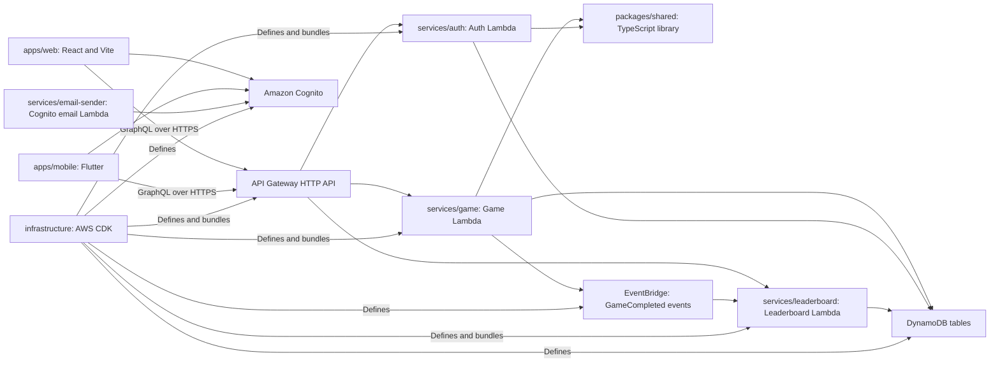

# Code Structure

## Verified against

- `package.json`; `apps/web/package.json`; `apps/mobile/pubspec.yaml`; `packages/shared/package.json`; `services/*/package.json`; `infrastructure/package.json`
- `apps/web/src/main.tsx` (`ErrorBoundary`, provider bootstrap), `apps/web/src/App.tsx` (`App`), and `apps/web/src/config/constants.ts` (`ROUTES`)
- `apps/web/src/pages/mini-golf/MiniGolfSetupPage.tsx` (`MiniGolfSetupPage`) and `MiniGolfGamePage.tsx` (`MiniGolfGamePage`)
- `apps/web/src/pages/language/LanguageGameSetup.tsx` (`LanguageGameSetup`) and `PronunciationGamePage.tsx` (`PronunciationGamePage`)
- `services/game/src/index.ts` (`handler`), `services/game/src/handlers/game.handler.ts` (`GameHandler`), and `services/game/src/services/game.service.ts` (`GameService`)
- `services/leaderboard/src/index.ts` (`handler`), `services/auth/src/index.ts` (`handler`), and `packages/shared/src/index.ts`
- `infrastructure/bin/memory-game.ts` and every source file under `infrastructure/lib/`
- Local Git history for commits `40fe1779e841e5a1025e27f63ecce43787b2811f` and `30b0b1b0195de0e009ba0a71ba8e42f65d8978e5`; no network history was queried

## Repository and build system

DashDen is a repository of independently managed projects, not an npm workspace. The root `package.json` has no `workspaces` field or root build/test scripts. Each npm project owns its lock file, compiler configuration, and commands. The Flutter project is independent.

| Area | Build system | Main commands and configuration | Internal dependency |
|---|---|---|---|
| Repository root | npm manifest only | Root `package.json` contains DynamoDB SDK development dependencies and no scripts. | None declared. |
| `apps/web/` | npm, TypeScript, Vite | `npm run build` runs `tsc && vite build`; `type-check`, `lint`, `dev`, and `preview` are declared in `apps/web/package.json`. `vite.config.ts` sets the `@` alias, port 3000, `dist`, and source maps. | It duplicates API models; it does not import `@memory-game/shared`. |
| `apps/mobile/` | Flutter and Dart | `pubspec.yaml` requires Dart 3.3+ and Flutter 3.19+. Normal Flutter tooling supplies build, analyze, and test commands. | It manually mirrors Game GraphQL contracts and does not consume the TypeScript shared package. |
| `packages/shared/` | npm and TypeScript | `build`, `typecheck`, Jest, ESLint, and Prettier scripts are in `packages/shared/package.json`; `tsconfig.lambda.json` supports Lambda packaging. | Public library consumed by Game and, as a development dependency, Auth. |
| `services/game/` | npm and TypeScript | CommonJS TypeScript build, Jest selectors, ESLint, and Prettier are declared in `services/game/package.json`. | Runtime file dependency on `@memory-game/shared`. |
| `services/auth/` | npm and TypeScript | CommonJS TypeScript build plus Jest, ESLint, Prettier, and legacy deployment commands. | Development file dependency on `@memory-game/shared`. |
| `services/leaderboard/` | npm and TypeScript | CommonJS TypeScript build, Jest, and ESLint. | Standalone; it maintains its own enums and models. |
| `services/email-sender/` | npm and CommonJS | No build script. Lambda source is `index.js`; npm installs the AWS Encryption SDK. | Standalone. |
| `infrastructure/` | npm, TypeScript, AWS CDK v2 | `build`, `synth`, `diff:*`, and deploy/destroy commands are declared in `infrastructure/package.json`; `cdk.json` runs `dist/bin/memory-game.js`. | CDK bundles service `src/index.ts` entry points directly. |

The repository contains tracked generated and deployment copies under directories such as `services/game/deployment-package/`, `services/game/deploy/`, `services/game/lambda-deploy-*`, `services/game/dist-package/`, `services/leaderboard/deploy/`, `services/leaderboard/dist-package/`, and `packages/shared/dist-lambda/`. These are not source-of-truth files. Current work should follow the TypeScript under `src/` unless a documented packaging step explicitly regenerates an output.

## Module and package relationships

Plain-text alternative: The web and mobile applications authenticate with Cognito and call the HTTP API. API Gateway routes requests to the Auth, Game, and Leaderboard Lambdas. Game and Auth consume the shared TypeScript library. All three backend services use DynamoDB. Game publishes `GameCompleted` events to EventBridge, which invokes Leaderboard. CDK defines the API, service Lambdas, eventing, data stores, and Cognito. The email-sender Lambda is a separate Cognito-triggered component.

## Key classes, modules, and functions

### Web application

| File and symbol | Responsibility |
|---|---|
| `apps/web/src/main.tsx` (`configureAmplify`, `ErrorBoundary`) | Configures Amplify and mounts React with BrowserRouter, Apollo, TanStack Query, Vercel Analytics, and Speed Insights. |
| `apps/web/src/App.tsx` (`App`) | Central public/protected route registry. Every protected game route renders inside `ProtectedRoute` and `AppLayout`. |
| `apps/web/src/context/AuthContext.tsx` (`AuthProvider`, `useAuth`) | Uses Amplify Cognito directly for registration, login, session restore, and logout; asks Game `canStartGame` for the displayed tier. |
| `apps/web/src/api/client.ts` (`authClient`, `gameClient`, `createAuthLink`) | Creates Apollo clients and attaches a Cognito ID token, with local-storage fallback. |
| `apps/web/src/api/game.ts` (`startGame`, `completeGame`, `listAvailableGames`, review and preference functions) | Browser wrapper for the runtime Game GraphQL operations. |
| `apps/web/src/api/leaderboard.ts` (`leaderboardClient`, `GameType`, `Timeframe`) | Independent Leaderboard client and duplicated leaderboard contract. |
| `apps/web/src/pages/hub/GameHubPage.tsx` (`GameHubPage`, `GAME_FILTER_MAP`) | Loads the DynamoDB-backed catalog, review aggregates, and tier; applies a second hard-coded subject filter. |
| `apps/web/src/components/hub/GameTile.tsx` (`GameTile`, `PREMIUM_GAMES`) | Renders catalog tiles, translations, ratings, and a separate paid-game registry. |
| `apps/web/src/hooks/useGame.ts` (`useGame`) | Memory Match state machine, timer, offline fallback, and generic `startGame`/`completeGame` integration. |
| `apps/web/src/components/game/ScoreBreakdownModal.tsx` (`ScoreBreakdownModal`) | Shared score display, leaderboard navigation, replay action, and one-to-five-star review submission. |
| `apps/web/src/i18n.ts` | Initializes English, Spanish, and Portuguese resources with local-storage/browser detection and English fallback. |
| `apps/web/src/pages/mini-golf/MiniGolfGamePage.tsx` (`MiniGolfGamePage`, `getCanvasPos`, `handleGameComplete`) | Responsive canvas precedent with mouse/touch coordinate conversion, animation-frame simulation, and generic session completion. |
| `apps/web/src/pages/bond-and-burn/BondAndBurnGamePage.tsx` (`BondAndBurnGamePage`) | Closest active native drag/touch/tap science-game precedent. |
| `apps/web/src/pages/scratch-coding/BlockRenderer.tsx` (`BlockRenderer`) | Orphaned dnd-kit example; no routed page imports it and no active `DndContext` was found. |

### Mobile application

| File and symbol | Responsibility |
|---|---|
| `apps/mobile/lib/main.dart` (`main`, `DashDenApp`) | Initializes the GraphQL cache and Riverpod, then selects splash or router UI from auth state. |
| `apps/mobile/lib/ui/router.dart` (`routerProvider`) | GoRouter routes plus authentication redirects. |
| `apps/mobile/lib/auth/auth_controller.dart` (`AuthController`, `authControllerProvider`) | Riverpod state machine for session restore, Cognito sign-in, Google OAuth, registration, confirmation, and sign-out. |
| `apps/mobile/lib/auth/cognito_service.dart` (`CognitoService`) | Cognito and Hosted UI operations; returns the ID token expected by API Gateway. |
| `apps/mobile/lib/api/game_api.dart` (`GameApi`) | Manual Dart implementation of `startGame`, `completeGame`, and `canStartGame`. |
| `apps/mobile/lib/game/game_controller.dart` (`GameController`, `gameControllerProvider`) | Memory Match state, timer, backend lifecycle, paywall/rate-limit flags, and offline behavior. |
| `apps/mobile/lib/game/game_logic.dart` (`generateCards`, `checkMatch`, `isGameComplete`, `gridColumnsFor`) | Pure Memory Match deck and matching logic, including Formula 1 teammate pairs. |

### Game Service

| File and symbol | Responsibility |
|---|---|
| `services/game/src/index.ts` (`handler`, `handleStripeWebhook`, `handleUnsubscribe`) | API Gateway adapter, CORS, JWT-claim extraction, public-route restriction, GraphQL body parsing, Stripe webhook dispatch, and unsubscribe HTML response. |
| `services/game/src/handlers/game.handler.ts` (`GameHandler`) | Composition root and manual GraphQL operation router. It constructs repositories/services and wraps results in GraphQL-shaped envelopes. |
| `services/game/src/services/game.service.ts` (`GameService.startGame`, `completeGame`, `canStartGame`) | Authoritative session creation, paid/rate-limit/theme checks, score calculation, persistence, metrics, achievements, and completion event publication. |
| `services/game/src/services/score-calculator.service.ts` (`ScoreCalculatorService`) | Deterministic score breakdown with game-specific time targets, base scores, and difficulty caps. |
| `services/game/src/services/rate-limiter.service.ts` (`RateLimiterService`) | Daily tier limits and next-midnight reset logic. |
| `services/game/src/services/event-publisher.service.ts` (`EventPublisherService`) | Publishes each completion to EventBridge and also invokes Leaderboard asynchronously. |
| `services/game/src/services/review.service.ts` (`ReviewService`) | Review upsert/read and aggregate-rating queries. |
| `services/game/src/repositories/game.repository.ts` (`GameRepository`) | DynamoDB game-session create, read, update, query, and delete operations. |
| `services/game/src/repositories/theme.repository.ts` (`ThemeRepository`) | Cached theme lookup and published-theme validation. |
| `services/game/src/repositories/game-catalog.repository.ts` (`GameCatalogRepository`) | Queries active and coming-soon catalog rows through `StatusIndex`. |
| `services/game/src/handlers/language.handler.ts` (`LanguageHandler`) and `services/game/src/services/language.service.ts` (`LanguageService`) | Language word, result, and progress operations. |
| `services/game/src/services/stripe.service.ts` (`StripeService`) | Checkout, portal, plan-change, webhook verification, and subscription lifecycle integration. |
| `services/game/src/services/admin.service.ts` (`AdminService`) | User and gameplay analytics plus administrative user operations. |

### Leaderboard Service

| File and symbol | Responsibility |
|---|---|
| `services/leaderboard/src/index.ts` (`handler`, `handleHttpGraphQLRequest`) | Multiplexes EventBridge, API Gateway HTTP, and AppSync-shaped events. |
| `services/leaderboard/src/handlers/event.handler.ts` (`EventHandler`) | Validates `GameCompleted`, accepts the Game score, checks anomalies, retries writes, updates aggregates, and emits metrics. |
| `services/leaderboard/src/handlers/graphql.handler.ts` (`GraphQLHandler`) | Authenticates JWTs, consumes token-bucket capacity, validates arguments, and routes four leaderboard operations. |
| `services/leaderboard/src/services/leaderboard.service.ts` (`LeaderboardService`) | Ranking, best-score de-duplication, overall fan-out, history, aggregate updates, and admin clearing. |
| `services/leaderboard/src/services/scoring.service.ts` (`ScoringService`) | Legacy score calculation plus validation of Game-supplied scores. |
| `services/leaderboard/src/services/anomaly.service.ts` (`AnomalyService`) | Statistical, velocity, and repeated-pattern anomaly flags. |
| `services/leaderboard/src/repositories/leaderboard.repository.ts` (`LeaderboardRepository`) | Entry writes and daily, weekly, monthly, all-time, and user-history reads. |
| `services/leaderboard/src/repositories/aggregate.repository.ts` (`AggregateRepository`) | Per-user/game totals, averages, best scores, and timeframe counters. |

### Auth and email services

| File and symbol | Responsibility |
|---|---|
| `services/auth/src/index.ts` (`handler`, `parseOperation`) | Public API Gateway adapter for the older Auth GraphQL-like API. |
| `services/auth/src/handlers/auth.handler.ts` (`resolvers`) | Auth query/mutation registry and token-derived user context. |
| `services/auth/src/services/auth.service.ts` (`AuthService`) | Registration, login, social login, verification, reset, refresh, logout, and profile orchestration. |
| `services/auth/src/repositories/cognito.client.ts` (`CognitoClient`) | AWS Cognito adapter. |
| `services/auth/src/repositories/user.repository.ts` (`UserRepository`) | User persistence through `id`, EmailIndex, and CognitoIdIndex. |
| `services/auth/src/repositories/user-settings.repository.ts` (`UserSettingsRepository`) | Default preferences and settings persistence. |
| `services/email-sender/index.js` (`handler`, `sendEmail`, `decryptCode`) | Cognito custom-email sender that decrypts Cognito codes and sends branded messages through Resend. |
| `services/game/src/daily-email.ts` (`handler`) | Scheduled digest generation from preferences, entries, and aggregates. |
| `services/game/src/activation-email.ts` (`handler`) | Scheduled activation email for verified users with zero games who have not opted out. |
| `services/game/src/pre-signup.ts` (`handler`) | Cognito pre-sign-up account linking for external identity providers. |

### Shared package

`packages/shared/src/index.ts` re-exports all types, schemas, calculations, and constants. Important symbols include:

- Domain contracts in `types/entities.ts`: `User`, `Game`, legacy `LeaderboardEntry`, `Subscription`, `Theme`, `Achievement`, `RateLimit`, `Invoice`, and `UserSettings`.
- Enumerations in `types/enums.ts`: `UserRole`, `SubscriptionTier`, `GameStatus`, `TimePeriod`, `SubscriptionStatus`, `BillingPeriod`, `ThemeCategory`, `ThemeStatus`, `AchievementType`, `InvoiceStatus`, and `UITheme`.
- Result/error APIs in `types/results.ts` and `types/errors.ts`: `Result<T>`, `success`, `failure`, `AppError`, and typed authentication, authorization, validation, not-found, rate-limit, and payment errors.
- Zod APIs in `schemas/index.ts`: `validate`, `getCachedSchema`, and entity/create/update schemas.
- Calculations in `utils/calculations.ts`: `scoreUtils.calculateGameScore`, `calculateRank`, `qualifiesForLeaderboard`, and `statsUtils.average`, `median`, and `percentile`.
- Configuration constants in `constants/`: `RATE_LIMITS`, `SUBSCRIPTION_PRICING`, `ACHIEVEMENTS`, `APP_CONSTANTS`, and `ERROR_CODES`.

The package reflects the original Memory Match model. For example, `gameSchema` requires UUID theme IDs and difficulties 12 through 48, while current Game runtime validation accepts named theme IDs and difficulties 1 through 5. The web and Leaderboard projects do not import these definitions.

### Infrastructure

`infrastructure/bin/memory-game.ts` instantiates `DatabaseStack`, `CognitoStack`, `EventBridgeStack`, `LambdaStack`, `LeaderboardLambdaStack`, `ApiStack`, and `MonitoringStack` in dependency order. `LeaderboardEventRuleStack` exists in source but is not instantiated; `LeaderboardLambdaStack` creates the same rule directly.

## Design patterns

| Pattern | Location | Implementation and purpose |
|---|---|---|
| Handler, service, repository layering | `services/game/src/handlers/game.handler.ts`, `services/game/src/services/`, `services/game/src/repositories/`; equivalent folders in Auth and Leaderboard | Transport parsing stays in handlers, business decisions in services, and DynamoDB/Cognito access in repositories. |
| Constructor dependency injection | `GameService`, `AchievementTrackerService`, `GraphQLHandler`, `LeaderboardService`, `EventHandler` | Production constructors compose defaults; tests can provide repositories or services. |
| Lambda container reuse | Module-level clients and `const gameHandler = new GameHandler()` in `services/game/src/index.ts` | SDK clients and service graphs survive warm invocations. |
| Manual GraphQL dispatch | `GameHandler.extractOperationName`, Auth `parseOperation`, Leaderboard `handleHttpGraphQLRequest` | Regex extracts a named operation or first field and calls a switch/resolver map. No executable GraphQL schema validates requests. |
| Data-driven catalog with duplicated registries | `GameCatalogRepository.getAllGames`, `GameHubPage.GAME_FILTER_MAP`, `GameTile.PREMIUM_GAMES`, `GameService.startGame` | DynamoDB controls tile existence/order, while filtering, paid gating, scoring, reviews, and leaderboard display each keep separate game lists. |
| React setup/game page pair | `apps/web/src/pages/<game>/...SetupPage.tsx` and `...GamePage.tsx` | Setup chooses settings and navigates; the game page starts a backend session, runs browser logic, completes it, and opens a result UI. |
| Pure engine plus UI shell | Math Maze and Scratch utilities/tests; Mini Golf `miniGolfData.ts` and `miniGolfPhysics.ts` | Deterministic or mostly deterministic logic is kept outside React when the feature author follows the strongest existing pattern. |
| Riverpod controller/provider | `apps/mobile/lib/auth/auth_controller.dart`, `apps/mobile/lib/game/game_controller.dart`, `apps/mobile/lib/api/game_providers.dart` | Stateful controllers expose immutable state through providers; UI screens observe those providers. |
| CDK stack graph | `infrastructure/bin/memory-game.ts` | Separate database, identity, event, Lambda, API, and monitoring stacks are connected through construct references and explicit dependencies. |
| Event-driven projection | `EventPublisherService.publishGameCompleted`, Leaderboard `EventHandler.handleGameCompletedEvent` | A completed Game session becomes a Leaderboard entry and aggregate asynchronously. A second direct Lambda invocation duplicates the delivery path. |

## Existing source-file inventory

The inventory below covers source-of-truth application, service, shared, and infrastructure files. First-party test files and all operational scripts are listed individually in `component-inventory.md`. In each inventory subsection, paths in the table are relative to the exact repository-relative directory named in that subsection heading.

### `apps/web/src/` core, API, configuration, and state

| Files | Purpose |
|---|---|
| `App.tsx`; `main.tsx` | Route registry and application bootstrap/provider graph. |
| `api/admin.ts`; `api/client.ts`; `api/game.ts`; `api/language.ts`; `api/leaderboard.ts`; `api/queryClient.ts`; `api/stripe.ts` | Admin, Apollo transport, Game, language, Leaderboard, TanStack configuration, and Stripe GraphQL documents. |
| `config/amplify.ts`; `config/constants.ts`; `config/env.ts` | Cognito setup, route/game constants, and environment/feature flags. |
| `context/AuthContext.tsx` | Browser authentication and current-user context. |
| `hooks/useAdminGuard.ts`; `hooks/useGame.ts`; `hooks/useSpeechRecognition.ts` | Admin route guard, Memory Match controller, and Web Speech/Web Audio controller. |
| `types/auth.ts`; `types/game.ts` | Browser-local auth and original Memory Match models. |
| `i18n.ts`; `locales/en.json`; `locales/es.json`; `locales/pt.json` | Localization bootstrap and three resource bundles. |
| `styles/index.css`; `vite-env.d.ts` | Global Tailwind/component styles and Vite ambient types. |

### `apps/web/src/components/`

| Files | Purpose |
|---|---|
| `ApiDebug.tsx`; `EnvDebug.tsx` | Development diagnostics for API/environment configuration. |
| `auth/AuthLayout.tsx` | Public authentication-page layout. |
| `common/Button.tsx`; `common/Input.tsx`; `common/LanguagePicker.tsx`; `common/Loading.tsx`; `common/Modal.tsx`; `common/ProtectedRoute.tsx` | Shared controls, locale picker, loading state, modal shell, and client-side route gate. |
| `dashboard/LeaderboardRankWidget.tsx`; `dashboard/RecentImprovements.tsx`; `dashboard/ScoreTrendsChart.tsx` | Dashboard ranking, recent-change, and trend visualizations. |
| `game/AchievementToast.tsx`; `game/Card.tsx`; `game/Confetti.tsx`; `game/GameBoard.tsx`; `game/GameHeader.tsx`; `game/GameOverModal.tsx`; `game/ScoreBreakdownModal.tsx`; `game/StartGameModal.tsx` | Original Memory Match UI plus reusable celebration, start/result, achievement, and score/review UI. |
| `hub/GameTile.tsx` | Catalog tile, rating, and client-side paid state. |
| `language/AudioWaveform.tsx` | Decorative microphone-frequency visualization. |
| `layout/AppLayout.tsx`; `layout/Footer.tsx`; `layout/Header.tsx` | Protected application shell. |
| `leaderboard/GameTypeFilter.tsx`; `leaderboard/LeaderboardRow.tsx`; `leaderboard/LeaderboardTable.tsx`; `leaderboard/TimeframeSelector.tsx` | Leaderboard selection and table presentation. |
| `math-maze/GatePrompt.tsx`; `math-maze/MazeGrid.tsx` | Math Maze equation dialog and maze grid. |

### `apps/web/src/pages/`

| Files | Purpose |
|---|---|
| `NotFoundPage.tsx` | Catch-all route. |
| `admin/AdminDashboard.tsx`; `admin/LanguageMaintenancePage.tsx`; `admin/SubscriptionsPage.tsx` | Admin analytics/users, language-data maintenance, and subscription management. |
| `auth/LoginPage.tsx`; `auth/RegisterPage.tsx`; `auth/ForgotPasswordPage.tsx`; `auth/ResetPasswordPage.tsx` | Cognito authentication flows. |
| `hub/GameHubPage.tsx` | Catalog and category-filter hub. |
| `game/GameSetupPage.tsx`; `game/GamePage.tsx` | Memory Match setup and gameplay. |
| `math/MathSetupPage.tsx`; `math/MathGamePage.tsx` | Math Challenge setup and gameplay. |
| `word-puzzle/WordPuzzleSetupPage.tsx`; `word-puzzle/WordPuzzleGamePage.tsx` | Word Puzzle setup and gameplay. |
| `language/LanguageSelectionPage.tsx`; `language/LanguageGameSetup.tsx`; `language/LanguageGamePage.tsx`; `language/PronunciationGamePage.tsx`; `language/LanguageGameResults.tsx` | Language selection, shared setup, image matching, pronunciation mode, and results. |
| `sudoku/SudokuSetupPage.tsx`; `sudoku/SudokuGamePage.tsx` | Sudoku setup and gameplay. |
| `puzzle/PuzzleSetupPage.tsx`; `puzzle/PuzzleGamePage.tsx` | Jigsaw Puzzle setup and gameplay. |
| `bubble-pop/BubblePopSetupPage.tsx`; `bubble-pop/BubblePopGamePage.tsx` | Bubble Pop setup and gameplay. |
| `sequence-memory/SequenceMemorySetupPage.tsx`; `sequence-memory/SequenceMemoryGamePage.tsx` | Sequence Memory setup and gameplay. |
| `code-a-bot/CodeABotSetupPage.tsx`; `code-a-bot/CodeABotGamePage.tsx` | Code-a-Bot setup and gameplay. |
| `geo-quiz/GeoQuizSetupPage.tsx`; `geo-quiz/GeoQuizGamePage.tsx` | Geography Quiz setup and gameplay. |
| `history-quiz/HistoryQuizSetupPage.tsx`; `history-quiz/HistoryQuizGamePage.tsx` | History Quiz setup and gameplay. |
| `civics-quiz/CivicsQuizSetupPage.tsx`; `civics-quiz/CivicsQuizGamePage.tsx` | Civics Quiz setup and gameplay. |
| `color-by-number/ColorByNumberSetupPage.tsx`; `color-by-number/ColorByNumberGamePage.tsx` | Color by Number setup and gameplay. |
| `hangman/HangmanSetupPage.tsx`; `hangman/HangmanGamePage.tsx` | Hangman setup and gameplay. |
| `tic-tac-toe/TicTacToeSetupPage.tsx`; `tic-tac-toe/TicTacToeGamePage.tsx` | Tic Tac Toe setup and gameplay. |
| `scratch-coding/ScratchCodingSetupPage.tsx`; `scratch-coding/ScratchCodingGamePage.tsx`; `scratch-coding/BlockRenderer.tsx` | Active click-to-insert Space Coder setup/game and an unreferenced dnd-kit renderer. |
| `math-maze/MathMazeSetupPage.tsx`; `math-maze/MathMazeGamePage.tsx` | Math Maze setup and gameplay. |
| `pattern-recall/PatternRecallSetupPage.tsx`; `pattern-recall/PatternRecallGamePage.tsx` | Pattern Recall setup and gameplay. |
| `space-entry/SpaceEntrySetupPage.tsx`; `space-entry/SpaceEntryGamePage.tsx` | Space Entry setup and physics gameplay. |
| `bond-and-burn/BondAndBurnSetupPage.tsx`; `bond-and-burn/BondAndBurnGamePage.tsx` | Bond & Burn setup and chemistry drag/touch gameplay. |
| `traffic-lab/TrafficLabSetupPage.tsx`; `traffic-lab/TrafficLabGamePage.tsx` | Traffic Lab setup and simulation gameplay. |
| `mini-golf/MiniGolfSetupPage.tsx`; `mini-golf/MiniGolfGamePage.tsx` | Mini Golf setup and responsive canvas gameplay. |
| `dashboard/DashboardPage.tsx`; `dashboard/StatisticsPage.tsx`; `dashboard/HistoryPage.tsx`; `dashboard/AchievementsPage.tsx` | User overview, statistics, history, and client-side achievement views. |
| `leaderboard/LeaderboardPage.tsx`; `profile/ProfilePage.tsx`; `contact/ContactPage.tsx` | Leaderboard, profile, and authenticated contact pages. |
| `subscription/RateLimitPage.tsx`; `subscription/SubscriptionSuccessPage.tsx` | Plan/paywall view and checkout verification result. |

### `apps/web/src/utils/`

| Files | Purpose |
|---|---|
| `bondAndBurnData.ts`; `bondAndBurnLogic.ts` | Chemistry recipes/elements and compound validation. |
| `bubblePopUtils.ts`; `codeABotUtils.ts`; `colorByNumberData.ts`; `patternRecallUtils.ts`; `puzzleUtils.ts`; `sequenceMemoryUtils.ts`; `sudokuUtils.ts`; `ticTacToeAI.ts`; `wordPuzzleUtils.ts` | Game-specific data generation and rules. |
| `civicsQuizData.ts`; `geoQuizData.ts`; `historyQuizData.ts`; `hangmanData.ts` | Quiz and word datasets. |
| `gameLogic.ts`; `mathUtils.ts` | Memory Match and Math Challenge logic. |
| `mazeEquations.ts`; `mazeGenerator.ts`; `mazeScoringUtils.ts` | Math Maze equation generation, maze generation, and completion scoring. |
| `miniGolfData.ts`; `miniGolfPhysics.ts` | Course/config models and vector/environment/collision simulation. |
| `pronunciationScoring.ts` | String/phonetic comparison, grading policy, locale mapping, and support detection. |
| `scratchCodingUtils.ts` | Space Coder command tree, execution, conditions, and level helpers. |
| `spaceEntryConfig.ts`; `spaceEntryLandingZones.ts`; `spaceEntryPhysics.ts`; `spaceEntryPuzzles.ts` | Re-entry configuration, geography zones, physics, and puzzle data. |
| `trafficLabData.ts` | Traffic simulation levels and data. |
| `formatting.ts`; `storage.ts`; `validation.ts` | General formatting, local storage wrapper, and browser form validation. |

### `apps/mobile/lib/`

| Files | Purpose |
|---|---|
| `main.dart` | Flutter entry point and root widget. |
| `api/game_api.dart`; `api/game_models.dart`; `api/game_providers.dart`; `api/graphql_client.dart` | Game GraphQL operations/models, Riverpod providers, and authenticated client construction. |
| `auth/auth_controller.dart`; `auth/cognito_service.dart`; `auth/token_storage.dart` | Auth state, Cognito/OAuth adapter, and secure token persistence. |
| `config/constants.dart`; `config/env.dart` | Themes/difficulties/storage keys and compile-time environment values. |
| `game/card.dart`; `game/game_controller.dart`; `game/game_logic.dart` | Card entity, game state controller, and pure matching/deck logic. |
| `ui/router.dart`; `ui/theme.dart` | Route graph and Material theme. |
| `ui/screens/home_screen.dart`; `ui/screens/login_screen.dart`; `ui/screens/memory_game_screen.dart`; `ui/screens/memory_setup_screen.dart`; `ui/screens/register_screen.dart` | Home, auth, Memory Match play, and setup screens. |

### `services/game/src/`

| Files | Purpose |
|---|---|
| `index.ts`; `webhook.ts`; `daily-email.ts`; `activation-email.ts`; `pre-signup.ts` | Main HTTP Lambda, standalone Stripe handler, daily digest, activation mailer, and Cognito pre-sign-up handlers. |
| `handlers/game.handler.ts`; `handlers/language.handler.ts` | Runtime operation routing and language adapters. |
| `repositories/achievement.repository.ts`; `game-catalog.repository.ts`; `game.repository.ts`; `language.repository.ts`; `rate-limit.repository.ts`; `subscription.repository.ts`; `theme.repository.ts` | DynamoDB persistence adapters for each Game domain. |
| `services/achievement-tracker.service.ts`; `admin.service.ts`; `contact.service.ts`; `email-prefs.service.ts`; `event-publisher.service.ts`; `game.service.ts`; `language.service.ts`; `rate-limiter.service.ts`; `review.service.ts`; `score-calculator.service.ts`; `stripe.service.ts` | Business services for completion side effects, admin analytics, contact, preferences, eventing, games, language, quotas, reviews, scoring, and payments. |
| `types/index.ts` | Game inputs, responses, repository interfaces, local domain types, event payload, and GraphQL context. |
| `utils/cache.ts`; `dynamodb.ts`; `error-mapper.ts`; `errors.ts`; `logger.ts`; `metrics.ts`; `validation.ts` | In-memory caches, shared DocumentClient, error translation/types, structured logging, metrics, and Zod/business validation. |

### `services/auth/src/`

| Files | Purpose |
|---|---|
| `index.ts`; `handlers/auth.handler.ts`; `services/auth.service.ts`; `types/index.ts` | HTTP adapter, resolver registry, auth orchestration, and local contracts. |
| `repositories/cognito.client.ts`; `repositories/user.repository.ts`; `repositories/user-settings.repository.ts` | Cognito, user-table, and settings-table adapters. |
| `utils/error-mapper.ts`; `utils/logger.ts`; `utils/metrics.ts`; `utils/token.ts`; `utils/validation.ts` | Friendly errors, logging, CloudWatch metrics, token decoding/header parsing, and input validation. |

### `services/leaderboard/src/`

| Files | Purpose |
|---|---|
| `index.ts`; `handlers/event.handler.ts`; `handlers/graphql.handler.ts`; `types/index.ts` | Lambda multiplexer, completion consumer, API resolver, and service contracts. |
| `repositories/index.ts`; `repositories/aggregate.repository.ts`; `repositories/leaderboard.repository.ts` | Repository barrel, aggregate storage, and entry storage/querying. |
| `services/anomaly.service.ts`; `services/leaderboard.service.ts`; `services/scoring.service.ts` | Anomaly flags, ranking/projection business logic, and scoring/score validation. |
| `utils/auth.util.ts`; `utils/ratelimit.util.ts` | Cognito JWT verification and DynamoDB token bucket. |
| `config/scoring.config.json` | Older four-game scoring configuration; current `ScoringService` also embeds a broader TypeScript configuration. |

### `packages/shared/src/`

| Files | Purpose |
|---|---|
| `index.ts`; `types/index.ts`; `schemas/index.ts`; `constants/index.ts` | Public barrels and schema helper functions. |
| `types/entities.ts`; `types/enums.ts`; `types/errors.ts`; `types/results.ts`; `types/utilities.ts` | Domain entities, enums, typed errors, Result helpers, and filter/pagination types. |
| `schemas/achievement.schema.ts`; `game.schema.ts`; `leaderboard.schema.ts`; `subscription.schema.ts`; `theme.schema.ts`; `user.schema.ts` | Zod contracts for the original shared domain. |
| `constants/achievements.ts`; `app.constants.ts`; `errors.ts`; `pricing.ts`; `rate-limits.ts` | Achievement metadata, application limits, error codes, prices, and original tier quotas. |
| `utils/calculations.ts` | Legacy score/rank and statistical functions. |
| `schemas/game.schema.test.ts`; `schemas/theme.schema.test.ts`; `schemas/user.schema.test.ts`; `types/errors.test.ts`; `types/results.test.ts` | Shared package Jest suites, detailed in `component-inventory.md`. |

### `infrastructure/`

| Files | Purpose |
|---|---|
| `bin/memory-game.ts` | CDK app and instantiated stack dependency graph. |
| `lib/stacks/database-stack.ts`; `cognito-stack.ts`; `eventbridge-stack.ts`; `lambda-stack.ts`; `leaderboard-lambda-stack.ts`; `api-stack.ts`; `monitoring-stack.ts` | Instantiated storage, identity, events, core Lambdas, Leaderboard Lambda/rule, HTTP API, and alarms/dashboard stacks. |
| `lib/stacks/leaderboard-event-rule-stack.ts` | Uninstantiated alternative stack for the completion-event rule. |
| `lib/constructs/lambda-function.ts`; `lib/constructs/leaderboard-event-rule.ts` | Reusable Lambda and EventBridge constructs; current instantiated stacks mostly configure resources directly. |
| `lib/config/environment-config.ts`; `lib/config/constants.ts` | Environment maps and infrastructure constants, some of which are not consumed by stack implementations. |

## Exact recent-game integration patterns

### Chronologically newest interactive capability: Language Pronunciation

Local history shows commit `40fe1779e841e5a1025e27f63ecce43787b2811f` added pronunciation mode on 2026-09-07. Later fixes through `9807e32790bd9e637fe9754d110db2ea3a73ff16` refined scoring. It is a mode within Language Learning rather than a separate catalog game, so its file pattern intentionally differs from a standalone game.

| Concern | Exact file and symbol | Current implementation |
|---|---|---|
| Route | `apps/web/src/App.tsx` (`App`) | Imports `PronunciationGamePage` and registers the protected hard-coded path `/language/pronunciation/:languageCode`. No `ROUTES` pronunciation constant exists in `apps/web/src/config/constants.ts`. |
| Setup | `apps/web/src/pages/language/LanguageGameSetup.tsx` (`LanguageGameSetup`, `GameSettings.mode`) | Extends the existing Language setup with `image-match` and `pronunciation`, checks `canStartGame` for a non-Free tier, checks Web Speech support, and passes settings in router state. No separate pronunciation setup file exists. |
| Game page | `apps/web/src/pages/language/PronunciationGamePage.tsx` (`PronunciationGamePage`) | Loads words, starts `LANGUAGE_PRONUNCIATION`, captures up to three attempts per word, calculates browser-side scores, completes the generic Game session, and submits a review under `LANGUAGE_PRONUNCIATION`. |
| Speech and audio input | `apps/web/src/hooks/useSpeechRecognition.ts` (`useSpeechRecognition`) | Wraps browser SpeechRecognition plus microphone `MediaStream` and `AudioContext`; cleans up tracks, recognition, timers, and the audio context. |
| Visual audio component | `apps/web/src/components/language/AudioWaveform.tsx` (`AudioWaveform`) | Renders microphone analyser frequency bars with `requestAnimationFrame`; it is decorative and `aria-hidden`. |
| Pure scoring | `apps/web/src/utils/pronunciationScoring.ts` (`calculatePronunciationScore`, `doubleMetaphone`, `stringSimilarity`) | Combines phonetic/string matching and usable recognition confidence; unsupported confidence becomes recognition-only pass/fail. |
| API client | `apps/web/src/api/language.ts` (`getLanguageWords`) and `apps/web/src/api/game.ts` (`startGame`, `completeGame`, `submitGameReview`) | Reuses existing generic clients. The feature commit did not add a pronunciation-specific HTTP client contract. |
| Backend registration | `scripts/seed-pronunciation-theme.sh` | Adds published theme ID `LANGUAGE_PRONUNCIATION` only. It does not add a catalog row because the mode starts from the Language Learning tile. |
| Game Service ID and rules | `services/game/src/services/game.service.ts` (`GameService.startGame`, `completeGame`) | Adds `LANGUAGE_PRONUNCIATION` to paid/non-Memory-Match handling and maps it to the same event game type. |
| Scoring | `services/game/src/services/score-calculator.service.ts` (`ScoreCalculatorService.calculateScoreBreakdown`) | Adds pronunciation time targets and treats the ID as premium. |
| i18n | `apps/web/src/locales/en.json`, `apps/web/src/locales/es.json`, `apps/web/src/locales/pt.json` | No pronunciation namespace or keys were added. Setup/game/results copy remains hard-coded English. |
| Shared types | `packages/shared/src/types/enums.ts`, `packages/shared/src/types/entities.ts`, and `packages/shared/src/schemas/index.ts` | No shared enum, entity, or schema was changed. The generic string `themeId` at Game runtime carries the ID. |
| Catalog | `services/game/src/repositories/game-catalog.repository.ts` (`getAllGames`) | No separate pronunciation catalog item exists. The existing `language-learning` row remains the entry point. |
| Audio playback | `apps/web/src/config/env.ts` (`env.features.enableSoundEffects`), `apps/web/src/pages/language/LanguageGamePage.tsx` (`playPronunciation`), and `apps/web/src/components/language/AudioWaveform.tsx` (`AudioWaveform`) | No sound asset, output-audio service, or success jingle was added. The feature uses microphone/Web Audio visualization; the older Language game uses browser speech synthesis. |
| Downstream gap | `services/leaderboard/src/types/index.ts` (`GameType`) and `apps/web/src/api/leaderboard.ts` (`GameType`) | Neither enum includes `LANGUAGE_PRONUNCIATION`, so its completion event does not satisfy Leaderboard validation. |

### Newest complete standalone-game precedent: Mini Golf

Commit `30b0b1b0195de0e009ba0a71ba8e42f65d8978e5` added Mini Golf, Bond & Burn, and Traffic Lab in one batch on 2026-08-01. Mini Golf provides the clearest standalone route, setup, game, catalog, localization, score, and Leaderboard trail.

1. `scripts/seed-mini-golf.sh` writes theme ID `MINI_GOLF` with status `PUBLISHED`, and catalog ID `mini-golf` with route `/mini-golf/setup`, status `ACTIVE`, display order 22, and category `Physics & Strategy`.
2. `apps/web/src/config/constants.ts` (`ROUTES.MINI_GOLF_SETUP`, `ROUTES.MINI_GOLF_GAME`) declares `/mini-golf/setup` and `/mini-golf/game`.
3. `apps/web/src/App.tsx` imports `MiniGolfSetupPage` and `MiniGolfGamePage`, then registers both under the protected application layout.
4. `apps/web/src/pages/mini-golf/MiniGolfSetupPage.tsx` calls `canStartGame`, redirects Free users, selects `easy`, `medium`, or `hard`, previews `COURSES`, and navigates with `?difficulty=`.
5. `apps/web/src/utils/miniGolfData.ts` defines `Difficulty`, `Vec2`, `Wall`, `Obstacle`, `Hole`, `Course`, `PHYSICS`, course data, `getCourse`, `getTotalPar`, `getScoreName`, and `difficultyToNumber`.
6. `apps/web/src/utils/miniGolfPhysics.ts` defines `BallState`, `EnvironmentConditions`, vector helpers, environmental modifiers, collision checks, `physicsTick`, `isBallMoving`, `calculatePower`, and `calculateDirection`.
7. `apps/web/src/pages/mini-golf/MiniGolfGamePage.tsx` starts `MINI_GOLF`, simulates and renders at a logical 600 by 600 resolution, converts mouse/touch coordinates with `getCanvasPos`, and reports elapsed time, strokes, and squared stroke efficiency through generic `completeGame` fields.
8. `apps/web/src/components/game/ScoreBreakdownModal.tsx` receives `gameType="MINI_GOLF"` for result display and reviews.
9. `apps/web/src/locales/en.json`, `es.json`, and `pt.json` add the page namespace `miniGolf`. They do not add `games.mini-golf`, so catalog title/description/category still fall back to server values.
10. `services/game/src/services/game.service.ts` adds `MINI_GOLF` to paid-game handling, non-Memory-Match accuracy/event mapping, premium caps, and completion processing.
11. `services/game/src/services/score-calculator.service.ts` adds Mini Golf base score and time targets. Its difficulty cap still limits Easy/Medium/Hard to 5,000/6,500/8,000 before `GameService` applies its nominal 99,999 Mini Golf cap.
12. `services/leaderboard/src/types/index.ts` (`GameType.MINI_GOLF`), `services/leaderboard/src/services/leaderboard.service.ts`, and `services/leaderboard/src/services/scoring.service.ts` accept and display the game.
13. `apps/web/src/api/leaderboard.ts` adds `GameType.MINI_GOLF`; `apps/web/src/components/leaderboard/GameTypeFilter.tsx`, `apps/web/src/components/dashboard/RecentImprovements.tsx`, and `apps/web/src/pages/admin/AdminDashboard.tsx` add display metadata.
14. No Mini Golf-specific API module, `@memory-game/shared` game type, audio service, sound asset, or focused automated test was added.
15. Two registries were missed: `GameHubPage.GAME_FILTER_MAP` has no `mini-golf`, and `GameTile.PREMIUM_GAMES` has no `mini-golf`. The catalog tile therefore appears only under All and does not show the paid badge even though Game Service enforces payment.

## Critical direct dependencies

| Project | Dependency examples and declared versions | Use |
|---|---|---|
| Web | React `^18.2.0`, React Router `^6.22.0`, Apollo `^3.9.0`, Amplify `^6.16.2`, Framer Motion `^11.0.0`, Tailwind `^3.4.0`, dnd-kit core `^6.3.1`, Vite `^5.1.0`, TypeScript `^5.3.0`, Vitest `^4.1.4` | SPA, auth, GraphQL, animation/styling, installed drag tooling, and tests/build. |
| Mobile | Flutter `>=3.19.0`, Riverpod `^2.5.1`, graphql_flutter `^5.1.2`, Cognito Dart `^3.6.3`, go_router `^14.2.0` | Native UI, state, API, auth, and routing. |
| Game | AWS SDK v3 clients, `@memory-game/shared` via `file:../../packages/shared`, Stripe `^12.18.0`, GraphQL `^16.8.1`, UUID `^8.3.2`, Zod `^3.22.4` | AWS integration, domain contracts, billing, request documents/types, IDs, and validation. |
| Auth | AWS SDK v3 Cognito/DynamoDB/CloudWatch, GraphQL `^16.8.1`, Zod `^3.22.4` | Identity, persistence, metrics, and validation. |
| Leaderboard | AWS SDK v3 DynamoDB/CloudWatch; Jest, ts-jest, fast-check in development | Projection persistence, metrics, and example/property testing. |
| Shared | Zod `^3.22.4`, date-fns `^3.0.0` | Runtime validation; date-fns is declared but not used in the inspected source paths. |
| Infrastructure | AWS CDK library `^2.100.0`, CLI `^2.1108.0`, constructs `^10.0.0`, esbuild `^0.27.3` | Cloud resource definitions and Lambda bundling. |
| Email sender | `@aws-crypto/client-node` `^4.0.1` | Cognito custom-email ciphertext decryption. |
