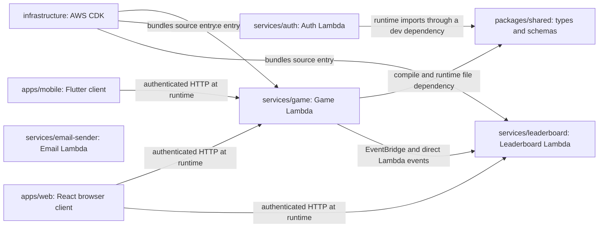

# Dependencies

## Verified against

- `package.json`, `apps/web/package.json`, `packages/shared/package.json`, and `infrastructure/package.json`
- `services/game/package.json`, `services/auth/package.json`, `services/leaderboard/package.json`, and `services/email-sender/package.json`
- `apps/mobile/pubspec.yaml`
- `infrastructure/bin/memory-game.ts`, `infrastructure/lib/stacks/lambda-stack.ts`, and `infrastructure/lib/stacks/leaderboard-lambda-stack.ts`
- `apps/web/src/main.tsx`, `apps/web/src/api/client.ts`, and `apps/mobile/lib/main.dart`
- `services/game/src/services/event-publisher.service.ts` and `services/auth/src/services/auth.service.ts`
- `services/leaderboard/src/repositories/leaderboard.repository.ts` and `services/leaderboard/src/repositories/aggregate.repository.ts`
- `.github/workflows/deploy-lambdas.yml`

Versions are direct dependency ranges from manifests. “No source import found” means a repository-wide first-party source search found no import of that package name; it does not prove a transitive or generated consumer cannot use it.

## Package Dependency Model

The repository is not an npm workspace: root `package.json` has no `workspaces` field, package list, or orchestration scripts. Builds and lockfiles are per project. Internal relationships include both package-manager dependencies and source/runtime coupling.

Text alternative: Game depends on Shared at compile time and runtime. Auth imports Shared at runtime even though its manifest classifies Shared as a development dependency. Infrastructure bundles the Game, Auth, and Leaderboard source entry points. Web calls Game and Leaderboard over authenticated HTTP. Mobile calls Game over authenticated HTTP. Game sends completion events to Leaderboard through EventBridge and direct asynchronous Lambda invocation. Email Sender has no internal package dependency.

## Internal Dependencies

| Consumer | Provider | Type | Evidence and purpose |
|---|---|---|---|
| `services/game` | `packages/shared` | Compile/runtime | `services/game/package.json` declares `@memory-game/shared: file:../../packages/shared`. `GameService`, repositories, metrics, and types import shared enums, entities, and error classes. |
| `services/auth` | `packages/shared` | Compile/runtime, misclassified as development-only | `services/auth/package.json` puts `@memory-game/shared` in `devDependencies`, while `AuthService`, handlers, repositories, token/error utilities, and types import it in production source. CDK tries to bundle it through `NodejsFunction`, but a production-only package install would omit it. |
| `infrastructure` | `services/game` | Build-time source coupling | `LambdaStack` points `NodejsFunction.entry` at `services/game/src/index.ts` and supplies its tsconfig. |
| `infrastructure` | `services/auth` | Build-time source coupling | `LambdaStack` points another `NodejsFunction.entry` at `services/auth/src/index.ts`. |
| `infrastructure` | `services/leaderboard` | Build-time source coupling | `LeaderboardLambdaStack` points `NodejsFunction.entry` at `services/leaderboard/src/index.ts`. |
| `apps/web` | Game Service | Runtime HTTP/API contract | `apps/web/src/api/client.ts` creates `gameClient`; `apps/web/src/api/game.ts`, `apps/web/src/api/admin.ts`, and `apps/web/src/api/language.ts` send manually maintained GraphQL documents and inputs. There is no generated client or shared package import. |
| `apps/web` | Leaderboard Service | Runtime HTTP/API contract | `apps/web/src/api/leaderboard.ts` owns a separate Apollo client, GraphQL documents, `GameType`, and response interfaces. |
| `apps/mobile` | Game Service | Runtime HTTP/API contract | `apps/mobile/lib/api/graphql_client.dart`, `apps/mobile/lib/api/game_api.dart`, and `apps/mobile/lib/api/game_models.dart` manually mirror the browser/backend contract. |
| `apps/web` / `apps/mobile` | Cognito configuration | Runtime identity integration | Web uses Amplify Auth; mobile uses the Dart Cognito package. Both pass tokens to APIs rather than importing Auth Service code. |
| `services/game` | `services/leaderboard` | Runtime event contract | `EventPublisherService.publishGameCompleted` sends the local `GameCompletedEvent` shape through EventBridge and direct asynchronous Lambda invocation. Leaderboard independently declares and validates the corresponding shape. |
| `services/email-sender` | None | Standalone | The CommonJS handler depends only on Node HTTPS, environment key names, and the AWS Encryption SDK package. |
| Root scripts | Root manifest | Tool/runtime | Root DynamoDB SDK development dependencies support data maintenance scripts such as `scripts/fix-animal-images.js` and `scripts/insert-language-data.mjs`. |

### Internal Contract Risks

- Shared is not a universal contract. Web, mobile, and Leaderboard duplicate game types and API models instead of importing or generating them from `packages/shared/src/index.ts`.
- `packages/shared/src/schemas/game.schema.ts` accepts UUID theme IDs and difficulty values 12 through 48, while `startGameInputSchema` in `services/game/src/utils/validation.ts` accepts named theme IDs and difficulty 1 through 5.
- Game's `GameCompletedEvent` in `services/game/src/types/index.ts` is separate from Leaderboard's event/detail and enum types. For example, Language Pronunciation exists in Game but not in Leaderboard `GameType`.
- The checked-in GraphQL SDL files are not executable contracts. Game, Auth, and Leaderboard handlers extract operation names with regular expressions, and the Game schema omits optional completion metrics used by `apps/web/src/api/game.ts`.
- Infrastructure compiles service source by relative path, so CDK synthesis depends on sibling project source and dependency installation even though there is no workspace-level build graph.

## External Dependencies by Package

### Root Operational Scripts

Source: `package.json`.

| Dependency | Version | Scope | Purpose |
|---|---:|---|---|
| `@aws-sdk/client-dynamodb` | `^3.1005.0` | Development | Low-level DynamoDB client used by root maintenance/data scripts. |
| `@aws-sdk/lib-dynamodb` | `^3.1005.0` | Development | Document client and commands used by those scripts. |

### Web Application

Source: `apps/web/package.json`.

#### Runtime dependencies

| Dependency | Version | Purpose / observed use |
|---|---:|---|
| `react` | `^18.2.0` | Component state, effects, contexts, and rendering. |
| `react-dom` | `^18.2.0` | Browser root mounting in `apps/web/src/main.tsx`. |
| `react-router-dom` | `^6.22.0` | SPA routes, navigation, route parameters, and redirects. |
| `@apollo/client` | `^3.9.0` | GraphQL documents, authenticated HTTP links, mutations/queries, and caches. |
| `graphql` | `^16.8.0` | GraphQL document parsing peer/runtime for Apollo. |
| `aws-amplify` | `^6.16.2` | Amplify setup and Cognito functions imported through `aws-amplify/auth`. |
| `@aws-amplify/auth` | `^6.19.1` | Declared Auth package; no direct import using this package name was found. |
| `@tanstack/react-query` | `^5.24.0` | Query client/provider setup. No first-party TanStack query hook use was found. |
| `react-hook-form` | `^7.50.0` | Authentication form state and submission. |
| `@hookform/resolvers` | `^3.3.0` | Connects Zod schemas to React Hook Form. |
| `zod` | `^3.22.0` | Browser-side authentication form schemas. |
| `react-i18next` | `^17.0.2` | React localization hooks and integration. |
| `i18next` | `^26.0.4` | Translation engine. |
| `i18next-browser-languagedetector` | `^8.2.1` | Browser/local-storage language selection. |
| `framer-motion` | `^11.0.0` | UI transitions, card motion, modal effects, and confetti. |
| `clsx` | `^2.1.0` | Conditional class names in leaderboard components. |
| `@dnd-kit/core` | `^6.3.1` | `useDroppable` in orphaned `pages/scratch-coding/BlockRenderer.tsx`; no active `DndContext` consumer was found. |
| `@dnd-kit/sortable` | `^10.0.0` | Declared drag sorting support; no first-party source import was found. |
| `@dnd-kit/utilities` | `^3.2.2` | Declared dnd-kit helpers; no first-party source import was found. |
| `@stripe/stripe-js` | `^8.9.0` | Declared browser Stripe SDK; no first-party source import was found. The UI redirects to backend-provided checkout/portal URLs. |
| `@vercel/analytics` | `^2.0.1` | Vercel Analytics component mounted in `apps/web/src/main.tsx`. |
| `@vercel/speed-insights` | `^2.0.0` | Vercel performance telemetry mounted in `apps/web/src/main.tsx`. |

#### Development dependencies

| Dependency | Version | Purpose |
|---|---:|---|
| `typescript` | `^5.3.0` | Strict browser type-checking. |
| `vite` | `^5.1.0` | Development server and production bundle. |
| `@vitejs/plugin-react` | `^4.2.0` | React transform for Vite. |
| `tailwindcss` | `^3.4.0` | Utility CSS generation. |
| `postcss` | `^8.4.0` | CSS processing. |
| `autoprefixer` | `^10.4.0` | Vendor prefix generation. |
| `eslint` | `^8.56.0` | Static lint runner. |
| `@typescript-eslint/parser` | `^7.0.0` | TypeScript parsing for ESLint. |
| `@typescript-eslint/eslint-plugin` | `^7.0.0` | TypeScript lint rules. |
| `eslint-plugin-react-hooks` | `^4.6.0` | React hook rules. |
| `eslint-plugin-react-refresh` | `^0.4.0` | Fast-refresh export rule. |
| `@types/react` / `@types/react-dom` | `^18.2.0` / `^18.2.0` | Type declarations. |
| `vitest` | `^4.1.4` | Unit/property test runner. |
| `fast-check` | `^4.6.0` | Property-based tests for Math Maze and Scratch Coding utilities. |
| `vercel` | `^56.4.0` | Vercel CLI deployment/project linking. |

### Game Service

Source: `services/game/package.json`.

#### Runtime dependencies

| Dependency | Version | Purpose / observed use |
|---|---:|---|
| `@aws-sdk/client-dynamodb` | `^3.750.0` | Base DynamoDB client for game, catalog, theme, subscription, review, language, email-preference, and admin data. |
| `@aws-sdk/lib-dynamodb` | `^3.750.0` | Document client and item/query/scan/update commands. |
| `@aws-sdk/client-cloudwatch` | `^3.750.0` | Custom gameplay and operational metrics. |
| `@aws-sdk/client-cognito-identity-provider` | `^3.750.0` | User lookup and administrative Cognito operations. |
| `@aws-sdk/client-eventbridge` | `^3.750.0` | Publishes `GameCompleted` events. |
| `@aws-sdk/client-lambda` | `^3.750.0` | Direct asynchronous Leaderboard invocation. |
| `@aws-sdk/client-s3` | `^3.1086.0` | Admin language-image upload command. |
| `@aws-sdk/s3-request-presigner` | `^3.1086.0` | Five-minute S3 upload URL generation. |
| `@aws-sdk/client-ses` | `^3.1025.0` | Contact-form email delivery. |
| `@memory-game/shared` | `file:../../packages/shared` | Internal entities, enums, constants, and application error types. |
| `stripe` | `^12.18.0` | Subscription checkout, portal, plan changes, and webhook validation. |
| `uuid` | `^8.3.2` | UUID generation for game/language records. |
| `zod` | `^3.22.4` | Selected start, completion, and history validation schemas. |
| `graphql` | `^16.8.1` | Declared and included by the deployment script, but no first-party Game source import was found. |
| `@types/uuid` | `^10.0.0` | Type declarations classified as a runtime dependency in the manifest. |

#### Development dependencies

| Dependency | Version | Purpose / concern |
|---|---:|---|
| `@aws-sdk/client-secrets-manager` | `^3.1009.0` | Imported by production `StripeService` (`services/game/src/services/stripe.service.ts`) and `services/game/src/activation-email.ts`, but classified as development-only. |
| `typescript` | `^5.3.3` | Build/type-check. |
| `jest` / `ts-jest` | `^29.7.0` / `^29.1.1` | TypeScript unit and integration tests. |
| `aws-sdk-client-mock` | `^3.0.0` | AWS client mocks in tests. |
| `eslint` | `^8.56.0` | Lint runner. |
| `@typescript-eslint/parser` / plugin | `^8.0.0` / `^8.0.0` | Type-aware TypeScript linting. |
| `prettier` / `eslint-config-prettier` / `eslint-plugin-prettier` | `^3.1.1` / `^9.1.0` / `^5.1.2` | Formatting and lint integration. |
| `@types/aws-lambda` / `@types/jest` / `@types/node` | `^8.10.130` / `^29.5.11` / `^20.10.6` | Type declarations. |

### Auth Service

Source: `services/auth/package.json`.

#### Runtime dependencies

| Dependency | Version | Purpose / observed use |
|---|---:|---|
| `@aws-sdk/client-cloudwatch` | `^3.450.0` | Authentication metrics. |
| `@aws-sdk/client-cognito-identity-provider` | `^3.450.0` | Cognito registration, authentication, verification, and profile operations. |
| `@aws-sdk/client-dynamodb` | `^3.450.0` | DynamoDB client. |
| `@aws-sdk/lib-dynamodb` | `^3.450.0` | User and settings item operations. |
| `zod` | `^3.22.4` | Email, password, display-name, code, token, and avatar URL schemas. |
| `graphql` | `^16.8.1` | Declared, but no first-party Auth source import was found; `src/index.ts` routes operations manually. |

#### Development dependencies

| Dependency | Version | Purpose / concern |
|---|---:|---|
| `@memory-game/shared` | `file:../../packages/shared` | Imported throughout production source but classified as development-only. |
| `typescript` | `^5.3.3` | Build/type-check. |
| `jest` / `ts-jest` | `^29.7.0` / `^29.1.1` | TypeScript test runner. |
| `eslint` | `^8.56.0` | Lint runner. |
| `@typescript-eslint/parser` / plugin | `^6.17.0` / `^6.17.0` | Type-aware lint rules. |
| `prettier` / `eslint-config-prettier` / `eslint-plugin-prettier` | `^3.1.1` / `^9.1.0` / `^5.1.2` | Formatting and lint integration. |
| `@types/aws-lambda` / `@types/jest` / `@types/node` | `^8.10.130` / `^29.5.11` / `^20.10.6` | Type declarations. |

### Leaderboard Service

Source: `services/leaderboard/package.json` plus repository imports.

#### Runtime dependencies

| Dependency | Version | Purpose / observed use |
|---|---:|---|
| `@aws-sdk/client-cloudwatch` | `^3.750.0` | Event-processing metrics. |
| `@aws-sdk/client-dynamodb` | `^3.750.0` | Low-level table operations for entries, aggregates, anomaly data, and rate-limit buckets. |
| `@aws-sdk/lib-dynamodb` | `^3.750.0` | Document client in token-bucket rate limiting and anomaly logic. |
| `@aws-sdk/util-dynamodb` | **Undeclared direct import** | `marshall`/`unmarshall` are imported by `LeaderboardRepository` and `AggregateRepository`; availability currently relies on transitive installation/bundling behavior. |

#### Development dependencies

| Dependency | Version | Purpose |
|---|---:|---|
| `typescript` | `^5.0.0` | Build/type-check. |
| `jest` / `ts-jest` | `^29.7.0` / `^29.1.0` | TypeScript test runner. |
| `aws-sdk-client-mock` | `^4.1.0` | AWS client mocks. |
| `fast-check` | `^3.15.0` | Property tests for scoring and rankings. |
| `@types/aws-lambda` / `@types/jest` / `@types/node` | `^8.10.0` / `^29.5.0` / `^20.0.0` | Type declarations. |

`services/leaderboard/package.json` declares `npm run lint` but does not declare ESLint or TypeScript ESLint, and the project has no first-party ESLint configuration.

### Shared Package

Source: `packages/shared/package.json`.

#### Runtime dependencies

| Dependency | Version | Purpose / observed use |
|---|---:|---|
| `zod` | `^3.22.4` | Domain schemas and parse/result helpers. |
| `date-fns` | `^3.0.0` | Declared date utility; no first-party Shared source import was found. |

#### Development dependencies

| Dependency | Version | Purpose |
|---|---:|---|
| `typescript` | `^5.3.0` | Strict library build/type-check. |
| `jest` / `ts-jest` | `^29.7.0` / `^29.1.0` | TypeScript unit tests. |
| `eslint` | `^8.55.0` | Lint runner. |
| `@typescript-eslint/parser` / plugin | `^6.15.0` / `^6.15.0` | Type-aware lint rules. |
| `prettier` / `eslint-config-prettier` | `^3.1.0` / `^9.1.0` | Formatting and lint conflict suppression. |
| `@types/jest` / `@types/node` | `^29.5.0` / `^20.10.0` | Type declarations. |
| `rimraf` | **Undeclared command dependency** | The `clean` script invokes `rimraf`, but the package does not declare it directly. |

### Infrastructure

Source: `infrastructure/package.json`.

#### Runtime dependencies

| Dependency | Version | Purpose |
|---|---:|---|
| `aws-cdk-lib` | `^2.100.0` | CDK constructs for DynamoDB, Cognito, Lambda, API Gateway, EventBridge, SQS, CloudWatch, SNS, IAM, and Logs. |
| `constructs` | `^10.0.0` | CDK construct base classes. |
| `source-map-support` | `^0.5.21` | Source-map registration in `infrastructure/bin/memory-game.ts`. |

#### Development dependencies

| Dependency | Version | Purpose |
|---|---:|---|
| `aws-cdk` | `^2.1108.0` | CDK CLI for synth, diff, deploy, bootstrap, and destroy. |
| `esbuild` | `^0.27.3` | `NodejsFunction` service bundling. |
| `typescript` | `^5.0.0` | CDK application compilation. |
| `ts-node` | `^10.9.0` | TypeScript execution support, though `infrastructure/cdk.json` currently invokes compiled JavaScript. |
| `jest` / `ts-jest` | `^29.5.0` / `^29.1.0` | Declared testing tools; no first-party infrastructure tests/config were found. |
| `@types/jest` / `@types/node` | `^29.5.0` / `^20.0.0` | Type declarations. |

The CDK CLI range and library range are independently versioned and widely separated (`^2.1108.0` versus `^2.100.0`), which can complicate reproducibility and feature compatibility.

### Email Sender

Source: `services/email-sender/package.json`.

| Dependency | Version | Scope | Purpose |
|---|---:|---|---|
| `@aws-crypto/client-node` | `^4.0.1` | Runtime | AWS Encryption SDK client used to decrypt Cognito custom-email codes before HTTPS delivery through Resend. |

Node's built-in `https` module performs the Resend request. No internal package is imported.

### Mobile Application

Source: `apps/mobile/pubspec.yaml`.

| Dependency | Version | Scope | Purpose / observed use |
|---|---:|---|---|
| `flutter` | SDK | Runtime | UI framework. |
| `flutter_riverpod` | `^2.5.1` | Runtime | State management and providers. |
| `graphql_flutter` | `^5.1.2` | Runtime | GraphQL client and cache. |
| `amazon_cognito_identity_dart_2` | `^3.6.3` | Runtime | Cognito authentication. |
| `flutter_secure_storage` | `^9.2.2` | Runtime | Secure mobile token storage. |
| `go_router` | `^14.2.0` | Runtime | Navigation. |
| `flutter_web_auth_2` | `^3.1.2` | Runtime | Hosted OAuth flow. |
| `crypto` | `^3.0.3` | Runtime | PKCE SHA-256 challenge. |
| `http` | `^1.2.0` | Runtime | OAuth token exchange. |
| `cupertino_icons` | `^1.0.8` | Runtime | Declared icon package; no first-party source reference was found. |
| `flutter_test` | SDK | Development | Flutter test framework; no mobile test file was found. |
| `flutter_lints` | `^4.0.0` | Development | Analyzer/linter baseline. |

## Locking and Resolution

- Tracked npm lockfiles exist at `package-lock.json`, `apps/web/package-lock.json`, `packages/shared/package-lock.json`, `services/game/package-lock.json`, `services/leaderboard/package-lock.json`, `services/email-sender/package-lock.json`, and `infrastructure/package-lock.json`.
- A local `services/auth/package-lock.json` exists, but `services/auth/.gitignore` explicitly excludes `package-lock.json`; it is not tracked at this snapshot.
- `apps/mobile/.gitignore` explicitly excludes `pubspec.lock`, so mobile dependency resolution is not committed.
- Most manifest entries use caret ranges. Tracked npm lockfiles constrain `npm ci`, but Auth and mobile installs can resolve differently over time.
- `.github/workflows/deploy-lambdas.yml` uses `npm ci` for Shared, Game, and Email Sender. The Leaderboard job does not install its manifest and invokes undeclared `npx esbuild`, so that build can resolve a moving tool version.

## Relevance to Circuit Builder

- The browser already has React, Tailwind, Framer Motion, dnd-kit packages, Vitest, and fast-check. Only dnd-kit core has any source consumer, and that consumer is not wired into an active page, so it is an available dependency rather than a proven canvas architecture.
- A deterministic circuit graph/physics module can follow the existing pure-utility test pattern without introducing a test framework. Connectivity, switch state, series/parallel paths, resistance/current calculations, and direct-source fault detection are suitable for Vitest and fast-check.
- A new game will cross runtime contracts rather than just package imports: web routes/catalog metadata, Game theme/scoring/event mapping, Leaderboard enums, and operational catalog/theme data are separately maintained.
- Existing browser audio uses speech and microphone APIs, not a general sound-effects dependency. A success jingle would either use browser-native audio or require an explicit new dependency and asset policy.
- Any new dependency should be added only to the owning package and its tracked lockfile. The current unused and misclassified dependencies show why import verification and production-package verification matter.
