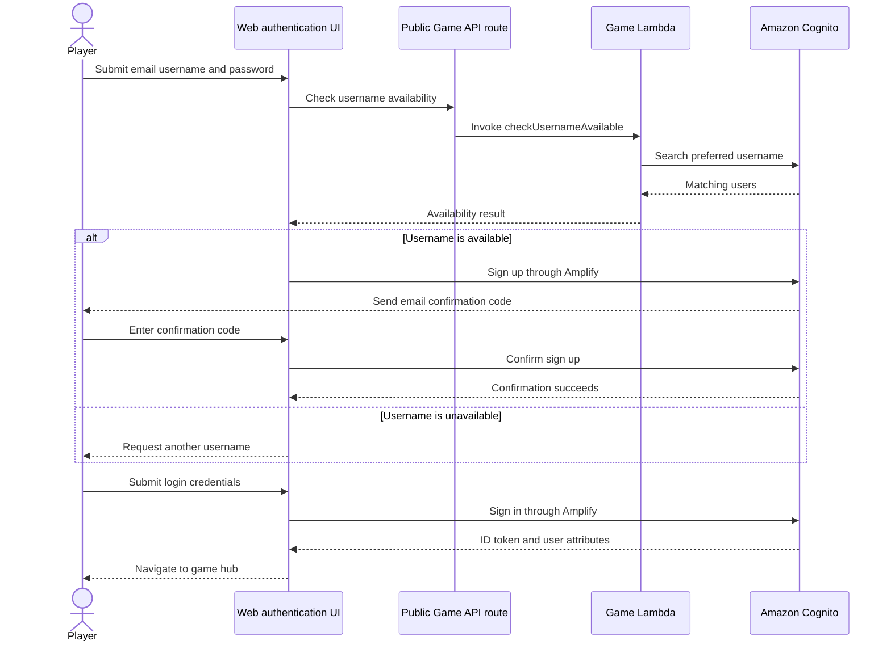
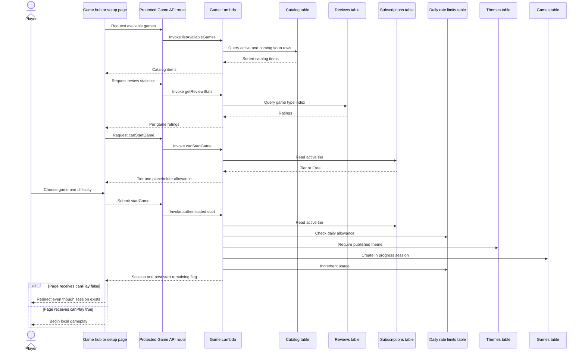
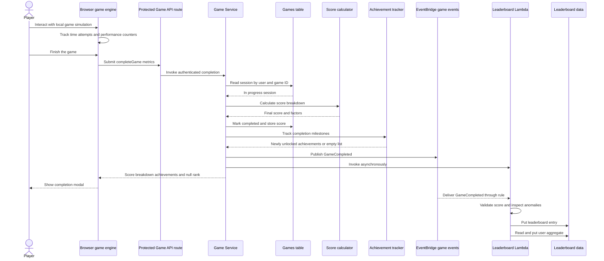
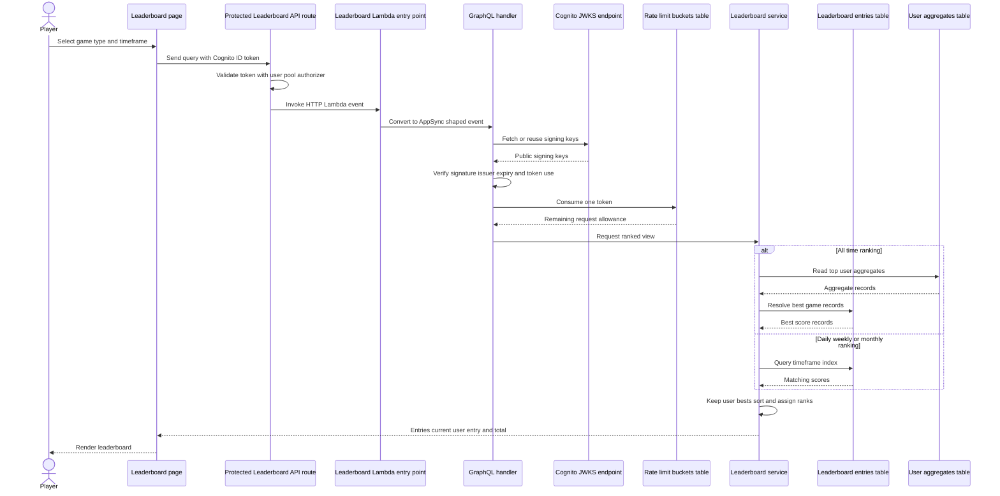
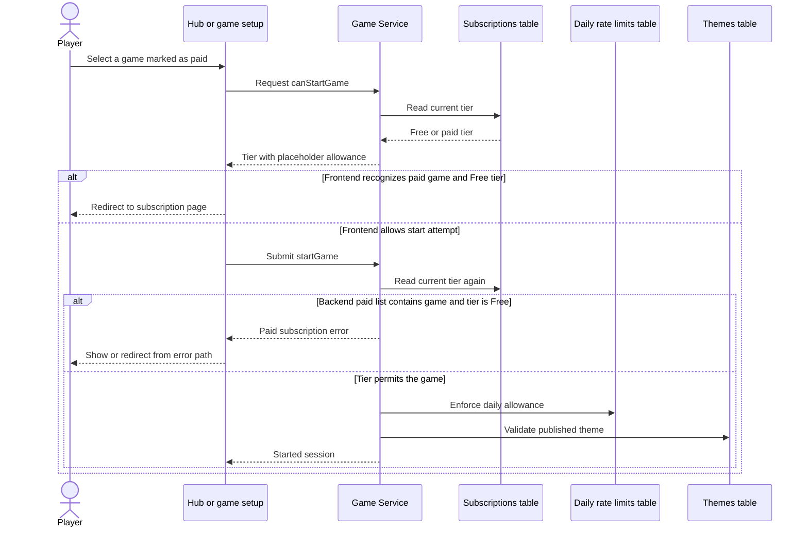
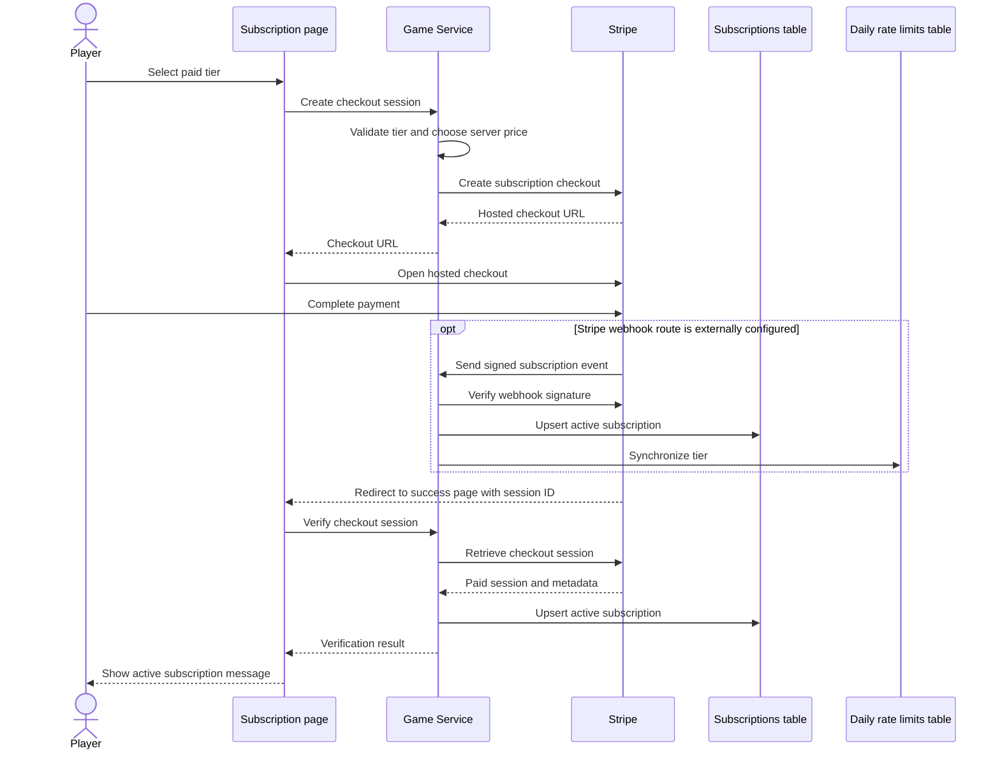
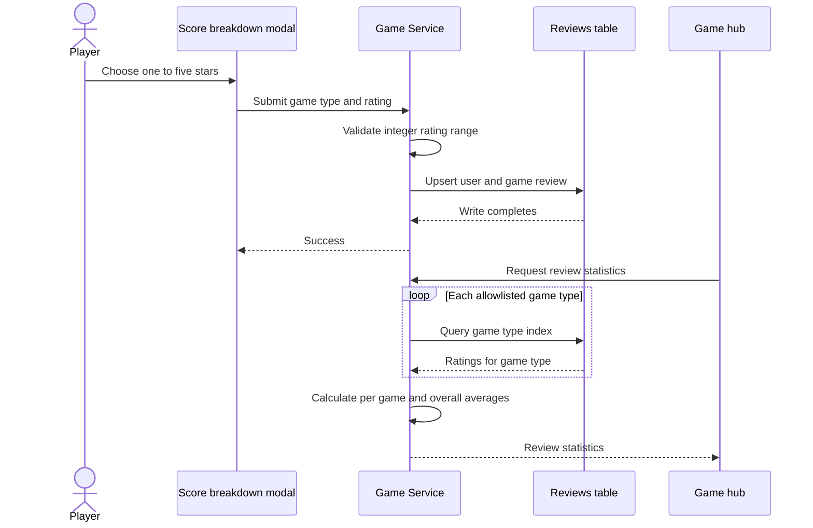
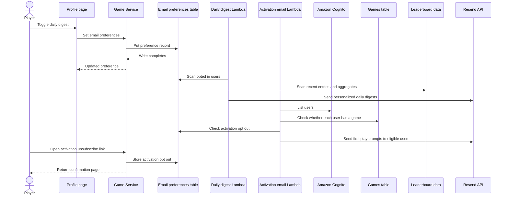
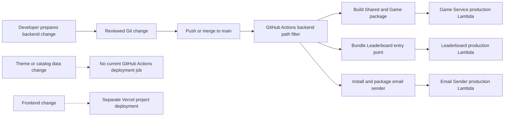

# Interaction Diagrams

## Verified against

- `apps/web/src/context/AuthContext.tsx` (`AuthProvider`, authentication methods)
- `apps/web/src/pages/hub/GameHubPage.tsx` (`loadGames`, `handleGameClick`)
- `apps/web/src/api/game.ts` and `apps/web/src/api/leaderboard.ts`
- `services/game/src/index.ts` (`handler`) and `services/game/src/handlers/game.handler.ts` (`GameHandler.routeOperation`)
- `services/game/src/services/game.service.ts` (`GameService.startGame`, `completeGame`, `canStartGame`)
- `services/game/src/services/stripe.service.ts` (`StripeService`) and `services/game/src/services/review.service.ts` (`ReviewService`)
- `services/game/src/services/event-publisher.service.ts` (`EventPublisherService.publishGameCompleted`)
- `services/leaderboard/src/index.ts`, `services/leaderboard/src/handlers/event.handler.ts`, and `services/leaderboard/src/handlers/graphql.handler.ts`
- `infrastructure/lib/stacks/api-stack.ts` and `infrastructure/lib/stacks/leaderboard-lambda-stack.ts`
- `.github/workflows/deploy-lambdas.yml`

These diagrams describe observed source behavior. Dashed or optional interactions identify code paths whose deployed wiring is not fully represented by current CDK.

## Account registration and login

**Text alternative:** Registration first checks username availability through the unauthenticated `/game/public` route, whose Game handler queries Cognito. If available, the web app calls Cognito through Amplify and asks the player to confirm the emailed code when required. Login also goes directly through Amplify/Cognito. The web app stores the returned ID token for later API calls and navigates to the hub. Google login uses Cognito redirect flow as a separate option.

Evidence: `apps/web/src/context/AuthContext.tsx` (`register`, `confirmEmail`, `login`, `loginWithGoogle`), `apps/web/src/pages/auth/RegisterPage.tsx` (`onSubmit`, `onConfirmEmail`), `services/game/src/index.ts` (`isCheckUsername`, `isPublicRoute`), and `services/game/src/handlers/game.handler.ts` (`checkUsernameAvailable`). The custom Resend email-sender implementation exists at `services/email-sender/index.js`, but its Cognito trigger attachment is not defined by `CognitoStack`.

## Catalog discovery and session start

**Text alternative:** The hub independently loads catalog items, review summaries, and the user's tier. A frontend paid-game list may redirect the player before play. The authoritative `startGame` operation reads the subscription, enforces paid-game and difficulty rules plus the daily allowance, verifies a published theme, creates an in-progress game record, and increments usage. Its `canPlay` flag describes remaining allowance after that increment. Some current pages redirect when the flag is false even though the just-created session is valid; otherwise the session ID is used for later completion.

Evidence: `apps/web/src/pages/hub/GameHubPage.tsx` (`loadGames`, `handleGameClick`), `services/game/src/repositories/game-catalog.repository.ts` (`getAllGames`), `services/game/src/services/review.service.ts` (`getReviewStats`), and `services/game/src/services/game.service.ts` (`canStartGame`, `startGame`). The `canStartGame` response currently reports `canPlay: true`, zero usage, and full remaining allowance; only `startGame` performs the actual limit check. Its returned `canPlay` indicates whether another play remains after incrementing usage, although some pages treat it as permission for the session just created.

## Browser gameplay and completion processing

**Text alternative:** Gameplay state is local to the browser. On completion, the browser reports elapsed time, attempts, and optional counters. The Game Service validates the session and generic bounds, computes and stores the score, and attempts achievement tracking. It submits the same completion payload through EventBridge and a direct asynchronous Lambda invocation. The browser receives the score breakdown immediately, but not a rank. Leaderboard processing later validates the event, checks anomalies, writes an entry, and updates the user's aggregate. Either delivery route can reach Leaderboard, so duplicate delivery is possible.

Evidence: `apps/web/src/pages/mini-golf/MiniGolfGamePage.tsx` (`MiniGolfGamePage`, `handleGameComplete`), `apps/web/src/api/game.ts` (`CompleteGameInput`), `services/game/src/services/game.service.ts` (`completeGame`), `services/game/src/services/score-calculator.service.ts` (`calculateScoreBreakdown`), `services/game/src/services/event-publisher.service.ts` (`publishGameCompleted`), and `services/leaderboard/src/handlers/event.handler.ts` (`handleGameCompletedEvent`). `GameHandler.completeGame` explicitly returns `leaderboardRank: null`.

## Leaderboard read

**Text alternative:** The browser sends a Cognito token to the protected Leaderboard route. API Gateway validates it once. The Leaderboard GraphQL handler validates the bearer token again against Cognito signing keys and consumes a DynamoDB token-bucket unit. Time-based views query leaderboard indexes; all-time views start from aggregates and resolve best game records. The service deduplicates users, sorts scores with completion time as a tiebreaker, assigns ranks, and returns the current user's row when present.

Evidence: `apps/web/src/api/leaderboard.ts` (`getLeaderboard`), `infrastructure/lib/stacks/api-stack.ts` (leaderboard route and authorizer), `services/leaderboard/src/index.ts` (`handleHttpGraphQLRequest`), `services/leaderboard/src/handlers/graphql.handler.ts` (`handleQuery`, `getLeaderboardResolver`), `services/leaderboard/src/utils/auth.util.ts` (`authenticateRequest`, `validateToken`), `services/leaderboard/src/utils/ratelimit.util.ts` (`enforceRateLimit`), and `services/leaderboard/src/services/leaderboard.service.ts` (`getLeaderboard`).

## Paid-game access decision

**Text alternative:** The browser may perform an early tier-based redirect, but its paid-game registry is separate from the backend registry. Every real start reads the tier again. The Game Service rejects a Free user when the requested uppercase theme ID is in its paid list, then applies the daily limit and published-theme checks. This backend start operation is the authoritative gate.

Evidence: `apps/web/src/components/hub/GameTile.tsx` (`PREMIUM_GAMES`), `apps/web/src/pages/hub/GameHubPage.tsx` (`handleGameClick`), `apps/web/src/pages/mini-golf/MiniGolfSetupPage.tsx` (`checkAccess`), and `services/game/src/services/game.service.ts` (`startGame`, `PAID_GAMES`). The current frontend and backend lists disagree for several existing games.

## Subscription checkout and activation

**Text alternative:** The subscription page asks the Game Service for a Stripe Checkout URL. The service validates the requested tier and uses its server-side price mapping. After payment, a configured webhook can verify the signature, update the subscription, and synchronize the rate-limit tier. Independently, the browser success page calls `verifyCheckoutSession`, which retrieves the session and updates the subscription record. The next authoritative game start reads that subscription.

Evidence: `apps/web/src/pages/subscription/RateLimitPage.tsx` (`handleSubscribe`), `apps/web/src/pages/subscription/SubscriptionSuccessPage.tsx` (`SubscriptionSuccessPage`), `services/game/src/handlers/game.handler.ts` (`createCheckoutSession`, `verifyCheckoutSession`), and `services/game/src/services/stripe.service.ts` (`createCheckoutSession`, `handleWebhook`, `handleCheckoutCompleted`). The Game Lambda contains a `/webhook` branch, but `infrastructure/lib/stacks/api-stack.ts` does not define that route.

## Review submission and aggregation

**Text alternative:** After a scored completion, the shared modal can submit a rating with a game type. The backend validates one through five and overwrites the user's prior review for that game type. The hub later requests aggregate statistics; the backend queries reviews only for game types in its fixed allowlist and calculates per-game and overall averages. A stored review for an unlisted new type does not enter those aggregates.

Evidence: `apps/web/src/components/game/ScoreBreakdownModal.tsx` (`ScoreBreakdownModal`), `apps/web/src/api/game.ts` (`submitGameReview`, `getReviewStats`), and `services/game/src/services/review.service.ts` (`submitReview`, `getReviewStats`).

## Email preferences and engagement messages

**Text alternative:** Players manage daily-digest consent on the Profile page, and the Game Service stores the choice. The daily function scans opted-in users plus recent leaderboard and aggregate data, then sends personalized messages with Resend. The activation function lists Cognito users, selects verified users with no game records, checks opt-out data, and sends first-play prompts. Its unsubscribe link invokes a Game handler that records activation opt-out state and returns HTML.

Evidence: `apps/web/src/pages/profile/ProfilePage.tsx` (`toggleDigest`), `services/game/src/services/email-prefs.service.ts` (`EmailPrefsService`), `services/game/src/daily-email.ts` (`handler`), `services/game/src/activation-email.ts` (`handler`, `isUserEligible`), and `services/game/src/index.ts` (`handleUnsubscribe`). The daily, activation, and unsubscribe deployment or route wiring is not fully represented in the current CDK application.

## Production backend deployment pipeline

**Text alternative:** A reviewed backend change reaches `main` and triggers the GitHub Actions workflow when Game, Leaderboard, Email Sender, or Shared paths match. The workflow builds or bundles all three Lambda packages and publishes each production function. The workflow has no job for theme/catalog data, infrastructure, ancillary email Lambdas, Auth, or the frontend. Frontend release is a separate Vercel process.

For Circuit Builder, backend commits and deployments are required to follow this GitHub Actions path. Direct local production AWS deployment is not part of the authorized feature workflow. Evidence: `.github/workflows/deploy-lambdas.yml` (`on.push`, `deploy-game-lambda`, `deploy-leaderboard-lambda`, `deploy-email-sender`), `apps/web/vercel.json`, and `.kiro/steering/deployment.md`. The current workflow deploys without running tests, lint, type-check, an account assertion, or a smoke test.
