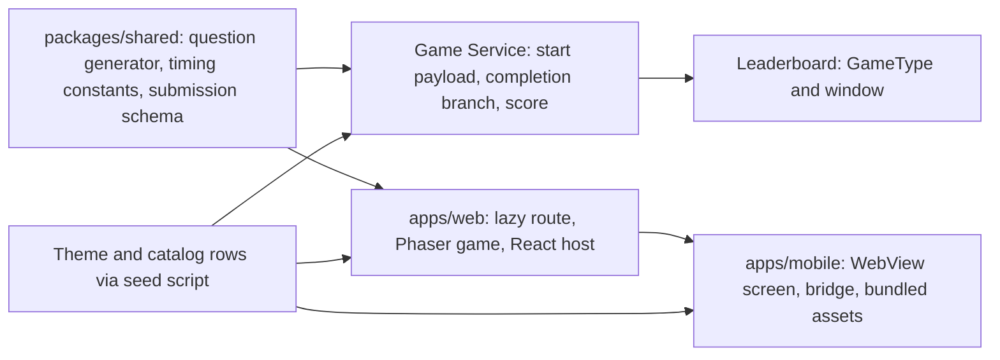

# Math Rally - Delta Reverse-Engineering Notes

**Created**: 2026-11-25
**Stage**: INCEPTION - Reverse Engineering (delta only, for the Math Rally feature)
**Name**: the feature was called Math Kart (working name) when this note was written; the owner named it Math Rally on 2026-11-25 (Q22), and the note was updated to the final name. The file keeps the `math-kart-` prefix for this inception run.
**Baseline**: the full reverse-engineering set in this folder describes HEAD `a328c74` and is stale.
**Read for this note**: branch `feat/math-kart` at `c6ccf0f` (origin/main, PR #35 merged). Every fact below was read in that tree unless it is marked *inferred* or *unverified*.
**Not re-done**: the business overview, architecture, API and dependency documents. This note lists only what changed since `a328c74` in the areas Math Rally touches, plus facts the requirements depend on.

---

## 1. What landed since `a328c74`

| PRs | Change | Relevance to Math Rally |
|---|---|---|
| #18, #21, #22, #23, #25 | Circuit Builder (leaderboard type, server re-evaluation, web game, score cap 8000) | Precedent for a new game type, a dedicated server-scored completion path, and the registry checklist (units U7a and U7b) |
| #26, #27, #28, #29 | Quest Map (shared config, `questContext`, progress table, map UI, thresholds, boss fix) | Launch contract Math Rally must support so it can become a node later |
| #24, #30 to #34 | Shirt page, Bond and Burn fix, playtest fixes, language images | Not relevant |
| #35 (17 mobile commits since `a328c74`) | Flutter app parity: 21 games ported natively to Dart, Quest Map screen, stats, Android build fix (`7f5db13`) | Math Rally is the first game the app would run in a WebView instead of a Dart port |

At `a328c74` the Flutter app had Memory Match only (`git ls-tree a328c74 apps/mobile/lib`). It now has `lib/game/*` controllers for every web game except Color by Number and Traffic Lab (`lib/game/game_registry.dart` comment).

---

## 2. New game type: the registry pattern (Circuit Builder U7a and U7b)

A game is visible, playable, scored and reported only when every registry below holds its id. Source: `aidlc-docs/construction/reporting-and-data/functional-design/functional-design.md` (U7a) and `.../reporting-and-data-web/functional-design/functional-design.md` (U7b), re-checked in code.

| # | Registry | File | Id form |
|---|---|---|---|
| 1 | Theme row, `status = PUBLISHED` (checked by `themeRepository.validateTheme` in `startGame`) | DynamoDB `memory-game-themes-{env}`, seeded by script | `UPPER_SNAKE` |
| 2 | Catalog row (`gameId`, `route`, `status ACTIVE`, `displayOrder`, `ageRange`, `category`) | DynamoDB `memory-game-catalog-{env}`, seeded by script | kebab |
| 3 | Seed and verify scripts with `--prod` guard and typed confirmation | `scripts/seed-circuit-builder.sh`, `scripts/verify-circuit-builder-seed.sh` | both |
| 4 | Paid gate | `packages/shared/src/constants/paid-games.ts` (`PAID_GAME_THEME_IDS`), read by `services/game/src/services/game.service.ts` | `UPPER_SNAKE` |
| 5 | Leaderboard `GameType` enum and `validateScore` switch with a config window | `services/leaderboard/src/types/index.ts`, `services/leaderboard/src/services/scoring.service.ts` | `UPPER_SNAKE` |
| 6 | Event `gameType` published on GameCompleted | `game.service.ts` | `UPPER_SNAKE` |
| 7 | Review aggregation list | `services/game/src/services/review.service.ts` | `UPPER_SNAKE` |
| 8 | Routes | `apps/web/src/config/constants.ts` (`ROUTES`), `apps/web/src/App.tsx` | path |
| 9 | Hub filter | `GAME_FILTER_MAP` in `apps/web/src/pages/hub/GameHubPage.tsx` | kebab |
| 10 | Paid badge (web) | `PREMIUM_GAMES` in `apps/web/src/components/hub/GameTile.tsx` | kebab |
| 11 | Web leaderboard enum and filter | `apps/web/src/api/leaderboard.ts`, `components/leaderboard/GameTypeFilter.tsx` | `UPPER_SNAKE` |
| 12 | Display maps | `RecentImprovements.tsx`, `AdminDashboard.tsx`, `HistoryPage.tsx`, `AchievementsPage.tsx`, `StatisticsPage.tsx` | `UPPER_SNAKE` |
| 13 | Locale keys `games.<id>.{title,description,category}` | `apps/web/src/locales/{en,es,pt}.json` | kebab |
| 14 | Consistency test | `apps/web/src/__tests__/circuitBuilderRegistry.test.ts` (reads sources as raw text, plus a mutation suite) | both |
| 15 | Mobile registry and paid copy | `apps/mobile/lib/game/game_registry.dart` (`kGameRegistry`), `apps/mobile/lib/config/paid_games.dart` (a test compares it with the shared list) | kebab and `UPPER_SNAKE` |

Facts that matter for a new game:
- **Production deploy order** (seed script header): Leaderboard first, then Game Service, then web registries live, then the seed last. Seeding first makes the hub tile point at a missing page, or lets players finish games whose leaderboard events are rejected.
- **No dev environment** is reachable from the maintainer machine; the seed's `--prod` mode is the real go-live action (seed script comment).
- **Achievements side effect**: `AchievementsPage` creates one per-game achievement per `GAME_INFO` key and its "play every game" total counts those keys. Registering a game changes that total (U7b design note).
- **Daily email** (`services/game/src/daily-email.ts`) was deliberately left out for Circuit Builder; the same reason applies.
- **Known drift** (U7b list, not fixed): `PREMIUM_GAMES` (web) lists 4 games while the server paid list has 7; Mini Golf is missing from `GAME_FILTER_MAP`.

---

## 3. Game Service: start, complete and score

Read in `services/game/src/services/game.service.ts`, `score-calculator.service.ts`, `utils/validation.ts`, `handlers/game.handler.ts`.

- **`startGame`**: tier lookup, optional `questContext` validation (before any allowance check), paid gate via `PAID_GAME_THEME_IDS`, **difficulty 4 blocked for FREE on every game**, rate limit check, theme validation, game record create, usage increment. The handler returns `id, userId, themeId, difficulty, status, startedAt, canPlay, rateLimit`; it has no per-game payload today.
- **`completeGame`** has two exits: the generic path, and `completeCircuitBuilderGame` (branch on `CIRCUIT_BUILDER_THEME_ID` before any generic logic). Both call `finalizeQuest`. The Circuit Builder path is the template for a server-scored game: E1 bounded validation, E2 server re-evaluation, E3 score from verified metrics only; every rejection uses one generic message and leaves the game `IN_PROGRESS` with nothing written.
- **Generic score formula** (`calculateScoreBreakdown`): `base x difficultyMultiplier x speedBonus x accuracyBonus`. Base 1000 (1100 at difficulty 4, 1700 for premium themes); multipliers 1.0 / 1.5 / 2.0 / 2.5; speed bonus `1 + (maxTime - t) / maxTime` clamped to [0.1, 2.0] (lower caps for some games); accuracy bonus `0.5 + accuracy`. A perfect fast free game therefore tops out at 3000 / 4500 / 6000 / 8000 (8250 capped) for difficulty 1 to 4 (computed from the constants, not measured).
- **Score caps, two layers**: the calculator caps by difficulty at 5000 / 6500 / 8000 (1, 2, 3+); `completeGame` then caps by game type: 6000 for free games at difficulty 1-3, 8000 for difficulty 4, 8000 for themes in a local `PREMIUM_GAME_THEMES` list, Mini Golf uncapped. Circuit Builder uses its own `CB_SCORE_CAP` 8000.
- **Duplicated lists**: `PREMIUM_GAME_THEMES` exists twice (score calculator and `completeGame`) and differs from `PAID_GAME_THEME_IDS` (no `CIRCUIT_BUILDER`). The "skip Memory Match attempts validation" and `preAccuracy` theme lists are also inline literals. A new game with its own completion branch avoids all of them.
- **Generic trust level**: the generic path scores from client-reported `completionTime`, `correctAnswers`, `totalQuestions`, bounded only by `validateCompletionTime` (minimum `2 x difficulty` seconds, maximum 3600 s).
- **Input schema**: `startGameInputSchema` passes `questContext` as `unknown`; `completeGameInputSchema` passes `circuitSubmission` as `unknown` and validates it later. A new per-game payload follows the same pattern.
- **Difficulty on the leaderboard**: the event maps 1 to EASY, 2 to MEDIUM, 3 and 4 to HARD (U7a finding: Super Hard is indistinguishable from Hard).

---

## 4. Leaderboard service

`validateScore` switches on `GameType`. Math Challenge's window is 10 to 600 s, max score 10000; Math Maze and other newer games reuse it. Circuit Builder has a dedicated `circuitBuilder` entry (1 to 3600 s, 0 to 8000) because reuse would reject legitimate long games and an event that fails validation **silently produces no leaderboard entry**. Nine stale leaderboard tests fail on `main` (U7a section 8); they are pre-existing.

---

## 5. Quest Map launch contract (for "launchable later")

- `packages/shared/src/quest/schema.ts`: `questContext = { worldId, nodeId, legIndex 0-2 }`, ids `^[a-z0-9-]{1,40}$`.
- Web: `apps/web/src/utils/questLaunch.ts` builds `<route>?difficulty=easy|medium|hard&quest=<world>:<node>:<leg>` for launch kind `difficulty`; `api/game.ts` `startGame` reads the `quest` param itself, and on any quest start failure redirects to the map (rule R1: an accepted quest start is playable even on the last allowed play).
- Mobile mirror: `apps/mobile/lib/quest/quest_launch.dart` (`kQuestLaunchTable`), `GameSessionArgs.questContext`.
- A theme can be a leg only if listed in `QUEST_GAME_THEME_IDS` (`packages/shared/src/quest/themes.ts`). The config test rejects a **World 1 leg that is paid or above difficulty 3**, so a game planned to become paid must not be placed in World 1.
- The `difficulty` launch kind can express difficulty 1-3 only (`DIFFICULTY_NAMES`).
- Any new completion branch must call `finalizeQuest`, or quest stars are never awarded for that game.

---

## 6. Web app facts

- React 18.2, Vite 5.1, TypeScript 5.3, Tailwind, Framer Motion (`apps/web/package.json`). **No Phaser, no canvas game library.**
- **No lazy routes**: every page is a static import in `App.tsx`, so the whole app ships as one entry bundle today. Math Rally would be the first `React.lazy` route.
- `React.StrictMode` wraps the app (`main.tsx`), so effects mount twice in development; an embedded engine must survive that.
- `@vercel/analytics` and `@vercel/speed-insights` are mounted app-wide (`main.tsx`).
- **CSP ships as `Content-Security-Policy-Report-Only`** (`apps/web/vercel.json`): `script-src 'self'`, `img-src 'self' data: https://upload.wikimedia.org` (no `blob:`), `connect-src` limited to the API, Cognito and `ipapi.co`, `frame-ancestors 'none'`, plus `X-Frame-Options: DENY`. SECURITY-04 is recorded as partial in `aidlc-state.md`. A game engine that creates `blob:` image URLs would raise reports now and break once CSP is enforced (*whether Phaser 4 does this is unverified*).
- `index.html` loads the Poppins font from Google Fonts; a bundle meant to run offline cannot rely on it.
- `apps/web` imports `packages/shared` through relative-path funnel modules (`utils/circuitEngine.ts`, `utils/questShared.ts`). Both carry a warning that Vercel might not see `packages/shared`; Quest Map web, which uses `questShared.ts`, was deployed to production on 2026-11-03 (audit log), so the path resolves in the Vercel build (*inferred from the deploy record*).
- Reusable pieces: `components/game/ScoreBreakdownModal.tsx` (result modal, Quest result section), `services/presentationPreferences.ts` (reduced motion and stored sound preference behind a testable seam), `services/audioService.ts`, `hooks/useGameAudio.ts`.
- Math content precedent: `utils/mathUtils.ts` (Math Challenge; Easy add/sub to 20, Medium adds multiply/divide to 12, Hard adds powers and roots) and `utils/mazeEquations.ts` (Math Maze). Both use unseeded `Math.random`, so neither can be regenerated by the server.
- Tests: Vitest in the node environment, no jsdom, no browser or viewport tooling (Circuit Builder NFR-CB-26). `localeCompleteness.test.ts` checks en/es/pt keys.

---

## 7. Flutter app facts (`apps/mobile`)

- Flutter 3.19+, Dart 3.3+, Riverpod, go_router, `graphql_flutter`, `amazon_cognito_identity_dart_2`, `flutter_secure_storage`, `audioplayers` (`pubspec.yaml`). **No WebView package.**
- **How games run today**: each game is a native Dart port (for example `lib/game/math/math_logic.dart` ports `mathUtils.ts`; `lib/game/circuit/engine/*` ports the circuit engine). A shared `GameSessionController` (`lib/game/framework/game_session.dart`) owns `startGame`, the timer, pause, `complete` and `completeOrRecover`; screens show `game_result_screen.dart`.
- **Offline rounds**: when `startGame` fails for a reason other than rate limit, paywall or quest, the controller starts an unscored round with no game id.
- **API and tokens**: `lib/api/graphql_client.dart` adds `Authorization: Bearer <idToken>` from `CognitoService.getValidIdToken()`; tokens are in the Keychain or EncryptedSharedPreferences (`lib/auth/token_storage.dart`). `completeGame` forwards only allowlisted extra keys (`GameApi.completeExtraKeys`, which already includes `circuitSubmission`).
- **CORS**: the HTTP API allows only `https://dashden.app`, `https://www.dashden.app` (prod) or `https://dev.dashden.app`, plus two localhost ports (`infrastructure/lib/stacks/api-stack.ts`). Native Dart HTTP calls are not subject to CORS; a fetch from inside a WebView page served from an app-local origin would be.
- **Registry and hub**: `kGameRegistry` decides what the app can show; the server catalog decides status and order. Older app versions never show a game they do not list.
- **Paid presentation**: `kPaidGamePresentation = neutralUnavailable` (paid games listed as unavailable, no purchase UI in the app).
- **Localization**: ARB files are generated from `apps/web/src/locales/*.json` by `tools/convert_locales.mjs`.
- **Orientation**: iPhone supports portrait and both landscapes (`ios/Runner/Info.plist`); no lock in `main.dart`.
- **Builds**: Android builds since `7f5db13`; iOS is built and verified only on the owner's Mac (README). Whether Flutter or the Android SDK is installed on this Windows machine was not checked.

---

## 8. Touch map for Math Rally

**Text alternative:** The shared package holds the question generator, timing constants and submission schema, used by the Game Service and the web game. The web game build is also bundled into the Flutter app, which hosts it in a WebView. The Game Service publishes results to the Leaderboard. Theme and catalog rows, seeded by a script, make the game startable and visible on web and mobile.

---

## 9. Corrections to the stale baseline documents

- `component-inventory.md` and `technology-stack.md` describe the mobile app as absent or Memory-Match-only; it is now a full client with 21 native games.
- The baseline lists `PAID_GAMES` as a local array in `game.service.ts`; it is now `PAID_GAME_THEME_IDS` in `packages/shared`.
- The baseline shows one `completeGame` path; there are now two exits plus the Quest Map hook.
- The baseline does not include the quest progress table, `quest.service.ts` or `quest-progress.repository.ts`.
