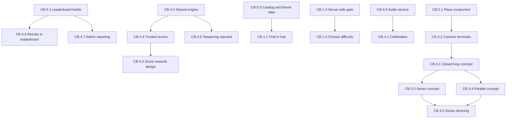

# Circuit Builder - User Stories

**Created**: 2026-10-29
**Stage**: INCEPTION - User Stories, Part 2 (Generation)
**Approach**: Epic hierarchy over user journeys, with dedicated epics for educational concepts, prerequisite enablement, and platform quality (Q1=C, Q4=C)
**Basis**: `aidlc-docs/inception/requirements/circuit-builder-requirements.md`, `circuit-builder-personas.md`

**Note on file naming**: A `stories.md` already exists in this directory from the original Memory Game inception. This Circuit Builder file is kept separate so the earlier artifact is preserved.

---

## Conventions

**Story ID**: `CB-<epic>.<number>`

**Priority**: `P0` must have, `P1` should have, `P2` could have, `P3` deferred

**Stage**: delivery stage from the requirements — `S1` prerequisites, `S2` frontend, `S3` backend integration

**Criteria format** (Q3=C): Given-When-Then for behavioral and multi-scenario stories; checklist for configuration and verification stories

**🖐 MANUAL** marks acceptance criteria with no automated coverage per `NFR-CB-26`, written as executable steps so they function as a test script (Q9=B)

**Personas**: P1 Mateo younger learner, P2 Sofía older learner, P3 Carolina parent or educator, P4 Diego administrator, P5 Tomás free-tier user

---

# Epic 1 — Discovery and Access

## CB-1.1 — Find Circuit Builder in the hub
**P0 · S3 · P2, P3**

As a paid subscriber, I want to find Circuit Builder in the game hub so I can start playing.

- **Given** I am signed in with an active Light, Standard, or Premium subscription
- **When** I open the game hub
- **Then** I see a Circuit Builder tile with its title, description, and icon
- **And** the tile appears when I select the `Science & Math` filter
- **And** the tile shows its star rating once reviews exist

*Requirements: FR-CB-38, FR-CB-40, FR-CB-44 · Depends on: CB-5.5*

## CB-1.2 — See that Circuit Builder is a paid game
**P0 · S3 · P5**

As a free-tier user, I want to see that Circuit Builder requires a subscription before I click it, so I am not surprised.

- **Given** I am signed in without a paid subscription
- **When** I view the Circuit Builder tile in the hub
- **Then** the tile displays the paid badge
- **And** clicking it takes me to the subscription page rather than the game

*Requirements: FR-CB-35, FR-CB-37 · Notes: the badge comes from `PREMIUM_GAMES`; omitting it is the documented Mini Golf defect*

## CB-1.3 — Free-tier access is blocked by the server, not the interface
**P0 · S3 · P5**
**Security story (Q10=C)**

As the platform owner, I want free-tier access blocked server-side so the paywall cannot be bypassed.

- **Given** I am signed in without a paid subscription
- **When** I navigate directly to the Circuit Builder game route, bypassing the hub
- **Then** the attempt to start a session is rejected by the Game Service
- **And** I am redirected to the subscription page
- **And** no game session is created

*Requirements: FR-CB-36 · Security: SECURITY-08 for new code · Notes: `PAID_GAMES` in `GameService.startGame` is the authoritative gate; browser checks are advisory only*

## CB-1.4 — Choose a difficulty and start a level
**P0 · S2, S3 · P1, P2**

As a player, I want to choose a difficulty before playing so the challenge matches my level.

- **Given** I have access to Circuit Builder
- **When** I open the setup page
- **Then** I can choose Easy, Medium, Hard, or Super Hard
- **And** each option explains what changes at that level
- **When** I start the level
- **Then** a backend session is created and the game begins

*Requirements: FR-CB-32, FR-CB-33 · Depends on: CB-1.3*

## CB-1.5 — Explore freely in sandbox mode
**P1 · S2 · P1, P2**

As a player, I want a free-play sandbox so I can experiment without a goal or a cost.

- **Given** I have access to Circuit Builder
- **When** I enter sandbox mode
- **Then** I can place any component and build any circuit with no objective
- **And** no daily game allowance is consumed
- **And** no score is produced and no leaderboard entry is created
- **And** the simulation behaves identically to guided levels

*Requirements: FR-CB-27, FR-CB-31 · Notes: sandbox calls neither `startGame` nor `completeGame`; this resolves the approved gap between sandbox play and metered sessions*

---

# Epic 2 — Building and Simulation

## CB-2.1 — Place a component on the grid
**P0 · S2 · P1, P2**

As a player, I want to drag components from the tray onto the canvas so I can build a circuit.

- **Given** I am in a level or sandbox
- **When** I drag a component from the tray onto the canvas
- **Then** it snaps to the nearest valid grid cell
- **And** it cannot be placed overlapping another component
- 🖐 **MANUAL** Verify with a mouse: drag each of the eight component types from the tray to the canvas and confirm each snaps to a cell
- 🖐 **MANUAL** Verify on a touch device: repeat the above by dragging with one finger
- 🖐 **MANUAL** Verify tap fallback: tap a tray component, then tap a grid cell, and confirm placement

*Requirements: FR-CB-1, FR-CB-2, FR-CB-3 · NFR-CB-1, NFR-CB-2*

## CB-2.2 — Connect two terminals
**P0 · S2 · P1, P2**

As a player, I want to connect component terminals so current can flow between them.

- **Given** two components are placed on the canvas
- **When** I draw a connection from a terminal on one to a terminal on the other
- **Then** a visible connection is created between those terminals
- **And** the simulation immediately re-evaluates the circuit
- **When** I attempt to connect a terminal to itself or to an invalid target
- **Then** no connection is created and the attempt gives visible feedback
- 🖐 **MANUAL** Verify with mouse and with touch that a connection can be drawn between two terminals

*Requirements: FR-CB-4, FR-CB-10 · NFR-CB-2*

## CB-2.3 — Remove components and connections
**P0 · S2 · P1, P2**

As a player, I want to remove things I placed so I can correct mistakes and experiment.

- **Given** a circuit with components and connections
- **When** I delete a single connection
- **Then** only that connection is removed and the components remain
- **When** I remove a component
- **Then** the component and its attached connections are removed
- **And** the simulation re-evaluates immediately

*Requirements: FR-CB-5, FR-CB-6*

## CB-2.4 — Toggle a switch during simulation
**P0 · S2 · P1, P2**

As a player, I want to open and close a switch so I can control the circuit while it runs.

- **Given** a working circuit containing a closed switch
- **When** I open the switch
- **Then** the conductive path breaks and affected loads de-energize immediately
- **When** I close the switch again
- **Then** the loads re-energize

*Requirements: FR-CB-8, FR-CB-11*

## CB-2.5 — Adjust the battery voltage
**P1 · S2 · P2**

As an older learner, I want to change the battery voltage so I can see how supply affects the circuit.

- **Given** a working circuit powered by the variable voltage battery
- **When** I increase the voltage within the permitted range
- **Then** computed current increases and loads respond visibly
- **When** I decrease the voltage toward zero
- **Then** loads dim and eventually stop
- **And** the voltage cannot be set outside the defined safe range

*Requirements: FR-CB-7, FR-CB-9, FR-CB-13*

## CB-2.6 — See energized paths glow
**P0 · S2 · P1, P2**

As a player, I want to see which parts of my circuit are carrying current so I can understand what is working.

- **Given** a circuit with both energized and de-energized sections
- **When** the simulation evaluates
- **Then** energized paths render as high-contrast glowing traces
- **And** de-energized paths are visually distinct at a glance
- 🖐 **MANUAL** Verify that energized and de-energized paths are distinguishable without relying on color alone

*Requirements: FR-CB-20 · NFR-CB-9*

## CB-2.7 — Each component behaves according to its electrical role
**P0 · S2 · P1, P2**

As a player, I want every component to behave like its real counterpart so what I learn is true.

Checklist:
- [ ] Variable Voltage Battery supplies power with adjustable voltage and defined polarity
- [ ] Solar Panel supplies power, modelled as a source with its own characteristics
- [ ] Wire conducts with negligible resistance and has no polarity
- [ ] Switch conducts when closed, blocks when open
- [ ] Resistor conducts with a defined resistance, limiting current
- [ ] LED Bulb illuminates proportionally to current and has polarity
- [ ] Electric Motor turns when energized, with speed reflecting current
- [ ] Buzzer sounds when energized

*Requirements: FR-CB-2, FR-CB-7, FR-CB-9, FR-CB-13 · Notes: a resistor is included because resistance is a stated learning objective; the original request omitted it*

---

# Epic 3 — Learning Concepts

Stories in this epic express what a learner should understand, with the system behavior that makes it observable in the acceptance criteria (Q8=C). A story here is only satisfied if the concept is *perceivable*, not merely computed.

## CB-3.1 — Understand that a circuit must be a closed loop through a load
**P0 · S2 · P1, P2, P3**

As a learner, I want to discover that electricity only flows in a complete loop that passes through something that uses it.

- **Given** a battery and a bulb that are not fully connected
- **When** I view the circuit
- **Then** the bulb is dark and no path glows
- **When** I complete the loop from positive, through the bulb, to negative
- **Then** the bulb lights and the whole path glows
- **And** the change is immediate and unmistakable

*Requirements: FR-CB-10, FR-CB-20 · Learning objective: closed circuits and conductivity*

## CB-3.2 — Understand that a switch controls the flow
**P0 · S2 · P1**

As a learner, I want to discover that a switch decides whether electricity can pass.

- **Given** a working circuit with a closed switch and a lit bulb
- **When** I open the switch
- **Then** the bulb goes dark even though nothing was removed
- **And** the broken path is visually distinguishable from the conducting one

*Requirements: FR-CB-8, FR-CB-11 · Learning objective: boolean control of a circuit*

## CB-3.3 — Understand that breaking a series circuit stops everything
**P0 · S2 · P1, P2, P3**

As a learner, I want to discover that in a single-path circuit, breaking one part stops all of it.

- **Given** three bulbs wired in series on one path, all lit
- **When** I remove any one bulb, delete any one connection, or open a switch anywhere on the path
- **Then** all three bulbs go dark, not just the one I touched
- **And** no part of the path remains glowing

*Requirements: FR-CB-11 · Learning objective: series circuits*

## CB-3.4 — Understand that parallel branches are independent
**P0 · S2 · P1, P2, P3**

As a learner, I want to discover that branches on separate paths keep working when one fails.

- **Given** three bulbs wired on three independent parallel branches, all lit
- **When** I remove one bulb or break one branch
- **Then** the other two bulbs remain lit
- **And** the surviving branches still glow while the broken one does not
- **And** this contrasts observably with the series behavior in CB-3.3

*Requirements: FR-CB-12 · Learning objective: parallel circuits*

## CB-3.5 — Understand that series sharing makes each bulb dimmer
**P1 · S2 · P2, P3**

As a learner, I want to see that bulbs in series share the supply and each gets less, so I understand why they are dimmer.

- **Given** two identical bulbs wired in series from a given battery
- **When** I compare them against the same two bulbs wired in parallel from the same battery
- **Then** the series bulbs are visibly dimmer than the parallel ones
- **And** the brightness difference is derived from computed current, not a hard-coded value
- **And** at Hard or Super Hard the current values are displayed and confirm what I see

*Requirements: FR-CB-9, FR-CB-13, FR-CB-34 · Learning objective: current division and voltage drop · Notes: this story fails if brightness is hard-coded per arrangement rather than computed*

## CB-3.6 — Understand that resistance limits current
**P1 · S2 · P2**

As a learner, I want to discover that a resistor restricts current and can protect a component.

- **Given** a circuit containing an LED with no current-limiting resistor
- **When** the circuit is energized at sufficient voltage
- **Then** the LED is shown to be at risk, with an explanation
- **When** I add a resistor in series with the LED
- **Then** computed current drops and the LED operates safely
- **And** at Hard or Super Hard the resistance and resulting current are displayed

*Requirements: FR-CB-2, FR-CB-9, FR-CB-34 · Learning objective: resistance and current limiting*

## CB-3.7 — Understand what a short circuit is and why it is bad
**P0 · S2 · P1, P2, P3**

As a learner, I want to discover what happens when I connect power directly with nothing to use it, and why that is a problem.

- **Given** a battery on the canvas
- **When** I connect its positive terminal to its negative terminal through only wire, with no load
- **Then** the fault is detected immediately
- **And** the consequence is shown visibly rather than silently ignored
- **And** I am told in plain language what went wrong and how to fix it

*Requirements: FR-CB-14, FR-CB-17, FR-CB-18 · Learning objective: short-circuit faults*

## CB-3.8 — Recover from a short circuit and keep experimenting
**P0 · S2 · P1**

As a younger learner, I want a mistake to teach me rather than end my attempt, so I keep trying things.

- **Given** I have caused a short circuit
- **When** the fault triggers
- **Then** a spark particle effect appears at the fault location
- **And** the fuse visibly pops and the circuit de-energizes
- **And** an educational tooltip explains the fault in age-appropriate language
- **When** I reset the fuse
- **Then** I continue the same attempt without restarting the level
- **And** a scoring penalty is applied for the fault

*Requirements: FR-CB-17, FR-CB-18, FR-CB-19, FR-CB-24 · Notes: the penalty supplies real consequence without punishing experimentation*

## CB-3.9 — See numeric detail appropriate to my level
**P0 · S2 · P1, P2**

As a learner, I want the amount of numeric detail to match my ability, so I am neither overwhelmed nor patronized.

- **Given** I am playing on Easy
- **Then** no numeric values are displayed; feedback is purely visual
- **Given** I am playing on Medium
- **Then** feedback is qualitative, such as relative brightness, with no units
- **Given** I am playing on Hard
- **Then** voltage and resistance values are displayed
- **Given** I am playing on Super Hard
- **Then** current per branch, voltage drop, and total resistance are displayed
- **And** the same engine computes all levels; only presentation differs

*Requirements: FR-CB-9, FR-CB-34 · Notes: this resolves the direct tension between personas P1 and P2*

---

# Epic 4 — Completion and Scoring

## CB-4.1 — Power the Mars Rover and celebrate
**P0 · S2 · P1, P2**

As a player, I want a clear goal and a satisfying reward when I achieve it.

- **Given** a level with the Mars Rover as the target machine
- **When** I build a circuit that satisfies the level's success condition
- **Then** the rover's components activate in their in-world roles
- **And** a celebration animation plays with glowing energized traces
- **And** a success sound plays, subject to the mute preference
- **And** the completion result is presented

*Requirements: FR-CB-20, FR-CB-29, FR-CB-30 · Depends on: CB-6.5*

## CB-4.2 — Receive a score that rewards good circuit design
**P0 · S3 · P2**

As a player, I want my score to reflect how well I built the circuit, not only how fast I was.

- **Given** I have completed a level
- **When** my score is computed
- **Then** it reflects completion time, component efficiency, and short-circuit penalties
- **And** using fewer components scores higher
- **And** each short circuit reduces the score
- **And** an efficient fault-free circuit can outscore a faster careless one

*Requirements: FR-CB-23, FR-CB-24, FR-CB-25 · Depends on: CB-4.3*

## CB-4.3 — Shared circuit engine available to browser and server
**P0 · S2 · P4**
**Technical enabler (Q12=C)**

As a developer, I need the circuit engine to live in `packages/shared` so the browser and the Game Service evaluate circuits with identical code.

Checklist:
- [ ] Engine is a pure module with no React or DOM dependency
- [ ] Engine is deterministic for a given circuit state
- [ ] Engine resides in `packages/shared` and is imported by both the web app and the Game Service
- [ ] Engine is bundled into the Game Lambda by the existing deploy script
- [ ] No second implementation of circuit evaluation exists anywhere in the codebase

*Requirements: FR-CB-15, FR-CB-16 · Enables: CB-4.4, CB-4.5 · Notes: this is honest infrastructure, not a player story; its player value is delivered through CB-4.4*

## CB-4.4 — Trust that leaderboard scores are real
**P0 · S3 · P2**

As a competitive player, I want to know scores cannot be faked, so the leaderboard is worth caring about.

- **Given** I have completed a level
- **When** my result is submitted
- **Then** the Game Service re-evaluates my submitted circuit layout using the shared engine
- **And** the score is computed server-side from that re-evaluation
- **And** the score shown to me matches the server-computed value

*Requirements: FR-CB-21 · Security: SECURITY-11 · Depends on: CB-4.3*

## CB-4.5 — Tampered submissions are rejected
**P0 · S3 · P4**
**Security story (Q10=C)**

As the platform owner, I want invalid or manipulated submissions rejected so the leaderboard stays trustworthy.

- **Given** a completion submission is received
- **When** the submitted layout does not satisfy the level's success condition on re-evaluation
- **Then** the submission is rejected and no score is recorded
- **When** a submission contains out-of-bounds values, such as impossible component counts, invalid grid coordinates, voltages outside the permitted range, or a negative elapsed time
- **Then** it is rejected by schema validation before processing
- **And** an unknown component or connection type is rejected
- **And** the rejection returns a generic error without exposing internal detail

*Requirements: FR-CB-22, FR-CB-26 · Security: SECURITY-05, SECURITY-09, SECURITY-11 · Depends on: CB-4.3*

## CB-4.6 — See my results in the leaderboard and my history
**P1 · S3 · P2, P3**

As a player, I want my Circuit Builder results to appear where my other game results appear.

- **Given** I have completed a Circuit Builder level
- **When** I view the leaderboard and select Circuit Builder
- **Then** my score appears with correct game identification
- **And** the entry appears in my History and contributes to Achievements

*Requirements: FR-CB-41, FR-CB-42, FR-CB-43 · Depends on: CB-5.1*

## CB-4.7 — Administrator sees Circuit Builder in reporting
**P2 · S3 · P4**

As an administrator, I want Circuit Builder present in every reporting surface so I can evaluate its performance.

Checklist:
- [ ] Appears in the leaderboard game-type filter
- [ ] Appears in Recent Improvements with correct icon and name
- [ ] Appears in the Admin Dashboard
- [ ] Appears in review statistics so ratings aggregate
- [ ] Appears in the daily email game list

*Requirements: FR-CB-43, FR-CB-44 · Depends on: CB-5.1*

---

# Epic 5 — Prerequisite Enablement

Delivery Stage 1. No player journey, but each item must be independently verifiable. These block the stories noted.

## CB-5.1 — Leaderboard service builds and tests pass
**P0 · S1 · P4**

As a developer, I need the Leaderboard service to compile and pass tests before adding a new game type to it.

Checklist:
- [ ] The `Difficulty` type mismatch between `types/index.ts` and `scoring.service.ts` is reconciled
- [ ] `tsc` type-check passes for the Leaderboard service
- [ ] The Leaderboard test suite passes
- [ ] No Circuit Builder game type is added until the above pass

*Requirements: PRE-1.1, PRE-1.2, PRE-1.3 · Blocks: CB-4.6, CB-4.7*

## CB-5.2 — Web responses carry required security headers
**P0 · S1 · P4**

As the platform owner, I want required security headers present so the browser enforces baseline protections.

Checklist:
- [ ] `Content-Security-Policy` set with a restrictive policy
- [ ] `Strict-Transport-Security` set with max-age of at least one year
- [ ] `X-Content-Type-Options` set to `nosniff`
- [ ] `X-Frame-Options` set appropriately
- [ ] `Referrer-Policy` set to `strict-origin-when-cross-origin`
- [ ] Any `unsafe-inline` or `unsafe-eval` usage is documented with justification

*Requirements: PRE-2 · Security: SECURITY-04*

## CB-5.3 — Internal error detail is no longer exposed to users
**P0 · S1 · P4**

As the platform owner, I want users to see generic errors so internal detail is not disclosed.

- **Given** an unhandled error occurs in the web app
- **When** the error boundary renders
- **Then** a generic message is shown
- **And** no `error.message` or `error.stack` content appears in the user interface
- **And** the error is still logged for diagnosis without sensitive data

*Requirements: PRE-2 · Security: SECURITY-09, SECURITY-15*

## CB-5.4 — Registry consistency is automatically checked
**P1 · S3 · P4**

As a developer, I want a check that fails when Circuit Builder registries disagree, so the game cannot silently half-ship.

Checklist:
- [ ] A check asserts the route constant exists and is registered
- [ ] A check asserts the `GAME_FILTER_MAP` entry exists
- [ ] A check asserts `PAID_GAMES` and `PREMIUM_GAMES` agree for this game
- [ ] A check asserts the leaderboard game type and display metadata exist
- [ ] A check asserts the review registry includes the game
- [ ] A check asserts translation keys exist for all three locales
- [ ] The check fails loudly when any entry is missing

*Requirements: FR-CB-45 · Notes: motivated by the documented Mini Golf and Language Pronunciation registry omissions*

## CB-5.5 — Catalog and theme data registered and verified
**P0 · S3 · P4**

As a developer, I need the catalog row and published theme row to exist so the tile appears and the session can start.

Checklist:
- [ ] A committed `scripts/seed-circuit-builder.sh` creates the catalog row with route, display order, age range, and category
- [ ] The same script creates the published theme row required by `startGame` theme validation
- [ ] An idempotent verification command confirms both rows exist and are valid
- [ ] The verification command is safe to run repeatedly
- [ ] Production use follows the GitHub Actions path, not a local production deployment

*Requirements: FR-CB-40, VER-1, VER-2 · Blocks: CB-1.1*

---

# Epic 6 — Platform Quality

## CB-6.1 — Play using only a keyboard
**P1 · S2 · P3**

As a player who cannot use a pointer, I want to perform core actions with a keyboard so I can play.

- **Given** I am using only a keyboard
- **When** I navigate the tray and canvas
- **Then** I can select a component, place it on a grid cell, toggle a switch, and connect one terminal to another
- **And** focus is always visible
- 🖐 **MANUAL** With pointer input unused, complete a full Easy level start to finish using only the keyboard
- 🖐 **MANUAL** Confirm focus order is logical and focus is never trapped
- **Known gap**: freeform wire routing and full screen-reader narration of an arbitrary circuit graph are out of scope and documented

*Requirements: NFR-CB-5, NFR-CB-6*

## CB-6.2 — Reduced motion is respected
**P1 · S2 · P1, P3**

As a player sensitive to motion, I want animations suppressed when I have asked my system for reduced motion.

- **Given** my system has `prefers-reduced-motion` enabled
- **When** a short circuit occurs
- **Then** the spark particle animation is suppressed or replaced with a static indication
- **When** I complete a level
- **Then** the celebration animation is reduced or replaced with a static success state
- **And** all information conveyed by animation remains available
- 🖐 **MANUAL** Enable reduced motion at the OS level, trigger a short circuit, and confirm sparks are suppressed
- 🖐 **MANUAL** With reduced motion enabled, complete a level and confirm the celebration is reduced

*Requirements: NFR-CB-7*

## CB-6.3 — Play comfortably on a phone
**P1 · S2 · P1**

As a player on a phone, I want enough room and large enough targets to build a circuit.

- **Given** I am on a mobile viewport
- **When** I open a Circuit Builder level
- **Then** a full-screen canvas mode is available
- **And** the component tray remains reachable without obscuring the canvas
- **And** touch targets are large enough to hit reliably
- 🖐 **MANUAL** On a real phone, complete an Easy level using touch only
- 🖐 **MANUAL** Confirm the tray and canvas are both usable in portrait orientation
- 🖐 **MANUAL** Confirm desktop continues to render inside the standard `AppLayout` shell

*Requirements: NFR-CB-10, NFR-CB-11*

## CB-6.4 — Play fully in Spanish or Portuguese
**P0 · S2 · P1, P3**

As a Spanish-speaking or Portuguese-speaking player, I want the whole game in my language, including the teaching text.

- **Given** my language is set to Spanish or Portuguese
- **When** I play Circuit Builder
- **Then** all interface text, level instructions, and component names are translated
- **And** every educational tooltip, including the short-circuit explanation, is translated
- **And** the hub tile title, description, and category are translated
- **And** no English fallback text appears

*Requirements: NFR-CB-17, NFR-CB-18 · Notes: the educational text is the product, so partial translation is a functional failure for these personas*

## CB-6.5 — Hear feedback, with my sound preference respected
**P1 · S2 · P1**

As a player, I want sound that enhances the game without ignoring my preferences.

- **Given** I have completed a level
- **When** the success state triggers
- **Then** a success sound plays
- **And** playback complies with the browser user-gesture requirement
- **Given** I have muted sound or have a stored sound preference set off
- **When** any sound would play
- **Then** no sound plays
- **And** if audio is unsupported or fails to load, gameplay continues without error
- 🖐 **MANUAL** Confirm no autoplay console error occurs on a fresh page load

*Requirements: NFR-CB-12, NFR-CB-13, NFR-CB-14, NFR-CB-16 · Enables: CB-4.1*

## CB-6.6 — Audio stops when I leave
**P1 · S2 · P1**

As a player, I want sound to stop when I navigate away so it does not follow me around the app.

- **Given** a sound is playing in Circuit Builder
- **When** I navigate to another page
- **Then** audio stops and its resources are released
- **And** no audio continues after the game unmounts
- 🖐 **MANUAL** Trigger a sound, navigate away mid-playback, and confirm silence

*Requirements: NFR-CB-15, NFR-CB-3*

---

# Dependency Map

**Text alternative:** CB-5.1, repairing the Leaderboard build, blocks both CB-4.6 leaderboard results and CB-4.7 administrator reporting. CB-4.3, the shared circuit engine, blocks CB-4.4 trusted scores and CB-4.5 tamper rejection, and CB-4.4 in turn blocks CB-4.2 design-rewarding scores. CB-5.5, catalog and theme registration, blocks CB-1.1 finding the game in the hub. CB-1.3, the server-side paywall gate, precedes CB-1.4 difficulty selection. CB-6.5, the audio service, enables CB-4.1 celebration. On the gameplay path, CB-2.1 component placement precedes CB-2.2 terminal connection, which precedes CB-3.1 the closed-loop concept, which branches into CB-3.3 series and CB-3.4 parallel, both of which are required before CB-3.5 series dimming can be demonstrated by comparison.

### Hard ordering constraints
1. **CB-5.1 before any leaderboard work.** Adding a game type to a service that does not compile is unsafe.
2. **CB-4.3 before any server-side scoring.** Server re-evaluation is impossible without the shared engine.
3. **CB-5.5 before CB-1.1.** The tile cannot appear and theme validation cannot pass without the data rows.
4. **CB-3.3 and CB-3.4 before CB-3.5.** Dimming is taught by contrast, so both arrangements must work first.

---

# Requirement Traceability

| Requirement range | Covered by |
|---|---|
| FR-CB-1 to FR-CB-8 (canvas and components) | CB-2.1, CB-2.2, CB-2.3, CB-2.4, CB-2.5, CB-2.7 |
| FR-CB-9 to FR-CB-16 (engine) | CB-2.5, CB-2.7, CB-3.1 to CB-3.7, CB-3.9, CB-4.3 |
| FR-CB-17 to FR-CB-20 (fault and success) | CB-2.6, CB-3.7, CB-3.8, CB-4.1 |
| FR-CB-21 to FR-CB-26 (integrity and scoring) | CB-4.2, CB-4.4, CB-4.5 |
| FR-CB-27 to FR-CB-34 (levels and progression) | CB-1.4, CB-1.5, CB-3.9, CB-4.1 |
| FR-CB-35 to FR-CB-40 (entitlement and catalog) | CB-1.1, CB-1.2, CB-1.3, CB-5.5 |
| FR-CB-41 to FR-CB-45 (leaderboard and reporting) | CB-4.6, CB-4.7, CB-5.4 |
| NFR-CB-1 to NFR-CB-4 (interaction) | CB-2.1, CB-2.2, CB-6.6 |
| NFR-CB-5 to NFR-CB-7 (accessibility) | CB-6.1, CB-6.2 |
| NFR-CB-8 to NFR-CB-11 (presentation) | CB-2.6, CB-6.3 |
| NFR-CB-12 to NFR-CB-16 (audio) | CB-6.5, CB-6.6 |
| NFR-CB-17 to NFR-CB-18 (localization) | CB-6.4 |
| NFR-CB-19 to NFR-CB-23 (security) | CB-1.3, CB-4.5, CB-5.2, CB-5.3 |
| NFR-CB-24 to NFR-CB-26 (testability) | CB-4.3, plus 🖐 MANUAL criteria throughout |
| NFR-CB-27 to NFR-CB-28 (platform scope) | CB-4.3 (pure engine enables a future port) |
| PRE-1, PRE-2 (prerequisites) | CB-5.1, CB-5.2, CB-5.3 |
| VER-1, VER-2 (data verification) | CB-5.5 |

**Coverage confirmed:** all 45 functional requirements, all 28 non-functional requirements, all 3 prerequisite items, and both verification items map to at least one story.

---

# Quality Verification

## INVEST compliance

| Criterion | How it is satisfied |
|---|---|
| **Independent** | Dependencies are explicit and acyclic; no two stories must be implemented simultaneously. CB-4.3 is deliberately separated as an enabler so dependent stories stay independent of each other. |
| **Negotiable** | Stories state intent and observable outcome, not implementation. Exceptions are the enabler and prerequisite stories, where the technical outcome *is* the requirement. |
| **Valuable** | Every story names its persona. CB-4.3 and the Epic 5 stories declare themselves enablers and link to the value they unlock rather than claiming false player value. |
| **Estimable** | Scope is bounded by explicit criteria. The engine is decomposed into per-concept stories rather than left as one unestimable block. |
| **Small** | Largest single story is CB-2.7, which is a checklist of eight component behaviors and can be split per component if needed. |
| **Testable** | Every story has verifiable criteria. Where no automated coverage exists, criteria are marked 🖐 MANUAL and written as executable steps. |

## Story counts

| Epic | Stories | P0 | Stage |
|---|---|---|---|
| E1 Discovery and Access | 5 | 4 | S2, S3 |
| E2 Building and Simulation | 7 | 6 | S2 |
| E3 Learning Concepts | 9 | 6 | S2 |
| E4 Completion and Scoring | 7 | 5 | S2, S3 |
| E5 Prerequisite Enablement | 5 | 4 | S1, S3 |
| E6 Platform Quality | 6 | 1 | S2 |
| **Total** | **39** | **26** | |

## Security story coverage
- **CB-1.3** paywall bypass via direct navigation — SECURITY-08 for new code
- **CB-4.5** layout tampering and out-of-bounds input — SECURITY-05, SECURITY-09, SECURITY-11
- **CB-5.2** required HTTP headers — SECURITY-04
- **CB-5.3** internal error disclosure — SECURITY-09, SECURITY-15

These four cover every Security Baseline rule the requirements marked as addressed for this feature.

## Manual verification protocol
17 acceptance criteria across CB-2.1, CB-2.2, CB-2.6, CB-6.1, CB-6.2, CB-6.3, CB-6.5, and CB-6.6 are marked 🖐 MANUAL. Together they form the executable test script covering the gap `NFR-CB-26` declares, namely drag, wiring, keyboard, reduced motion, mobile layout, and audio lifecycle.
